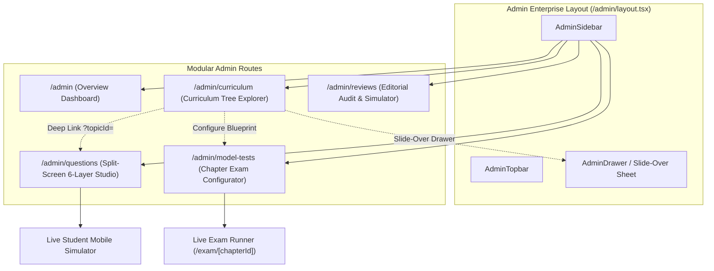

# poRi Admin Enterprise UI & Workflow Architecture Implementation Plan

> **For agentic workers:** REQUIRED SUB-SKILL: Use superpowers:subagent-driven-development to implement this plan task-by-task. Steps use checkbox (`- [ ]`) syntax for tracking.

**Goal:** Transform the poRi Admin Portal into an enterprise-grade EdTech CMS with a persistent foldable sidebar, dynamic breadcrumbs, modular Next.js routes (`/admin`, `/admin/curriculum`, `/admin/questions`, `/admin/model-tests`, `/admin/reviews`), slide-over flyout sheets, and a split-screen authoring studio with real-time student mobile simulation.

**Architecture:** Next.js 15 App Router nested layouts (`apps/web/src/app/admin/layout.tsx`) hosting a responsive enterprise sidebar (`AdminSidebar`), top navigation header (`AdminTopbar`), and right slide-over drawers (`AdminDrawer`). Each domain has a dedicated route preserving URL state and browser history, with direct integration to the NestJS API at `http://localhost:3001`.

**Architecture Diagram:**

**Tech Stack:** Next.js 15 (App Router), React 19, Tailwind CSS, Lucide React, KaTeX LaTeX math rendering, NestJS 11 backend, Vitest.

**Spec:** [`docs/superpowers/specs/2026-11-08-admin-enterprise-ui-design.md`](file:///Users/technonext/Desktop/poRi/docs/superpowers/specs/2026-11-08-admin-enterprise-ui-design.md)

## Global Constraints

- Must strictly adhere to Next.js 15 App Router conventions (`layout.tsx`, `page.tsx`).
- Zero `any` types; all API payload interfaces must be strictly typed.
- KaTeX LaTeX formulas must render without layout shift or console errors.
- All drawer actions must provide optimistic feedback and error banners.
- `pnpm test` and `pnpm -r build` must pass with 0 errors after every task.

---

### Task 1: Enterprise Admin Shell Components (Sidebar, Topbar, and Slide-Over Drawer)

**Files:**
- Create: `apps/web/src/components/admin/layout/AdminSidebar.tsx`
- Create: `apps/web/src/components/admin/layout/AdminTopbar.tsx`
- Create: `apps/web/src/components/admin/layout/AdminDrawer.tsx`
- Create: `apps/web/src/app/admin/layout.tsx`
- Test: `apps/web/tests/admin-layout.test.tsx`

**Interfaces:**
- `AdminSidebar`: Props `{ isCollapsed: boolean, onToggleCollapse: () => void }`
- `AdminTopbar`: Props `{ breadcrumbs: Array<{ label: string, href?: string }>, apiStatus: 'online' | 'offline' }`
- `AdminDrawer`: Props `{ isOpen: boolean, onClose: () => void, title: string, subtitle?: string, children: React.ReactNode, footer?: React.ReactNode }`

- [x] **Step 1: Write unit tests for AdminSidebar, AdminTopbar, and AdminDrawer**
  - Verify sidebar renders brand logo, navigation links, and student app button.
  - Verify topbar renders breadcrumbs and backend API status badge.
  - Verify drawer slides in when `isOpen={true}` and triggers `onClose` on escape key or backdrop click.
- [x] **Step 2: Implement AdminSidebar**
  - Support collapsible navigation state (`w-64` vs `w-20`).
  - Render links to `/admin`, `/admin/curriculum`, `/admin/questions`, `/admin/model-tests`, `/admin/reviews` with active path styling.
- [x] **Step 3: Implement AdminTopbar**
  - Compute active breadcrumbs dynamically using `usePathname()`.
  - Add backend ping status check against `http://localhost:3001/curriculum/subjects`.
- [x] **Step 4: Implement AdminDrawer**
  - Slide-over sheet with backdrop overlay, transition animations, sticky header, scrollable body, and sticky action buttons.
- [x] **Step 5: Implement `apps/web/src/app/admin/layout.tsx`**
  - Wrap child routes with `AdminSidebar`, `AdminTopbar`, and flex layout container.
- [x] **Step 6: Run tests and verify**
  - Run `pnpm --filter @pori/web test` and ensure all layout tests pass.
- [x] **Step 7: Commit changes**
  - `git commit -am "feat(admin): implement enterprise layout, sidebar, topbar, and slide-over drawer"`

---

### Task 2: Overview & Analytics Dashboard Route (`/admin`)

**Files:**
- Create: `apps/web/src/app/admin/page.tsx`
- Test: `apps/web/tests/admin-overview.test.tsx`

**Interfaces:**
- Consumes: `GET /curriculum/subjects`, `GET /admin/content/reviews`
- Produces: KPI cards, Subject Completion Gauges, Quick Action Jump Buttons

- [x] **Step 1: Write unit test for `/admin` Overview page**
  - Test metrics card rendering (Total Subjects, Chapters, Topics, Questions).
  - Test quick navigation links to `/admin/curriculum` and `/admin/questions`.
- [x] **Step 2: Implement Overview Dashboard**
  - Fetch summary data from backend (`/curriculum/subjects` and review items).
  - Display syllabus readiness cards with toggle shortcuts.
  - Display quick action banner ("নতুন প্রশ্ন যোগ", "নতুন বিষয় যোগ", "মডেল টেস্ট তৈরি").
- [x] **Step 3: Run tests and verify**
  - Run `pnpm --filter @pori/web test apps/web/tests/admin-overview.test.tsx`.
- [x] **Step 4: Commit changes**
  - `git commit -am "feat(admin): implement modular overview dashboard route"`

---

### Task 3: Curriculum Tree Explorer with Slide-Over Drawers (`/admin/curriculum`)

**Files:**
- Create: `apps/web/src/app/admin/curriculum/page.tsx`
- Refactor: `apps/web/src/components/admin/curriculum-manager.tsx`
- Test: `apps/web/tests/admin-curriculum-drawer.test.tsx`

**Interfaces:**
- Consumes: `POST /admin/content/subjects`, `POST /admin/content/chapters`, `POST /admin/content/topics`, `POST /admin/content/subjects/:id/toggle-ready`
- Uses: `AdminDrawer` for Subject, Chapter, and Topic creation forms.

- [x] **Step 1: Write unit tests for Curriculum Explorer with Drawers**
  - Verify clicking "+ নতুন বিষয়" opens Subject Drawer.
  - Verify clicking "+ নতুন অধ্যায়" opens Chapter Drawer with subject pre-selected.
  - Verify clicking "+ টপিক যোগ" opens Topic Drawer with chapter pre-selected.
- [x] **Step 2: Implement Curriculum Page with Slide-Over Drawers**
  - Replace centered modal popups with right-anchored `AdminDrawer` components.
  - Maintain URL query param `?subjectId=...` for persistence.
  - Provide direct jump buttons:
    - "+ প্রশ্ন যোগ" $\rightarrow$ `/admin/questions?topicId={id}&subjectId={subId}`
    - "+ অধ্যায় মডেল টেস্ট" $\rightarrow$ `/admin/model-tests?subjectId={subId}&chapterId={chId}`
- [x] **Step 3: Run tests and verify**
  - Run `pnpm --filter @pori/web test apps/web/tests/admin-curriculum-drawer.test.tsx`.
- [x] **Step 4: Commit changes**
  - `git commit -am "feat(admin): implement curriculum tree explorer with slide-over drawers"`

---

### Task 4: Split-Screen Question & Lesson Authoring Studio with Live Student Preview (`/admin/questions`)

**Files:**
- Create: `apps/web/src/app/admin/questions/page.tsx`
- Refactor/Enhance: `apps/web/src/components/admin/authoring-studio.tsx`
- Create: `apps/web/src/components/admin/student-simulator-frame.tsx`
- Test: `apps/web/tests/admin-questions-studio.test.tsx`

**Interfaces:**
- Consumes: `useSearchParams()` for `topicId`, `subjectId`, `type` (`mcq` vs `lesson`)
- Produces: Live KaTeX-rendered interactive mobile simulator card side-by-side with authoring form.

- [x] **Step 1: Write unit test for Split-Screen Authoring Studio**
  - Test real-time reflection of question stem and option text in the student preview frame.
  - Test 6-layer explanation rendering in the simulator preview.
- [x] **Step 2: Implement Student Simulator Frame**
  - Build styled mobile phone card preview (`w-full max-w-sm rounded-3xl border-4 border-slate-800 shadow-2xl p-4 bg-slate-50`).
  - Interactive radio option selection showing correct answer highlight and explanation trigger.
- [x] **Step 3: Implement Questions Studio Page**
  - Desktop 60/40 split-screen layout with sticky preview.
  - KaTeX math toolbar integration.
  - 6-Layer Multi-Layer Explanation accordion inputs with validation.
- [x] **Step 4: Run tests and verify**
  - Run `pnpm --filter @pori/web test apps/web/tests/admin-questions-studio.test.tsx`.
- [x] **Step 5: Commit changes**
  - `git commit -am "feat(admin): implement split-screen question authoring studio with live student simulator"`

---

### Task 5: Model Test Manager & Editorial Review Console Routes (`/admin/model-tests`, `/admin/reviews`)

**Files:**
- Create: `apps/web/src/app/admin/model-tests/page.tsx`
- Create: `apps/web/src/app/admin/reviews/page.tsx`
- Test: `apps/web/tests/admin-model-tests-reviews.test.tsx`

**Interfaces:**
- `/admin/model-tests`: Chapter-wise timed test configurator, question count, negative penalty, launch live exam.
- `/admin/reviews`: Editorial queue, revision comparison, student simulator test, approval stamps.

- [x] **Step 1: Write unit tests for Model Tests & Reviews pages**
  - Test test blueprint creation and slider interactions.
  - Test review item rejection/approval workflow actions.
- [x] **Step 2: Implement `/admin/model-tests/page.tsx`**
  - Dedicated page hosting `ModelTestManager` with breadcrumb context and quick exam launching.
- [x] **Step 3: Implement `/admin/reviews/page.tsx`**
  - Dedicated page hosting `ReviewConsole` with student simulator and audit trail.
- [x] **Step 4: Deprecate or redirect old `/admin/content`**
  - Set up redirect or link forwarding from legacy `/admin/content` to `/admin/curriculum`.
- [x] **Step 5: Run tests and verify**
  - Run `pnpm test` and `pnpm -r build`.
- [x] **Step 6: Commit changes**
  - `git commit -am "feat(admin): implement model test and review console routes and redirect legacy path"`

---

### Task 6: Full Verification, Clean Build, and Integration

**Files:**
- Verify all routes and components across `apps/web` and `apps/api`.

- [x] **Step 1: Run full TypeScript checks and linting**
  - `pnpm --filter @pori/web lint`
  - `pnpm --filter @pori/api lint`
- [x] **Step 2: Run all unit and e2e tests in monorepo**
  - `pnpm test` (all packages must pass 100%)
- [x] **Step 3: Run full monorepo build**
  - `pnpm -r build` (zero errors across packages/shared, apps/api, apps/web)
- [x] **Step 4: Verify live dev servers**
  - Test `GET http://localhost:3000/admin`, `http://localhost:3000/admin/curriculum`, `http://localhost:3000/admin/questions`, `http://localhost:3000/admin/model-tests`, `http://localhost:3000/admin/reviews`.
- [x] **Step 5: Commit and merge**
  - `git commit -am "chore(admin): verify full enterprise UI suite and clean production build"`
