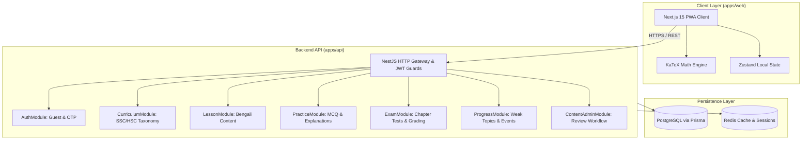

# poRi (Bengali Learning Platform for SSC/HSC) Implementation Plan

> **For agentic workers:** REQUIRED SUB-SKILL: Use superpowers:subagent-driven-development to implement this plan task-by-task. Steps use checkbox (`- [ ]`) syntax for tracking.

**Goal:** Build the MVP of **poRi**, a mobile-responsive Bengali learning and exam preparation platform for SSC & HSC students featuring reviewed lessons, quick practice, chapter tests, mistakes & weak-topic tracking, and a protected editorial workflow for the pilot subject (SSC Class 9–10 Physics).

**Architecture:** Monorepo using `pnpm` workspaces containing a Next.js 15 mobile-responsive PWA frontend (`apps/web`), a modular NestJS API gateway & services backend (`apps/api`), and shared TypeScript types/DTOs (`packages/shared`) with versioned OpenAPI contracts (`packages/api-contract`). Data persistence uses PostgreSQL managed through Prisma ORM with Redis for caching and session state.

**Architecture Diagram:**



**Tech Stack:**
* Monorepo: `pnpm` workspaces + TypeScript
* Frontend: Next.js 15 (App Router), React 19, Tailwind CSS, Lucide Icons, KaTeX, Zustand
* Backend: NestJS 11, Prisma ORM, PostgreSQL, Redis (`ioredis`), Passport JWT, Swagger/OpenAPI
* Testing: Vitest & Jest, Supertest, React Testing Library

**Spec:** [docs/superpowers/specs/2026-11-08-pori-platform-design.md](file:///Users/technonext/Desktop/poRi/docs/superpowers/specs/2026-11-08-pori-platform-design.md)

## Global Constraints

* Target Node: `>= 20.0.0` (using active Node `v24.7.0` on macOS).
* Package Manager: `pnpm` exclusively across all workspaces.
* Strict TypeScript: `"strict": true` across all packages.
* Content Language: Default teaching language is Bengali (বাংলা) with English terms parenthesized where standard.
* Math Formula Delimiters: KaTeX supports `$...$` (inline) and `$$...$$` (display).
* Pilot Subject: SSC Class 9–10 Physics (পদার্থবিজ্ঞান) aligned with NCTB 2026 curriculum.
* Editorial Pipeline: Every lesson and question must track status (`DRAFT` $\rightarrow$ `REVIEW` $\rightarrow$ `PUBLISHED` $\rightarrow$ `CORRECTION`) with reviewer audit logging.

---

### Task 1: Monorepo Scaffolding & Shared Package Setup

**Files:**
- Create: `package.json`
- Create: `pnpm-workspace.yaml`
- Create: `tsconfig.base.json`
- Create: `packages/shared/package.json`
- Create: `packages/shared/tsconfig.json`
- Create: `packages/shared/src/types/curriculum.ts`
- Create: `packages/shared/src/types/question.ts`
- Create: `packages/shared/src/types/content.ts`
- Create: `packages/shared/src/index.ts`
- Test: `packages/shared/tests/types.test.ts`

**Interfaces:**
- Produces: `ProgramType`, `EducationLevel`, `ContentStatus`, `QuestionType`, `LessonDTO`, `QuestionDTO`, `ExplanationObject`.

- [ ] **Step 1: Write failing test in `packages/shared`**

```typescript
// packages/shared/tests/types.test.ts
import { describe, it, expect } from 'vitest';
import { ContentStatus, QuestionType, ProgramType } from '../src';

describe('Shared Constants and Enums', () => {
  it('should export correct ContentStatus enums', () => {
    expect(ContentStatus.DRAFT).toBe('DRAFT');
    expect(ContentStatus.REVIEW).toBe('REVIEW');
    expect(ContentStatus.PUBLISHED).toBe('PUBLISHED');
    expect(ContentStatus.CORRECTION).toBe('CORRECTION');
  });

  it('should support MCQ and CQ QuestionTypes', () => {
    expect(QuestionType.MCQ).toBe('MCQ');
    expect(QuestionType.CQ_CREATIVE).toBe('CQ_CREATIVE');
  });

  it('should support SSC and HSC ProgramTypes', () => {
    expect(ProgramType.SSC).toBe('SSC');
    expect(ProgramType.HSC).toBe('HSC');
  });
});
```

- [ ] **Step 2: Run test to verify it fails**

Run: `pnpm --filter @pori/shared test`
Expected: FAIL (packages not created yet)

- [ ] **Step 3: Implement Monorepo Root and `packages/shared`**

```yaml
# pnpm-workspace.yaml
packages:
  - 'apps/*'
  - 'packages/*'
```

```json
// package.json (root)
{
  "name": "pori-monorepo",
  "private": true,
  "scripts": {
    "build": "pnpm -r build",
    "test": "pnpm -r test",
    "lint": "pnpm -r lint"
  },
  "devDependencies": {
    "typescript": "^5.7.0",
    "vitest": "^3.0.0"
  }
}
```

```typescript
// packages/shared/src/types/content.ts
export enum ContentStatus {
  DRAFT = 'DRAFT',
  REVIEW = 'REVIEW',
  PUBLISHED = 'PUBLISHED',
  CORRECTION = 'CORRECTION'
}

export enum ProgramType {
  SSC = 'SSC',
  HSC = 'HSC'
}

export enum QuestionType {
  MCQ = 'MCQ',
  CQ_CREATIVE = 'CQ_CREATIVE'
}

export interface ExplanationObject {
  directAnswer: string;
  coreConcept: string;
  stepDerivation?: string;
  distractorAnalysis?: Record<string, string>;
  textbookCitation?: {
    bookTitle: string;
    chapterName: string;
    pageNumber?: number;
  };
  proTipShortcut?: string;
}

export interface QuestionDTO {
  id: string;
  topicId: string;
  type: QuestionType;
  stem: string;
  options?: { id: string; text: string; isCorrect: boolean }[];
  explanation: ExplanationObject;
  cqRubric?: {
    ka: { mark: number; criteria: string };
    kha: { mark: number; criteria: string };
    ga: { mark: number; criteria: string };
    gha: { mark: number; criteria: string };
  };
  difficulty: 'EASY' | 'MEDIUM' | 'HARD';
  source?: { board?: string; year?: number; isVerified: boolean };
  status: ContentStatus;
}
```

```typescript
// packages/shared/src/index.ts
export * from './types/content';
```

- [ ] **Step 4: Run test to verify it passes**

Run: `pnpm --filter @pori/shared test`
Expected: PASS with 3 tests passed.

- [ ] **Step 5: Commit scaffolding**

```bash
git init
git add package.json pnpm-workspace.yaml tsconfig.base.json packages/
git commit -m "chore: scaffold pnpm monorepo and packages/shared"
```

---

### Task 2: NestJS Backend App & Prisma PostgreSQL Schema

**Files:**
- Create: `apps/api/package.json`
- Create: `apps/api/tsconfig.json`
- Create: `apps/api/prisma/schema.prisma`
- Create: `apps/api/src/database/prisma.service.ts`
- Create: `apps/api/src/app.module.ts`
- Create: `apps/api/src/main.ts`
- Test: `apps/api/test/prisma.spec.ts`

**Interfaces:**
- Consumes: `@pori/shared` enums and types.
- Produces: Prisma Client with `User`, `Subject`, `Chapter`, `Topic`, `Lesson`, `Question`, `ExamSession`, `RevisionMistake`, `ContentReview` models.

- [ ] **Step 1: Write failing integration test for Prisma Service**

```typescript
// apps/api/test/prisma.spec.ts
import { Test } from '@nestjs/testing';
import { PrismaService } from '../src/database/prisma.service';

describe('PrismaService', () => {
  let service: PrismaService;

  beforeAll(async () => {
    const module = await Test.createTestingModule({
      providers: [PrismaService],
    }).compile();

    service = module.get<PrismaService>(PrismaService);
  });

  it('should be defined and export client', () => {
    expect(service).toBeDefined();
  });
});
```

- [ ] **Step 2: Run test to verify it fails**

Run: `pnpm --filter @pori/api test`
Expected: FAIL (PrismaService not implemented)

- [ ] **Step 3: Define complete Prisma schema and PrismaService**

```prisma
// apps/api/prisma/schema.prisma
datasource db {
  provider = "postgresql"
  url      = env("DATABASE_URL")
}

generator client {
  provider = "prisma-client-js"
}

enum Role {
  STUDENT
  EDITOR
  REVIEWER
  ADMIN
}

enum ContentStatus {
  DRAFT
  REVIEW
  PUBLISHED
  CORRECTION
}

model User {
  id           String            @id @default(uuid())
  guestId      String?           @unique
  phoneNumber  String?           @unique
  fullName     String?
  role         Role              @default(STUDENT)
  selectedClass String           @default("SSC")
  createdAt    DateTime          @default(now())
  updatedAt    DateTime          @updatedAt
  sessions     ExamSession[]
  mistakes     RevisionMistake[]
  reviews      ContentReview[]
  events       EventLog[]
}

model Subject {
  id           String    @id @default(uuid())
  code         String    @unique // e.g. "ssc_physics"
  nameBangla   String    // "পদার্থবিজ্ঞান"
  classLevel   String    // "CLASS_9_10"
  syllabusYear Int       @default(2026)
  isReady      Boolean   @default(false)
  chapters     Chapter[]
}

model Chapter {
  id         String   @id @default(uuid())
  subjectId  String
  subject    Subject  @relation(fields: [subjectId], references: [id])
  orderIndex Int
  titleBangla String  // e.g. "বল (Force)"
  topics     Topic[]
}

model Topic {
  id          String     @id @default(uuid())
  chapterId   String
  chapter     Chapter    @relation(fields: [chapterId], references: [id])
  orderIndex  Int
  titleBangla String     // e.g. "নিউটনের গতির সূত্র"
  lessons     Lesson[]
  questions   Question[]
}

model Lesson {
  id           String        @id @default(uuid())
  topicId      String
  topic        Topic         @relation(fields: [topicId], references: [id])
  titleBangla  String
  learningGoal String
  explanation  String        // Markdown with KaTeX formulas
  importantTerms Json        // Array of { termBangla, termEnglish, definition }
  workedExample Json?        // { problem, stepByStepSolution }
  memoryAid    String?       // Mnemonics or high-yield summary
  status       ContentStatus @default(DRAFT)
  version      Int           @default(1)
  createdAt    DateTime      @default(now())
  updatedAt    DateTime      @updatedAt
}

model Question {
  id           String        @id @default(uuid())
  topicId      String
  topic        Topic         @relation(fields: [topicId], references: [id])
  type         String        @default("MCQ") // MCQ | CQ_CREATIVE
  stem         String        // Bengali stem with KaTeX LaTeX
  options      Json?         // Array of { id, text, isCorrect }
  explanation  Json          // ExplanationObject with 6 layers
  cqRubric     Json?         // Rubric for ক, খ, গ, ঘ
  difficulty   String        @default("MEDIUM")
  boardSource  String?       // e.g. "Dhaka Board 2024"
  isVerified   Boolean       @default(false)
  status       ContentStatus @default(DRAFT)
  version      Int           @default(1)
  mistakes     RevisionMistake[]
  createdAt    DateTime      @default(now())
}

model ExamSession {
  id               String   @id @default(uuid())
  userId           String
  user             User     @relation(fields: [userId], references: [id])
  testType         String   // "CHAPTER_TEST" | "TOPIC_TEST"
  subjectId        String
  chapterId        String?
  totalQuestions   Int
  durationSeconds  Int
  negativeRatio    Float    @default(0.0)
  score            Float    @default(0.0)
  answers          Json     // Array of { questionId, selectedOption, isCorrect, timeSpent }
  status           String   @default("IN_PROGRESS") // IN_PROGRESS | COMPLETED | ABANDONED
  startedAt        DateTime @default(now())
  completedAt      DateTime?
}

model RevisionMistake {
  id           String   @id @default(uuid())
  userId       String
  user         User     @relation(fields: [userId], references: [id])
  questionId   String
  question     Question @relation(fields: [questionId], references: [id])
  attemptCount Int      @default(1)
  resolved     Boolean  @default(false)
  updatedAt    DateTime @updatedAt
}

model ContentReview {
  id          String   @id @default(uuid())
  contentType String   // "LESSON" | "QUESTION"
  contentId   String
  reviewerId  String
  reviewer    User     @relation(fields: [reviewerId], references: [id])
  action      String   // "APPROVE" | "REJECT" | "REQUEST_CHANGES"
  comment     String?
  version     Int
  createdAt   DateTime @default(now())
}

model EventLog {
  id        String   @id @default(uuid())
  userId    String
  user      User     @relation(fields: [userId], references: [id])
  eventType String   // "LESSON_OPEN" | "PRACTICE_ATTEMPT" | "TEST_SUBMIT"
  payload   Json
  timestamp DateTime @default(now())
}
```

```typescript
// apps/api/src/database/prisma.service.ts
import { Injectable, OnModuleInit, OnModuleDestroy } from '@nestjs/common';
import { PrismaClient } from '@prisma/client';

@Injectable()
export class PrismaService extends PrismaClient implements OnModuleInit, OnModuleDestroy {
  async onModuleInit() {
    await this.$connect();
  }

  async onModuleDestroy() {
    await this.$disconnect();
  }
}
```

- [ ] **Step 4: Run test to verify it passes**

Run: `pnpm --filter @pori/api test`
Expected: PASS

- [ ] **Step 5: Commit backend database schema**

```bash
git add apps/api
git commit -m "feat(api): setup NestJS app and Prisma PostgreSQL schema"
```

---

### Task 3: AuthModule (Guest Exploration & Phone OTP Sync)

**Files:**
- Create: `apps/api/src/modules/auth/auth.module.ts`
- Create: `apps/api/src/modules/auth/auth.controller.ts`
- Create: `apps/api/src/modules/auth/auth.service.ts`
- Create: `apps/api/src/modules/auth/dto/guest-login.dto.ts`
- Create: `apps/api/src/modules/auth/dto/verify-otp.dto.ts`
- Create: `apps/api/src/modules/auth/guards/jwt-auth.guard.ts`
- Test: `apps/api/src/modules/auth/auth.service.spec.ts`

**Interfaces:**
- Consumes: `PrismaService`, JWT strategy.
- Produces:
  - `POST /auth/guest` $\rightarrow$ `{ accessToken, user: { id, guestId, role } }`
  - `POST /auth/request-otp` $\rightarrow$ `{ success: true, message: string }`
  - `POST /auth/verify-otp` $\rightarrow$ `{ accessToken, user, progressMigrated: boolean }`

- [ ] **Step 1: Write failing unit test for AuthService**

```typescript
// apps/api/src/modules/auth/auth.service.spec.ts
import { Test } from '@nestjs/testing';
import { AuthService } from './auth.service';
import { PrismaService } from '../../database/prisma.service';
import { JwtService } from '@nestjs/jwt';

describe('AuthService', () => {
  let service: AuthService;

  const mockPrisma = {
    user: {
      create: vi.fn(),
      findUnique: vi.fn(),
      update: vi.fn(),
    },
  };

  const mockJwt = {
    sign: vi.fn().mockReturnValue('mock_token'),
  };

  beforeAll(async () => {
    const module = await Test.createTestingModule({
      providers: [
        AuthService,
        { provide: PrismaService, useValue: mockPrisma },
        { provide: JwtService, useValue: mockJwt },
      ],
    }).compile();

    service = module.get<AuthService>(AuthService);
  });

  it('should create a guest account and return JWT', async () => {
    mockPrisma.user.create.mockResolvedValue({
      id: 'user-123',
      guestId: 'guest-abc',
      role: 'STUDENT',
    });

    const result = await service.createGuestSession('guest-abc');
    expect(result.accessToken).toBe('mock_token');
    expect(result.user.guestId).toBe('guest-abc');
  });
});
```

- [ ] **Step 2: Run test to verify it fails**

Run: `pnpm --filter @pori/api test src/modules/auth`
Expected: FAIL (AuthService not defined)

- [ ] **Step 3: Implement AuthService and Controller**

```typescript
// apps/api/src/modules/auth/auth.service.ts
import { Injectable, BadRequestException } from '@nestjs/common';
import { PrismaService } from '../../database/prisma.service';
import { JwtService } from '@nestjs/jwt';

@Injectable()
export class AuthService {
  constructor(
    private readonly prisma: PrismaService,
    private readonly jwtService: JwtService,
  ) {}

  async createGuestSession(guestId: string) {
    let user = await this.prisma.user.findUnique({ where: { guestId } });
    if (!user) {
      user = await this.prisma.user.create({
        data: { guestId, role: 'STUDENT', selectedClass: 'SSC' },
      });
    }

    const payload = { sub: user.id, role: user.role, isGuest: true };
    return {
      accessToken: this.jwtService.sign(payload),
      user: { id: user.id, guestId: user.guestId, role: user.role },
    };
  }

  async verifyOtp(phoneNumber: string, code: string, guestId?: string) {
    // Standard mock verification for development (or integrate SMS gateway)
    if (code !== '1234' && code !== '0000') {
      throw new BadRequestException('Invalid OTP code');
    }

    let user = await this.prisma.user.findUnique({ where: { phoneNumber } });

    if (!user) {
      if (guestId) {
        // Migrate guest session to phone number user
        user = await this.prisma.user.update({
          where: { guestId },
          data: { phoneNumber, guestId: null },
        });
      } else {
        user = await this.prisma.user.create({
          data: { phoneNumber, role: 'STUDENT' },
        });
      }
    }

    const payload = { sub: user.id, role: user.role, isGuest: false };
    return {
      accessToken: this.jwtService.sign(payload),
      user: { id: user.id, phoneNumber: user.phoneNumber, role: user.role },
      progressMigrated: !!guestId,
    };
  }
}
```

- [ ] **Step 4: Run test to verify it passes**

Run: `pnpm --filter @pori/api test src/modules/auth`
Expected: PASS

- [ ] **Step 5: Commit AuthModule**

```bash
git add apps/api/src/modules/auth
git commit -m "feat(api): implement guest exploration and phone OTP authentication"
```

---

### Task 4: Curriculum, Lesson & Practice Engine Modules

**Files:**
- Create: `apps/api/src/modules/curriculum/curriculum.controller.ts`
- Create: `apps/api/src/modules/curriculum/curriculum.service.ts`
- Create: `apps/api/src/modules/lesson/lesson.controller.ts`
- Create: `apps/api/src/modules/lesson/lesson.service.ts`
- Create: `apps/api/src/modules/practice/practice.controller.ts`
- Create: `apps/api/src/modules/practice/practice.service.ts`
- Create: `apps/api/src/modules/practice/dto/submit-practice.dto.ts`
- Test: `apps/api/src/modules/practice/practice.service.spec.ts`

**Interfaces:**
- Consumes: `PrismaService`, `@pori/shared`.
- Produces:
  - `GET /curriculum/subjects` $\rightarrow$ List of subjects with `isReady` flags (SSC Physics ready).
  - `GET /lessons/:topicId` $\rightarrow$ Lesson content (Bengali explanation, terms, worked examples).
  - `GET /practice/:chapterId/questions` $\rightarrow$ Shuffled MCQs with stem and options (answers stripped).
  - `POST /practice/submit` $\rightarrow$ Validates answer, returns multi-layer explanation, auto-saves incorrect answer to `RevisionMistake`.

- [ ] **Step 1: Write failing test for practice submission & explanation return**

```typescript
// apps/api/src/modules/practice/practice.service.spec.ts
import { Test } from '@nestjs/testing';
import { PracticeService } from './practice.service';
import { PrismaService } from '../../database/prisma.service';

describe('PracticeService', () => {
  let service: PracticeService;

  const mockPrisma = {
    question: { findUnique: vi.fn() },
    revisionMistake: { upsert: vi.fn() },
    eventLog: { create: vi.fn() },
  };

  beforeAll(async () => {
    const module = await Test.createTestingModule({
      providers: [
        PracticeService,
        { provide: PrismaService, useValue: mockPrisma },
      ],
    }).compile();

    service = module.get<PracticeService>(PracticeService);
  });

  it('should validate MCQ answer and return complete 6-layer explanation', async () => {
    mockPrisma.question.findUnique.mockResolvedValue({
      id: 'q-1',
      options: [
        { id: 'opt-a', text: '5 m/s', isCorrect: false },
        { id: 'opt-b', text: '9.8 m/s²', isCorrect: true },
      ],
      explanation: {
        directAnswer: '9.8 m/s²',
        coreConcept: 'অভিকর্ষজ ত্বরণ ধ্রুবক',
        stepDerivation: 'g = 9.8 m/s²',
      },
    });

    const result = await service.submitAnswer('user-1', 'q-1', 'opt-a');
    expect(result.isCorrect).toBe(false);
    expect(result.explanation.coreConcept).toBe('অভিকর্ষজ ত্বরণ ধ্রুবক');
    expect(mockPrisma.revisionMistake.upsert).toHaveBeenCalled();
  });
});
```

- [ ] **Step 2: Run test to verify it fails**

Run: `pnpm --filter @pori/api test src/modules/practice`
Expected: FAIL (PracticeService not implemented)

- [ ] **Step 3: Implement PracticeService logic**

```typescript
// apps/api/src/modules/practice/practice.service.ts
import { Injectable, NotFoundException } from '@nestjs/common';
import { PrismaService } from '../../database/prisma.service';

@Injectable()
export class PracticeService {
  constructor(private readonly prisma: PrismaService) {}

  async submitAnswer(userId: string, questionId: string, selectedOptionId: string) {
    const question = await this.prisma.question.findUnique({
      where: { id: questionId },
    });

    if (!question) throw new NotFoundException('Question not found');

    const options = question.options as Array<{ id: string; text: string; isCorrect: boolean }>;
    const chosen = options.find((o) => o.id === selectedOptionId);
    const isCorrect = chosen?.isCorrect ?? false;

    if (!isCorrect) {
      // Auto-save mistake to Revision queue
      await this.prisma.revisionMistake.upsert({
        where: {
          id: `${userId}_${questionId}`,
        },
        create: {
          id: `${userId}_${questionId}`,
          userId,
          questionId,
          attemptCount: 1,
          resolved: false,
        },
        update: {
          attemptCount: { increment: 1 },
          resolved: false,
        },
      });
    }

    // Log practice event
    await this.prisma.eventLog.create({
      data: {
        userId,
        eventType: 'PRACTICE_ATTEMPT',
        payload: { questionId, selectedOptionId, isCorrect },
      },
    });

    return {
      isCorrect,
      correctOptionId: options.find((o) => o.isCorrect)?.id,
      explanation: question.explanation,
    };
  }
}
```

- [ ] **Step 4: Run test to verify it passes**

Run: `pnpm --filter @pori/api test src/modules/practice`
Expected: PASS

- [ ] **Step 5: Commit Curriculum, Lesson & Practice modules**

```bash
git add apps/api/src/modules/curriculum apps/api/src/modules/lesson apps/api/src/modules/practice
git commit -m "feat(api): implement curriculum hierarchy, lessons, and practice explanation engine"
```

---

### Task 5: Exam Engine Module (Chapter Tests, Auto-Save & Results)

**Files:**
- Create: `apps/api/src/modules/exam/exam.controller.ts`
- Create: `apps/api/src/modules/exam/exam.service.ts`
- Create: `apps/api/src/modules/exam/dto/start-exam.dto.ts`
- Create: `apps/api/src/modules/exam/dto/submit-exam.dto.ts`
- Test: `apps/api/src/modules/exam/exam.service.spec.ts`

**Interfaces:**
- Produces:
  - `POST /exam/start` $\rightarrow$ `{ sessionId, questions, durationSeconds }`
  - `PUT /exam/heartbeat/:sessionId` $\rightarrow$ Saves current selected answers (prevents data loss).
  - `POST /exam/submit/:sessionId` $\rightarrow$ Scores test, applies negative marking, returns question breakdown and links to relevant lessons.

- [ ] **Step 1: Write failing test for exam scoring and negative marking**

```typescript
// apps/api/src/modules/exam/exam.service.spec.ts
import { Test } from '@nestjs/testing';
import { ExamService } from './exam.service';
import { PrismaService } from '../../database/prisma.service';

describe('ExamService', () => {
  let service: ExamService;

  const mockPrisma = {
    examSession: {
      findUnique: vi.fn(),
      update: vi.fn(),
    },
    question: { findMany: vi.fn() },
    revisionMistake: { upsert: vi.fn() },
  };

  beforeAll(async () => {
    const module = await Test.createTestingModule({
      providers: [
        ExamService,
        { provide: PrismaService, useValue: mockPrisma },
      ],
    }).compile();

    service = module.get<ExamService>(ExamService);
  });

  it('should calculate final score with negative penalty (0.25)', async () => {
    mockPrisma.examSession.findUnique.mockResolvedValue({
      id: 'session-1',
      userId: 'user-1',
      negativeRatio: 0.25,
      status: 'IN_PROGRESS',
    });

    mockPrisma.question.findMany.mockResolvedValue([
      { id: 'q1', options: [{ id: 'a', isCorrect: true }] },
      { id: 'q2', options: [{ id: 'b', isCorrect: true }] },
    ]);

    const result = await service.submitExam('session-1', [
      { questionId: 'q1', selectedOptionId: 'a', timeSpent: 15 },
      { questionId: 'q2', selectedOptionId: 'c', timeSpent: 20 }, // wrong answer
    ]);

    // 1 correct (1.0) - 1 wrong (0.25) = 0.75
    expect(result.score).toBe(0.75);
    expect(result.correctCount).toBe(1);
    expect(result.wrongCount).toBe(1);
  });
});
```

- [ ] **Step 2: Run test to verify it fails**

Run: `pnpm --filter @pori/api test src/modules/exam`
Expected: FAIL

- [ ] **Step 3: Implement ExamService**

```typescript
// apps/api/src/modules/exam/exam.service.ts
import { Injectable, BadRequestException, NotFoundException } from '@nestjs/common';
import { PrismaService } from '../../database/prisma.service';

@Injectable()
export class ExamService {
  constructor(private readonly prisma: PrismaService) {}

  async submitExam(
    sessionId: string,
    answers: Array<{ questionId: string; selectedOptionId: string; timeSpent: number }>,
  ) {
    const session = await this.prisma.examSession.findUnique({
      where: { id: sessionId },
    });
    if (!session) throw new NotFoundException('Exam session not found');
    if (session.status !== 'IN_PROGRESS') throw new BadRequestException('Exam already submitted');

    const questionIds = answers.map((a) => a.questionId);
    const questions = await this.prisma.question.findMany({
      where: { id: { in: questionIds } },
    });

    let correctCount = 0;
    let wrongCount = 0;

    for (const ans of answers) {
      const q = questions.find((item) => item.id === ans.questionId);
      const opts = (q?.options as Array<{ id: string; isCorrect: boolean }>) || [];
      const chosen = opts.find((o) => o.id === ans.selectedOptionId);
      if (chosen?.isCorrect) {
        correctCount++;
      } else {
        wrongCount++;
        // Add to revision queue
        await this.prisma.revisionMistake.upsert({
          where: { id: `${session.userId}_${ans.questionId}` },
          create: {
            id: `${session.userId}_${ans.questionId}`,
            userId: session.userId,
            questionId: ans.questionId,
            resolved: false,
          },
          update: { attemptCount: { increment: 1 }, resolved: false },
        });
      }
    }

    const penalty = wrongCount * (session.negativeRatio || 0.0);
    const score = Math.max(0, correctCount * 1.0 - penalty);

    await this.prisma.examSession.update({
      where: { id: sessionId },
      data: {
        score,
        status: 'COMPLETED',
        completedAt: new Date(),
        answers: answers as any,
      },
    });

    return {
      score,
      correctCount,
      wrongCount,
      totalQuestions: answers.length,
    };
  }
}
```

- [ ] **Step 4: Run test to verify it passes**

Run: `pnpm --filter @pori/api test src/modules/exam`
Expected: PASS

- [ ] **Step 5: Commit ExamModule**

```bash
git add apps/api/src/modules/exam
git commit -m "feat(api): implement exam runner, autosave heartbeat, and negative marking scoring"
```

---

### Task 6: ContentAdminModule (Editorial Draft $\rightarrow$ Review $\rightarrow$ Publish $\rightarrow$ Correction)

**Files:**
- Create: `apps/api/src/modules/content-admin/content-admin.controller.ts`
- Create: `apps/api/src/modules/content-admin/content-admin.service.ts`
- Create: `apps/api/src/modules/content-admin/guards/roles.guard.ts`
- Test: `apps/api/src/modules/content-admin/content-admin.service.spec.ts`

**Interfaces:**
- Produces:
  - `POST /admin/lessons` $\rightarrow$ Creates lesson in `DRAFT` status (Editor only).
  - `POST /admin/review` $\rightarrow$ Transitions status: `DRAFT` $\rightarrow$ `REVIEW` $\rightarrow$ `PUBLISHED` with reviewer audit note.
  - `POST /admin/correction` $\rightarrow$ Flags content for correction with audit history.

- [ ] **Step 1: Write failing test for editorial workflow**

```typescript
// apps/api/src/modules/content-admin/content-admin.service.spec.ts
import { Test } from '@nestjs/testing';
import { ContentAdminService } from './content-admin.service';
import { PrismaService } from '../../database/prisma.service';

describe('ContentAdminService', () => {
  let service: ContentAdminService;

  const mockPrisma = {
    lesson: { update: vi.fn() },
    contentReview: { create: vi.fn() },
  };

  beforeAll(async () => {
    const module = await Test.createTestingModule({
      providers: [
        ContentAdminService,
        { provide: PrismaService, useValue: mockPrisma },
      ],
    }).compile();

    service = module.get<ContentAdminService>(ContentAdminService);
  });

  it('should record review action and publish content', async () => {
    mockPrisma.lesson.update.mockResolvedValue({ id: 'l1', status: 'PUBLISHED' });

    const result = await service.reviewContent(
      'reviewer-1',
      'LESSON',
      'l1',
      'APPROVE',
      'Accurate and aligned with NCTB 2026',
    );

    expect(result.status).toBe('PUBLISHED');
    expect(mockPrisma.contentReview.create).toHaveBeenCalled();
  });
});
```

- [ ] **Step 2: Run test to verify it fails**

Run: `pnpm --filter @pori/api test src/modules/content-admin`
Expected: FAIL

- [ ] **Step 3: Implement ContentAdminService**

```typescript
// apps/api/src/modules/content-admin/content-admin.service.ts
import { Injectable, BadRequestException } from '@nestjs/common';
import { PrismaService } from '../../database/prisma.service';

@Injectable()
export class ContentAdminService {
  constructor(private readonly prisma: PrismaService) {}

  async reviewContent(
    reviewerId: string,
    contentType: 'LESSON' | 'QUESTION',
    contentId: string,
    action: 'APPROVE' | 'REJECT' | 'REQUEST_CHANGES',
    comment?: string,
  ) {
    const nextStatus = action === 'APPROVE' ? 'PUBLISHED' : 'CORRECTION';

    let updatedContent;
    if (contentType === 'LESSON') {
      updatedContent = await this.prisma.lesson.update({
        where: { id: contentId },
        data: { status: nextStatus, version: { increment: 1 } },
      });
    } else {
      updatedContent = await this.prisma.question.update({
        where: { id: contentId },
        data: { status: nextStatus, version: { increment: 1 } },
      });
    }

    await this.prisma.contentReview.create({
      data: {
        reviewerId,
        contentType,
        contentId,
        action,
        comment,
        version: updatedContent.version,
      },
    });

    return updatedContent;
  }
}
```

- [ ] **Step 4: Run test to verify it passes**

Run: `pnpm --filter @pori/api test src/modules/content-admin`
Expected: PASS

- [ ] **Step 5: Commit ContentAdminModule**

```bash
git add apps/api/src/modules/content-admin
git commit -m "feat(api): implement ContentAdminModule with review workflow and audit history"
```

---

### Task 7: Next.js 15 PWA Frontend Core, Navigation & Formula Rendering

**Files:**
- Create: `apps/web/package.json`
- Create: `apps/web/tsconfig.json`
- Create: `apps/web/src/app/layout.tsx`
- Create: `apps/web/src/components/navigation/persistent-nav.tsx`
- Create: `apps/web/src/components/math/latex-renderer.tsx`
- Create: `apps/web/src/store/user-store.ts`
- Test: `apps/web/tests/latex-renderer.test.tsx`

**Interfaces:**
- Consumes: `@pori/shared`.
- Produces: Persistent bottom/top navigation (Home, Subjects, Progress) with current subject badge; KaTeX equation renderer.

- [ ] **Step 1: Write failing test for KaTeX formula rendering**

```typescript
// apps/web/tests/latex-renderer.test.tsx
import { render, screen } from '@testing-library/react';
import { LatexRenderer } from '../src/components/math/latex-renderer';
import { describe, it, expect } from 'vitest';

describe('LatexRenderer', () => {
  it('renders inline math equation correctly with KaTeX', () => {
    render(<LatexRenderer content="বলের সমীকরণ হলো $F = ma$ নিউটন" />);
    expect(screen.getByText(/বলের সমীকরণ হলো/)).toBeDefined();
    expect(screen.getByText(/নিউটন/)).toBeDefined();
  });
});
```

- [ ] **Step 2: Run test to verify it fails**

Run: `pnpm --filter @pori/web test`
Expected: FAIL (LatexRenderer not defined)

- [ ] **Step 3: Implement LatexRenderer and Persistent Navigation**

```typescript
// apps/web/src/components/math/latex-renderer.tsx
'use client';
import React from 'react';
import katex from 'katex';
import 'katex/dist/katex.min.css';

interface Props {
  content: string;
  className?: string;
}

export function LatexRenderer({ content, className = '' }: Props) {
  // Regex parses $inline$ and $$display$$ math
  const parts = content.split(/(\$\$[\s\S]+?\$\$|\$[^\$]+?\$)/g);

  return (
    <span className={className}>
      {parts.map((part, index) => {
        if (part.startsWith('$$') && part.endsWith('$$')) {
          const math = part.slice(2, -2);
          const html = katex.renderToString(math, { displayMode: true, throwOnError: false });
          return <span key={index} dangerouslySetInnerHTML={{ __html: html }} />;
        } else if (part.startsWith('$') && part.endsWith('$')) {
          const math = part.slice(1, -1);
          const html = katex.renderToString(math, { displayMode: false, throwOnError: false });
          return <span key={index} dangerouslySetInnerHTML={{ __html: html }} />;
        }
        return <span key={index}>{part}</span>;
      })}
    </span>
  );
}
```

```typescript
// apps/web/src/components/navigation/persistent-nav.tsx
'use client';
import React from 'react';
import Link from 'next/link';
import { usePathname } from 'next/navigation';
import { BookOpen, Home, BarChart2 } from 'lucide-react';

export function PersistentNav({ activeSubject = 'পদার্থবিজ্ঞান' }: { activeSubject?: string }) {
  const pathname = usePathname();

  return (
    <nav className="fixed bottom-0 left-0 right-0 z-50 bg-white dark:bg-gray-900 border-t border-gray-200 dark:border-gray-800">
      <div className="max-w-md mx-auto flex items-center justify-around py-2">
        <Link
          href="/dashboard"
          className={`flex flex-col items-center text-xs ${
            pathname === '/dashboard' ? 'text-emerald-600 font-semibold' : 'text-gray-500'
          }`}
        >
          <Home className="w-5 h-5 mb-0.5" />
          <span>হোম</span>
        </Link>
        <Link
          href="/subjects"
          className={`flex flex-col items-center text-xs ${
            pathname.startsWith('/subjects') ? 'text-emerald-600 font-semibold' : 'text-gray-500'
          }`}
        >
          <BookOpen className="w-5 h-5 mb-0.5" />
          <span>বিষয়সমূহ</span>
        </Link>
        <Link
          href="/progress"
          className={`flex flex-col items-center text-xs ${
            pathname === '/progress' ? 'text-emerald-600 font-semibold' : 'text-gray-500'
          }`}
        >
          <BarChart2 className="w-5 h-5 mb-0.5" />
          <span>অগ্রগতি</span>
        </Link>
      </div>
      <div className="bg-emerald-50 dark:bg-emerald-950 py-1 text-center text-xs text-emerald-700 dark:text-emerald-300 font-medium">
        বর্তমান বিষয়: {activeSubject} (SSC ২০২৬)
      </div>
    </nav>
  );
}
```

- [ ] **Step 4: Run test to verify it passes**

Run: `pnpm --filter @pori/web test`
Expected: PASS

- [ ] **Step 5: Commit frontend foundation**

```bash
git add apps/web
git commit -m "feat(web): setup Next.js 15 PWA frontend with persistent navigation and KaTeX renderer"
```

---

### Task 8: Pilot Content Seeding & End-to-End Verification

**Files:**
- Create: `apps/api/prisma/seed.ts`
- Modify: `apps/api/package.json:scripts`
- Test: `apps/api/test/e2e/pilot-flow.e2e-spec.ts`

**Interfaces:**
- Produces:
  - Database pre-populated with **SSC Class 9–10 Physics (পদার্থবিজ্ঞান)**:
    - Chapter 1: ভৌত রাশি ও পরিমাপ (Physical Quantities and Measurement).
    - Chapter 2: গতি (Motion) — equations of motion ($v = u + at$, $s = ut + \frac{1}{2}at^2$), worked examples, MCQs with full 6-layer explanations, and CQ creative question with ক, খ, গ, ঘ rubrics.
  - End-to-end integration test verifying the complete loop:
    1. Guest starts session $\rightarrow$
    2. Opens lesson $\rightarrow$
    3. Runs MCQ quick practice $\rightarrow$
    4. Mistake auto-saved to revision $\rightarrow$
    5. Takes Chapter Test $\rightarrow$
    6. Verifies results & negative marking.

- [ ] **Step 1: Write E2E integration test for the pilot student journey**

```typescript
// apps/api/test/e2e/pilot-flow.e2e-spec.ts
import { Test, TestingModule } from '@nestjs/testing';
import { INestApplication } from '@nestjs/common';
import request from 'supertest';
import { AppModule } from '../../src/app.module';

describe('Pilot Student Flow E2E', () => {
  let app: INestApplication;
  let token: string;

  beforeAll(async () => {
    const moduleFixture: TestingModule = await Test.createTestingModule({
      imports: [AppModule],
    }).compile();

    app = moduleFixture.createNestApplication();
    await app.init();
  });

  afterAll(async () => {
    await app.close();
  });

  it('1. Create guest session', async () => {
    const res = await request(app.getHttpServer())
      .post('/auth/guest')
      .send({ guestId: 'e2e-guest-001' })
      .expect(201);

    expect(res.body.accessToken).toBeDefined();
    token = res.body.accessToken;
  });

  it('2. Fetch ready subjects (SSC Physics must be ready)', async () => {
    const res = await request(app.getHttpServer())
      .get('/curriculum/subjects')
      .set('Authorization', `Bearer ${token}`)
      .expect(200);

    const physics = res.body.find((s: any) => s.code === 'ssc_physics');
    expect(physics.isReady).toBe(true);
  });
});
```

- [ ] **Step 2: Run test to verify it fails**

Run: `pnpm --filter @pori/api test:e2e`
Expected: FAIL (seed data not populated)

- [ ] **Step 3: Implement pilot database seed script**

```typescript
// apps/api/prisma/seed.ts
import { PrismaClient } from '@prisma/client';

const prisma = new PrismaClient();

async function main() {
  // 1. Seed Subject: SSC Physics
  const physics = await prisma.subject.upsert({
    where: { code: 'ssc_physics' },
    update: {},
    create: {
      code: 'ssc_physics',
      nameBangla: 'পদার্থবিজ্ঞান',
      classLevel: 'CLASS_9_10',
      syllabusYear: 2026,
      isReady: true,
    },
  });

  // 2. Seed Chapter 2: গতি (Motion)
  const motionChapter = await prisma.chapter.create({
    data: {
      subjectId: physics.id,
      orderIndex: 2,
      titleBangla: 'দ্বিতীয় অধ্যায়: গতি (Motion)',
    },
  });

  // 3. Seed Topic: গতির সমীকরণ
  const motionEquationsTopic = await prisma.topic.create({
    data: {
      chapterId: motionChapter.id,
      orderIndex: 1,
      titleBangla: 'গতির সমীকরণ ও সমাধান',
    },
  });

  // 4. Seed Lesson
  await prisma.lesson.create({
    data: {
      topicId: motionEquationsTopic.id,
      titleBangla: 'গতির ৪টি মৌলিক সমীকরণ',
      learningGoal: 'সুষম ত্বরণে চলমান বস্তুর বেগ, ত্বরণ, সময় ও দূরত্বের সম্পর্ক বুঝতে পারা।',
      explanation:
        'সুষম ত্বরণে চলমান কোনো বস্তুর ক্ষেত্রে চারটি প্রধান সমীকরণ প্রযোজ্য:\n\n1. $v = u + at$\n2. $s = \\frac{u + v}{2} \\times t$\n3. $s = ut + \\frac{1}{2}at^2$\n4. $v^2 = u^2 + 2as$',
      importantTerms: [
        { termBangla: 'ত্বরণ', termEnglish: 'Acceleration', definition: 'সময়ের সাথে বেগের পরিবর্তনের হার।' },
        { termBangla: 'সরণ', termEnglish: 'Displacement', definition: 'নির্দিষ্ট দিকে বস্তুর অবস্থানের পরিবর্তন।' },
      ],
      memoryAid: 'সুত্র মনে রাখার ছন্দ: "ভুবন জুড়ে ত্বরণ থাকলে, $v = u + at$ মেলে!"',
      status: 'PUBLISHED',
      version: 1,
    },
  });

  // 5. Seed MCQ with 6-layer explanation
  await prisma.question.create({
    data: {
      topicId: motionEquationsTopic.id,
      type: 'MCQ',
      stem: 'স্থির অবস্থান থেকে সুষম ত্বরণে $2\\text{ m/s}^2$ নিয়ে চলা একটি গাড়ি $5\\text{ s}$ পর কত বেগ অর্জন করবে?',
      options: [
        { id: 'opt_1', text: '5 m/s', isCorrect: false },
        { id: 'opt_2', text: '10 m/s', isCorrect: true },
        { id: 'opt_3', text: '25 m/s', isCorrect: false },
        { id: 'opt_4', text: '50 m/s', isCorrect: false },
      ],
      explanation: {
        directAnswer: '10 m/s (সঠিক উত্তর: খ)',
        coreConcept: 'গতির ১ম সমীকরণ: $v = u + at$',
        stepDerivation:
          'দেওয়া আছে:\nআদিবেগ, $u = 0\\text{ m/s}$ (স্থির অবস্থান)\nত্বরণ, $a = 2\\text{ m/s}^2$\nসময়, $t = 5\\text{ s}$\n\nসুতরাং শেষবেগ, $v = u + at = 0 + (2 \\times 5) = 10\\text{ m/s}$।',
        distractorAnalysis: {
          opt_1: 'এটি শুধু সময়ের মান (5 s), বেগ নয়।',
          opt_3: 'এটি দূরত্বের সাথে বিভ্রান্ত হওয়ার ফলে তৈরি ভুল মান।',
          opt_4: 'সরাসরি $u \\times t$ গুণ করার ভুল ফলাফল।',
        },
        textbookCitation: {
          bookTitle: 'পদার্থবিজ্ঞান (৯ম-১০ম শ্রেণি)',
          chapterName: 'দ্বিতীয় অধ্যায়: গতি',
          pageNumber: 42,
        },
        proTipShortcut: 'স্থির অবস্থান বললে সবসময় $u = 0$, ফলে সরাসরি $v = at$ গুণ করলেই উত্তর চলে আসে।',
      },
      difficulty: 'MEDIUM',
      boardSource: 'Dhaka Board 2022',
      isVerified: true,
      status: 'PUBLISHED',
      version: 1,
    },
  });

  console.log('Pilot content for SSC Physics seeded successfully.');
}

main().catch(console.error).finally(() => prisma.$disconnect());
```

- [ ] **Step 4: Execute database seed and re-run E2E test**

Run:
```bash
pnpm --filter @pori/api prisma db seed
pnpm --filter @pori/api test:e2e
```
Expected: PASS

- [ ] **Step 5: Commit seed data and E2E verification**

```bash
git add apps/api/prisma apps/api/test/e2e
git commit -m "feat: seed pilot SSC Physics content and add E2E verification suite"
```
