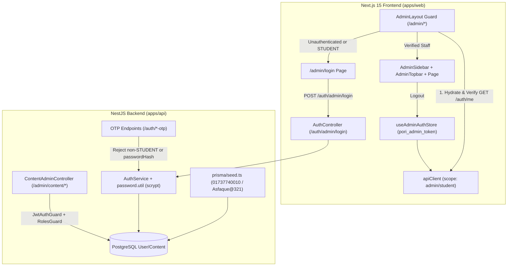

# poRi Admin Authentication & Authorization (Phase 1) Implementation Plan

> **For agentic workers:** REQUIRED SUB-SKILL: Use superpowers:subagent-driven-development to implement this plan task-by-task. Steps use checkbox (`- [ ]`) syntax for tracking.

**Goal:** Implement Phase 1 Admin Authentication & Authorization across PostgreSQL/Prisma, NestJS API, and Next.js `/admin/*`, seeding system admin `01737740010` (`Asfaque@321`) and enforcing verified staff access across all admin UI routes and mutations.

**Architecture:** `User` gains a nullable `passwordHash` column populated via zero-dependency `crypto.scrypt` utilities and seeded idempotently in `apps/api/prisma/seed.ts`. `AuthModule` adds `POST /auth/admin/login` (role-checked against `ADMIN | EDITOR | REVIEWER`) and hardens `requestOtp`/`verifyOtp` against password/staff account takeover. On the web frontend, `useAdminAuthStore` (`pori_admin_token`) isolates admin sessions from the student store, `apiClient` scopes `/admin*` tokens automatically, `/admin/login` authenticates admins, and `AdminLayout` blocks unauthenticated or `STUDENT`-role access by verifying via `GET /auth/me` before rendering children.

**Architecture Diagram:**



**Tech Stack:** NestJS 11, Prisma 6 + PostgreSQL, Node `crypto` (`scrypt`, `timingSafeEqual`), Next.js 15 App Router, React 19, Zustand (`persist`), Tailwind CSS, Vitest, Supertest.

**Spec:** [`docs/superpowers/specs/2026-11-09-admin-authorization-design.md`](file:///Users/technonext/Desktop/poRi/docs/superpowers/specs/2026-11-09-admin-authorization-design.md)

## Global Constraints

- Adhere strictly to `tsconfig.base.json` (`strict: true`, `noImplicitAny: true`, `noUnusedLocals: true`, `noUnusedParameters: true`).
- Zero new npm dependencies for password hashing — use Node's built-in `crypto` module (`scrypt`, `randomBytes`, `timingSafeEqual`).
- Never return `passwordHash` in any API response or client state.
- Admin token (`pori_admin_token` in `useAdminAuthStore`) must remain isolated from student token (`pori_auth_token` in `useUserStore`).
- Existing 152 monorepo tests must remain green alongside all new tests, and `pnpm -r lint && pnpm -r build` must pass with 0 errors.

---

### Task 1: Prisma `User.passwordHash`, `scrypt` Password Utility, and Admin Seed

**Files:**
- Create: [`apps/api/src/modules/auth/password.util.ts`](file:///Users/technonext/Desktop/poRi/apps/api/src/modules/auth/password.util.ts)
- Modify: [`apps/api/prisma/schema.prisma`](file:///Users/technonext/Desktop/poRi/apps/api/prisma/schema.prisma#L24-L37)
- Modify: [`apps/api/prisma/seed.ts`](file:///Users/technonext/Desktop/poRi/apps/api/prisma/seed.ts#L1-L20) and [`apps/api/prisma/seed.ts`](file:///Users/technonext/Desktop/poRi/apps/api/prisma/seed.ts#L284-L348)
- Test: [`apps/api/src/modules/auth/password.util.spec.ts`](file:///Users/technonext/Desktop/poRi/apps/api/src/modules/auth/password.util.spec.ts)

**Interfaces:**
- Consumes: `PrismaClient`, `Role` from `@prisma/client`, Node `crypto` (`scrypt`, `randomBytes`, `timingSafeEqual`).
- Produces:
  - `hashPassword(password: string): Promise<string>`
  - `verifyPassword(password: string, storedHash: string): Promise<boolean>`
  - `seedAdminUser(prisma: PrismaClient): Promise<void>` (invoked inside `seed(prisma)`)
  - Prisma `User.passwordHash` (`String?`)

- [ ] **Step 1: Write the failing unit tests for `password.util.ts` and `seedAdminUser`**

Create `apps/api/src/modules/auth/password.util.spec.ts`:

```ts
import { describe, it, expect, vi, beforeEach, afterEach } from 'vitest';
import { hashPassword, verifyPassword } from './password.util';
import { seedAdminUser } from '../../../prisma/seed';

describe('password.util', () => {
  it('hashes a password with a random salt and verifies the matching password', async () => {
    const hash1 = await hashPassword('Asfaque@321');
    const hash2 = await hashPassword('Asfaque@321');

    expect(hash1).toContain(':');
    expect(hash1).not.toBe(hash2);
    expect(await verifyPassword('Asfaque@321', hash1)).toBe(true);
    expect(await verifyPassword('Asfaque@321', hash2)).toBe(true);
  });

  it('rejects wrong passwords and malformed stored hashes safely', async () => {
    const stored = await hashPassword('Asfaque@321');

    expect(await verifyPassword('WrongPass@123', stored)).toBe(false);
    expect(await verifyPassword('', stored)).toBe(false);
    expect(await verifyPassword('Asfaque@321', '')).toBe(false);
    expect(await verifyPassword('Asfaque@321', 'invalidhashwithoutcolon')).toBe(false);
    expect(await verifyPassword('Asfaque@321', 'salt:nothex')).toBe(false);
  });
});

describe('seedAdminUser', () => {
  const originalEnv = { ...process.env };

  beforeEach(() => {
    process.env = { ...originalEnv };
    delete process.env.ADMIN_SEED_PHONE;
    delete process.env.ADMIN_SEED_PASSWORD;
  });

  afterEach(() => {
    process.env = { ...originalEnv };
  });

  it('upserts default system admin 01737740010 with verifiable hashed password Asfaque@321', async () => {
    const upsertMock = vi.fn().mockResolvedValue({ id: 'usr_admin_seed' });
    const mockPrisma = { user: { upsert: upsertMock } } as any;

    await seedAdminUser(mockPrisma);

    expect(upsertMock).toHaveBeenCalledTimes(1);
    const callArg = upsertMock.mock.calls[0][0];
    expect(callArg.where).toEqual({ phoneNumber: '01737740010' });
    expect(callArg.create.role).toBe('ADMIN');
    expect(callArg.update.role).toBe('ADMIN');
    expect(callArg.create.passwordHash).toBeDefined();
    expect(callArg.create.passwordHash).not.toBe('Asfaque@321');
    expect(await verifyPassword('Asfaque@321', callArg.create.passwordHash)).toBe(true);
  });
});
```

- [ ] **Step 2: Run test to verify it fails**

Run: `pnpm --filter @pori/api test src/modules/auth/password.util.spec.ts`
Expected: FAIL because `./password.util` does not exist and `seedAdminUser` is not exported.

- [ ] **Step 3: Create `apps/api/src/modules/auth/password.util.ts`**

```ts
import { randomBytes, scrypt, timingSafeEqual } from 'crypto';
import { promisify } from 'util';

const scryptAsync = promisify(scrypt);
const KEY_LENGTH = 64;

export async function hashPassword(password: string): Promise<string> {
  const salt = randomBytes(16).toString('hex');
  const derivedKey = (await scryptAsync(password, salt, KEY_LENGTH)) as Buffer;
  return `${salt}:${derivedKey.toString('hex')}`;
}

export async function verifyPassword(password: string, storedHash: string): Promise<boolean> {
  if (!password || !storedHash || !storedHash.includes(':')) {
    return false;
  }

  const parts = storedHash.split(':');
  if (parts.length !== 2) {
    return false;
  }

  const [salt, expectedHex] = parts;
  if (!salt || !expectedHex || !/^[0-9a-f]+$/i.test(expectedHex)) {
    return false;
  }

  const expectedBuffer = Buffer.from(expectedHex, 'hex');
  if (expectedBuffer.length !== KEY_LENGTH) {
    return false;
  }

  const derivedBuffer = (await scryptAsync(password, salt, KEY_LENGTH)) as Buffer;
  if (derivedBuffer.length !== expectedBuffer.length) {
    return false;
  }

  return timingSafeEqual(derivedBuffer, expectedBuffer);
}
```

- [ ] **Step 4: Add `passwordHash` to `apps/api/prisma/schema.prisma` and update `apps/api/prisma/seed.ts`**

In `apps/api/prisma/schema.prisma`:
```diff
 model User {
   id            String            @id @default(uuid())
   guestId       String?           @unique
   phoneNumber   String?           @unique
   fullName      String?
+  passwordHash  String?
   role          Role              @default(STUDENT)
   selectedClass String            @default("SSC")
```

In `apps/api/prisma/seed.ts`:
```diff
-import { PrismaClient, ContentStatus } from '@prisma/client';
+import { PrismaClient, ContentStatus, Role } from '@prisma/client';
+import { hashPassword } from '../src/modules/auth/password.util';
```
And add `seedAdminUser` and invoke it inside `seed(prisma)`:
```ts
export async function seedAdminUser(prisma: PrismaClient) {
  const adminPhone = process.env.ADMIN_SEED_PHONE || '01737740010';
  const adminPassword =
    process.env.ADMIN_SEED_PASSWORD ||
    (process.env.NODE_ENV === 'production' ? '' : 'Asfaque@321');

  if (!adminPassword) {
    console.warn('[Prisma Seed] ADMIN_SEED_PASSWORD not set in production; skipping admin user seed.');
    return;
  }

  const passwordHash = await hashPassword(adminPassword);

  await prisma.user.upsert({
    where: { phoneNumber: adminPhone },
    update: {
      fullName: 'Asfaque (System Admin)',
      role: Role.ADMIN,
      passwordHash,
    },
    create: {
      phoneNumber: adminPhone,
      fullName: 'Asfaque (System Admin)',
      role: Role.ADMIN,
      selectedClass: 'SSC',
      passwordHash,
    },
  });
}
```
And inside `export async function seed(prisma: PrismaClient)`:
```ts
  // 0. Seed System Admin User
  await seedAdminUser(prisma);
```

- [ ] **Step 5: Push Prisma schema, regenerate client, run unit tests & seed PostgreSQL**

Run:
`pnpm --filter @pori/api prisma:push && pnpm --filter @pori/api prisma:generate && pnpm --filter @pori/api prisma:seed`
Run:
`pnpm --filter @pori/api test src/modules/auth/password.util.spec.ts && pnpm --filter @pori/api lint`
Expected: PASS (`3 passed`, zero TypeScript errors, DB synced & seeded with `01737740010`).

- [ ] **Step 6: Commit Task 1**

```bash
git add apps/api/prisma/schema.prisma apps/api/prisma/seed.ts apps/api/src/modules/auth/password.util.ts apps/api/src/modules/auth/password.util.spec.ts
git commit -m "feat(auth): add User.passwordHash, scrypt password util, and admin user seed"
```

---

### Task 2: Backend Admin Password Login (`POST /auth/admin/login`) & OTP Hardening

**Files:**
- Create: [`apps/api/src/modules/auth/dto/admin-login.dto.ts`](file:///Users/technonext/Desktop/poRi/apps/api/src/modules/auth/dto/admin-login.dto.ts)
- Modify: [`apps/api/src/modules/auth/auth.service.ts`](file:///Users/technonext/Desktop/poRi/apps/api/src/modules/auth/auth.service.ts#L1-L160)
- Modify: [`apps/api/src/modules/auth/auth.controller.ts`](file:///Users/technonext/Desktop/poRi/apps/api/src/modules/auth/auth.controller.ts#L1-L32)
- Test: [`apps/api/src/modules/auth/auth.service.spec.ts`](file:///Users/technonext/Desktop/poRi/apps/api/src/modules/auth/auth.service.spec.ts)
- Test: [`apps/api/test/auth.e2e.spec.ts`](file:///Users/technonext/Desktop/poRi/apps/api/test/auth.e2e.spec.ts)

**Interfaces:**
- Consumes: `hashPassword`, `verifyPassword` from `./password.util`.
- Produces:
  - `POST /auth/admin/login` accepting `{ phoneNumber, password }` -> returns `{ accessToken, user: { id, phoneNumber, fullName, role, selectedClass } }`.
  - `AuthService.adminLogin(phoneNumber: string, password: string)`
  - OTP protection rejecting `requestOtp` and `verifyOtp` with `ForbiddenException` (`403`) whenever target `phoneNumber` belongs to a non-`STUDENT` or password-enabled account.

- [ ] **Step 1: Write failing unit tests in `apps/api/src/modules/auth/auth.service.spec.ts`**

Add tests inside `describe('AuthService', ...)`:

```ts
  describe('adminLogin', () => {
    it('authenticates ADMIN/EDITOR/REVIEWER user with valid password and omits passwordHash', async () => {
      const { hashPassword } = await import('./password.util');
      const passwordHash = await hashPassword('Asfaque@321');

      prisma.user.findUnique.mockResolvedValue({
        id: 'u-admin-1',
        guestId: null,
        phoneNumber: '01737740010',
        fullName: 'Asfaque (System Admin)',
        passwordHash,
        role: 'ADMIN',
        selectedClass: 'SSC',
      });

      const result = await authService.adminLogin('+8801737740010', 'Asfaque@321');

      expect(jwtService.sign).toHaveBeenCalledWith({
        sub: 'u-admin-1',
        role: 'ADMIN',
        isGuest: false,
      });
      expect(result).toEqual({
        accessToken: 'mock_jwt_token',
        user: {
          id: 'u-admin-1',
          phoneNumber: '01737740010',
          fullName: 'Asfaque (System Admin)',
          role: 'ADMIN',
          selectedClass: 'SSC',
        },
      });
      expect((result.user as any).passwordHash).toBeUndefined();
    });

    it('throws UnauthorizedException for wrong password or missing user', async () => {
      const { hashPassword } = await import('./password.util');
      const passwordHash = await hashPassword('Asfaque@321');

      prisma.user.findUnique.mockResolvedValueOnce(null);
      await expect(authService.adminLogin('01737740010', 'Asfaque@321')).rejects.toThrow(
        UnauthorizedException,
      );

      prisma.user.findUnique.mockResolvedValueOnce({
        id: 'u-admin-1',
        phoneNumber: '01737740010',
        passwordHash,
        role: 'ADMIN',
      });
      await expect(authService.adminLogin('01737740010', 'WrongPassword')).rejects.toThrow(
        UnauthorizedException,
      );
    });

    it('throws ForbiddenException when a STUDENT with passwordHash attempts adminLogin', async () => {
      const { hashPassword } = await import('./password.util');
      const passwordHash = await hashPassword('StudentPass123');

      prisma.user.findUnique.mockResolvedValue({
        id: 'u-student-1',
        phoneNumber: '01712345678',
        passwordHash,
        role: 'STUDENT',
        selectedClass: 'SSC',
      });

      await expect(authService.adminLogin('01712345678', 'StudentPass123')).rejects.toThrow(
        ForbiddenException,
      );
    });
  });

  describe('OTP Hardening for Admin/Staff Accounts', () => {
    it('blocks requestOtp and verifyOtp (even master OTP 1234) for ADMIN account', async () => {
      prisma.user.findUnique.mockResolvedValue({
        id: 'u-admin-1',
        phoneNumber: '01737740010',
        passwordHash: 'salt:hash',
        role: 'ADMIN',
      });

      await expect(authService.requestOtp('01737740010')).rejects.toThrow(ForbiddenException);
      await expect(authService.verifyOtp('01737740010', '1234')).rejects.toThrow(
        ForbiddenException,
      );
    });
  });
```
*(Update line 2 of `auth.service.spec.ts` to import `ForbiddenException` from `@nestjs/common`.)*

- [ ] **Step 2: Write failing E2E tests in `apps/api/test/auth.e2e.spec.ts`**

Update `MockUser` in `apps/api/test/auth.e2e.spec.ts` to include `passwordHash?: string | null;` and `data.passwordHash ?? null` in `create`, and add an E2E `describe('POST /auth/admin/login & Admin RBAC', ...)` suite:

```ts
  describe('POST /auth/admin/login & Admin RBAC', () => {
    it('logs in seeded ADMIN with password, accesses /auth/me & /admin/content/subjects, rejects bad password and blocks OTP bypass', async () => {
      const { hashPassword } = await import('../src/modules/auth/password.util');
      const passwordHash = await hashPassword('Asfaque@321');
      users.push({
        id: 'usr_admin_1',
        guestId: null,
        phoneNumber: '01737740010',
        fullName: 'Asfaque (System Admin)',
        passwordHash,
        role: 'ADMIN',
        selectedClass: 'SSC',
        createdAt: new Date(),
        updatedAt: new Date(),
      });

      // 1. Rejects invalid password
      await request(app.getHttpServer())
        .post('/auth/admin/login')
        .send({ phoneNumber: '01737740010', password: 'WrongPassword' })
        .expect(401);

      // 2. Blocks OTP takeover even with dev master OTP 1234
      await request(app.getHttpServer())
        .post('/auth/request-otp')
        .send({ phoneNumber: '01737740010' })
        .expect(403);

      await request(app.getHttpServer())
        .post('/auth/verify-otp')
        .send({ phoneNumber: '01737740010', code: '1234' })
        .expect(403);

      // 3. Valid password login returns JWT and sanitized admin user
      const loginRes = await request(app.getHttpServer())
        .post('/auth/admin/login')
        .send({ phoneNumber: '01737740010', password: 'Asfaque@321' })
        .expect(201);

      expect(loginRes.body.accessToken).toBeDefined();
      expect(loginRes.body.user).toMatchObject({
        id: 'usr_admin_1',
        phoneNumber: '01737740010',
        role: 'ADMIN',
      });
      expect(loginRes.body.user.passwordHash).toBeUndefined();

      const adminToken = loginRes.body.accessToken;

      // 4. Token validates on /auth/me without exposing passwordHash
      const meRes = await request(app.getHttpServer())
        .get('/auth/me')
        .set('Authorization', `Bearer ${adminToken}`)
        .expect(200);

      expect(meRes.body.role).toBe('ADMIN');
      expect(meRes.body.passwordHash).toBeUndefined();
    });
  });
```

- [ ] **Step 3: Run auth tests to verify they fail**

Run: `pnpm --filter @pori/api test src/modules/auth/auth.service.spec.ts test/auth.e2e.spec.ts`
Expected: FAIL because `adminLogin` and `/auth/admin/login` do not exist yet.

- [ ] **Step 4: Create `apps/api/src/modules/auth/dto/admin-login.dto.ts`**

```ts
import { IsNotEmpty, IsString, Matches, MinLength } from 'class-validator';
import { PHONE_REGEX } from './request-otp.dto';

export class AdminLoginDto {
  @IsString()
  @IsNotEmpty()
  @Matches(PHONE_REGEX, {
    message:
      'phoneNumber must be a valid Bangladesh mobile number (e.g. 017XXXXXXXX) or E.164 formatted number',
  })
  phoneNumber!: string;

  @IsString()
  @IsNotEmpty()
  @MinLength(6, { message: 'Password must be at least 6 characters' })
  password!: string;
}
```

- [ ] **Step 5: Implement `adminLogin` and OTP hardening in `auth.service.ts` and route in `auth.controller.ts`**

In `apps/api/src/modules/auth/auth.service.ts`:
- Import `ForbiddenException` from `@nestjs/common` and `verifyPassword` from `./password.util`.
- Define:
  ```ts
  const ALLOWED_ADMIN_PORTAL_ROLES: Role[] = [Role.ADMIN, Role.EDITOR, Role.REVIEWER];

  export interface AdminAuthResult {
    accessToken: string;
    user: {
      id: string;
      phoneNumber: string | null;
      fullName: string | null;
      role: Role;
      selectedClass: string;
    };
  }
  ```
- In `requestOtp`:
  ```ts
  const existingUser = await this.prisma.user.findUnique({
    where: { phoneNumber: normalizedPhone },
  });
  if (existingUser && (existingUser.role !== Role.STUDENT || Boolean(existingUser.passwordHash))) {
    throw new ForbiddenException('OTP login is not permitted for admin or staff accounts');
  }
  ```
- In `verifyOtp` (right after `const normalizedPhone = this.normalizePhoneNumber(phoneNumber);`):
  Look up `existingUserWithPhone` first and reject:
  ```ts
  const existingUserWithPhone = await this.prisma.user.findUnique({
    where: { phoneNumber: normalizedPhone },
  });
  if (
    existingUserWithPhone &&
    (existingUserWithPhone.role !== Role.STUDENT || Boolean(existingUserWithPhone.passwordHash))
  ) {
    throw new ForbiddenException('OTP login is not permitted for admin or staff accounts');
  }
  ```
  *(Remove the duplicate `findUnique` call lower down in `verifyOtp` so `prisma.user.findUnique` call ordering stays exact for existing migration unit tests!)*
- Add `adminLogin`:
  ```ts
  async adminLogin(phoneNumber: string, password: string): Promise<AdminAuthResult> {
    const normalizedPhone = this.normalizePhoneNumber(phoneNumber);
    const user = await this.prisma.user.findUnique({
      where: { phoneNumber: normalizedPhone },
    });

    if (!user || !user.passwordHash) {
      throw new UnauthorizedException('Invalid phone number or password');
    }

    const isPasswordValid = await verifyPassword(password, user.passwordHash);
    if (!isPasswordValid) {
      throw new UnauthorizedException('Invalid phone number or password');
    }

    if (!ALLOWED_ADMIN_PORTAL_ROLES.includes(user.role)) {
      throw new ForbiddenException('Admin or staff access required');
    }

    const accessToken = this.jwtService.sign({
      sub: user.id,
      role: user.role,
      isGuest: false,
    });

    return {
      accessToken,
      user: {
        id: user.id,
        phoneNumber: user.phoneNumber,
        fullName: user.fullName,
        role: user.role,
        selectedClass: user.selectedClass,
      },
    };
  }
  ```

In `apps/api/src/modules/auth/auth.controller.ts`:
```ts
import { AdminLoginDto } from './dto/admin-login.dto';
...
  @Post('admin/login')
  async adminLogin(@Body() dto: AdminLoginDto) {
    return this.authService.adminLogin(dto.phoneNumber, dto.password);
  }
```

- [ ] **Step 6: Run all `@pori/api` tests and lint**

Run: `pnpm --filter @pori/api test && pnpm --filter @pori/api lint`
Expected: PASS (100% of API unit and E2E tests green, `tsc --noEmit` exits 0).

- [ ] **Step 7: Commit Task 2**

```bash
git add apps/api/src/modules/auth/dto/admin-login.dto.ts apps/api/src/modules/auth/auth.service.ts apps/api/src/modules/auth/auth.controller.ts apps/api/src/modules/auth/auth.service.spec.ts apps/api/test/auth.e2e.spec.ts
git commit -m "feat(auth): add admin password login endpoint and block OTP bypass for staff accounts"
```

---

### Task 3: Frontend Isolated Admin Auth Store & Scoped API Client

**Files:**
- Create: [`apps/web/src/store/admin-auth-store.ts`](file:///Users/technonext/Desktop/poRi/apps/web/src/store/admin-auth-store.ts)
- Modify: [`apps/web/src/lib/api-client.ts`](file:///Users/technonext/Desktop/poRi/apps/web/src/lib/api-client.ts#L1-L89)
- Test: [`apps/web/tests/admin-auth-store.test.ts`](file:///Users/technonext/Desktop/poRi/apps/web/tests/admin-auth-store.test.ts)

**Interfaces:**
- Consumes: `useUserStore` from `@/store/user-store`.
- Produces:
  - `ADMIN_TOKEN_STORAGE_KEY = 'pori_admin_token'`
  - `ADMIN_PORTAL_ROLES = ['ADMIN', 'EDITOR', 'REVIEWER'] as const`
  - `AdminUserProfile`, `useAdminAuthStore` (`{ token, adminUser, isVerified, setSession, setVerified, logout }`)
  - `apiClient` supporting `{ scope?: 'student' | 'admin' }` with strict token isolation and automatic `logout()` on admin-scoped `401`.

- [ ] **Step 1: Write failing unit tests in `apps/web/tests/admin-auth-store.test.ts`**

```ts
import { describe, it, expect, beforeEach, vi, afterEach } from 'vitest';
import { useAdminAuthStore, ADMIN_TOKEN_STORAGE_KEY } from '../src/store/admin-auth-store';
import { useUserStore } from '../src/store/user-store';
import { apiClient, ApiError } from '../src/lib/api-client';

describe('useAdminAuthStore & scoped apiClient', () => {
  const fetchMock = vi.fn();

  beforeEach(() => {
    localStorage.clear();
    useAdminAuthStore.getState().logout();
    useUserStore.getState().logout();
    vi.stubGlobal('fetch', fetchMock);
    fetchMock.mockReset();
  });

  afterEach(() => {
    vi.unstubAllGlobals();
  });

  it('stores admin session independently from student useUserStore', () => {
    useUserStore.getState().setToken('student_jwt_token');
    useAdminAuthStore.getState().setSession('admin_jwt_token', {
      id: 'adm_1',
      phoneNumber: '01737740010',
      fullName: 'Asfaque (System Admin)',
      role: 'ADMIN',
      selectedClass: 'SSC',
    });

    expect(localStorage.getItem('pori_auth_token')).toBe('student_jwt_token');
    expect(localStorage.getItem(ADMIN_TOKEN_STORAGE_KEY)).toBe('admin_jwt_token');

    useAdminAuthStore.getState().logout();
    expect(localStorage.getItem(ADMIN_TOKEN_STORAGE_KEY)).toBeNull();
    expect(localStorage.getItem('pori_auth_token')).toBe('student_jwt_token');
  });

  it('uses admin token automatically on /admin endpoints and never leaks student token', async () => {
    useUserStore.getState().setToken('student_jwt_token');
    fetchMock.mockResolvedValue(
      new Response(JSON.stringify({ ok: true }), {
        status: 200,
        headers: { 'content-type': 'application/json' },
      }),
    );

    // Without admin token, /admin/content/pending must NOT attach student token
    await apiClient.get('/admin/content/pending');
    const firstHeaders = fetchMock.mock.calls[0][1].headers as Headers;
    expect(firstHeaders.get('Authorization')).toBeNull();

    // With admin token, attaches admin token even when student token exists
    useAdminAuthStore.getState().setSession('admin_jwt_token', {
      id: 'adm_1',
      phoneNumber: '01737740010',
      role: 'ADMIN',
    });
    await apiClient.get('/admin/content/pending');
    const secondHeaders = fetchMock.mock.calls[1][1].headers as Headers;
    expect(secondHeaders.get('Authorization')).toBe('Bearer admin_jwt_token');
  });

  it('clears stale admin session when admin-scoped request returns 401', async () => {
    useAdminAuthStore.getState().setSession('expired_admin_jwt', {
      id: 'adm_1',
      phoneNumber: '01737740010',
      role: 'ADMIN',
    });

    fetchMock.mockResolvedValue(
      new Response(JSON.stringify({ message: 'Unauthorized' }), {
        status: 401,
        statusText: 'Unauthorized',
        headers: { 'content-type': 'application/json' },
      }),
    );

    await expect(apiClient.get('/auth/me', { scope: 'admin' })).rejects.toBeInstanceOf(ApiError);
    expect(useAdminAuthStore.getState().token).toBeNull();
    expect(useAdminAuthStore.getState().isVerified).toBe(false);
    expect(localStorage.getItem(ADMIN_TOKEN_STORAGE_KEY)).toBeNull();
  });
});
```

- [ ] **Step 2: Run test to verify it fails**

Run: `pnpm --filter @pori/web test tests/admin-auth-store.test.ts`
Expected: FAIL because `admin-auth-store.ts` does not exist.

- [ ] **Step 3: Create `apps/web/src/store/admin-auth-store.ts`**

```ts
import { create } from 'zustand';
import { persist } from 'zustand/middleware';

export const ADMIN_TOKEN_STORAGE_KEY = 'pori_admin_token';
export const ADMIN_PORTAL_ROLES = ['ADMIN', 'EDITOR', 'REVIEWER'] as const;

export type AdminPortalRole = (typeof ADMIN_PORTAL_ROLES)[number];

export interface AdminUserProfile {
  id: string;
  phoneNumber?: string | null;
  fullName?: string | null;
  role: string;
  selectedClass?: string;
}

export function isAllowedAdminRole(role?: string | null): role is AdminPortalRole {
  return Boolean(role && ADMIN_PORTAL_ROLES.includes(role as AdminPortalRole));
}

interface AdminAuthState {
  token: string | null;
  adminUser: AdminUserProfile | null;
  isVerified: boolean;

  setSession: (token: string, user: AdminUserProfile) => void;
  setVerified: (isVerified: boolean, user?: AdminUserProfile) => void;
  logout: () => void;
}

export const useAdminAuthStore = create<AdminAuthState>()(
  persist(
    (set) => ({
      token: null,
      adminUser: null,
      isVerified: false,

      setSession: (token, adminUser) => {
        if (typeof window !== 'undefined') {
          localStorage.setItem(ADMIN_TOKEN_STORAGE_KEY, token);
        }
        set({ token, adminUser, isVerified: true });
      },

      setVerified: (isVerified, adminUser) =>
        set((state) => ({
          isVerified,
          adminUser: adminUser !== undefined ? adminUser : state.adminUser,
        })),

      logout: () => {
        if (typeof window !== 'undefined') {
          localStorage.removeItem(ADMIN_TOKEN_STORAGE_KEY);
        }
        set({ token: null, adminUser: null, isVerified: false });
      },
    }),
    {
      name: 'pori-admin-auth-storage',
      partialize: (state) => ({
        token: state.token,
        adminUser: state.adminUser,
      }),
    },
  ),
);
```

- [ ] **Step 4: Update `apps/web/src/lib/api-client.ts`**

```ts
import { useUserStore } from '@/store/user-store';
import { useAdminAuthStore, ADMIN_TOKEN_STORAGE_KEY } from '@/store/admin-auth-store';

const API_BASE_URL = process.env.NEXT_PUBLIC_API_URL || 'http://localhost:3001';

export class ApiError extends Error {
  constructor(
    public status: number,
    public statusText: string,
    public data: unknown,
  ) {
    super(`API Error ${status}: ${statusText}`);
    this.name = 'ApiError';
  }
}

export interface RequestOptions extends RequestInit {
  token?: string;
  scope?: 'student' | 'admin';
}

function isAdminEndpoint(endpoint: string): boolean {
  if (endpoint.startsWith('http')) {
    try {
      return new URL(endpoint).pathname.startsWith('/admin');
    } catch {
      return false;
    }
  }
  return endpoint.startsWith('/admin');
}

async function request<T>(endpoint: string, options: RequestOptions = {}): Promise<T> {
  const url = endpoint.startsWith('http') ? endpoint : `${API_BASE_URL}${endpoint}`;
  const isAdminScope = options.scope === 'admin' || (!options.scope && isAdminEndpoint(endpoint));

  let token = options.token;
  if (!token) {
    if (isAdminScope) {
      try {
        token = useAdminAuthStore.getState().token ?? undefined;
      } catch {
        // Running outside store
      }
      if (!token && typeof window !== 'undefined') {
        token = localStorage.getItem(ADMIN_TOKEN_STORAGE_KEY) ?? undefined;
      }
    } else {
      try {
        token = useUserStore.getState().token ?? undefined;
      } catch {
        // Running outside store
      }
      if (!token && typeof window !== 'undefined') {
        token = localStorage.getItem('pori_auth_token') ?? undefined;
      }
    }
  }

  const headers = new Headers(options.headers);
  if (!headers.has('Content-Type') && !(options.body instanceof FormData)) {
    headers.set('Content-Type', 'application/json');
  }
  if (token && !headers.has('Authorization')) {
    headers.set('Authorization', `Bearer ${token}`);
  }

  const { scope: _scope, token: _token, ...fetchOptions } = options;
  const response = await fetch(url, {
    ...fetchOptions,
    headers,
  });

  if (!response.ok) {
    let errorData: unknown;
    try {
      errorData = await response.json();
    } catch {
      errorData = await response.text();
    }
    if (response.status === 401 && isAdminScope && endpoint !== '/auth/admin/login') {
      try {
        useAdminAuthStore.getState().logout();
      } catch {
        // Ignore outside store context
      }
    }
    throw new ApiError(response.status, response.statusText, errorData);
  }

  const contentType = response.headers.get('content-type');
  if (contentType && contentType.includes('application/json')) {
    return (await response.json()) as T;
  }

  return (await response.text()) as unknown as T;
}
```
*(Keep `apiClient` `get`, `post`, `put`, `delete` exports identical, typed cleanly with `unknown` instead of `any`.)*

- [ ] **Step 5: Run tests and lint**

Run: `pnpm --filter @pori/web test tests/admin-auth-store.test.ts && pnpm --filter @pori/web lint`
Expected: PASS (`3 passed`, `tsc --noEmit` exits 0).

- [ ] **Step 6: Commit Task 3**

```bash
git add apps/web/src/store/admin-auth-store.ts apps/web/src/lib/api-client.ts apps/web/tests/admin-auth-store.test.ts
git commit -m "feat(web): add isolated admin auth store and scoped Bearer token handling"
```

---

### Task 4: Admin Login Page (`/admin/login`) & Route Guard in `AdminLayout` + Shell Logout

**Files:**
- Create: [`apps/web/src/app/admin/login/page.tsx`](file:///Users/technonext/Desktop/poRi/apps/web/src/app/admin/login/page.tsx)
- Modify: [`apps/web/src/app/admin/layout.tsx`](file:///Users/technonext/Desktop/poRi/apps/web/src/app/admin/layout.tsx)
- Modify: [`apps/web/src/components/admin/layout/AdminTopbar.tsx`](file:///Users/technonext/Desktop/poRi/apps/web/src/components/admin/layout/AdminTopbar.tsx)
- Modify: [`apps/web/src/components/admin/layout/AdminSidebar.tsx`](file:///Users/technonext/Desktop/poRi/apps/web/src/components/admin/layout/AdminSidebar.tsx)
- Test: [`apps/web/tests/admin-auth.test.tsx`](file:///Users/technonext/Desktop/poRi/apps/web/tests/admin-auth.test.tsx)

**Interfaces:**
- Consumes: `useAdminAuthStore`, `isAllowedAdminRole`, `ADMIN_TOKEN_STORAGE_KEY`, `apiClient`.
- Produces: `/admin/login` authentication route, `resolveSafeAdminRedirect`, verified `AdminLayout` guard, Admin identity badge & logout button in `AdminTopbar` / `AdminSidebar`.

- [ ] **Step 1: Write failing tests in `apps/web/tests/admin-auth.test.tsx`**

```tsx
import { describe, it, expect, beforeEach, vi, afterEach } from 'vitest';
import { render, screen, fireEvent, waitFor } from '@testing-library/react';
import React from 'react';
import AdminLoginPage, { resolveSafeAdminRedirect } from '../src/app/admin/login/page';
import AdminLayout from '../src/app/admin/layout';
import { useAdminAuthStore } from '../src/store/admin-auth-store';
import { apiClient, ApiError } from '../src/lib/api-client';

const mockPush = vi.fn();
const mockReplace = vi.fn();
let mockPathname = '/admin/curriculum';
let mockSearchParams = new URLSearchParams();

vi.mock('next/navigation', () => ({
  usePathname: () => mockPathname,
  useRouter: () => ({ push: mockPush, replace: mockReplace, prefetch: vi.fn() }),
  useSearchParams: () => mockSearchParams,
}));

describe('Admin Authorization UI & Layout Guard', () => {
  beforeEach(() => {
    localStorage.clear();
    useAdminAuthStore.getState().logout();
    mockPush.mockReset();
    mockReplace.mockReset();
    mockPathname = '/admin/curriculum';
    mockSearchParams = new URLSearchParams();
  });

  afterEach(() => {
    vi.restoreAllMocks();
  });

  it('validates safe ?next= redirects to prevent open redirects or login loops', () => {
    expect(resolveSafeAdminRedirect(null)).toBe('/admin');
    expect(resolveSafeAdminRedirect('/admin/curriculum')).toBe('/admin/curriculum');
    expect(resolveSafeAdminRedirect('/admin/login')).toBe('/admin');
    expect(resolveSafeAdminRedirect('https://evil.com')).toBe('/admin');
    expect(resolveSafeAdminRedirect('//evil.com')).toBe('/admin');
  });

  it('submits credentials on /admin/login, stores session, and redirects', async () => {
    mockPathname = '/admin/login';
    mockSearchParams = new URLSearchParams('next=/admin/curriculum');

    const postSpy = vi.spyOn(apiClient, 'post').mockResolvedValueOnce({
      accessToken: 'jwt_admin_123',
      user: {
        id: 'adm_1',
        phoneNumber: '01737740010',
        fullName: 'Asfaque (System Admin)',
        role: 'ADMIN',
      },
    });

    render(<AdminLoginPage />);

    fireEvent.change(screen.getByLabelText(/মোবাইল নম্বর/i), {
      target: { value: '01737740010' },
    });
    fireEvent.change(screen.getByLabelText(/পাসওয়ার্ড/i), {
      target: { value: 'Asfaque@321' },
    });
    fireEvent.click(screen.getByRole('button', { name: /লগইন করুন/i }));

    await waitFor(() => {
      expect(postSpy).toHaveBeenCalledWith(
        '/auth/admin/login',
        { phoneNumber: '01737740010', password: 'Asfaque@321' },
        { scope: 'admin' },
      );
      expect(useAdminAuthStore.getState().token).toBe('jwt_admin_123');
      expect(mockReplace).toHaveBeenCalledWith('/admin/curriculum');
    });
  });

  it('displays Bengali error banner on 401 invalid credentials', async () => {
    mockPathname = '/admin/login';
    vi.spyOn(apiClient, 'post').mockRejectedValueOnce(
      new ApiError(401, 'Unauthorized', { message: 'Invalid credentials' }),
    );

    render(<AdminLoginPage />);

    fireEvent.change(screen.getByLabelText(/মোবাইল নম্বর/i), {
      target: { value: '01737740010' },
    });
    fireEvent.change(screen.getByLabelText(/পাসওয়ার্ড/i), {
      target: { value: 'wrongpass' },
    });
    fireEvent.click(screen.getByRole('button', { name: /লগইন করুন/i }));

    expect(await screen.findByText(/ভুল মোবাইল নম্বর অথবা পাসওয়ার্ড/i)).toBeDefined();
  });

  it('blocks protected children and redirects unauthenticated user to /admin/login', async () => {
    mockPathname = '/admin/curriculum';

    render(
      <AdminLayout>
        <div data-testid="protected-admin-page">সুরক্ষিত কনটেন্ট</div>
      </AdminLayout>,
    );

    expect(screen.queryByTestId('protected-admin-page')).toBeNull();
    await waitFor(() => {
      expect(mockReplace).toHaveBeenCalledWith('/admin/login?next=%2Fadmin%2Fcurriculum');
    });
  });

  it('rejects STUDENT role from /auth/me and redirects to /admin/login', async () => {
    mockPathname = '/admin/curriculum';
    localStorage.setItem('pori_admin_token', 'student_like_token');
    useAdminAuthStore.setState({ token: 'student_like_token', adminUser: null, isVerified: false });

    vi.spyOn(apiClient, 'get').mockResolvedValueOnce({
      id: 'stu_1',
      phoneNumber: '01712345678',
      role: 'STUDENT',
    });

    render(
      <AdminLayout>
        <div data-testid="protected-admin-page">সুরক্ষিত কনটেন্ট</div>
      </AdminLayout>,
    );

    await waitFor(() => {
      expect(mockReplace).toHaveBeenCalledWith('/admin/login?next=%2Fadmin%2Fcurriculum');
      expect(useAdminAuthStore.getState().token).toBeNull();
    });
    expect(screen.queryByTestId('protected-admin-page')).toBeNull();
  });

  it('renders protected children, admin identity, and supports logout when verified ADMIN', async () => {
    mockPathname = '/admin/curriculum';
    localStorage.setItem('pori_admin_token', 'valid_admin_token');
    useAdminAuthStore.setState({
      token: 'valid_admin_token',
      adminUser: null,
      isVerified: false,
    });

    vi.spyOn(apiClient, 'get').mockImplementation(async (url: string) => {
      if (url === '/auth/me') {
        return {
          id: 'adm_1',
          phoneNumber: '01737740010',
          fullName: 'Asfaque (System Admin)',
          role: 'ADMIN',
        };
      }
      return [];
    });

    render(
      <AdminLayout>
        <div data-testid="protected-admin-page">সুরক্ষিত কনটেন্ট</div>
      </AdminLayout>,
    );

    expect(await screen.findByTestId('protected-admin-page')).toBeDefined();
    expect(screen.getAllByText(/01737740010|Asfaque/i).length).toBeGreaterThanOrEqual(1);

    const logoutBtns = screen.getAllByRole('button', { name: /লগআউট/i });
    fireEvent.click(logoutBtns[0]);
    expect(useAdminAuthStore.getState().token).toBeNull();
    expect(mockReplace).toHaveBeenCalledWith('/admin/login');
  });
});
```

- [ ] **Step 2: Run test to verify it fails**

Run: `pnpm --filter @pori/web test tests/admin-auth.test.tsx`
Expected: FAIL because `apps/web/src/app/admin/login/page.tsx` does not exist yet.

- [ ] **Step 3: Implement `apps/web/src/app/admin/login/page.tsx`**

Implement the Light-Theme login page:
- Export `resolveSafeAdminRedirect(nextParam: string | null): string` returning `nextParam` only if `nextParam.startsWith('/admin') && !nextParam.startsWith('//') && nextParam !== '/admin/login'`, else `'/admin'`.
- Wrap form logic using `useSearchParams()` inside `<Suspense>`.
- Submit to `apiClient.post<{ accessToken: string; user: AdminUserProfile }>('/auth/admin/login', { phoneNumber: phoneNumber.trim(), password }, { scope: 'admin' })`.
- Call `setSession(res.accessToken, res.user)` and `router.replace(safeNext)`.
- Handle `ApiError`: `401` -> `'ভুল মোবাইল নম্বর অথবা পাসওয়ার্ড। অনুগ্রহ করে আবার চেষ্টা করুন।'`; `403` -> `'এই অ্যাকাউন্টটির অ্যাডমিন প্যানেলে প্রবেশের অনুমতি নেই।'`; generic -> `'লগইন সম্পন্ন করা যায়নি। এপিআই সার্ভার সংযোগ পরীক্ষা করুন।'`.
- Include show/hide password eye toggle button, `GraduationCap` brand header matching `AdminSidebar`, and subtle link back to `/` (student app).

- [ ] **Step 4: Implement route guard in `apps/web/src/app/admin/layout.tsx` and identity/logout in `AdminTopbar.tsx` / `AdminSidebar.tsx`**

In `apps/web/src/app/admin/layout.tsx`:
- If `pathname === '/admin/login'`, render `<div className="min-h-screen bg-slate-50 text-slate-800 antialiased">{children}</div>`.
- Otherwise, use `useAdminAuthStore` + `useEffect`:
  - Check `const activeToken = token || (typeof window !== 'undefined' ? localStorage.getItem(ADMIN_TOKEN_STORAGE_KEY) : null);`.
  - If `!activeToken`, call `logout()` and `router.replace('/admin/login?next=' + encodeURIComponent(pathname || '/admin'))`, set checking finished/unauthorized.
  - Else if `!isVerified`, call `apiClient.get<AdminUserProfile>('/auth/me', { scope: 'admin', token: activeToken })`:
    - If `isAllowedAdminRole(profile.role)`, call `setSession(activeToken, profile)`.
    - Otherwise catch / unauthorized: `logout()` and `router.replace('/admin/login?next=' + encodeURIComponent(pathname || '/admin'))`.
- While `!isVerified`, render a clean centered light-theme spinner card (`অ্যাডমিন সেশন যাচাই করা হচ্ছে...`) and NEVER mount `AdminSidebar`, `AdminTopbar`, or `children`.

In `apps/web/src/components/admin/layout/AdminTopbar.tsx`:
- Replace hardcoded `fetch('http://localhost:3001/curriculum/subjects')` health ping with `apiClient.get('/curriculum/subjects', { scope: 'admin' })` (using try/catch so `admin-layout.test.tsx` doesn't break when offline).
- Display active user pill (`adminUser.fullName || adminUser.phoneNumber` + `adminUser.role` badge) when `adminUser` exists, plus a **লগআউট** button (`aria-label="লগআউট"`) that triggers `logout()` + `router.replace('/admin/login')`.

In `apps/web/src/components/admin/layout/AdminSidebar.tsx`:
- Display signed-in role status pill (`adminUser?.role`) and optional compact logout button in footer alongside Student App shortcut (keeping existing nav labels & `কোল্যাপস` button intact so all tests in `admin-layout.test.tsx` remain green).

- [ ] **Step 5: Run tests and lint**

Run: `pnpm --filter @pori/web test && pnpm --filter @pori/web lint`
Expected: PASS (all existing 27 tests + all new `admin-auth` and `admin-auth-store` tests green, zero TS errors).

- [ ] **Step 6: Commit Task 4**

```bash
git add apps/web/src/app/admin/login/page.tsx apps/web/src/app/admin/layout.tsx apps/web/src/components/admin/layout/AdminTopbar.tsx apps/web/src/components/admin/layout/AdminSidebar.tsx apps/web/tests/admin-auth.test.tsx
git commit -m "feat(web): implement /admin/login UI, AdminLayout auth guard, and logout controls"
```

---

### Task 5: Admin Mutation Error Surfacing & End-to-End Verification

**Files:**
- Modify: [`apps/web/src/app/admin/page.tsx`](file:///Users/technonext/Desktop/poRi/apps/web/src/app/admin/page.tsx#L27-L52)
- Modify: [`apps/web/src/components/admin/curriculum-manager.tsx`](file:///Users/technonext/Desktop/poRi/apps/web/src/components/admin/curriculum-manager.tsx#L189-L355)
- Modify: [`apps/web/src/components/admin/review-console.tsx`](file:///Users/technonext/Desktop/poRi/apps/web/src/components/admin/review-console.tsx#L160-L188)
- Test: [`apps/web/tests/admin-auth.test.tsx`](file:///Users/technonext/Desktop/poRi/apps/web/tests/admin-auth.test.tsx)

**Interfaces:**
- Consumes: `apiClient`, `ApiError` from `@/lib/api-client`.
- Produces: Explicit Bengali authorization/error banners on `CurriculumManager` and `ReviewConsole` mutations instead of silent fake-success catch fallbacks.

- [ ] **Step 1: Add failing test in `apps/web/tests/admin-auth.test.tsx`**

```tsx
import { CurriculumManager } from '../src/components/admin/curriculum-manager';

  it('surfaces authorization error banner instead of faking success when CurriculumManager gets 403', async () => {
    vi.spyOn(apiClient, 'get').mockResolvedValue([]);
    vi.spyOn(apiClient, 'post').mockRejectedValueOnce(
      new ApiError(403, 'Forbidden', { message: 'Forbidden resource' }),
    );

    render(<CurriculumManager />);

    fireEvent.click(screen.getByRole('button', { name: /নতুন বিষয় যোগ করুন/i }));
    fireEvent.change(screen.getByLabelText(/বিষয়ের বাংলা নাম/i), {
      target: { value: 'উচ্চতর গণিত' },
    });
    const codeInput = screen.getByLabelText(/ইউনিক কোড/i);
    fireEvent.change(codeInput, { target: { value: 'ssc_higher_math' } });
    fireEvent.click(screen.getByRole('button', { name: /বিষয় সংরক্ষণ করো/i }));

    expect(
      await screen.findByText(/অনুমতি নেই|লগইন|ব্যর্থ হয়েছে/i),
    ).toBeDefined();
  });
```

- [ ] **Step 2: Run test to verify it fails**

Run: `pnpm --filter @pori/web test tests/admin-auth.test.tsx`
Expected: FAIL because `CurriculumManager` catches errors and displays ✅ fake success.

- [ ] **Step 3: Update `CurriculumManager`, `ReviewConsole`, and `AdminOverviewPage` error handling**

In `apps/web/src/components/admin/curriculum-manager.tsx`:
- Add `const [errorMessage, setErrorMessage] = useState<string | null>(null);` and render a clear rose error alert banner right next to `bannerMessage`.
- In `handleToggleReady`, `handleCreateSubject`, `handleCreateChapter`, `handleCreateTopic`:
  - Import `ApiError` from `@/lib/api-client`.
  - When `err instanceof ApiError` (HTTP 401/403/400/409/500): DO NOT fake local state mutation or show a ✅ banner. Display explicit Bengali error message (`err.status === 401 ? 'সেশনের মেয়াদ শেষ হয়েছে। অনুগ্রহ করে পুনরায় লগইন করুন।' : err.status === 403 ? 'এই কাজটি করার অনুমতি নেই (Admin অধিকার প্রয়োজন)।' : 'সার্ভারে সংরক্ষণ ব্যর্থ হয়েছে।'`) in `errorMessage`.
  - Only keep offline demo state fallback if `!(err instanceof ApiError)` (e.g., component tests rendered without running backend)!

In `apps/web/src/components/admin/review-console.tsx`:
- Add `const [errorMessage, setErrorMessage] = useState<string | null>(null);`.
- When `apiClient.post('/admin/content/review', ...)` throws `ApiError`, show explicit Bengali error banner instead of mutating local status.

In `apps/web/src/app/admin/page.tsx`:
- Replace raw `fetch('http://localhost:3001/curriculum/subjects')` with `apiClient.get<SubjectWithCount[]>('/curriculum/subjects', { scope: 'admin' })`.

- [ ] **Step 4: Run full monorepo tests, TypeScript lint, and production build**

Run:
`pnpm -r test && pnpm -r lint && pnpm -r build`
Expected:
- `@pori/shared`: all pass
- `@pori/api`: all unit & E2E tests pass
- `@pori/web`: all unit/component/auth tests pass
- `tsc --noEmit` & `next build`: exit 0 with zero errors.

- [ ] **Step 5: Live verification against running database, API, and Web server**

Run:
- Ensure dev servers or test curl checks hit PostgreSQL + NestJS (`http://localhost:3001`) cleanly:
  1. `POST http://localhost:3001/auth/admin/login` with `{"phoneNumber":"01737740010","password":"Asfaque@321"}` -> returns HTTP `201` + `accessToken` + `"role":"ADMIN"`.
  2. `POST http://localhost:3001/auth/verify-otp` with `{"phoneNumber":"01737740010","code":"1234"}` -> returns HTTP `403`.
  3. `GET http://localhost:3001/admin/content/pending` without token -> `401`; with returned admin token -> `200`.
  4. `GET http://localhost:3000/admin/login` -> `200 OK`.

- [ ] **Step 6: Commit Task 5**

```bash
git add apps/web/src/app/admin/page.tsx apps/web/src/components/admin/curriculum-manager.tsx apps/web/src/components/admin/review-console.tsx apps/web/tests/admin-auth.test.tsx
git commit -m "feat(admin): surface auth errors cleanly on mutations and wire overview to apiClient"
```

---

## Plan Self-Review

1. **Spec Coverage:** Every section of `docs/superpowers/specs/2026-11-09-admin-authorization-design.md` maps to Tasks 1–5 (`schema.prisma` + `password.util` + `seed.ts` -> Task 1; `admin-login.dto` + `adminLogin` + OTP hardening -> Task 2; `admin-auth-store` + `apiClient` scoping -> Task 3; `/admin/login` + `AdminLayout` guard + logout -> Task 4; error surfacing + full live verification -> Task 5).
2. **Placeholder Scan:** No TBDs, TODOs, or unspecified test steps; all code blocks, DTOs, helpers, and commands are concrete.
3. **Type & Import Consistency:** `ADMIN_TOKEN_STORAGE_KEY`, `ADMIN_PORTAL_ROLES`, `isAllowedAdminRole`, `resolveSafeAdminRedirect`, `seedAdminUser`, `hashPassword`, `verifyPassword`, and `RequestOptions.scope` match across all tasks and tests.
