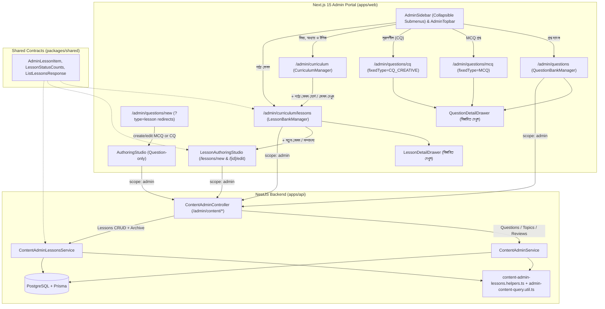

# poRi Admin Navigation Submenus, "See Details" Sidebars & Curriculum Lessons Implementation Plan

> **For agentic workers:** REQUIRED SUB-SKILL: Use superpowers:subagent-driven-development to implement this plan task-by-task. Steps use checkbox (`- [ ]`) syntax for tracking.

**Goal:** Add `MCQ` and `CQ` sidebar submenus + a "See Details" slide-over drawer under `/admin/questions`, and consolidate `Subjects`, `Chapters`, `Topics`, and full `Lessons` CRUD (`List`, `See Details Drawer`, `Add`, `Edit`, `Archive`) under `/admin/curriculum`.

**Architecture:** `packages/shared` and `apps/api` add Lesson query/update/archive contracts (`AdminLessonItem`, `ListLessonsResponse`, `GET/PATCH/archive` endpoints via a cohesive `ContentAdminLessonsService` and pure helpers that keep existing `ContentAdminService` constructor signatures intact), add `Lesson` composite indexes in Prisma, and exclude `ContentStatus.ARCHIVED` from lesson fallbacks and topic content queries. On `apps/web`, `AdminDrawer` gains escape-stacking control and accessible labelling for `QuestionDetailDrawer` and `LessonDetailDrawer`; `QuestionBankManager` adds `fixedType` (`MCQ` / `CQ_CREATIVE`) routes and drops Lesson creation links; `AdminSidebar` and `AdminTopbar` add 2-level submenus and breadcrumbs for Curriculum (`Hierarchy` + `Lessons`) and Questions (`All` + `MCQ` + `CQ`); and `LessonBankManager` + `LessonAuthoringStudio` provide full Lesson management under `/admin/curriculum/lessons/*`.

**Architecture Diagram:**



**Tech Stack:** NestJS 11, Prisma 6 + PostgreSQL, `class-validator` + `class-transformer`, Next.js 15 App Router, React 19, Zustand (`useAdminAuthStore`), Tailwind CSS, KaTeX, Vitest, Supertest.

**Spec:** [`docs/superpowers/specs/2026-11-09-admin-navigation-details-lessons-design.md`](file:///Users/technonext/Desktop/poRi/docs/superpowers/specs/2026-11-09-admin-navigation-details-lessons-design.md)

## Global Constraints

- Adhere strictly to [`tsconfig.base.json`](file:///Users/technonext/Desktop/poRi/tsconfig.base.json) (`strict: true`, `noImplicitAny: true`, `noUnusedLocals: true`, `noUnusedParameters: true`).
- Rebuild `@pori/shared` (`pnpm --filter @pori/shared build`) immediately after modifying `packages/shared/src/**` so `apps/api` and `apps/web` resolve updated `dist/` exports.
- Every field on [`ListLessonsQueryDto`](file:///Users/technonext/Desktop/poRi/apps/api/src/modules/content-admin/dto/list-lessons-query.dto.ts) and [`UpdateLessonAdminDto`](file:///Users/technonext/Desktop/poRi/apps/api/src/modules/content-admin/dto/update-lesson-admin.dto.ts) must carry explicit `class-validator` decorators because [`main.ts`](file:///Users/technonext/Desktop/poRi/apps/api/src/main.ts#L8-L13) enables `ValidationPipe({ whitelist: true, transform: true })`; additionally enforce runtime type/value validation in service helpers for Vitest unit calls that bypass HTTP pipes.
- Keep `ContentAdminService`'s constructor signature (`constructor(@Inject(PrismaService) prisma: PrismaService)`) unchanged so existing direct instantiations (`new ContentAdminService(mockPrisma)`) continue passing, and add explicit `@Inject(...)` decorators on [`ContentAdminLessonsService`](file:///Users/technonext/Desktop/poRi/apps/api/src/modules/content-admin/content-admin-lessons.service.ts) and [`ContentAdminController`](file:///Users/technonext/Desktop/poRi/apps/api/src/modules/content-admin/content-admin.controller.ts).
- Never hard-delete `Question` or `Lesson` rows; always soft-archive with `ContentStatus.ARCHIVED`, guard `ARCHIVED` items against `PATCH` edit (`400`) and `POST /admin/content/review` (`400`), and exclude `ARCHIVED` items from student fallbacks and `getTopicContent`.
- Keep all admin HTTP requests from web components scoped with `{ scope: 'admin' }`, preserve KaTeX rendering via `<LatexRenderer />`, and keep all monorepo tests (`pnpm -r test`, `pnpm --filter @pori/api test:e2e`), lint (`pnpm -r lint`), and builds (`pnpm -r build`) passing.

---

### Task 1: Lesson Schema Indexes, `@pori/shared` Contracts & Lesson Backend CRUD API

**Files:**
- Modify: [`apps/api/prisma/schema.prisma`](file:///Users/technonext/Desktop/poRi/apps/api/prisma/schema.prisma#L76-L90)
- Modify: [`packages/shared/src/types/content.ts`](file:///Users/technonext/Desktop/poRi/packages/shared/src/types/content.ts#L1-L35)
- Modify: [`packages/shared/tests/types.test.ts`](file:///Users/technonext/Desktop/poRi/packages/shared/tests/types.test.ts#L1-L183)
- Create: [`apps/api/src/modules/content-admin/dto/list-lessons-query.dto.ts`](file:///Users/technonext/Desktop/poRi/apps/api/src/modules/content-admin/dto/list-lessons-query.dto.ts)
- Create: [`apps/api/src/modules/content-admin/dto/update-lesson-admin.dto.ts`](file:///Users/technonext/Desktop/poRi/apps/api/src/modules/content-admin/dto/update-lesson-admin.dto.ts)
- Create: [`apps/api/src/modules/content-admin/admin-content-query.util.ts`](file:///Users/technonext/Desktop/poRi/apps/api/src/modules/content-admin/admin-content-query.util.ts)
- Create: [`apps/api/src/modules/content-admin/content-admin-lessons.helpers.ts`](file:///Users/technonext/Desktop/poRi/apps/api/src/modules/content-admin/content-admin-lessons.helpers.ts)
- Create: [`apps/api/src/modules/content-admin/content-admin-lessons.service.ts`](file:///Users/technonext/Desktop/poRi/apps/api/src/modules/content-admin/content-admin-lessons.service.ts)
- Modify: [`apps/api/src/modules/content-admin/content-admin.service.ts`](file:///Users/technonext/Desktop/poRi/apps/api/src/modules/content-admin/content-admin.service.ts#L1-L92) and [`apps/api/src/modules/content-admin/content-admin.service.ts`](file:///Users/technonext/Desktop/poRi/apps/api/src/modules/content-admin/content-admin.service.ts#L476-L500)
- Modify: [`apps/api/src/modules/lesson/lesson.service.ts`](file:///Users/technonext/Desktop/poRi/apps/api/src/modules/lesson/lesson.service.ts#L46-L53)
- Modify: [`apps/api/src/modules/content-admin/content-admin.controller.ts`](file:///Users/technonext/Desktop/poRi/apps/api/src/modules/content-admin/content-admin.controller.ts#L1-L45)
- Modify: [`apps/api/src/modules/content-admin/content-admin.module.ts`](file:///Users/technonext/Desktop/poRi/apps/api/src/modules/content-admin/content-admin.module.ts#L1-L14)
- Create: [`apps/api/src/modules/content-admin/content-admin-lessons.service.spec.ts`](file:///Users/technonext/Desktop/poRi/apps/api/src/modules/content-admin/content-admin-lessons.service.spec.ts)
- Modify: [`apps/api/src/modules/content-admin/content-admin.service.spec.ts`](file:///Users/technonext/Desktop/poRi/apps/api/src/modules/content-admin/content-admin.service.spec.ts#L746-L759)
- Modify: [`apps/api/src/modules/lesson/lesson.service.spec.ts`](file:///Users/technonext/Desktop/poRi/apps/api/src/modules/lesson/lesson.service.spec.ts#L140-L167)
- Modify: [`apps/api/test/content-admin.e2e.spec.ts`](file:///Users/technonext/Desktop/poRi/apps/api/test/content-admin.e2e.spec.ts#L47-L233) and append Lesson HTTP & RBAC tests

**Interfaces:**
- Consumes: `PrismaService`, `JwtAuthGuard`, `RolesGuard`, `@Roles(...)`, `Role`, `ContentStatus`, `Prisma`, `QuestionTopicHierarchy` (`@pori/shared`).
- Produces:
  - `model Lesson` composite indexes `@@index([topicId, status])` and `@@index([status, updatedAt])` in [`schema.prisma`](file:///Users/technonext/Desktop/poRi/apps/api/prisma/schema.prisma)
  - `LessonTermItem`, `LessonWorkedExample`, `AdminLessonItem`, `LessonStatusCounts`, `ListLessonsResponse` exported from `@pori/shared`
  - [`ListLessonsQueryDto`](file:///Users/technonext/Desktop/poRi/apps/api/src/modules/content-admin/dto/list-lessons-query.dto.ts) & [`UpdateLessonAdminDto`](file:///Users/technonext/Desktop/poRi/apps/api/src/modules/content-admin/dto/update-lesson-admin.dto.ts)
  - `ContentAdminLessonsService` (`createLesson`, `listLessons`, `getLessonById`, `updateLesson`, `archiveLesson`)
  - Endpoints: `GET /admin/content/lessons`, `GET /admin/content/lessons/:id`, `POST /admin/content/lessons`, `PATCH /admin/content/lessons/:id`, `POST /admin/content/lessons/:id/archive`
  - `ContentStatus.ARCHIVED` exclusion in [`LessonService.getLessonByTopic`](file:///Users/technonext/Desktop/poRi/apps/api/src/modules/lesson/lesson.service.ts#L46-L52) and [`ContentAdminService.getTopicContent`](file:///Users/technonext/Desktop/poRi/apps/api/src/modules/content-admin/content-admin.service.ts#L484-L493).

- [ ] **Step 1: Write the failing shared, unit, and E2E tests**

Update [`packages/shared/tests/types.test.ts`](file:///Users/technonext/Desktop/poRi/packages/shared/tests/types.test.ts#L1-L183):

```diff
   type QuestionTopicHierarchy,
   type AdminQuestionItem,
   type QuestionStatusCounts,
   type ListQuestionsResponse,
+  type LessonTermItem,
+  type LessonWorkedExample,
+  type AdminLessonItem,
+  type LessonStatusCounts,
+  type ListLessonsResponse,
 } from '../src';
```

Append inside `describe('Shared Type Structures', ...)`:

```ts
  it('should construct valid AdminLessonItem, LessonStatusCounts, and ListLessonsResponse', () => {
    const hierarchy: QuestionTopicHierarchy = {
      id: 'top_1',
      titleBangla: 'গতির সমীকরণ',
      chapter: {
        id: 'chap_2',
        titleBangla: 'দ্বিতীয় অধ্যায়: গতি',
        subject: {
          id: 'sub_phy',
          code: 'ssc_physics',
          nameBangla: 'পদার্থবিজ্ঞান',
        },
      },
    };

    const term: LessonTermItem = {
      termBangla: 'জড়তা',
      termEnglish: 'Inertia',
      definition: 'অবস্থা পরিবর্তনের অনীহা',
    };
    const example: LessonWorkedExample = {
      problem: '$F = ma$ বের কর',
      stepByStepSolution: '$F = 2 \\times 5 = 10\\text{ N}$',
    };

    const lesson: AdminLessonItem = {
      id: 'les_1',
      topicId: hierarchy.id,
      titleBangla: 'নিউটনের গতিসূত্র',
      learningGoal: 'বল ও ত্বরণের সম্পর্ক বোঝা',
      explanation: 'সুষম ত্বরণের ব্যাখ্যা $F=ma$',
      importantTerms: [term],
      workedExample: example,
      memoryAid: 'F সমান m গুণ a',
      status: ContentStatus.DRAFT,
      version: 1,
      createdAt: '2026-11-09T00:00:00Z',
      updatedAt: '2026-11-09T01:00:00Z',
      topic: hierarchy,
    };

    const statusCounts: LessonStatusCounts = {
      ALL: 5,
      DRAFT: 2,
      REVIEW: 1,
      CORRECTION: 0,
      PUBLISHED: 2,
      ARCHIVED: 1,
    };

    const list: ListLessonsResponse = {
      items: [lesson],
      total: 5,
      page: 1,
      limit: 20,
      totalPages: 1,
      statusCounts,
    };

    expect(list.items[0].importantTerms[0].termBangla).toBe('জড়তা');
    expect(list.items[0].topic?.chapter.subject.code).toBe('ssc_physics');
    expect(list.statusCounts.PUBLISHED).toBe(2);
    expect(list.statusCounts.ARCHIVED).toBe(1);
  });
```

Update [`apps/api/src/modules/lesson/lesson.service.spec.ts`](file:///Users/technonext/Desktop/poRi/apps/api/src/modules/lesson/lesson.service.spec.ts#L141-L157):

```ts
    it('should exclude ARCHIVED lessons when falling back for editor', async () => {
      prisma.lesson.findFirst
        .mockResolvedValueOnce(null)
        .mockResolvedValueOnce(null);

      const editor = { id: 'usr_editor', role: Role.EDITOR };
      await expect(lessonService.getLessonByTopic('top_1', editor, false)).rejects.toThrow(
        NotFoundException,
      );

      expect(prisma.lesson.findFirst).toHaveBeenNthCalledWith(2, {
        where: {
          topicId: 'top_1',
          status: { not: ContentStatus.ARCHIVED },
        },
        orderBy: { version: 'desc' },
      });
    });
```

Update [`apps/api/src/modules/content-admin/content-admin.service.spec.ts`](file:///Users/technonext/Desktop/poRi/apps/api/src/modules/content-admin/content-admin.service.spec.ts#L746-L759):

```diff
   describe('getTopicContent', () => {
     it('should return topic with its lessons and questions', async () => {
       mockPrisma.topic.findUnique.mockResolvedValue({ id: 'top_1', titleBangla: 'গতি' });
       mockPrisma.lesson.findMany.mockResolvedValue([{ id: 'les_1', titleBangla: 'গতির সমীকরণ' }]);
       mockPrisma.question.findMany.mockResolvedValue([{ id: 'q_1', stem: 'v = u + at' }]);
 
       const res = await service.getTopicContent('top_1');
 
+      expect(mockPrisma.lesson.findMany).toHaveBeenCalledWith({
+        where: { topicId: 'top_1', status: { not: ContentStatus.ARCHIVED } },
+        orderBy: { createdAt: 'desc' },
+      });
+      expect(mockPrisma.question.findMany).toHaveBeenCalledWith({
+        where: { topicId: 'top_1', status: { not: ContentStatus.ARCHIVED } },
+        orderBy: { createdAt: 'desc' },
+      });
       expect(res.topic.id).toBe('top_1');
       expect(res.lessons.length).toBe(1);
       expect(res.questions.length).toBe(1);
     });
   });
```

Create [`apps/api/src/modules/content-admin/content-admin-lessons.service.spec.ts`](file:///Users/technonext/Desktop/poRi/apps/api/src/modules/content-admin/content-admin-lessons.service.spec.ts):

```ts
import 'reflect-metadata';
import { describe, it, expect, beforeEach, vi } from 'vitest';
import {
  BadRequestException,
  ForbiddenException,
  NotFoundException,
  ValidationPipe,
} from '@nestjs/common';
import { ContentStatus, Prisma, Role } from '@prisma/client';
import { ContentAdminLessonsService } from './content-admin-lessons.service';
import { PrismaService } from '../../database/prisma.service';
import { ListLessonsQueryDto } from './dto/list-lessons-query.dto';
import { UpdateLessonAdminDto } from './dto/update-lesson-admin.dto';

describe('ContentAdminLessonsService', () => {
  let service: ContentAdminLessonsService;
  let mockPrisma: any;

  const sampleLesson = {
    id: 'les_motion_1',
    topicId: 'top_motion_1',
    titleBangla: 'গতির মৌলিক ধারণা',
    learningGoal: 'সুষম ও অসম বেগের পার্থক্য বুঝতে পারা',
    explanation: 'সময়ের সাথে অবস্থান পরিবর্তনকে গতি বলে। $v = u + at$',
    importantTerms: [
      { termBangla: 'বেগ', termEnglish: 'Velocity', definition: 'সরণের পরিবর্তনের হার' },
    ],
    workedExample: {
      problem: 'একটি গাড়ি $2\\text{ m/s}^2$ ত্বরণে $5\\text{ s}$ চললে বেগ কত?',
      stepByStepSolution: '$v = 0 + 2 \\times 5 = 10\\text{ m/s}$',
    },
    memoryAid: 'ভুবন জুড়ে ত্বরণ',
    status: ContentStatus.DRAFT,
    version: 1,
    createdAt: new Date('2026-11-08T00:00:00Z'),
    updatedAt: new Date('2026-11-09T00:00:00Z'),
    topic: {
      id: 'top_motion_1',
      titleBangla: 'গতির সমীকরণ',
      chapter: {
        id: 'chap_motion',
        titleBangla: 'দ্বিতীয় অধ্যায়: গতি',
        subject: { id: 'sub_phy', code: 'ssc_physics', nameBangla: 'পদার্থবিজ্ঞান' },
      },
    },
  };

  beforeEach(() => {
    mockPrisma = {
      topic: { findUnique: vi.fn() },
      lesson: {
        findUnique: vi.fn(),
        findMany: vi.fn(),
        count: vi.fn(),
        groupBy: vi.fn(),
        create: vi.fn(),
        update: vi.fn(),
      },
    };
    service = new ContentAdminLessonsService(mockPrisma as unknown as PrismaService);
  });

  describe('listLessons', () => {
    it('excludes ARCHIVED by default, applies hierarchy/search filters, clamps page offset, and aggregates statusCounts', async () => {
      mockPrisma.lesson.findMany.mockResolvedValue([sampleLesson]);
      mockPrisma.lesson.count.mockResolvedValue(1);
      mockPrisma.lesson.groupBy.mockResolvedValue([
        { status: ContentStatus.DRAFT, _count: { _all: 2 } },
        { status: ContentStatus.PUBLISHED, _count: { _all: 3 } },
        { status: ContentStatus.ARCHIVED, _count: { _all: 4 } },
      ]);

      const res = await service.listLessons({
        subjectId: 'sub_phy',
        chapterId: 'chap_motion',
        search: 'গতির',
        page: '999999999999',
        limit: '150',
      });

      expect(mockPrisma.lesson.findMany).toHaveBeenCalledWith(
        expect.objectContaining({
          where: {
            topic: {
              chapterId: 'chap_motion',
              chapter: { subjectId: 'sub_phy' },
            },
            OR: [
              { titleBangla: { contains: 'গতির', mode: 'insensitive' } },
              { learningGoal: { contains: 'গতির', mode: 'insensitive' } },
            ],
            status: { not: ContentStatus.ARCHIVED },
          },
          take: 100,
          orderBy: [{ updatedAt: 'desc' }, { createdAt: 'desc' }],
        }),
      );
      expect(res.limit).toBe(100);
      expect(res.page).toBeLessThanOrEqual(Math.floor(2_147_483_647 / 100) + 1);
      expect(res.statusCounts).toEqual({
        ALL: 5,
        DRAFT: 2,
        REVIEW: 0,
        CORRECTION: 0,
        PUBLISHED: 3,
        ARCHIVED: 4,
      });
    });

    it('throws BadRequestException for invalid query inputs', async () => {
      await expect(service.listLessons({ status: 'UNKNOWN' as any })).rejects.toThrow(
        BadRequestException,
      );
      await expect(service.listLessons({ includeArchived: 'yes' })).rejects.toThrow(
        BadRequestException,
      );
      await expect(service.listLessons({ page: '-1' })).rejects.toThrow(BadRequestException);
    });
  });

  describe('getLessonById', () => {
    it('returns lesson with hierarchy or throws NotFoundException', async () => {
      mockPrisma.lesson.findUnique.mockResolvedValue(sampleLesson);
      const found = await service.getLessonById('les_motion_1');
      expect(found.id).toBe('les_motion_1');

      mockPrisma.lesson.findUnique.mockResolvedValue(null);
      await expect(service.getLessonById('missing')).rejects.toThrow(NotFoundException);
    });
  });

  describe('updateLesson', () => {
    it('blocks editing ARCHIVED lessons (400) and blocks EDITOR preservePublished (403)', async () => {
      mockPrisma.lesson.findUnique.mockResolvedValueOnce({
        ...sampleLesson,
        status: ContentStatus.ARCHIVED,
      });
      await expect(
        service.updateLesson('les_motion_1', { titleBangla: 'নতুন' }, Role.ADMIN),
      ).rejects.toThrow(BadRequestException);

      mockPrisma.lesson.findUnique.mockResolvedValueOnce({
        ...sampleLesson,
        status: ContentStatus.PUBLISHED,
      });
      await expect(
        service.updateLesson('les_motion_1', { preservePublished: true }, Role.EDITOR),
      ).rejects.toThrow(ForbiddenException);
    });

    it('demotes PUBLISHED -> REVIEW unless ADMIN sets preservePublished, normalizes empty workedExample/memoryAid to DbNull/null, and increments version', async () => {
      mockPrisma.lesson.findUnique.mockResolvedValue({
        ...sampleLesson,
        status: ContentStatus.PUBLISHED,
      });
      mockPrisma.topic.findUnique.mockResolvedValue({ id: 'top_motion_1' });
      mockPrisma.lesson.update.mockImplementation(async ({ data }: any) => ({
        ...sampleLesson,
        ...data,
        version: 2,
      }));

      await service.updateLesson(
        'les_motion_1',
        {
          titleBangla: '  আপডেটেড শিরোনাম  ',
          workedExample: { problem: '   ', stepByStepSolution: '' },
          memoryAid: '   ',
        },
        Role.ADMIN,
      );

      expect(mockPrisma.lesson.update).toHaveBeenCalledWith(
        expect.objectContaining({
          where: { id: 'les_motion_1' },
          data: expect.objectContaining({
            titleBangla: 'আপডেটেড শিরোনাম',
            workedExample: Prisma.DbNull,
            memoryAid: null,
            status: ContentStatus.REVIEW,
            version: { increment: 1 },
          }),
        }),
      );

      mockPrisma.lesson.update.mockClear();
      await service.updateLesson(
        'les_motion_1',
        { preservePublished: true, titleBangla: 'প্রকাশিতই থাকবে' },
        Role.ADMIN,
      );
      expect(mockPrisma.lesson.update).toHaveBeenCalledWith(
        expect.objectContaining({
          data: expect.objectContaining({
            status: ContentStatus.PUBLISHED,
            version: { increment: 1 },
          }),
        }),
      );
    });

    it('rejects empty importantTerms on updateLesson and missing topicId (404)', async () => {
      mockPrisma.lesson.findUnique.mockResolvedValue(sampleLesson);
      await expect(
        service.updateLesson('les_motion_1', { importantTerms: [] }, Role.EDITOR),
      ).rejects.toThrow(BadRequestException);

      mockPrisma.topic.findUnique.mockResolvedValue(null);
      await expect(
        service.updateLesson('les_motion_1', { topicId: 'missing_top' }, Role.EDITOR),
      ).rejects.toThrow(NotFoundException);
    });

    it('allows nullable workedExample and memoryAid through ValidationPipe whitelist', async () => {
      const pipe = new ValidationPipe({ whitelist: true, transform: true });
      const parsedUpdate = await pipe.transform(
        { workedExample: null, memoryAid: null, preservePublished: true },
        { type: 'body', metatype: UpdateLessonAdminDto },
      );
      expect(parsedUpdate).toEqual({
        workedExample: null,
        memoryAid: null,
        preservePublished: true,
      });

      const parsedQuery = await pipe.transform(
        { subjectId: 'sub_phy', includeArchived: 'true', page: '2', limit: '20' },
        { type: 'query', metatype: ListLessonsQueryDto },
      );
      expect(parsedQuery.includeArchived).toBe('true');
    });
  });

  describe('archiveLesson', () => {
    it('prevents EDITOR from archiving PUBLISHED lesson and sets ARCHIVED status for valid actors', async () => {
      mockPrisma.lesson.findUnique.mockResolvedValueOnce({
        ...sampleLesson,
        status: ContentStatus.PUBLISHED,
      });
      await expect(service.archiveLesson('les_motion_1', Role.EDITOR)).rejects.toThrow(
        ForbiddenException,
      );

      mockPrisma.lesson.findUnique.mockResolvedValueOnce(sampleLesson);
      mockPrisma.lesson.update.mockResolvedValueOnce({
        ...sampleLesson,
        status: ContentStatus.ARCHIVED,
      });
      const res = await service.archiveLesson('les_motion_1', Role.EDITOR);
      expect(res.status).toBe(ContentStatus.ARCHIVED);
    });
  });
});
```

- [ ] **Step 2: Run shared/unit tests to verify they fail**

Run: `pnpm --filter @pori/shared test && pnpm --filter @pori/api test`
Expected: FAIL because new `@pori/shared` Lesson interfaces, DTOs, and `ContentAdminLessonsService` do not exist yet.

- [ ] **Step 3: Implement Prisma indexes and `@pori/shared` contracts, and rebuild `@pori/shared`**

Update [`apps/api/prisma/schema.prisma`](file:///Users/technonext/Desktop/poRi/apps/api/prisma/schema.prisma#L76-L90):

```diff
 model Lesson {
   id             String        @id @default(uuid())
   topicId        String
   topic          Topic         @relation(fields: [topicId], references: [id])
   titleBangla    String
   learningGoal   String
   explanation    String        // Markdown with KaTeX formulas
   importantTerms Json          // Array of { termBangla, termEnglish, definition }
   workedExample  Json?         // { problem, stepByStepSolution }
   memoryAid      String?       // Mnemonics or high-yield summary
   status         ContentStatus @default(DRAFT)
   version        Int           @default(1)
   createdAt      DateTime      @default(now())
   updatedAt      DateTime      @updatedAt
+
+  @@index([topicId, status])
+  @@index([status, updatedAt])
 }
```

Update [`packages/shared/src/types/content.ts`](file:///Users/technonext/Desktop/poRi/packages/shared/src/types/content.ts#L1-L35):

```ts
import type { QuestionTopicHierarchy } from './question';

export enum ContentStatus {
  DRAFT = 'DRAFT',
  REVIEW = 'REVIEW',
  PUBLISHED = 'PUBLISHED',
  CORRECTION = 'CORRECTION',
  ARCHIVED = 'ARCHIVED',
}

export type ContentType = 'LESSON' | 'QUESTION';

export interface ImportantTerm {
  termBangla: string;
  termEnglish: string;
  definition: string;
}

export interface WorkedExample {
  problem: string;
  stepByStepSolution: string;
}

export interface LessonDTO {
  id: string;
  topicId: string;
  titleBangla: string;
  learningGoal: string;
  explanation: string;
  importantTerms: ImportantTerm[];
  workedExample?: WorkedExample;
  memoryAid?: string;
  status: ContentStatus;
  version: number;
  createdAt?: Date | string;
  updatedAt?: Date | string;
}

export interface LessonTermItem {
  termBangla: string;
  termEnglish?: string;
  definition?: string;
}

export interface LessonWorkedExample {
  problem?: string;
  stepByStepSolution?: string;
}

export interface AdminLessonItem {
  id: string;
  topicId: string;
  titleBangla: string;
  learningGoal: string;
  explanation: string;
  importantTerms: LessonTermItem[];
  workedExample?: LessonWorkedExample | null;
  memoryAid?: string | null;
  status: ContentStatus | 'DRAFT' | 'REVIEW' | 'CORRECTION' | 'PUBLISHED' | 'ARCHIVED';
  version: number;
  createdAt: Date | string;
  updatedAt: Date | string;
  topic?: QuestionTopicHierarchy;
}

export interface LessonStatusCounts {
  ALL: number;
  DRAFT: number;
  REVIEW: number;
  CORRECTION: number;
  PUBLISHED: number;
  ARCHIVED: number;
}

export interface ListLessonsResponse {
  items: AdminLessonItem[];
  total: number;
  page: number;
  limit: number;
  totalPages: number;
  statusCounts: LessonStatusCounts;
}
```

Run: `pnpm --filter @pori/shared test && pnpm --filter @pori/shared build`
Expected: PASS (`@pori/shared` tests green and `dist/` rebuilt with new Lesson contracts).

- [ ] **Step 4: Implement DTOs, shared query utilities, Lesson helpers, `ContentAdminLessonsService`, controller routes, module wiring, and `ARCHIVED` exclusions**

Create [`apps/api/src/modules/content-admin/dto/list-lessons-query.dto.ts`](file:///Users/technonext/Desktop/poRi/apps/api/src/modules/content-admin/dto/list-lessons-query.dto.ts):

```ts
import { IsEnum, IsIn, IsNumberString, IsOptional, IsString } from 'class-validator';
import { ContentStatus } from '@prisma/client';

export class ListLessonsQueryDto {
  @IsOptional()
  @IsString()
  subjectId?: string;

  @IsOptional()
  @IsString()
  chapterId?: string;

  @IsOptional()
  @IsString()
  topicId?: string;

  @IsOptional()
  @IsEnum(ContentStatus)
  status?: ContentStatus;

  @IsOptional()
  @IsString()
  search?: string;

  @IsOptional()
  @IsIn(['true', 'false'])
  includeArchived?: string;

  @IsOptional()
  @IsNumberString({ no_symbols: true })
  page?: string;

  @IsOptional()
  @IsNumberString({ no_symbols: true })
  limit?: string;
}
```

Create [`apps/api/src/modules/content-admin/dto/update-lesson-admin.dto.ts`](file:///Users/technonext/Desktop/poRi/apps/api/src/modules/content-admin/dto/update-lesson-admin.dto.ts):

```ts
import {
  IsArray,
  IsBoolean,
  IsObject,
  IsOptional,
  IsString,
  ValidateIf,
} from 'class-validator';

export class UpdateLessonAdminDto {
  @IsOptional()
  @IsString()
  topicId?: string;

  @IsOptional()
  @IsString()
  titleBangla?: string;

  @IsOptional()
  @IsString()
  learningGoal?: string;

  @IsOptional()
  @IsString()
  explanation?: string;

  @IsOptional()
  @IsArray()
  importantTerms?: any[];

  @IsOptional()
  @ValidateIf((_, value) => value !== null)
  @IsObject()
  workedExample?: { problem?: string; stepByStepSolution?: string } | null;

  @IsOptional()
  @ValidateIf((_, value) => value !== null)
  @IsString()
  memoryAid?: string | null;

  @IsOptional()
  @IsBoolean()
  preservePublished?: boolean;

  @IsOptional()
  @IsBoolean()
  submitForReview?: boolean;
}
```

Create [`apps/api/src/modules/content-admin/admin-content-query.util.ts`](file:///Users/technonext/Desktop/poRi/apps/api/src/modules/content-admin/admin-content-query.util.ts):

```ts
import { BadRequestException } from '@nestjs/common';
import { ContentStatus, Prisma } from '@prisma/client';

export const CONTENT_HIERARCHY_INCLUDE = {
  topic: {
    select: {
      id: true,
      titleBangla: true,
      chapter: {
        select: {
          id: true,
          titleBangla: true,
          subject: {
            select: {
              id: true,
              code: true,
              nameBangla: true,
            },
          },
        },
      },
    },
  },
} as const;

export interface BaseContentListQuery {
  subjectId?: unknown;
  chapterId?: unknown;
  topicId?: unknown;
  status?: unknown;
  includeArchived?: unknown;
  search?: unknown;
  page?: unknown;
  limit?: unknown;
}

export function validateBaseListQuery(query: BaseContentListQuery) {
  if (!query || typeof query !== 'object' || Array.isArray(query)) {
    throw new BadRequestException('Query must be an object');
  }

  const stringFilterFields = [
    'subjectId',
    'chapterId',
    'topicId',
    'search',
    'page',
    'limit',
  ] as const;

  for (const field of stringFilterFields) {
    if (query[field] !== undefined && typeof query[field] !== 'string') {
      throw new BadRequestException(`${field} must be a string`);
    }
  }

  const validStatuses = Object.values(ContentStatus) as string[];
  if (
    query.status !== undefined &&
    (typeof query.status !== 'string' || !validStatuses.includes(query.status))
  ) {
    throw new BadRequestException('Invalid status filter');
  }

  if (
    query.includeArchived !== undefined &&
    (typeof query.includeArchived !== 'string' ||
      !['true', 'false'].includes(query.includeArchived))
  ) {
    throw new BadRequestException('includeArchived must be true or false');
  }

  if (query.page !== undefined && !/^\d+$/.test(query.page as string)) {
    throw new BadRequestException('page must be a non-negative integer string');
  }

  if (query.limit !== undefined && !/^\d+$/.test(query.limit as string)) {
    throw new BadRequestException('limit must be a non-negative integer string');
  }
}

export function buildTopicFilter(query: {
  chapterId?: string;
  subjectId?: string;
}): Prisma.TopicWhereInput | undefined {
  const topicFilter: Prisma.TopicWhereInput = {};
  if (query.chapterId?.trim()) {
    topicFilter.chapterId = query.chapterId.trim();
  }
  if (query.subjectId?.trim()) {
    topicFilter.chapter = { subjectId: query.subjectId.trim() };
  }
  return Object.keys(topicFilter).length > 0 ? topicFilter : undefined;
}

export function parseListPagination(query: { page?: string; limit?: string }) {
  const parsedLimit = Number.parseInt(query.limit ?? '20', 10);
  const limit =
    Number.isFinite(parsedLimit) && parsedLimit >= 1 ? Math.min(100, parsedLimit) : 20;
  const MAX_INT32 = 2_147_483_647;
  const maxPage = Math.floor(MAX_INT32 / limit) + 1;
  const parsedPage = Number.parseInt(query.page ?? '1', 10);
  const page =
    Number.isFinite(parsedPage) && parsedPage >= 1
      ? Math.min(maxPage, parsedPage)
      : parsedPage === Infinity
        ? maxPage
        : 1;
  return {
    page,
    limit,
    skip: (page - 1) * limit,
  };
}

export function aggregateStatusCounts(
  groupedCounts: Array<{ status: ContentStatus; _count: { _all: number } }>,
) {
  const statusCounts = {
    ALL: 0,
    DRAFT: 0,
    REVIEW: 0,
    CORRECTION: 0,
    PUBLISHED: 0,
    ARCHIVED: 0,
  };

  for (const row of groupedCounts) {
    const count = row._count._all;
    if (row.status === ContentStatus.DRAFT) {
      statusCounts.DRAFT += count;
      statusCounts.ALL += count;
    } else if (row.status === ContentStatus.REVIEW) {
      statusCounts.REVIEW += count;
      statusCounts.ALL += count;
    } else if (row.status === ContentStatus.CORRECTION) {
      statusCounts.CORRECTION += count;
      statusCounts.ALL += count;
    } else if (row.status === ContentStatus.PUBLISHED) {
      statusCounts.PUBLISHED += count;
      statusCounts.ALL += count;
    } else if (row.status === ContentStatus.ARCHIVED) {
      statusCounts.ARCHIVED += count;
    }
  }

  return statusCounts;
}
```

Create [`apps/api/src/modules/content-admin/content-admin-lessons.helpers.ts`](file:///Users/technonext/Desktop/poRi/apps/api/src/modules/content-admin/content-admin-lessons.helpers.ts):

```ts
import { BadRequestException, NotFoundException } from '@nestjs/common';
import { ContentStatus, Prisma, Role } from '@prisma/client';
import { PrismaService } from '../../database/prisma.service';
import { CreateLessonAdminDto } from './dto/create-lesson-admin.dto';

export interface NormalizedImportantTerm {
  termBangla: string;
  termEnglish: string;
  definition: string;
}

export function normalizeImportantTerms(
  raw: unknown,
  options: { requireAtLeastOne?: boolean } = {},
): NormalizedImportantTerm[] {
  if (!Array.isArray(raw)) {
    throw new BadRequestException('importantTerms must be an array of objects');
  }
  if (options.requireAtLeastOne && raw.length === 0) {
    throw new BadRequestException('importantTerms must contain at least one term');
  }

  return raw.map((term) => {
    if (!term || typeof term !== 'object' || Array.isArray(term)) {
      throw new BadRequestException(
        'Each importantTerm must be an object containing at least termBangla',
      );
    }
    const record = term as Record<string, unknown>;
    if (typeof record.termBangla !== 'string' || !record.termBangla.trim()) {
      throw new BadRequestException(
        'Each importantTerm must be an object containing at least termBangla',
      );
    }
    if (record.termEnglish !== undefined && typeof record.termEnglish !== 'string') {
      throw new BadRequestException('importantTerm.termEnglish must be a string');
    }
    if (record.definition !== undefined && typeof record.definition !== 'string') {
      throw new BadRequestException('importantTerm.definition must be a string');
    }
    return {
      termBangla: record.termBangla.trim(),
      termEnglish: typeof record.termEnglish === 'string' ? record.termEnglish.trim() : '',
      definition: typeof record.definition === 'string' ? record.definition.trim() : '',
    };
  });
}

export function normalizeWorkedExample(
  raw: unknown,
): { problem: string; stepByStepSolution: string } | null {
  if (raw === undefined || raw === null) {
    return null;
  }
  if (typeof raw !== 'object' || Array.isArray(raw)) {
    throw new BadRequestException('workedExample must be an object or null');
  }
  const record = raw as Record<string, unknown>;
  if (record.problem !== undefined && typeof record.problem !== 'string') {
    throw new BadRequestException('workedExample.problem must be a string');
  }
  if (
    record.stepByStepSolution !== undefined &&
    typeof record.stepByStepSolution !== 'string'
  ) {
    throw new BadRequestException('workedExample.stepByStepSolution must be a string');
  }
  const problem = typeof record.problem === 'string' ? record.problem.trim() : '';
  const stepByStepSolution =
    typeof record.stepByStepSolution === 'string' ? record.stepByStepSolution.trim() : '';
  if (!problem && !stepByStepSolution) {
    return null;
  }
  return { problem, stepByStepSolution };
}

export function normalizeMemoryAid(raw: unknown): string | null {
  if (raw === undefined || raw === null) {
    return null;
  }
  if (typeof raw !== 'string') {
    throw new BadRequestException('memoryAid must be a string or null');
  }
  const trimmed = raw.trim();
  return trimmed ? trimmed : null;
}

export function validateRequiredLessonStrings(payload: {
  topicId?: unknown;
  titleBangla?: unknown;
  learningGoal?: unknown;
  explanation?: unknown;
}) {
  if (
    !payload.topicId ||
    typeof payload.topicId !== 'string' ||
    !payload.topicId.trim()
  ) {
    throw new BadRequestException('topicId is required');
  }
  if (
    !payload.titleBangla ||
    typeof payload.titleBangla !== 'string' ||
    !payload.titleBangla.trim()
  ) {
    throw new BadRequestException('titleBangla is required');
  }
  if (
    !payload.learningGoal ||
    typeof payload.learningGoal !== 'string' ||
    !payload.learningGoal.trim()
  ) {
    throw new BadRequestException('learningGoal is required');
  }
  if (
    !payload.explanation ||
    typeof payload.explanation !== 'string' ||
    !payload.explanation.trim()
  ) {
    throw new BadRequestException('explanation is required');
  }

  return {
    topicId: payload.topicId.trim(),
    titleBangla: payload.titleBangla.trim(),
    learningGoal: payload.learningGoal.trim(),
    explanation: payload.explanation.trim(),
  };
}

export function resolveLessonEditStatus(
  currentStatus: ContentStatus,
  actorRole: Role,
  preservePublished?: boolean,
  submitForReview?: boolean,
): ContentStatus {
  if (currentStatus === ContentStatus.PUBLISHED) {
    return preservePublished === true && actorRole === Role.ADMIN
      ? ContentStatus.PUBLISHED
      : ContentStatus.REVIEW;
  }
  if (
    currentStatus === ContentStatus.DRAFT ||
    currentStatus === ContentStatus.REVIEW ||
    currentStatus === ContentStatus.CORRECTION
  ) {
    return submitForReview === true ? ContentStatus.REVIEW : currentStatus;
  }
  return currentStatus;
}

export async function createLessonRecord(
  prisma: PrismaService,
  dto: CreateLessonAdminDto,
) {
  const strings = validateRequiredLessonStrings({
    topicId: dto?.topicId,
    titleBangla: dto?.titleBangla,
    learningGoal: dto?.learningGoal,
    explanation: dto?.explanation,
  });
  const importantTerms = normalizeImportantTerms(dto?.importantTerms);
  const workedExample = normalizeWorkedExample(dto?.workedExample);
  const memoryAid = normalizeMemoryAid(dto?.memoryAid);

  const topic = await prisma.topic.findUnique({
    where: { id: strings.topicId },
  });
  if (!topic) {
    throw new NotFoundException(`Topic with id ${strings.topicId} not found`);
  }

  return prisma.lesson.create({
    data: {
      topicId: strings.topicId,
      titleBangla: strings.titleBangla,
      learningGoal: strings.learningGoal,
      explanation: strings.explanation,
      importantTerms: importantTerms as unknown as Prisma.InputJsonValue,
      workedExample:
        workedExample !== null
          ? (workedExample as unknown as Prisma.InputJsonValue)
          : undefined,
      memoryAid,
      status: ContentStatus.DRAFT,
      version: 1,
    },
  });
}
```

Create [`apps/api/src/modules/content-admin/content-admin-lessons.service.ts`](file:///Users/technonext/Desktop/poRi/apps/api/src/modules/content-admin/content-admin-lessons.service.ts):

```ts
import {
  BadRequestException,
  ForbiddenException,
  Inject,
  Injectable,
  NotFoundException,
} from '@nestjs/common';
import { ContentStatus, Prisma, Role } from '@prisma/client';
import { PrismaService } from '../../database/prisma.service';
import {
  CONTENT_HIERARCHY_INCLUDE,
  aggregateStatusCounts,
  buildTopicFilter,
  parseListPagination,
  validateBaseListQuery,
} from './admin-content-query.util';
import {
  createLessonRecord,
  normalizeImportantTerms,
  normalizeMemoryAid,
  normalizeWorkedExample,
  resolveLessonEditStatus,
  validateRequiredLessonStrings,
} from './content-admin-lessons.helpers';
import { CreateLessonAdminDto } from './dto/create-lesson-admin.dto';
import { ListLessonsQueryDto } from './dto/list-lessons-query.dto';
import { UpdateLessonAdminDto } from './dto/update-lesson-admin.dto';

@Injectable()
export class ContentAdminLessonsService {
  constructor(
    @Inject(PrismaService)
    private readonly prisma: PrismaService,
  ) {}

  async createLesson(dto: CreateLessonAdminDto) {
    return createLessonRecord(this.prisma, dto);
  }

  async listLessons(query: ListLessonsQueryDto = {}) {
    validateBaseListQuery(query);

    const baseWhere: Prisma.LessonWhereInput = {};
    if (query.topicId?.trim()) {
      baseWhere.topicId = query.topicId.trim();
    }

    const topicFilter = buildTopicFilter(query);
    if (topicFilter) {
      baseWhere.topic = topicFilter;
    }

    const trimmedSearch = query.search?.trim();
    if (trimmedSearch) {
      baseWhere.OR = [
        { titleBangla: { contains: trimmedSearch, mode: 'insensitive' } },
        { learningGoal: { contains: trimmedSearch, mode: 'insensitive' } },
      ];
    }

    const where: Prisma.LessonWhereInput = { ...baseWhere };
    if (query.status) {
      where.status = query.status;
    } else if (query.includeArchived !== 'true') {
      where.status = { not: ContentStatus.ARCHIVED };
    }

    const { page, limit, skip } = parseListPagination(query);

    const [items, total, groupedCounts] = await Promise.all([
      this.prisma.lesson.findMany({
        where,
        include: CONTENT_HIERARCHY_INCLUDE,
        orderBy: [{ updatedAt: 'desc' }, { createdAt: 'desc' }],
        skip,
        take: limit,
      }),
      this.prisma.lesson.count({ where }),
      this.prisma.lesson.groupBy({
        by: ['status'],
        where: baseWhere,
        _count: { _all: true },
      }),
    ]);

    return {
      items,
      total,
      page,
      limit,
      totalPages: Math.max(1, Math.ceil(total / limit)),
      statusCounts: aggregateStatusCounts(groupedCounts),
    };
  }

  async getLessonById(id: string) {
    const lesson = await this.prisma.lesson.findUnique({
      where: { id },
      include: CONTENT_HIERARCHY_INCLUDE,
    });

    if (!lesson) {
      throw new NotFoundException(`Lesson with id ${id} not found`);
    }

    return lesson;
  }

  async updateLesson(id: string, dto: UpdateLessonAdminDto, actorRole: Role) {
    if (!dto || typeof dto !== 'object' || Array.isArray(dto)) {
      throw new BadRequestException('Update payload must be an object');
    }
    if (dto.topicId !== undefined && typeof dto.topicId !== 'string') {
      throw new BadRequestException('topicId must be a string');
    }
    if (dto.titleBangla !== undefined && typeof dto.titleBangla !== 'string') {
      throw new BadRequestException('titleBangla must be a string');
    }
    if (dto.learningGoal !== undefined && typeof dto.learningGoal !== 'string') {
      throw new BadRequestException('learningGoal must be a string');
    }
    if (dto.explanation !== undefined && typeof dto.explanation !== 'string') {
      throw new BadRequestException('explanation must be a string');
    }
    if (
      dto.preservePublished !== undefined &&
      dto.preservePublished !== null &&
      typeof dto.preservePublished !== 'boolean'
    ) {
      throw new BadRequestException('preservePublished must be a boolean');
    }
    if (
      dto.submitForReview !== undefined &&
      dto.submitForReview !== null &&
      typeof dto.submitForReview !== 'boolean'
    ) {
      throw new BadRequestException('submitForReview must be a boolean');
    }

    const existing = await this.prisma.lesson.findUnique({
      where: { id },
    });
    if (!existing) {
      throw new NotFoundException(`Lesson with id ${id} not found`);
    }
    if (existing.status === ContentStatus.ARCHIVED) {
      throw new BadRequestException('Archived lessons cannot be edited directly');
    }
    if (dto.preservePublished === true && actorRole !== Role.ADMIN) {
      throw new ForbiddenException('Only Admin can keep a lesson published during edit');
    }

    const mergedStrings = validateRequiredLessonStrings({
      topicId: dto.topicId !== undefined ? dto.topicId : existing.topicId,
      titleBangla: dto.titleBangla !== undefined ? dto.titleBangla : existing.titleBangla,
      learningGoal: dto.learningGoal !== undefined ? dto.learningGoal : existing.learningGoal,
      explanation: dto.explanation !== undefined ? dto.explanation : existing.explanation,
    });

    const mergedTerms = normalizeImportantTerms(
      dto.importantTerms !== undefined ? dto.importantTerms : existing.importantTerms,
      { requireAtLeastOne: true },
    );
    const mergedWorkedExample = normalizeWorkedExample(
      dto.workedExample !== undefined ? dto.workedExample : existing.workedExample,
    );
    const mergedMemoryAid = normalizeMemoryAid(
      dto.memoryAid !== undefined ? dto.memoryAid : existing.memoryAid,
    );

    const topic = await this.prisma.topic.findUnique({
      where: { id: mergedStrings.topicId },
    });
    if (!topic) {
      throw new NotFoundException(`Topic with id ${mergedStrings.topicId} not found`);
    }

    const nextStatus = resolveLessonEditStatus(
      existing.status,
      actorRole,
      dto.preservePublished,
      dto.submitForReview,
    );

    return this.prisma.lesson.update({
      where: { id },
      data: {
        topicId: mergedStrings.topicId,
        titleBangla: mergedStrings.titleBangla,
        learningGoal: mergedStrings.learningGoal,
        explanation: mergedStrings.explanation,
        importantTerms: mergedTerms as unknown as Prisma.InputJsonValue,
        workedExample:
          mergedWorkedExample === null
            ? Prisma.DbNull
            : (mergedWorkedExample as unknown as Prisma.InputJsonValue),
        memoryAid: mergedMemoryAid,
        status: nextStatus,
        version: { increment: 1 },
      },
      include: CONTENT_HIERARCHY_INCLUDE,
    });
  }

  async archiveLesson(id: string, actorRole: Role) {
    const existing = await this.prisma.lesson.findUnique({
      where: { id },
    });
    if (!existing) {
      throw new NotFoundException(`Lesson with id ${id} not found`);
    }
    if (existing.status === ContentStatus.PUBLISHED && actorRole !== Role.ADMIN) {
      throw new ForbiddenException('Only Admin can archive published lessons');
    }

    return this.prisma.lesson.update({
      where: { id },
      data: {
        status: ContentStatus.ARCHIVED,
      },
      include: CONTENT_HIERARCHY_INCLUDE,
    });
  }
}
```

Update [`apps/api/src/modules/content-admin/content-admin.service.ts`](file:///Users/technonext/Desktop/poRi/apps/api/src/modules/content-admin/content-admin.service.ts#L10-L92) and lines 484–499:

```diff
 import { ListQuestionsQueryDto } from './dto/list-questions-query.dto';
 import { UpdateQuestionAdminDto } from './dto/update-question-admin.dto';
+import { CONTENT_HIERARCHY_INCLUDE } from './admin-content-query.util';
+import { createLessonRecord } from './content-admin-lessons.helpers';
 
-export const QUESTION_HIERARCHY_INCLUDE = {
-  topic: {
-    select: {
-      id: true,
-      titleBangla: true,
-      chapter: {
-        select: {
-          id: true,
-          titleBangla: true,
-          subject: {
-            select: {
-              id: true,
-              code: true,
-              nameBangla: true,
-            },
-          },
-        },
-      },
-    },
-  },
-} as const;
+export const QUESTION_HIERARCHY_INCLUDE = CONTENT_HIERARCHY_INCLUDE;
```

```diff
   async createLesson(dto: CreateLessonAdminDto) {
-    if (!dto?.topicId || typeof dto.topicId !== 'string' || !dto.topicId.trim()) {
-      throw new BadRequestException('topicId is required');
-    }
-    ...
-    return this.prisma.lesson.create({ ... });
+    return createLessonRecord(this.prisma, dto);
   }
```

```diff
     const [lessons, questions] = await Promise.all([
       this.prisma.lesson.findMany({
-        where: { topicId },
+        where: { topicId, status: { not: ContentStatus.ARCHIVED } },
         orderBy: { createdAt: 'desc' },
       }),
       this.prisma.question.findMany({
-        where: { topicId },
+        where: { topicId, status: { not: ContentStatus.ARCHIVED } },
         orderBy: { createdAt: 'desc' },
       }),
     ]);
```

Update [`apps/api/src/modules/lesson/lesson.service.ts`](file:///Users/technonext/Desktop/poRi/apps/api/src/modules/lesson/lesson.service.ts#L46-L52):

```diff
       if (!lesson && isEditor) {
-        // Fallback to draft or latest version for editor
+        // Fallback to non-archived latest version for editor
         lesson = await this.prisma.lesson.findFirst({
-          where: { topicId },
+          where: {
+            topicId,
+            status: { not: ContentStatus.ARCHIVED },
+          },
           orderBy: { version: 'desc' },
         });
       }
```

Update [`apps/api/src/modules/content-admin/content-admin.controller.ts`](file:///Users/technonext/Desktop/poRi/apps/api/src/modules/content-admin/content-admin.controller.ts#L19-L42):

```diff
 import { Roles } from './decorators/roles.decorator';
 import { ContentAdminService } from './content-admin.service';
+import { ContentAdminLessonsService } from './content-admin-lessons.service';
 import { CreateLessonAdminDto } from './dto/create-lesson-admin.dto';
 import { CreateQuestionAdminDto } from './dto/create-question-admin.dto';
 import { ReviewContentDto } from './dto/review-content.dto';
 import { CreateChapterAdminDto } from './dto/create-chapter-admin.dto';
 import { CreateTopicAdminDto } from './dto/create-topic-admin.dto';
 import { CreateSubjectAdminDto } from './dto/create-subject-admin.dto';
 import { ListQuestionsQueryDto } from './dto/list-questions-query.dto';
 import { UpdateQuestionAdminDto } from './dto/update-question-admin.dto';
+import { ListLessonsQueryDto } from './dto/list-lessons-query.dto';
+import { UpdateLessonAdminDto } from './dto/update-lesson-admin.dto';
 
 @Controller('admin/content')
 @UseGuards(JwtAuthGuard, RolesGuard)
 export class ContentAdminController {
   constructor(
     @Inject(ContentAdminService)
     private readonly contentAdminService: ContentAdminService,
+    @Inject(ContentAdminLessonsService)
+    private readonly contentAdminLessonsService: ContentAdminLessonsService,
   ) {}
 
   @Post('lessons')
   @Roles(Role.EDITOR, Role.ADMIN)
   async createLesson(@Body() dto: CreateLessonAdminDto) {
-    return this.contentAdminService.createLesson(dto);
+    return this.contentAdminLessonsService.createLesson(dto);
   }
+
+  @Get('lessons')
+  @Roles(Role.EDITOR, Role.REVIEWER, Role.ADMIN)
+  async listLessons(@Query() query: ListLessonsQueryDto) {
+    return this.contentAdminLessonsService.listLessons(query);
+  }
+
+  @Get('lessons/:id')
+  @Roles(Role.EDITOR, Role.REVIEWER, Role.ADMIN)
+  async getLessonById(@Param('id') id: string) {
+    return this.contentAdminLessonsService.getLessonById(id);
+  }
+
+  @Patch('lessons/:id')
+  @Roles(Role.EDITOR, Role.ADMIN)
+  async updateLesson(
+    @Param('id') id: string,
+    @Body() dto: UpdateLessonAdminDto,
+    @Req() req: { user: { id: string; role: Role } },
+  ) {
+    return this.contentAdminLessonsService.updateLesson(id, dto, req.user.role);
+  }
+
+  @Post('lessons/:id/archive')
+  @HttpCode(HttpStatus.OK)
+  @Roles(Role.EDITOR, Role.ADMIN)
+  async archiveLesson(
+    @Param('id') id: string,
+    @Req() req: { user: { id: string; role: Role } },
+  ) {
+    return this.contentAdminLessonsService.archiveLesson(id, req.user.role);
+  }
```

Update [`apps/api/src/modules/content-admin/content-admin.module.ts`](file:///Users/technonext/Desktop/poRi/apps/api/src/modules/content-admin/content-admin.module.ts#L1-L14):

```diff
 import { ContentAdminController } from './content-admin.controller';
 import { ContentAdminService } from './content-admin.service';
+import { ContentAdminLessonsService } from './content-admin-lessons.service';
 import { RolesGuard } from './guards/roles.guard';
 
 @Module({
   imports: [PrismaModule, AuthModule],
   controllers: [ContentAdminController],
-  providers: [ContentAdminService, RolesGuard],
-  exports: [ContentAdminService, RolesGuard],
+  providers: [ContentAdminService, ContentAdminLessonsService, RolesGuard],
+  exports: [ContentAdminService, ContentAdminLessonsService, RolesGuard],
 })
 export class ContentAdminModule {}
```

- [ ] **Step 5: Run unit tests, upgrade `mockPrismaService.lesson`, and add E2E Lesson RBAC tests**

Run: `pnpm --filter @pori/api test`
Expected: PASS (all unit tests in `apps/api`).

Update [`apps/api/test/content-admin.e2e.spec.ts`](file:///Users/technonext/Desktop/poRi/apps/api/test/content-admin.e2e.spec.ts#L47-L89) with a helper `attachTopicHierarchy` and full `mockPrismaService.lesson` (`findUnique` with `include?.topic`, `findMany` with `topicId`/`status`/`topic`/`OR`/`skip`/`take`/`include`, `count`, `groupBy`, `update` with `Prisma.DbNull` & `include?.topic`):

```ts
  const attachTopicHierarchy = (item: any) => {
    const t = topics.find((itemTopic) => itemTopic.id === item.topicId);
    const ch = t ? chapters.find((c) => c.id === t.chapterId) : null;
    const sub = ch ? subjects.find((s) => s.id === ch.subjectId) : null;
    return {
      ...item,
      topic: t
        ? {
            id: t.id,
            titleBangla: t.titleBangla,
            chapter: ch
              ? {
                  id: ch.id,
                  titleBangla: ch.titleBangla,
                  subject: sub
                    ? { id: sub.id, code: sub.code, nameBangla: sub.nameBangla }
                    : null,
                }
              : null,
          }
        : null,
    };
  };
```

In `mockPrismaService.lesson`:

```ts
    lesson: {
      findUnique: async ({ where, include }: any) => {
        const found = lessons.find((l) => l.id === where.id) || null;
        if (!found) return null;
        return include?.topic ? attachTopicHierarchy(found) : found;
      },
      findMany: async ({ where, include, skip = 0, take }: any) => {
        const matchWhere = (l: any) => {
          if (where?.topicId && l.topicId !== where.topicId) return false;
          if (where?.status) {
            if (typeof where.status === 'string' && l.status !== where.status) return false;
            if (where.status.in && !where.status.in.includes(l.status)) return false;
            if (where.status.not && l.status === where.status.not) return false;
          }
          if (where?.topic) {
            const t = topics.find((item) => item.id === l.topicId);
            if (!t) return false;
            if (where.topic.chapterId && t.chapterId !== where.topic.chapterId) return false;
            if (where.topic.chapter?.subjectId) {
              const ch = chapters.find((c) => c.id === t.chapterId);
              if (!ch || ch.subjectId !== where.topic.chapter.subjectId) return false;
            }
          }
          if (where?.OR) {
            const needle = (where.OR[0]?.titleBangla?.contains || '').toLowerCase();
            const titleMatch = (l.titleBangla || '').toLowerCase().includes(needle);
            const goalMatch = (l.learningGoal || '').toLowerCase().includes(needle);
            if (!titleMatch && !goalMatch) return false;
          }
          return true;
        };

        let res = lessons
          .filter(matchWhere)
          .sort((a, b) => new Date(b.updatedAt).getTime() - new Date(a.updatedAt).getTime());
        if (typeof take === 'number') {
          res = res.slice(skip, skip + take);
        }
        return include?.topic ? res.map(attachTopicHierarchy) : res;
      },
      count: async ({ where }: any) => {
        const list = await mockPrismaService.lesson.findMany({ where });
        return list.length;
      },
      groupBy: async ({ where }: any) => {
        const matched = await mockPrismaService.lesson.findMany({ where });
        const counts = new Map<string, number>();
        for (const l of matched) {
          counts.set(l.status, (counts.get(l.status) || 0) + 1);
        }
        return Array.from(counts.entries()).map(([status, _all]) => ({
          status,
          _count: { _all },
        }));
      },
      create: async ({ data }: any) => {
        const newLesson = {
          id: `les_${Date.now()}_${Math.random().toString(36).substring(2, 6)}`,
          topicId: data.topicId,
          titleBangla: data.titleBangla,
          learningGoal: data.learningGoal,
          explanation: data.explanation,
          importantTerms: data.importantTerms,
          workedExample:
            data.workedExample === Prisma.DbNull ? null : (data.workedExample ?? null),
          memoryAid: data.memoryAid ?? null,
          status: data.status ?? ContentStatus.DRAFT,
          version: data.version ?? 1,
          createdAt: new Date(),
          updatedAt: new Date(),
        };
        lessons.push(newLesson);
        return newLesson;
      },
      update: async ({ where, data, include }: any) => {
        const idx = lessons.findIndex((l) => l.id === where.id);
        if (idx === -1) throw new Error('Lesson not found');
        const curr = lessons[idx];
        const normalized: Record<string, any> = { ...data };
        if (normalized.workedExample === Prisma.DbNull) normalized.workedExample = null;
        const updated = {
          ...curr,
          ...normalized,
          version: data.version?.increment ? curr.version + data.version.increment : curr.version,
          updatedAt: new Date(),
        };
        lessons[idx] = updated;
        return include?.topic ? attachTopicHierarchy(updated) : updated;
      },
    },
```

Append a `describe('Lesson Management (List, Detail, Update, Archive) & RBAC', ...)` suite in [`apps/api/test/content-admin.e2e.spec.ts`](file:///Users/technonext/Desktop/poRi/apps/api/test/content-admin.e2e.spec.ts):

```ts
  describe('Lesson Management (List, Detail, Update, Archive) & RBAC', () => {
    it('supports list, detail, search/hierarchy filtering, STUDENT 403, REVIEWER read-only, and ARCHIVED exclusion', async () => {
      const createRes = await request(app.getHttpServer())
        .post('/admin/content/lessons')
        .set('Authorization', `Bearer ${editorToken}`)
        .send({
          topicId: 'topic_force',
          titleBangla: 'নিউটনের গতিসূত্র ও বল',
          learningGoal: 'বলের ধারণা ব্যাখ্যা করা',
          explanation: '$F = ma$',
          importantTerms: [{ termBangla: 'বল', termEnglish: 'Force', definition: 'ধাক্কা বা টান' }],
          workedExample: { problem: '$2\\times 3$', stepByStepSolution: '$6$' },
          memoryAid: 'F=ma',
        })
        .expect(201);

      const lessonId = createRes.body.id;

      await request(app.getHttpServer())
        .get('/admin/content/lessons')
        .set('Authorization', `Bearer ${studentToken}`)
        .expect(403);

      const reviewerList = await request(app.getHttpServer())
        .get('/admin/content/lessons?search=বল')
        .set('Authorization', `Bearer ${reviewerToken}`)
        .expect(200);

      expect(reviewerList.body.items).toHaveLength(1);
      expect(reviewerList.body.items[0].topic.chapter.subject.code).toBe('ssc_physics');
      expect(reviewerList.body.statusCounts.DRAFT).toBe(1);

      const detailRes = await request(app.getHttpServer())
        .get(`/admin/content/lessons/${lessonId}`)
        .set('Authorization', `Bearer ${reviewerToken}`)
        .expect(200);
      expect(detailRes.body.id).toBe(lessonId);

      // REVIEWER cannot edit or archive
      await request(app.getHttpServer())
        .patch(`/admin/content/lessons/${lessonId}`)
        .set('Authorization', `Bearer ${reviewerToken}`)
        .send({ titleBangla: 'চেষ্টা' })
        .expect(403);
      await request(app.getHttpServer())
        .post(`/admin/content/lessons/${lessonId}/archive`)
        .set('Authorization', `Bearer ${reviewerToken}`)
        .expect(403);
    });

    it('enforces PUBLISHED -> REVIEW demotion, ADMIN preservePublished, ARCHIVED edit/review 400 guards, and nullable clearing', async () => {
      const created = await request(app.getHttpServer())
        .post('/admin/content/lessons')
        .set('Authorization', `Bearer ${editorToken}`)
        .send({
          topicId: 'topic_force',
          titleBangla: 'ভরবেগ ও সংরক্ষণ',
          learningGoal: 'ভরবেগ বোঝা',
          explanation: '$p = mv$',
          importantTerms: [{ termBangla: 'ভরবেগ' }],
          workedExample: { problem: 'উদাহরণ', stepByStepSolution: 'সমাধান' },
          memoryAid: 'p=mv',
        })
        .expect(201);

      const lessonId = created.body.id;

      // Publish via review
      await request(app.getHttpServer())
        .post('/admin/content/review')
        .set('Authorization', `Bearer ${reviewerToken}`)
        .send({ contentType: 'LESSON', contentId: lessonId, action: 'APPROVE' })
        .expect(201);

      // EDITOR cannot preservePublished or archive PUBLISHED
      await request(app.getHttpServer())
        .patch(`/admin/content/lessons/${lessonId}`)
        .set('Authorization', `Bearer ${editorToken}`)
        .send({ preservePublished: true })
        .expect(403);
      await request(app.getHttpServer())
        .post(`/admin/content/lessons/${lessonId}/archive`)
        .set('Authorization', `Bearer ${editorToken}`)
        .expect(403);

      // ADMIN keeps PUBLISHED and clears nullable fields
      const adminPatch = await request(app.getHttpServer())
        .patch(`/admin/content/lessons/${lessonId}`)
        .set('Authorization', `Bearer ${adminToken}`)
        .send({
          preservePublished: true,
          workedExample: null,
          memoryAid: null,
        })
        .expect(200);
      expect(adminPatch.body.status).toBe(ContentStatus.PUBLISHED);
      expect(adminPatch.body.workedExample).toBeNull();
      expect(adminPatch.body.memoryAid).toBeNull();
      expect(adminPatch.body.version).toBe(3);

      // EDITOR edit demotes PUBLISHED -> REVIEW
      const editorPatch = await request(app.getHttpServer())
        .patch(`/admin/content/lessons/${lessonId}`)
        .set('Authorization', `Bearer ${editorToken}`)
        .send({ titleBangla: 'সংশোধিত ভরবেগ' })
        .expect(200);
      expect(editorPatch.body.status).toBe(ContentStatus.REVIEW);
      expect(editorPatch.body.version).toBe(4);

      // ARCHIVE & verify guards
      await request(app.getHttpServer())
        .post(`/admin/content/lessons/${lessonId}/archive`)
        .set('Authorization', `Bearer ${adminToken}`)
        .expect(200);

      await request(app.getHttpServer())
        .patch(`/admin/content/lessons/${lessonId}`)
        .set('Authorization', `Bearer ${adminToken}`)
        .send({ titleBangla: 'আর্কাইভে এডিট' })
        .expect(400);

      await request(app.getHttpServer())
        .post('/admin/content/review')
        .set('Authorization', `Bearer ${adminToken}`)
        .send({ contentType: 'LESSON', contentId: lessonId, action: 'APPROVE' })
        .expect(400);

      const defaultList = await request(app.getHttpServer())
        .get('/admin/content/lessons')
        .set('Authorization', `Bearer ${adminToken}`)
        .expect(200);
      expect(defaultList.body.items).toHaveLength(0);
      expect(defaultList.body.statusCounts.ARCHIVED).toBe(1);

      const archivedList = await request(app.getHttpServer())
        .get('/admin/content/lessons?includeArchived=true')
        .set('Authorization', `Bearer ${adminToken}`)
        .expect(200);
      expect(archivedList.body.items).toHaveLength(1);
    });
  });
```

- [ ] **Step 6: Run API unit & E2E suites and build `@pori/api`**

Run: `pnpm --filter @pori/api test && pnpm --filter @pori/api test:e2e && pnpm --filter @pori/api build`
Expected: PASS (all unit tests, all E2E tests including new Lesson endpoints & RBAC, clean TypeScript build).

- [ ] **Step 7: Commit**

```bash
git add apps/api/prisma/schema.prisma \
  packages/shared/src/types/content.ts \
  packages/shared/tests/types.test.ts \
  apps/api/src/modules/content-admin/dto/list-lessons-query.dto.ts \
  apps/api/src/modules/content-admin/dto/update-lesson-admin.dto.ts \
  apps/api/src/modules/content-admin/admin-content-query.util.ts \
  apps/api/src/modules/content-admin/content-admin-lessons.helpers.ts \
  apps/api/src/modules/content-admin/content-admin-lessons.service.ts \
  apps/api/src/modules/content-admin/content-admin-lessons.service.spec.ts \
  apps/api/src/modules/content-admin/content-admin.service.ts \
  apps/api/src/modules/content-admin/content-admin.service.spec.ts \
  apps/api/src/modules/content-admin/content-admin.controller.ts \
  apps/api/src/modules/content-admin/content-admin.module.ts \
  apps/api/src/modules/lesson/lesson.service.ts \
  apps/api/src/modules/lesson/lesson.service.spec.ts \
  apps/api/test/content-admin.e2e.spec.ts
git commit -m "feat(api,shared): add Lesson CRUD, ARCHIVED guards, Prisma indexes, and shared contracts"
```

---

### Task 2: Question Submenus (`MCQ`/`CQ`), `QuestionDetailDrawer` ("বিস্তারিত দেখুন"), & Question-Only `AuthoringStudio`

**Files:**
- Modify: [`apps/web/src/components/admin/layout/AdminDrawer.tsx`](file:///Users/technonext/Desktop/poRi/apps/web/src/components/admin/layout/AdminDrawer.tsx#L1-L91)
- Create: [`apps/web/src/components/admin/content-status-badge.ts`](file:///Users/technonext/Desktop/poRi/apps/web/src/components/admin/content-status-badge.ts)
- Create: [`apps/web/src/components/admin/questions/QuestionDetailDrawer.tsx`](file:///Users/technonext/Desktop/poRi/apps/web/src/components/admin/questions/QuestionDetailDrawer.tsx)
- Modify: [`apps/web/src/components/admin/question-bank-manager.tsx`](file:///Users/technonext/Desktop/poRi/apps/web/src/components/admin/question-bank-manager.tsx#L1-L716)
- Create: [`apps/web/src/app/admin/questions/mcq/page.tsx`](file:///Users/technonext/Desktop/poRi/apps/web/src/app/admin/questions/mcq/page.tsx)
- Create: [`apps/web/src/app/admin/questions/cq/page.tsx`](file:///Users/technonext/Desktop/poRi/apps/web/src/app/admin/questions/cq/page.tsx)
- Modify: [`apps/web/src/components/admin/authoring/authoring-helpers.ts`](file:///Users/technonext/Desktop/poRi/apps/web/src/components/admin/authoring/authoring-helpers.ts#L1-L5) and [`authoring-helpers.ts:263-274,455-485`](file:///Users/technonext/Desktop/poRi/apps/web/src/components/admin/authoring/authoring-helpers.ts#L455-L485)
- Modify: [`apps/web/src/components/admin/authoring-studio.tsx`](file:///Users/technonext/Desktop/poRi/apps/web/src/components/admin/authoring-studio.tsx#L1-L625)
- Modify: [`apps/web/src/app/admin/questions/new/page.tsx`](file:///Users/technonext/Desktop/poRi/apps/web/src/app/admin/questions/new/page.tsx#L1-L58)
- Modify: [`apps/web/tests/admin-question-bank.test.tsx`](file:///Users/technonext/Desktop/poRi/apps/web/tests/admin-question-bank.test.tsx#L172-L228) and [`admin-question-bank.test.tsx:422-467`](file:///Users/technonext/Desktop/poRi/apps/web/tests/admin-question-bank.test.tsx#L422-L467)
- Modify: [`apps/web/tests/admin-questions-studio.test.tsx`](file:///Users/technonext/Desktop/poRi/apps/web/tests/admin-questions-studio.test.tsx#L12-L22) and [`admin-questions-studio.test.tsx:334-354`](file:///Users/technonext/Desktop/poRi/apps/web/tests/admin-questions-studio.test.tsx#L334-L354)
- Modify: [`apps/web/tests/admin-components.test.tsx`](file:///Users/technonext/Desktop/poRi/apps/web/tests/admin-components.test.tsx#L103-L116)

**Interfaces:**
- Consumes: `AdminDrawer` ([`AdminDrawer.tsx`](file:///Users/technonext/Desktop/poRi/apps/web/src/components/admin/layout/AdminDrawer.tsx)), `LatexRenderer`, `AdminQuestionItem`, `AdminLessonItem`, `ListQuestionsResponse`, `QuestionStatusCounts` (`@pori/shared`).
- Produces:
  - `AdminDrawer` optional `closeOnEscape?: boolean` (default `true`) + `aria-labelledby` heading association
  - `getContentStatusBadge`, `formatAdminDateTime` in [`content-status-badge.ts`](file:///Users/technonext/Desktop/poRi/apps/web/src/components/admin/content-status-badge.ts)
  - [`QuestionDetailDrawer`](file:///Users/technonext/Desktop/poRi/apps/web/src/components/admin/questions/QuestionDetailDrawer.tsx)
  - `QuestionBankManager` with `fixedType?: 'MCQ' | 'CQ_CREATIVE'`, integrated `"বিস্তারিত দেখুন"` detail drawer, and Lesson creation CTA removed
  - Routes `/admin/questions/mcq` and `/admin/questions/cq`
  - Question-only `AuthoringStudio` (`'MCQ' | 'CQ'`) + `/admin/questions/new?type=lesson` redirect to `/admin/curriculum/lessons/new`
  - `createInitialLessonFormState`, `buildLessonEditPayload`, `buildLessonEditEditorialFields` in [`authoring-helpers.ts`](file:///Users/technonext/Desktop/poRi/apps/web/src/components/admin/authoring/authoring-helpers.ts) (consumed by Task 4).

- [ ] **Step 1: Write failing Web tests for `fixedType`, `QuestionDetailDrawer`, `/admin/questions/mcq|cq`, and Question-only `AuthoringStudio`**

Update [`apps/web/tests/admin-question-bank.test.tsx`](file:///Users/technonext/Desktop/poRi/apps/web/tests/admin-question-bank.test.tsx#L1-L466):

```diff
 import { QuestionBankManager } from '../src/components/admin/question-bank-manager';
+import AdminMcqQuestionsPage from '../src/app/admin/questions/mcq/page';
+import AdminCqQuestionsPage from '../src/app/admin/questions/cq/page';
 import { useAdminAuthStore } from '../src/store/admin-auth-store';
```

```diff
     explanation: {
       directAnswer: '4 m/s',
       coreConcept: 'v = u + at',
+      stepDerivation: '$v = 0 + 2 \\times 2 = 4\\text{ m/s}$',
+      distractorAnalysis: {
+        opt_q1_a: 'সঠিক সূত্র $v = u + at$',
+        opt_q1_b: 'সময়ের মান বসানো ভুল হয়েছে',
+      },
+      textbookCitation: {
+        bookTitle: 'পদার্থবিজ্ঞান (৯ম-১০ম শ্রেণি)',
+        chapterName: 'দ্বিতীয় অধ্যায়: গতি',
+        pageNumber: 45,
+      },
+      proTipShortcut: '$u=0$ হলে সরাসরি গুণ করুন',
     },
```

```diff
-    cqRubric: { ka: { mark: 1, criteria: 'ত্বরণ কী?' } },
+    cqRubric: {
+      ka: { mark: 1, criteria: 'ত্বরণ কী?' },
+      kha: { mark: 2, criteria: 'সমবেগ ব্যাখ্যা কর।' },
+    },
```

Update existing CTA assertions in lines 187–189 and 454–456 of [`apps/web/tests/admin-question-bank.test.tsx`](file:///Users/technonext/Desktop/poRi/apps/web/tests/admin-question-bank.test.tsx#L184-L457):

```diff
     const addQuestionLink = screen.getByText(/\+ নতুন প্রশ্ন যোগ করুন/i).closest('a');
     expect(addQuestionLink?.getAttribute('href')).toBe('/admin/questions/new');
 
-    const addLessonLink = screen.getByText(/\+ নতুন লেসন যোগ/i).closest('a');
-    expect(addLessonLink?.getAttribute('href')).toBe('/admin/questions/new?type=lesson');
+    expect(screen.queryByText(/\+ নতুন লেসন যোগ/i)).toBeNull();
```

```diff
     const addQuestionHref = screen.getByText(/\+ নতুন প্রশ্ন যোগ করুন/i).closest('a')?.getAttribute('href');
     expect(addQuestionHref).toBe('/admin/questions/new?subjectId=sub_phy&topicId=top_motion_1');
 
-    const addLessonHref = screen.getByText(/\+ নতুন লেসন যোগ/i).closest('a')?.getAttribute('href');
-    expect(addLessonHref).toBe('/admin/questions/new?type=lesson&subjectId=sub_phy&topicId=top_motion_1');
+    expect(screen.queryByText(/\+ নতুন লেসন যোগ/i)).toBeNull();
```

Append new test cases inside `describe('QuestionBankManager', ...)`:

```tsx
  it('opens QuestionDetailDrawer via "বিস্তারিত দেখুন" for MCQ & CQ, enforces RBAC footer, and coordinates archive Escape/close', async () => {
    mockDefaultApi();
    mockedApi.post.mockResolvedValue({ ...MOCK_QUESTIONS[1], status: 'ARCHIVED' });
    render(<QuestionBankManager />);

    await waitForInitialLoad();
    await screen.findByRole('option', { name: 'পদার্থবিজ্ঞান' });

    const detailButtons = screen.getAllByRole('button', { name: /বিস্তারিত দেখুন/i });
    expect(detailButtons).toHaveLength(2);

    // 1. Open MCQ details
    fireEvent.click(detailButtons[0]);
    const mcqDrawer = screen.getByRole('dialog', { name: /প্রশ্নের বিস্তারিত/i });
    expect(mcqDrawer).toBeDefined();
    expect(screen.getByText(/সঠিক সূত্র/i)).toBeDefined();
    expect(screen.getByText(/সময়ের মান বসানো ভুল হয়েছে/i)).toBeDefined();
    expect(screen.getByText(/পৃষ্ঠা: 45/i)).toBeDefined();
    expect(screen.getByText(/সরাসরি গুণ করুন/i)).toBeDefined();
    expect(screen.getByText(/সম্পাদনা করুন/i).closest('a')?.getAttribute('href')).toBe(
      '/admin/questions/q_motion_mcq_1/edit',
    );
    expect(screen.getByRole('button', { name: /আর্কাইভ করুন/i })).toBeDefined();

    // Press Escape to close drawer when no confirmation modal is open
    fireEvent.keyDown(window, { key: 'Escape' });
    expect(screen.queryByRole('dialog', { name: /প্রশ্নের বিস্তারিত/i })).toBeNull();

    // 2. Open CQ details and verify rubric parts + archive stacking
    fireEvent.click(screen.getAllByRole('button', { name: /বিস্তারিত দেখুন/i })[1]);
    expect(screen.getByRole('dialog', { name: /প্রশ্নের বিস্তারিত/i })).toBeDefined();
    expect(screen.getByText(/ক — জ্ঞানমূলক/i)).toBeDefined();
    expect(screen.getByText(/ত্বরণ কী\?/i)).toBeDefined();

    // Click Archive inside Drawer -> Archive modal opens ON TOP of Drawer
    fireEvent.click(screen.getByRole('button', { name: /আর্কাইভ করুন/i }));
    expect(screen.getByRole('dialog', { name: /প্রশ্ন আর্কাইভ নিশ্চিতকরণ/i })).toBeDefined();
    expect(screen.getByRole('dialog', { name: /প্রশ্নের বিস্তারিত/i })).toBeDefined();

    // Confirm Archive closes both modal and drawer after list refresh
    fireEvent.click(screen.getByText(/আর্কাইভ নিশ্চিত করুন/i));
    await waitFor(() => {
      expect(screen.queryByRole('dialog')).toBeNull();
      expect(screen.getByText(/প্রশ্নটি সফলভাবে আর্কাইভ করা হয়েছে/i)).toBeDefined();
    });
  });

  it('supports fixedType="MCQ" and fixedType="CQ_CREATIVE" sub-pages locking type filter and pre-seeding add CTA', async () => {
    mockDefaultApi([MOCK_QUESTIONS[0]]);
    const mcqView = render(<AdminMcqQuestionsPage />);
    await waitForInitialLoad();

    expect(screen.getByText(/MCQ প্রশ্ন ব্যাংক/i)).toBeDefined();
    expect(screen.getByText(/শুধুমাত্র MCQ প্রশ্ন/i)).toBeDefined();
    expect(screen.queryByLabelText(/প্রশ্নের ধরন ফিল্টার/i)).toBeNull();
    expect(mockedApi.get).toHaveBeenCalledWith(
      expect.stringContaining('type=MCQ'),
      { scope: 'admin' },
    );
    expect(screen.getByText(/\+ নতুন প্রশ্ন যোগ করুন/i).closest('a')?.getAttribute('href')).toBe(
      '/admin/questions/new?type=mcq',
    );
    mcqView.unmount();

    mockDefaultApi([MOCK_QUESTIONS[1]]);
    render(<AdminCqQuestionsPage />);
    await waitForInitialLoad(/একটি গাড়ি/i);

    expect(screen.getByText(/সৃজনশীল \(CQ\) প্রশ্ন ব্যাংক/i)).toBeDefined();
    expect(screen.getByText(/শুধুমাত্র সৃজনশীল \(CQ\) প্রশ্ন/i)).toBeDefined();
    expect(screen.queryByLabelText(/প্রশ্নের ধরন ফিল্টার/i)).toBeNull();
    expect(mockedApi.get).toHaveBeenCalledWith(
      expect.stringContaining('type=CQ_CREATIVE'),
      { scope: 'admin' },
    );
    expect(screen.getByText(/\+ নতুন প্রশ্ন যোগ করুন/i).closest('a')?.getAttribute('href')).toBe(
      '/admin/questions/new?type=cq',
    );
  });
```

Update [`apps/web/tests/admin-questions-studio.test.tsx`](file:///Users/technonext/Desktop/poRi/apps/web/tests/admin-questions-studio.test.tsx#L12-L22), reset `mockReplace.mockReset()` in `beforeEach`, and replace the `?type=lesson` test (lines 334–353) with a redirect assertion + back-link test for `?type=mcq` and `?type=cq`:

```diff
+const mockReplace = vi.fn();
 let mockPathname = '/admin/questions/new';
 let mockSearchParams = new URLSearchParams();
 let mockParams: Record<string, string> = { id: 'q_motion_mcq_1' };
 
 vi.mock('next/navigation', () => ({
   usePathname: () => mockPathname,
-  useRouter: () => ({ push: vi.fn(), replace: vi.fn(), prefetch: vi.fn() }),
+  useRouter: () => ({ push: vi.fn(), replace: mockReplace, prefetch: vi.fn() }),
   useSearchParams: () => mockSearchParams,
   useParams: () => mockParams,
 }));
```

```diff
   beforeEach(() => {
     mockedApi.get.mockReset();
     mockedApi.post.mockReset();
     mockedApi.patch.mockReset();
+    mockReplace.mockReset();
     mockPathname = '/admin/questions/new';
```

```ts
  it('AdminNewQuestionPage redirects ?type=lesson cleanly to /admin/curriculum/lessons/new preserving subjectId and topicId', async () => {
    mockSearchParams = new URLSearchParams(
      'type=lesson&subjectId=sub_ssc_chemistry&topicId=top_chem_1',
    );

    render(<AdminNewQuestionPage />);

    await waitFor(() => {
      expect(mockReplace).toHaveBeenCalledWith(
        '/admin/curriculum/lessons/new?topicId=top_chem_1&subjectId=sub_ssc_chemistry',
      );
    });
    expect(screen.queryByPlaceholderText(/প্রশ্নের মূল বিবরণ লিখুন/i)).toBeNull();
  });

  it('AdminNewQuestionPage removes Lesson tab and targets filtered list on ?type=mcq and ?type=cq back links', async () => {
    mockCurriculumApi();
    mockSearchParams = new URLSearchParams('type=cq&subjectId=sub_ssc_physics&topicId=top_motion_1');

    render(<AdminNewQuestionPage />);
    expect(await screen.findByText(/সৃজনশীল \(CQ\)/i)).toBeDefined();
    expect(screen.queryByText(/পাঠ্য লেসন \(Lesson\)/i)).toBeNull();
    expect(screen.getByText(/← প্রশ্ন তালিকায় ফিরুন/i).closest('a')?.getAttribute('href')).toBe(
      '/admin/questions/cq',
    );
  });
```

Update [`apps/web/tests/admin-components.test.tsx`](file:///Users/technonext/Desktop/poRi/apps/web/tests/admin-components.test.tsx#L103-L116):

```ts
  describe('AuthoringStudio', () => {
    it('renders Question-only MCQ and CQ modes without Lesson tab', () => {
      render(<AuthoringStudio />);

      expect(screen.getByText(/অথরিং স্টুডিও/i)).toBeDefined();
      expect(screen.getByText(/৬-স্তরের ব্যাখ্যাসহ প্রশ্ন জমা দাও/i)).toBeDefined();
      expect(screen.getByText(/স্তরের বিশ্লেষণ ও ডিপ এক্সপ্ল্যানেশন সিস্টেম/i)).toBeDefined();
      expect(screen.queryByText(/পাঠ্য লেসন \(Lesson\)/i)).toBeNull();

      // Switch to CQ authoring
      fireEvent.click(screen.getByText(/সৃজনশীল \(CQ\)/i));
      expect(screen.getByText(/সৃজনশীল উদ্দীপক/i)).toBeDefined();
      expect(screen.getByText(/সৃজনশীল \(CQ\) ৪ অংশের প্রশ্ন ও মূল্যায়ন রুব্রিক/i)).toBeDefined();
    });
  });
```

- [ ] **Step 2: Run Web tests to verify failure**

Run: `pnpm --filter @pori/web test tests/admin-question-bank.test.tsx tests/admin-questions-studio.test.tsx tests/admin-components.test.tsx`
Expected: FAIL because `QuestionDetailDrawer`, `/admin/questions/mcq`, `/admin/questions/cq`, and Question-only `AuthoringStudio` are not yet implemented.

- [ ] **Step 3: Implement `AdminDrawer` `closeOnEscape`/`aria-labelledby`, `content-status-badge.ts`, `QuestionDetailDrawer.tsx`, `QuestionBankManager` updates, and `/admin/questions/mcq|cq` routes**

Update [`apps/web/src/components/admin/layout/AdminDrawer.tsx`](file:///Users/technonext/Desktop/poRi/apps/web/src/components/admin/layout/AdminDrawer.tsx#L1-L91):

```tsx
'use client';

import React, { useEffect, useId } from 'react';
import { X } from 'lucide-react';

export interface AdminDrawerProps {
  isOpen: boolean;
  onClose: () => void;
  closeOnEscape?: boolean;
  title: string;
  subtitle?: string;
  children: React.ReactNode;
  footer?: React.ReactNode;
  widthClass?: string;
}

export function AdminDrawer({
  isOpen,
  onClose,
  closeOnEscape = true,
  title,
  subtitle,
  children,
  footer,
  widthClass = 'max-w-md',
}: AdminDrawerProps) {
  const headingId = useId();

  useEffect(() => {
    const handleKeyDown = (e: KeyboardEvent) => {
      if (e.key === 'Escape' && isOpen && closeOnEscape) {
        onClose();
      }
    };

    if (isOpen) {
      document.body.style.overflow = 'hidden';
      window.addEventListener('keydown', handleKeyDown);
    } else {
      document.body.style.overflow = '';
    }

    return () => {
      document.body.style.overflow = '';
      window.removeEventListener('keydown', handleKeyDown);
    };
  }, [isOpen, closeOnEscape, onClose]);

  if (!isOpen) {
    return null;
  }

  return (
    <div
      className="fixed inset-0 z-50 overflow-hidden"
      role="dialog"
      aria-modal="true"
      aria-labelledby={headingId}
    >
      <div
        className="fixed inset-0 bg-slate-900/60 backdrop-blur-xs transition-opacity duration-300 animate-in fade-in"
        onClick={onClose}
        aria-hidden="true"
      />

      <div className="fixed inset-y-0 right-0 flex max-w-full pl-10 pointer-events-none">
        <div
          className={`w-screen ${widthClass} pointer-events-auto bg-white shadow-2xl flex flex-col justify-between border-l border-slate-200 transition-transform duration-300 animate-in slide-in-from-right`}
        >
          <div className="px-6 py-5 border-b border-slate-200 flex items-start justify-between bg-slate-50/50">
            <div>
              <h2 id={headingId} className="text-base font-bold text-slate-900">
                {title}
              </h2>
              {subtitle && <p className="text-xs text-slate-500 mt-1">{subtitle}</p>}
            </div>
            <button
              type="button"
              onClick={onClose}
              aria-label="বন্ধ করুন"
              className="p-1.5 -mr-1 rounded-xl text-slate-400 hover:text-slate-700 hover:bg-slate-200/60 transition-colors"
            >
              <X className="w-5 h-5" />
            </button>
          </div>

          <div className="flex-1 overflow-y-auto px-6 py-5 space-y-4">{children}</div>

          {footer && (
            <div className="px-6 py-4 border-t border-slate-200 bg-slate-50 flex items-center justify-end gap-3">
              {footer}
            </div>
          )}
        </div>
      </div>
    </div>
  );
}
```

Create [`apps/web/src/components/admin/content-status-badge.ts`](file:///Users/technonext/Desktop/poRi/apps/web/src/components/admin/content-status-badge.ts):

```ts
export function getContentStatusBadge(status: string): {
  label: string;
  className: string;
} {
  switch (status) {
    case 'PUBLISHED':
      return {
        label: 'প্রকাশিত (PUBLISHED)',
        className: 'bg-emerald-50 text-emerald-700 border-emerald-200',
      };
    case 'REVIEW':
      return {
        label: 'রিভিউ (REVIEW)',
        className: 'bg-amber-50 text-amber-700 border-amber-200',
      };
    case 'CORRECTION':
      return {
        label: 'সংশোধন (CORRECTION)',
        className: 'bg-rose-50 text-rose-700 border-rose-200',
      };
    case 'ARCHIVED':
      return {
        label: 'আর্কাইভড (ARCHIVED)',
        className: 'bg-slate-200 text-slate-600 border-slate-300',
      };
    default:
      return {
        label: 'খসড়া (DRAFT)',
        className: 'bg-slate-100 text-slate-700 border-slate-200',
      };
  }
}

export function formatAdminDateTime(value?: Date | string | null): string {
  if (!value) {
    return '—';
  }
  const date = value instanceof Date ? value : new Date(value);
  if (Number.isNaN(date.getTime())) {
    return String(value);
  }
  try {
    return date.toLocaleString('bn-BD', {
      year: 'numeric',
      month: 'short',
      day: 'numeric',
      hour: '2-digit',
      minute: '2-digit',
    });
  } catch {
    return date.toISOString();
  }
}
```

Create [`apps/web/src/components/admin/questions/QuestionDetailDrawer.tsx`](file:///Users/technonext/Desktop/poRi/apps/web/src/components/admin/questions/QuestionDetailDrawer.tsx):

```tsx
'use client';

import React from 'react';
import Link from 'next/link';
import { Archive, BookOpen, CheckCircle2, Pencil, ShieldCheck, Sparkles } from 'lucide-react';
import type { AdminQuestionItem, CQRubric, ExplanationObject } from '@pori/shared';
import { AdminDrawer } from '../layout/AdminDrawer';
import { LatexRenderer } from '@/components/math/latex-renderer';
import { formatAdminDateTime, getContentStatusBadge } from '../content-status-badge';

export interface QuestionDetailDrawerProps {
  question: AdminQuestionItem | null;
  isOpen: boolean;
  onClose: () => void;
  closeOnEscape?: boolean;
  canEdit: boolean;
  isAdmin: boolean;
  onRequestArchive: (question: AdminQuestionItem) => void;
}

const CQ_DETAIL_PARTS: Array<{ key: keyof CQRubric; title: string }> = [
  { key: 'ka', title: 'ক — জ্ঞানমূলক মানদণ্ড' },
  { key: 'kha', title: 'খ — অনুধাবনমূলক মানদণ্ড' },
  { key: 'ga', title: 'গ — প্রয়োগমূলক মানদণ্ড' },
  { key: 'gha', title: 'ঘ — উচ্চতর দক্ষতা মানদণ্ড' },
];

export function QuestionDetailDrawer({
  question,
  isOpen,
  onClose,
  closeOnEscape = true,
  canEdit,
  isAdmin,
  onRequestArchive,
}: QuestionDetailDrawerProps) {
  if (!isOpen || !question) {
    return null;
  }

  const statusMeta = getContentStatusBadge(question.status);
  const showEdit = canEdit && question.status !== 'ARCHIVED';
  const showArchive =
    canEdit &&
    question.status !== 'ARCHIVED' &&
    (question.status !== 'PUBLISHED' || isAdmin);

  const options = Array.isArray(question.options) ? question.options : [];
  const optionIds = new Set(options.map((opt) => opt.id));
  const distractorAnalysis = question.explanation?.distractorAnalysis ?? {};
  const unmappedDistractors = Object.entries(distractorAnalysis).filter(
    ([key, val]) => !optionIds.has(key) && typeof val === 'string' && val.trim().length > 0,
  );
  const rawNotes = (question.explanation as ExplanationObject & { distractorNotes?: unknown })
    ?.distractorNotes;
  const distractorNotes = typeof rawNotes === 'string' && rawNotes.trim() ? rawNotes.trim() : null;

  const cqParts = CQ_DETAIL_PARTS.filter(({ key }) =>
    Boolean(question.cqRubric?.[key]?.criteria?.trim()),
  );
  const totalCqMark = cqParts.reduce(
    (sum, { key }) => sum + (question.cqRubric?.[key]?.mark ?? 0),
    0,
  );

  const hierarchyLabel = [
    question.topic?.chapter?.subject?.nameBangla || 'অজানা বিষয়',
    question.topic?.chapter?.titleBangla,
    question.topic?.titleBangla,
  ]
    .filter(Boolean)
    .join(' > ');

  return (
    <AdminDrawer
      isOpen={isOpen}
      onClose={onClose}
      closeOnEscape={closeOnEscape}
      widthClass="max-w-xl"
      title="প্রশ্নের বিস্তারিত (Question Details)"
      subtitle={hierarchyLabel}
      footer={
        <div className="w-full flex flex-wrap items-center justify-end gap-2.5">
          {showEdit && (
            <Link
              href={`/admin/questions/${question.id}/edit`}
              className="inline-flex items-center gap-1.5 px-3.5 py-2 rounded-xl text-xs font-bold text-indigo-700 bg-indigo-50 hover:bg-indigo-100 border border-indigo-200 transition-colors"
            >
              <Pencil className="w-3.5 h-3.5" />
              <span>সম্পাদনা করুন</span>
            </Link>
          )}
          {showArchive && (
            <button
              type="button"
              onClick={() => onRequestArchive(question)}
              className="inline-flex items-center gap-1.5 px-3.5 py-2 rounded-xl text-xs font-bold text-rose-700 bg-rose-50 hover:bg-rose-100 border border-rose-200 transition-colors"
            >
              <Archive className="w-3.5 h-3.5" />
              <span>আর্কাইভ করুন</span>
            </button>
          )}
          <button
            type="button"
            onClick={onClose}
            className="px-4 py-2 rounded-xl text-xs font-bold text-slate-700 bg-white hover:bg-slate-100 border border-slate-300 transition-colors"
          >
            বন্ধ করুন
          </button>
        </div>
      }
    >
      {/* Metadata Cards */}
      <div className="bg-slate-50 rounded-2xl border border-slate-200 p-4 space-y-2.5 text-xs">
        <div className="flex flex-wrap items-center gap-2">
          <span className="font-mono text-[11px] bg-white border border-slate-200 px-2 py-0.5 rounded-md text-slate-600">
            ID: {question.id}
          </span>
          <span
            className={`text-[10px] font-bold px-2 py-0.5 rounded-md border ${
              question.type === 'CQ_CREATIVE'
                ? 'bg-purple-50 text-purple-700 border-purple-200'
                : 'bg-sky-50 text-sky-700 border-sky-200'
            }`}
          >
            {question.type === 'CQ_CREATIVE' ? 'সৃজনশীল (CQ)' : 'MCQ'}
          </span>
          <span
            className={`text-[10px] font-bold px-2 py-0.5 rounded-full border ${statusMeta.className}`}
          >
            {statusMeta.label}
          </span>
          <span className="text-[11px] font-mono font-bold text-slate-600 bg-white px-2 py-0.5 rounded-md border border-slate-200">
            v{question.version}
          </span>
          <span
            className={`inline-flex items-center gap-1 text-[10px] font-bold px-2 py-0.5 rounded-md border ${
              question.isVerified
                ? 'bg-emerald-50 text-emerald-700 border-emerald-200'
                : 'bg-slate-100 text-slate-500 border-slate-200'
            }`}
          >
            <ShieldCheck className="w-3 h-3" />
            <span>{question.isVerified ? 'যাচাইকৃত' : 'অযাচাইকৃত'}</span>
          </span>
          <span className="text-[10px] font-mono font-bold px-2 py-0.5 rounded-md bg-white border border-slate-200 text-slate-700">
            {question.difficulty}
          </span>
          {question.boardSource && (
            <span className="text-[10px] font-bold px-2 py-0.5 rounded-md bg-indigo-50 text-indigo-700 border border-indigo-200">
              {question.boardSource}
            </span>
          )}
        </div>
        <div className="text-[11px] text-slate-600 font-medium">{hierarchyLabel}</div>
      </div>

      {/* Question Stem */}
      <div className="bg-white rounded-2xl border border-slate-200 p-4 space-y-2">
        <h3 className="text-xs font-bold text-slate-500 uppercase tracking-wider">
          {question.type === 'CQ_CREATIVE' ? 'সৃজনশীল উদ্দীপক' : 'প্রশ্নের বিবরণ'}
        </h3>
        <div className="text-sm font-semibold text-slate-900 leading-relaxed">
          <LatexRenderer content={question.stem} />
        </div>
      </div>

      {/* MCQ Options & Per-Option Distractor Notes */}
      {question.type === 'MCQ' && options.length > 0 && (
        <div className="bg-white rounded-2xl border border-slate-200 p-4 space-y-2.5">
          <h3 className="text-xs font-bold text-slate-500 uppercase tracking-wider">
            বিকল্পসমূহ ও সঠিক উত্তর
          </h3>
          <ol className="space-y-2">
            {options.map((opt, idx) => {
              const label = ['ক', 'খ', 'গ', 'ঘ'][idx] || String(idx + 1);
              const note = distractorAnalysis[opt.id]?.trim();
              return (
                <li
                  key={opt.id}
                  className={`p-3 rounded-xl border text-xs space-y-1.5 ${
                    opt.isCorrect
                      ? 'bg-emerald-50/70 border-emerald-300 text-emerald-950'
                      : 'bg-slate-50/60 border-slate-200 text-slate-800'
                  }`}
                >
                  <div className="flex items-start justify-between gap-2">
                    <div className="flex items-start gap-2 font-semibold">
                      <span className="inline-flex w-5 h-5 rounded-full bg-white border border-slate-300 items-center justify-center text-[10px] font-bold shrink-0">
                        {label}
                      </span>
                      <LatexRenderer content={opt.text} />
                    </div>
                    {opt.isCorrect && (
                      <span className="inline-flex items-center gap-1 text-[10px] font-bold text-emerald-700 bg-emerald-100 px-2 py-0.5 rounded-full shrink-0">
                        <CheckCircle2 className="w-3 h-3" />
                        <span>সঠিক উত্তর</span>
                      </span>
                    )}
                  </div>
                  {note && (
                    <div className="pl-7 text-[11px] text-slate-600 leading-relaxed">
                      <span className="font-bold text-slate-700">নোট: </span>
                      <LatexRenderer content={note} />
                    </div>
                  )}
                </li>
              );
            })}
          </ol>
        </div>
      )}

      {/* CQ Rubric */}
      {question.type === 'CQ_CREATIVE' && cqParts.length > 0 && (
        <div className="bg-white rounded-2xl border border-slate-200 p-4 space-y-3">
          <div className="flex items-center justify-between">
            <h3 className="text-xs font-bold text-slate-500 uppercase tracking-wider">
              সৃজনশীল (CQ) রুব্রিক
            </h3>
            <span className="text-[11px] font-bold px-2.5 py-0.5 rounded-full bg-purple-50 text-purple-700 border border-purple-200">
              মোট নম্বর: {totalCqMark}
            </span>
          </div>
          <div className="space-y-2">
            {cqParts.map(({ key, title }) => {
              const part = question.cqRubric?.[key];
              if (!part) return null;
              return (
                <div
                  key={key}
                  className="p-3 rounded-xl border border-slate-200 bg-slate-50/70 text-xs space-y-1"
                >
                  <div className="flex items-center justify-between font-bold text-slate-800">
                    <span>{title}</span>
                    <span className="font-mono text-indigo-700">নম্বর: {part.mark}</span>
                  </div>
                  <div className="text-slate-700 leading-relaxed">
                    <LatexRenderer content={part.criteria} />
                  </div>
                </div>
              );
            })}
          </div>
        </div>
      )}

      {/* 6-Layer Explanation & Citation */}
      <div className="bg-white rounded-2xl border border-slate-200 p-4 space-y-3 text-xs">
        <h3 className="text-xs font-bold text-slate-500 uppercase tracking-wider">
          ৬-স্তরের ব্যাখ্যা ও রেফারেন্স
        </h3>

        <div className="bg-emerald-50/60 border border-emerald-200 rounded-xl p-3 space-y-1">
          <div className="text-[11px] font-bold text-emerald-900">সরাসরি উত্তর</div>
          <div className="text-slate-800">
            <LatexRenderer content={question.explanation?.directAnswer || '—'} />
          </div>
        </div>

        <div className="bg-indigo-50/60 border border-indigo-200 rounded-xl p-3 space-y-1">
          <div className="text-[11px] font-bold text-indigo-900">মূল ধারণা</div>
          <div className="text-slate-800">
            <LatexRenderer content={question.explanation?.coreConcept || '—'} />
          </div>
        </div>

        {question.explanation?.stepDerivation && (
          <div className="bg-purple-50/60 border border-purple-200 rounded-xl p-3 space-y-1">
            <div className="text-[11px] font-bold text-purple-900">ধাপওয়ারী সমাধান</div>
            <div className="text-slate-800 leading-relaxed">
              <LatexRenderer content={question.explanation.stepDerivation} />
            </div>
          </div>
        )}

        {(unmappedDistractors.length > 0 || distractorNotes) && (
          <div className="bg-amber-50/60 border border-amber-200 rounded-xl p-3 space-y-1">
            <div className="text-[11px] font-bold text-amber-900">
              ডিস্ট্র্যাক্টর বিশ্লেষণ / সাধারণ নোট
            </div>
            {distractorNotes && (
              <div className="text-slate-800">
                <LatexRenderer content={distractorNotes} />
              </div>
            )}
            {unmappedDistractors.map(([key, note]) => (
              <div key={key} className="text-slate-700">
                <span className="font-mono font-bold mr-1.5">{key}:</span>
                <LatexRenderer content={note} />
              </div>
            ))}
          </div>
        )}

        {question.explanation?.textbookCitation?.bookTitle && (
          <div className="bg-slate-50 border border-slate-200 rounded-xl p-3 flex items-start gap-2 text-slate-700">
            <BookOpen className="w-4 h-4 text-slate-500 shrink-0 mt-0.5" />
            <div>
              <span className="font-bold text-slate-800">NCTB পাঠ্যবই রেফারেন্স: </span>
              <span>
                {question.explanation.textbookCitation.bookTitle}
                {question.explanation.textbookCitation.chapterName
                  ? ` • ${question.explanation.textbookCitation.chapterName}`
                  : ''}
                {question.explanation.textbookCitation.pageNumber !== undefined
                  ? ` • পৃষ্ঠা: ${question.explanation.textbookCitation.pageNumber}`
                  : ''}
              </span>
            </div>
          </div>
        )}

        {question.explanation?.proTipShortcut && (
          <div className="bg-emerald-50 border border-emerald-200 rounded-xl p-3 flex items-start gap-2 text-emerald-900">
            <Sparkles className="w-4 h-4 text-emerald-600 shrink-0 mt-0.5" />
            <div>
              <span className="font-bold">প্রো-টিপ / শর্টকাট: </span>
              <LatexRenderer content={question.explanation.proTipShortcut} />
            </div>
          </div>
        )}

        <div className="pt-2 border-t border-slate-100 flex flex-wrap items-center justify-between gap-2 text-[11px] text-slate-500">
          <span>তৈরি: {formatAdminDateTime(question.createdAt)}</span>
          <span>সর্বশেষ হালনাগাদ: {formatAdminDateTime(question.updatedAt)}</span>
        </div>
      </div>
    </AdminDrawer>
  );
}
```

Update [`apps/web/src/components/admin/question-bank-manager.tsx`](file:///Users/technonext/Desktop/poRi/apps/web/src/components/admin/question-bank-manager.tsx#L1-L716) with these exact diffs:

```diff
 import {
   Archive,
-  BookOpen,
   CheckCircle2,
+  Eye,
   FileQuestion,
   Filter,
   Pencil,
   Plus,
   RotateCcw,
   Search,
 } from 'lucide-react';
...
 import { useAdminAuthStore, type AdminPortalRole } from '@/store/admin-auth-store';
 import { LatexRenderer } from '@/components/math/latex-renderer';
+import { getContentStatusBadge } from './content-status-badge';
+import { QuestionDetailDrawer } from './questions/QuestionDetailDrawer';
```

```diff
 export interface QuestionBankManagerProps {
   userRole?: AdminPortalRole;
+  fixedType?: 'MCQ' | 'CQ_CREATIVE';
 }
```

Remove the local `getStatusBadge` helper (lines 65–96, replaced by `getContentStatusBadge` from `./content-status-badge`), then update component state, query, CTAs, row actions, drawer, and modal stacking:

```diff
-export function QuestionBankManager({ userRole }: QuestionBankManagerProps) {
+export function QuestionBankManager({ userRole, fixedType }: QuestionBankManagerProps) {
   const storeRole = useAdminAuthStore((s) => s.adminUser?.role);
   const role = userRole ?? storeRole;
   const canEdit = role === 'ADMIN' || role === 'EDITOR';
   const isAdmin = role === 'ADMIN';
...
   const [items, setItems] = useState<AdminQuestionItem[]>([]);
   const [total, setTotal] = useState(0);
   const [totalPages, setTotalPages] = useState(1);
   const [statusCounts, setStatusCounts] = useState<QuestionStatusCounts>(EMPTY_COUNTS);
   const [loading, setLoading] = useState(true);
   const [errorMessage, setErrorMessage] = useState<string | null>(null);
   const [successMessage, setSuccessMessage] = useState<string | null>(null);
 
+  const [detailItem, setDetailItem] = useState<AdminQuestionItem | null>(null);
   const [confirmArchiveItem, setConfirmArchiveItem] = useState<AdminQuestionItem | null>(null);
   const [isArchiving, setIsArchiving] = useState(false);
```

```diff
+  const effectiveTypeFilter = fixedType ?? typeFilter;
+
   const fetchQuestions = useCallback(async () => {
     const requestId = ++requestSeqRef.current;
     setLoading(true);
     setErrorMessage(null);
     let willClampPage = false;
     try {
       const params = new URLSearchParams();
       if (subjectId) params.set('subjectId', subjectId);
       if (chapterId) params.set('chapterId', chapterId);
       if (topicId) params.set('topicId', topicId);
-      if (typeFilter) params.set('type', typeFilter);
+      if (effectiveTypeFilter) params.set('type', effectiveTypeFilter);
       if (statusFilter) params.set('status', statusFilter);
       if (debouncedSearch) params.set('search', debouncedSearch);
       params.set('page', String(page));
       params.set('limit', '20');
...
-  }, [subjectId, chapterId, topicId, typeFilter, statusFilter, debouncedSearch, page]);
+  }, [subjectId, chapterId, topicId, effectiveTypeFilter, statusFilter, debouncedSearch, page]);
```

```diff
   const newQuestionHref = useMemo(() => {
     const params = new URLSearchParams();
+    if (fixedType === 'MCQ') {
+      params.set('type', 'mcq');
+    } else if (fixedType === 'CQ_CREATIVE') {
+      params.set('type', 'cq');
+    }
     if (subjectId) params.set('subjectId', subjectId);
     if (topicId) params.set('topicId', topicId);
     const qs = params.toString();
     return qs ? `/admin/questions/new?${qs}` : '/admin/questions/new';
-  }, [subjectId, topicId]);
-
-  const newLessonHref = useMemo(() => {
-    const params = new URLSearchParams();
-    params.set('type', 'lesson');
-    if (subjectId) params.set('subjectId', subjectId);
-    if (topicId) params.set('topicId', topicId);
-    return `/admin/questions/new?${params.toString()}`;
-  }, [subjectId, topicId]);
+  }, [fixedType, subjectId, topicId]);
...
   const handleConfirmArchive = async () => {
     if (!confirmArchiveItem) return;
+    const archivedId = confirmArchiveItem.id;
     setIsArchiving(true);
     setErrorMessage(null);
     setSuccessMessage(null);
     try {
       await apiClient.post(
-        `/admin/content/questions/${confirmArchiveItem.id}/archive`,
+        `/admin/content/questions/${archivedId}/archive`,
         undefined,
         { scope: 'admin' },
       );
       if (!isMountedRef.current) return;
       setConfirmArchiveItem(null);
+      setDetailItem((curr) => (curr?.id === archivedId ? null : curr));
       setSuccessMessage('প্রশ্নটি সফলভাবে আর্কাইভ করা হয়েছে।');
       await fetchQuestions();
```

```diff
       {/* Header */}
       <div className="bg-white rounded-2xl border border-slate-200/90 p-5 shadow-xs flex flex-col lg:flex-row lg:items-center justify-between gap-4">
         <div className="space-y-1">
           <h1 className="text-lg font-bold text-slate-900 flex items-center gap-2">
             <FileQuestion className="w-5 h-5 text-indigo-600" />
-            <span>প্রশ্ন ব্যাংক ও তালিকা</span>
+            <span>
+              {fixedType === 'MCQ'
+                ? 'MCQ প্রশ্ন ব্যাংক'
+                : fixedType === 'CQ_CREATIVE'
+                  ? 'সৃজনশীল (CQ) প্রশ্ন ব্যাংক'
+                  : 'প্রশ্ন ব্যাংক ও তালিকা'}
+            </span>
+            {fixedType && (
+              <span className="text-[11px] font-bold px-2.5 py-0.5 rounded-full bg-indigo-50 text-indigo-700 border border-indigo-200">
+                {fixedType === 'MCQ'
+                  ? 'শুধুমাত্র MCQ প্রশ্ন'
+                  : 'শুধুমাত্র সৃজনশীল (CQ) প্রশ্ন'}
+              </span>
+            )}
           </h1>
...
         <div className="flex flex-wrap items-center gap-2.5 shrink-0">
-          <Link
-            href={newLessonHref}
-            className="inline-flex items-center gap-1.5 px-3.5 py-2 rounded-xl text-xs font-bold text-indigo-700 bg-indigo-50 hover:bg-indigo-100 border border-indigo-200 transition-colors"
-          >
-            <BookOpen className="w-3.5 h-3.5" />
-            <span>+ নতুন লেসন যোগ</span>
-          </Link>
           <Link
             href={newQuestionHref}
             className="inline-flex items-center gap-1.5 px-4 py-2 rounded-xl text-xs font-bold text-white bg-indigo-600 hover:bg-indigo-700 shadow-xs transition-colors"
```

```diff
-        <div className="grid grid-cols-1 sm:grid-cols-2 lg:grid-cols-6 gap-3">
+        <div
+          className={`grid grid-cols-1 sm:grid-cols-2 ${
+            fixedType ? 'lg:grid-cols-5' : 'lg:grid-cols-6'
+          } gap-3`}
+        >
...
-          <select
-            aria-label="প্রশ্নের ধরন ফিল্টার"
-            value={typeFilter}
-            onChange={(e) => {
-              setSuccessMessage(null);
-              setTypeFilter(e.target.value as '' | 'MCQ' | 'CQ_CREATIVE');
-              setPage(1);
-            }}
-            className="text-xs font-medium p-2.5 bg-slate-50 border border-slate-300 rounded-xl outline-none focus:border-indigo-500"
-          >
-            <option value="">সব ধরন</option>
-            <option value="MCQ">MCQ</option>
-            <option value="CQ_CREATIVE">সৃজনশীল (CQ)</option>
-          </select>
+          {!fixedType && (
+            <select
+              aria-label="প্রশ্নের ধরন ফিল্টার"
+              value={typeFilter}
+              onChange={(e) => {
+                setSuccessMessage(null);
+                setTypeFilter(e.target.value as '' | 'MCQ' | 'CQ_CREATIVE');
+                setPage(1);
+              }}
+              className="text-xs font-medium p-2.5 bg-slate-50 border border-slate-300 rounded-xl outline-none focus:border-indigo-500"
+            >
+              <option value="">সব ধরন</option>
+              <option value="MCQ">MCQ</option>
+              <option value="CQ_CREATIVE">সৃজনশীল (CQ)</option>
+            </select>
+          )}
```

```diff
                 {items.map((q) => {
-                  const statusMeta = getStatusBadge(q.status);
+                  const statusMeta = getContentStatusBadge(q.status);
                   const showEdit = canEdit && q.status !== 'ARCHIVED';
                   const showArchive =
                     canEdit &&
                     q.status !== 'ARCHIVED' &&
                     (q.status !== 'PUBLISHED' || isAdmin);
 
                   return (
                     <tr key={q.id} className="hover:bg-slate-50/70 transition-colors">
                       <td className="px-4 py-3.5 max-w-md space-y-1">
-                        <div className="font-semibold text-slate-900 leading-relaxed">
+                        <button
+                          type="button"
+                          onClick={() => setDetailItem(q)}
+                          className="text-left font-semibold text-slate-900 hover:text-indigo-700 leading-relaxed transition-colors cursor-pointer"
+                        >
                           <LatexRenderer content={truncateStem(q.stem)} />
-                        </div>
+                        </button>
```

```diff
                       <td className="px-4 py-3.5 text-right">
-                        <div className="inline-flex items-center justify-end gap-2">
+                        <div className="inline-flex items-center justify-end gap-2 flex-wrap">
+                          <button
+                            type="button"
+                            onClick={() => setDetailItem(q)}
+                            aria-label={`বিস্তারিত দেখুন — ${truncateStem(q.stem, 40)}`}
+                            className="inline-flex items-center gap-1 px-2.5 py-1.5 rounded-lg text-[11px] font-bold text-slate-700 bg-slate-100 hover:bg-slate-200 border border-slate-300 transition-colors"
+                          >
+                            <Eye className="w-3 h-3" />
+                            <span>বিস্তারিত দেখুন</span>
+                          </button>
                           {showEdit && (
```

And render `<QuestionDetailDrawer />` BEFORE the archive modal (updating modal z-index from `z-50` to `z-[60]`):

```diff
+      <QuestionDetailDrawer
+        question={detailItem}
+        isOpen={Boolean(detailItem)}
+        onClose={() => setDetailItem(null)}
+        closeOnEscape={!confirmArchiveItem}
+        canEdit={canEdit}
+        isAdmin={isAdmin}
+        onRequestArchive={(q) => setConfirmArchiveItem(q)}
+      />
+
       {/* Inline Archive Confirmation Modal */}
       {confirmArchiveItem && (
         <div
           role="dialog"
           aria-modal="true"
           aria-labelledby="archive-dialog-title"
-          className="fixed inset-0 z-50 bg-slate-950/50 backdrop-blur-xs flex items-center justify-center p-4"
+          className="fixed inset-0 z-[60] bg-slate-950/50 backdrop-blur-xs flex items-center justify-center p-4"
         >
```

Create [`apps/web/src/app/admin/questions/mcq/page.tsx`](file:///Users/technonext/Desktop/poRi/apps/web/src/app/admin/questions/mcq/page.tsx):

```tsx
'use client';

import React from 'react';
import { QuestionBankManager } from '../../../../components/admin/question-bank-manager';

export default function AdminMcqQuestionsPage() {
  return (
    <div className="space-y-6">
      <QuestionBankManager fixedType="MCQ" />
    </div>
  );
}
```

Create [`apps/web/src/app/admin/questions/cq/page.tsx`](file:///Users/technonext/Desktop/poRi/apps/web/src/app/admin/questions/cq/page.tsx):

```tsx
'use client';

import React from 'react';
import { QuestionBankManager } from '../../../../components/admin/question-bank-manager';

export default function AdminCqQuestionsPage() {
  return (
    <div className="space-y-6">
      <QuestionBankManager fixedType="CQ_CREATIVE" />
    </div>
  );
}
```

- [ ] **Step 4: Restrict `AuthoringStudio` to Questions (`MCQ`/`CQ`), extend `authoring-helpers.ts` for Lesson editing, and redirect `?type=lesson` on `/admin/questions/new`**

Update [`apps/web/src/components/admin/authoring/authoring-helpers.ts`](file:///Users/technonext/Desktop/poRi/apps/web/src/components/admin/authoring/authoring-helpers.ts#L1-L546):

```diff
-import type { AdminQuestionItem, CQRubric } from '@pori/shared';
+import type {
+  AdminLessonItem,
+  AdminQuestionItem,
+  CQRubric,
+  QuestionTopicHierarchy,
+} from '@pori/shared';
 import { formatAdminApiError } from '@/lib/admin-api-errors';
 
-export type AuthoringContentType = 'MCQ' | 'LESSON' | 'CQ';
+export type AuthoringContentType = 'MCQ' | 'CQ';
```

Also widen `ensureChapterTopicInList` (line 516) so both Question and Lesson studios share it without casts:

```diff
 export function ensureChapterTopicInList(
   chapters: ChapterOption[],
-  topic?: AdminQuestionItem['topic'] | null,
+  topic?: QuestionTopicHierarchy | AdminQuestionItem['topic'] | AdminLessonItem['topic'] | null,
 ): ChapterOption[] {
```

Add `createInitialLessonFormState`, update `buildLessonPayload` (`hasWorkedExample`), and add `buildLessonEditPayload` + `buildLessonEditEditorialFields`:

```ts
export function createInitialLessonFormState(
  lesson?: AdminLessonItem | null,
): LessonFormState {
  if (!lesson) {
    return createEmptyLessonFormState();
  }
  const normalizedTerms: LessonTermDraft[] =
    Array.isArray(lesson.importantTerms) && lesson.importantTerms.length > 0
      ? lesson.importantTerms.map((t) => ({
          termBangla: t.termBangla ?? '',
          termEnglish: t.termEnglish ?? '',
          definition: t.definition ?? '',
        }))
      : [{ termBangla: '', termEnglish: '', definition: '' }];

  return {
    lessonTitle: lesson.titleBangla || '',
    learningGoal: lesson.learningGoal || '',
    lessonExplanation: lesson.explanation || '',
    terms: normalizedTerms,
    workedExampleProblem: lesson.workedExample?.problem ?? '',
    workedExampleSolution: lesson.workedExample?.stepByStepSolution ?? '',
    memoryAid: lesson.memoryAid ?? '',
  };
}
```

In `buildLessonPayload` (`authoring-helpers.ts:455-485`) and new edit helpers:

```ts
export function buildLessonPayload(params: {
  topicId: string;
  lessonTitle: string;
  learningGoal: string;
  lessonExplanation: string;
  terms: LessonTermDraft[];
  workedExampleProblem: string;
  workedExampleSolution: string;
  memoryAid: string;
}) {
  const hasWorkedExample =
    Boolean(params.workedExampleProblem.trim()) ||
    Boolean(params.workedExampleSolution.trim());

  return {
    topicId: params.topicId,
    titleBangla: params.lessonTitle.trim(),
    learningGoal: params.learningGoal.trim(),
    explanation: params.lessonExplanation.trim(),
    importantTerms: params.terms
      .filter((t) => t.termBangla.trim())
      .map((t) => ({
        termBangla: t.termBangla.trim(),
        termEnglish: t.termEnglish.trim(),
        definition: t.definition.trim(),
      })),
    workedExample: hasWorkedExample
      ? {
          problem: params.workedExampleProblem.trim(),
          stepByStepSolution: params.workedExampleSolution.trim(),
        }
      : undefined,
    memoryAid: params.memoryAid.trim() || undefined,
  };
}

export function buildLessonEditPayload(params: {
  topicId: string;
  lessonTitle: string;
  learningGoal: string;
  lessonExplanation: string;
  terms: LessonTermDraft[];
  workedExampleProblem: string;
  workedExampleSolution: string;
  memoryAid: string;
}) {
  const createShape = buildLessonPayload(params);
  return {
    ...createShape,
    workedExample: createShape.workedExample ?? null,
    memoryAid: params.memoryAid.trim() || null,
  };
}

export function buildLessonEditEditorialFields(
  lesson: AdminLessonItem,
  adminRole: string | undefined,
  preservePublished: boolean,
  submitForReview: boolean,
) {
  return {
    ...(lesson.status === 'PUBLISHED'
      ? { preservePublished: adminRole === 'ADMIN' ? preservePublished : false }
      : {}),
    ...(lesson.status === 'DRAFT' || lesson.status === 'CORRECTION'
      ? { submitForReview }
      : {}),
  };
}
```

Update [`apps/web/src/components/admin/authoring-studio.tsx`](file:///Users/technonext/Desktop/poRi/apps/web/src/components/admin/authoring-studio.tsx#L1-L625) to be Question-only (`MCQ` | `CQ`):

```diff
 import { TopicHierarchySelector } from './authoring/TopicHierarchySelector';
-import { LessonAuthoringForm } from './authoring/LessonAuthoringForm';
 import { EditorialStatusBanners } from './authoring/EditorialStatusBanners';
 import { QuestionAuthoringForm } from './authoring/QuestionAuthoringForm';
 import {
   AuthoringContentType,
   ChapterOption,
   DEFAULT_CHAPTERS_MAP,
   DEFAULT_SUBJECTS,
-  LessonFormState,
   QuestionFormState,
   SAMPLE_CQ_TEMPLATE,
-  SAMPLE_LESSON_TEMPLATE,
   SAMPLE_MCQ_TEMPLATE,
   SubjectOption,
   buildCqCreatePayload,
   buildCqRubricPayload,
   buildDistractorPayload,
   buildEditEditorialFields,
   buildExplanationPayload,
-  buildLessonPayload,
   buildMcqPayload,
   buildSubjectBookTitle,
-  createEmptyLessonFormState,
   createInitialQuestionFormState,
   ensureChapterTopicInList,
```

```diff
 export interface AuthoringStudioProps {
   mode?: 'create' | 'edit';
   initialQuestion?: AdminQuestionItem;
   onContentCreated?: () => void;
   onQuestionUpdated?: (updated: AdminQuestionItem) => void;
   initialTopicId?: string;
   initialSubjectId?: string;
-  initialContentType?: 'MCQ' | 'LESSON' | 'CQ';
+  initialContentType?: 'MCQ' | 'CQ';
 }
```

```diff
   const [questionForm, setQuestionForm] = useState<QuestionFormState>(() =>
     createInitialQuestionFormState(isEditMode ? initialQuestion : undefined),
   );
-  const [lessonForm, setLessonForm] = useState<LessonFormState>(
-    createEmptyLessonFormState,
-  );
```

```diff
-    } else if (contentType === 'CQ') {
+    } else {
       setQuestionForm((prev) => ({
         ...prev,
         ...SAMPLE_CQ_TEMPLATE,
         cqRubric: normalizeRubric(SAMPLE_CQ_TEMPLATE.cqRubric),
       }));
-    } else {
-      setLessonForm({
-        ...SAMPLE_LESSON_TEMPLATE,
-        terms: SAMPLE_LESSON_TEMPLATE.terms.map((t) => ({ ...t })),
-      });
     }
```

```diff
     if (!selectedTopicId) {
       setErrorMessage(
-        'একটি নির্দিষ্ট টপিক নির্বাচন করুন। টপিক ছাড়া প্রশ্ন বা লেসন তৈরি করা যাবে না।',
+        'একটি নির্দিষ্ট টপিক নির্বাচন করুন। টপিক ছাড়া প্রশ্ন তৈরি করা যাবে না।',
       );
       setIsSubmitting(false);
       return;
     }
...
         } else {
           await apiClient.post('/admin/content/questions', mcqPayload, { scope: 'admin' });
           setSuccessMessage(
             '✅ ৬-স্তরের ব্যাখ্যাসহ MCQ প্রশ্ন সফলভাবে তৈরি হয়েছে এবং রিভিউ কিউতে যুক্ত করা হয়েছে!',
           );
         }
-      } else if (contentType === 'LESSON') {
-        const payload = buildLessonPayload({
-          topicId: selectedTopicId,
-          ...lessonForm,
-        });
-        await apiClient.post('/admin/content/lessons', payload, { scope: 'admin' });
-        setSuccessMessage(
-          '✅ NCTB লেসন খসড়া সফলভাবে সংরক্ষিত হয়েছে এবং সম্পাদকীয় পর্যালোচনায় পাঠানো হয়েছে!',
-        );
       }
```

```diff
             <div className="flex bg-slate-100 p-1 rounded-xl">
               {(
                 [
                   { type: 'MCQ', label: '৬-স্তরের MCQ' },
                   { type: 'CQ', label: 'সৃজনশীল (CQ)' },
-                  { type: 'LESSON', label: 'পাঠ্য লেসন (Lesson)' },
                 ] as const
               ).map((tab) => (
```

```diff
       {(contentType === 'MCQ' || contentType === 'CQ') && (
         <QuestionAuthoringForm
           contentType={contentType}
           questionForm={questionForm}
           isEditMode={isEditMode}
           isSubmitting={isSubmitting}
           isArchived={isArchived}
           onQuestionFormChange={setQuestionForm}
           onSubmit={handleSubmit}
         />
       )}
-
-      {contentType === 'LESSON' && !isEditMode && (
-        <LessonAuthoringForm
-          lessonForm={lessonForm}
-          isSubmitting={isSubmitting}
-          onLessonFormChange={setLessonForm}
-          onSubmit={handleSubmit}
-        />
-      )}
     </div>
```

Update [`apps/web/src/app/admin/questions/new/page.tsx`](file:///Users/technonext/Desktop/poRi/apps/web/src/app/admin/questions/new/page.tsx):

```tsx
'use client';

import React, { Suspense, useEffect } from 'react';
import Link from 'next/link';
import { useRouter, useSearchParams } from 'next/navigation';
import { AuthoringStudio } from '../../../../components/admin/authoring-studio';

function resolveQuestionType(rawType: string | null): 'MCQ' | 'CQ' {
  const normalized = rawType?.trim().toLowerCase();
  if (normalized === 'cq' || normalized === 'cq_creative') {
    return 'CQ';
  }
  return 'MCQ';
}

function NewQuestionPageContent() {
  const router = useRouter();
  const searchParams = useSearchParams();
  const topicId = searchParams.get('topicId') || undefined;
  const subjectId = searchParams.get('subjectId') || undefined;
  const rawType = searchParams.get('type');
  const normalizedType = rawType?.trim().toLowerCase();
  const isLessonRedirect = normalizedType === 'lesson';

  useEffect(() => {
    if (!isLessonRedirect) {
      return;
    }
    const params = new URLSearchParams();
    if (topicId) params.set('topicId', topicId);
    if (subjectId) params.set('subjectId', subjectId);
    const qs = params.toString();
    router.replace(qs ? `/admin/curriculum/lessons/new?${qs}` : '/admin/curriculum/lessons/new');
  }, [isLessonRedirect, router, subjectId, topicId]);

  if (isLessonRedirect) {
    return (
      <div className="p-8 text-center text-xs text-slate-400">
        পাঠ্য লেসন স্টুডিওতে রিডাইরেক্ট করা হচ্ছে...
      </div>
    );
  }

  const contentType = resolveQuestionType(rawType);
  const backHref =
    normalizedType === 'mcq'
      ? '/admin/questions/mcq'
      : normalizedType === 'cq' || normalizedType === 'cq_creative'
        ? '/admin/questions/cq'
        : '/admin/questions';

  return (
    <div className="space-y-6">
      <div className="flex items-center justify-between">
        <Link
          href={backHref}
          className="inline-flex items-center gap-1.5 text-xs font-bold text-slate-600 hover:text-indigo-700 bg-white border border-slate-200 px-3 py-1.5 rounded-xl shadow-2xs transition-colors"
        >
          ← প্রশ্ন তালিকায় ফিরুন
        </Link>
      </div>

      <AuthoringStudio
        mode="create"
        initialTopicId={topicId}
        initialSubjectId={subjectId}
        initialContentType={contentType}
      />
    </div>
  );
}

export default function AdminNewQuestionPage() {
  return (
    <Suspense
      fallback={
        <div className="p-8 text-center text-xs text-slate-400">
          অথরিং স্টুডিও লোড হচ্ছে...
        </div>
      }
    >
      <NewQuestionPageContent />
    </Suspense>
  );
}
```

- [ ] **Step 5: Run tests and verify pass**

Run: `pnpm --filter @pori/web test tests/admin-question-bank.test.tsx tests/admin-questions-studio.test.tsx tests/admin-components.test.tsx`
Expected: PASS (0 failures).

- [ ] **Step 6: Commit**

```bash
git add apps/web/src/components/admin/layout/AdminDrawer.tsx \
  apps/web/src/components/admin/content-status-badge.ts \
  apps/web/src/components/admin/questions/QuestionDetailDrawer.tsx \
  apps/web/src/components/admin/question-bank-manager.tsx \
  apps/web/src/app/admin/questions/mcq/page.tsx \
  apps/web/src/app/admin/questions/cq/page.tsx \
  apps/web/src/components/admin/authoring/authoring-helpers.ts \
  apps/web/src/components/admin/authoring-studio.tsx \
  apps/web/src/app/admin/questions/new/page.tsx \
  apps/web/tests/admin-question-bank.test.tsx \
  apps/web/tests/admin-questions-studio.test.tsx \
  apps/web/tests/admin-components.test.tsx
git commit -m "feat(web): add Question MCQ/CQ sub-pages, QuestionDetailDrawer, and Question-only AuthoringStudio"
```

---

### Task 3: Collapsible Sidebar Submenus, Topbar Breadcrumbs, Curriculum & Overview Navigation

*(Note: Disjoint files from Task 2 — safe to execute alongside or directly adjacent to Task 2 after Task 1.)*

**Files:**
- Modify: [`apps/web/src/components/admin/layout/AdminSidebar.tsx`](file:///Users/technonext/Desktop/poRi/apps/web/src/components/admin/layout/AdminSidebar.tsx#L1-L253)
- Modify: [`apps/web/src/components/admin/layout/AdminTopbar.tsx`](file:///Users/technonext/Desktop/poRi/apps/web/src/components/admin/layout/AdminTopbar.tsx#L70-L94)
- Modify: [`apps/web/src/components/admin/curriculum-manager.tsx`](file:///Users/technonext/Desktop/poRi/apps/web/src/components/admin/curriculum-manager.tsx#L92-L152) and [`curriculum-manager.tsx:740-769`](file:///Users/technonext/Desktop/poRi/apps/web/src/components/admin/curriculum-manager.tsx#L740-L769)
- Modify: [`apps/web/src/app/admin/curriculum/page.tsx`](file:///Users/technonext/Desktop/poRi/apps/web/src/app/admin/curriculum/page.tsx#L1-L55)
- Modify: [`apps/web/src/app/admin/page.tsx`](file:///Users/technonext/Desktop/poRi/apps/web/src/app/admin/page.tsx#L65-L90)
- Modify: [`apps/web/tests/admin-layout.test.tsx`](file:///Users/technonext/Desktop/poRi/apps/web/tests/admin-layout.test.tsx#L33-L127)
- Modify: [`apps/web/tests/admin-auth.test.tsx`](file:///Users/technonext/Desktop/poRi/apps/web/tests/admin-auth.test.tsx#L165-L185)
- Modify: [`apps/web/tests/admin-curriculum-drawer.test.tsx`](file:///Users/technonext/Desktop/poRi/apps/web/tests/admin-curriculum-drawer.test.tsx#L53-L103)
- Modify: [`apps/web/tests/admin-overview.test.tsx`](file:///Users/technonext/Desktop/poRi/apps/web/tests/admin-overview.test.tsx#L21-L43)

**Interfaces:**
- Consumes: `AdminSidebarProps`, `AdminTopbarProps`, `CurriculumManagerProps`.
- Produces:
  - Collapsible 2-level `AdminSidebar` groups:
    - `কারিকুলাম ও পাঠ` (`/admin/curriculum`) -> `বিষয়, অধ্যায় ও টপিক` (`/admin/curriculum`) + `পাঠ্য লেসন` (`/admin/curriculum/lessons`)
    - `প্রশ্ন ব্যাংক ও স্টুডিও` (`/admin/questions`) -> `MCQ প্রশ্ন` (`/admin/questions/mcq`) + `সৃজনশীল (CQ)` (`/admin/questions/cq`)
  - Granular `AdminTopbar` breadcrumbs for `/admin/curriculum`, `/admin/curriculum/lessons*`, `/admin/questions/mcq`, `/admin/questions/cq`, `/admin/questions/new`, `/admin/questions/[id]/edit`
  - `CurriculumManager` topic actions routing `+ পাঠ্য লেসন যোগ` -> `/admin/curriculum/lessons/new?...` and `লেসন দেখুন` -> `/admin/curriculum/lessons?...`
  - Overview `পাঠ্য লেসন` shortcut -> `/admin/curriculum/lessons`.

- [ ] **Step 1: Write failing tests in `admin-layout.test.tsx`, `admin-auth.test.tsx`, `admin-curriculum-drawer.test.tsx`, and `admin-overview.test.tsx`**

Update [`apps/web/tests/admin-layout.test.tsx`](file:///Users/technonext/Desktop/poRi/apps/web/tests/admin-layout.test.tsx#L33-L127):

```tsx
    it('renders brand, collapsible Curriculum & Questions submenus, and hides submenus when collapsed', () => {
      const handleToggle = vi.fn();
      const first = render(<AdminSidebar isCollapsed={false} onToggleCollapse={handleToggle} />);

      expect(screen.getByText(/poRi Admin/i)).toBeDefined();
      expect(screen.getByText(/কারিকুলাম ও পাঠ/i)).toBeDefined();
      expect(screen.getByText(/বিষয়, অধ্যায় ও টপিক/i).closest('a')?.getAttribute('href')).toBe(
        '/admin/curriculum',
      );
      expect(screen.getByText(/পাঠ্য লেসন/i).closest('a')?.getAttribute('href')).toBe(
        '/admin/curriculum/lessons',
      );
      expect(screen.getByText(/প্রশ্ন ব্যাংক ও স্টুডিও/i).closest('a')?.getAttribute('href')).toBe(
        '/admin/questions',
      );
      expect(screen.getByText(/MCQ প্রশ্ন/i).closest('a')?.getAttribute('href')).toBe(
        '/admin/questions/mcq',
      );
      expect(screen.getByText(/সৃজনশীল \(CQ\)/i).closest('a')?.getAttribute('href')).toBe(
        '/admin/questions/cq',
      );

      // Submenu chevron toggle collapses & re-expands child links
      const toggleQuestionsBtn = screen.getByRole('button', {
        name: /প্রশ্ন ব্যাংক ও স্টুডিও সাবমেনু টগল/i,
      });
      fireEvent.click(toggleQuestionsBtn);
      expect(screen.queryByText(/MCQ প্রশ্ন/i)).toBeNull();
      fireEvent.click(toggleQuestionsBtn);
      expect(screen.getByText(/MCQ প্রশ্ন/i)).toBeDefined();

      // Collapsed icon rail hides expanded child submenus
      first.unmount();
      render(<AdminSidebar isCollapsed={true} onToggleCollapse={handleToggle} />);
      expect(screen.queryByText(/বিষয়, অধ্যায় ও টপিক/i)).toBeNull();
      expect(screen.queryByText(/MCQ প্রশ্ন/i)).toBeNull();
    });

    it('highlights active Question and Curriculum submenus accurately across nested routes', () => {
      mockPathname = '/admin/questions/mcq';
      const mcqRender = render(<AdminSidebar isCollapsed={false} onToggleCollapse={vi.fn()} />);
      expect(screen.getByText(/প্রশ্ন ব্যাংক ও স্টুডিও/i).closest('a')?.className).toContain(
        'bg-indigo-50',
      );
      expect(screen.getByText(/MCQ প্রশ্ন/i).closest('a')?.className).toContain('bg-indigo-50');
      expect(screen.getByText(/সৃজনশীল \(CQ\)/i).closest('a')?.className).not.toContain(
        'bg-indigo-50',
      );
      mcqRender.unmount();

      mockPathname = '/admin/curriculum/lessons/les_1/edit';
      const lessonsRender = render(<AdminSidebar isCollapsed={false} onToggleCollapse={vi.fn()} />);
      expect(screen.getByText(/পাঠ্য লেসন/i).closest('a')?.className).toContain('bg-indigo-50');
      expect(screen.getByText(/বিষয়, অধ্যায় ও টপিক/i).closest('a')?.className).not.toContain(
        'bg-indigo-50',
      );
      lessonsRender.unmount();

      mockPathname = '/admin/questions/new';
      const newRender = render(<AdminSidebar isCollapsed={false} onToggleCollapse={vi.fn()} />);
      expect(screen.getByText(/প্রশ্ন ব্যাংক ও স্টুডিও/i).closest('a')?.className).toContain(
        'bg-indigo-50',
      );
      newRender.unmount();

      mockPathname = '/admin/questions/q_1/edit';
      render(<AdminSidebar isCollapsed={false} onToggleCollapse={vi.fn()} />);
      expect(screen.getByText(/প্রশ্ন ব্যাংক ও স্টুডিও/i).closest('a')?.className).toContain(
        'bg-indigo-50',
      );
      expect(screen.getByText(/কারিকুলাম ও পাঠ/i).closest('a')?.className).not.toContain(
        'bg-indigo-50',
      );
    });
```

Update `AdminTopbar` tests in [`apps/web/tests/admin-layout.test.tsx`](file:///Users/technonext/Desktop/poRi/apps/web/tests/admin-layout.test.tsx#L78-L126) to verify breadcrumbs for `/admin/questions/mcq`, `/admin/questions/cq`, `/admin/curriculum/lessons`, `/admin/curriculum/lessons/new`, `/admin/curriculum/lessons/les_1/edit`, `/admin/questions/new`, and `/admin/questions/q_1/edit`:

```tsx
    it('renders granular breadcrumbs for MCQ, CQ, and Curriculum Lesson sub-routes', async () => {
      mockPathname = '/admin/questions/mcq';
      const view1 = render(<AdminTopbar isCollapsed={false} onToggleCollapse={vi.fn()} />);
      expect(screen.getByText('প্রশ্ন ব্যাংক').closest('a')?.getAttribute('href')).toBe(
        '/admin/questions',
      );
      expect(screen.getByText('MCQ')).toBeDefined();
      view1.unmount();

      mockPathname = '/admin/questions/cq';
      const view2 = render(<AdminTopbar isCollapsed={false} onToggleCollapse={vi.fn()} />);
      expect(screen.getByText('সৃজনশীল (CQ)')).toBeDefined();
      view2.unmount();

      mockPathname = '/admin/curriculum/lessons/new';
      const view3 = render(<AdminTopbar isCollapsed={false} onToggleCollapse={vi.fn()} />);
      expect(screen.getByText('কারিকুলাম').closest('a')?.getAttribute('href')).toBe(
        '/admin/curriculum',
      );
      expect(screen.getByText('পাঠ্য লেসন').closest('a')?.getAttribute('href')).toBe(
        '/admin/curriculum/lessons',
      );
      expect(screen.getByText('নতুন যোগ')).toBeDefined();
      view3.unmount();

      mockPathname = '/admin/curriculum/lessons/les_1/edit';
      render(<AdminTopbar isCollapsed={false} onToggleCollapse={vi.fn()} />);
      expect(screen.getByText('লেসন সম্পাদনা')).toBeDefined();

      await waitFor(() => {
        expect(apiClient.get).toHaveBeenCalled();
      });
    });
```

Update [`apps/web/tests/admin-auth.test.tsx`](file:///Users/technonext/Desktop/poRi/apps/web/tests/admin-auth.test.tsx#L166-L185):

```diff
-    expect(screen.queryByText(/কারিকুলাম ট্রাফি/i)).toBeNull();
+    expect(screen.queryByText(/কারিকুলাম ও পাঠ/i)).toBeNull();
```
(Update both lines `167` and `183`.)

Update [`apps/web/tests/admin-curriculum-drawer.test.tsx`](file:///Users/technonext/Desktop/poRi/apps/web/tests/admin-curriculum-drawer.test.tsx#L53-L103):

```diff
-  it('AdminCurriculumPage navigates topic "+ প্রশ্ন" and "+ লেসন" CTAs to /admin/questions/new with query params', async () => {
+  it('AdminCurriculumPage navigates topic "+ প্রশ্ন", "লেসন দেখুন", and "+ লেসন" CTAs to Question and Curriculum Lesson routes with query params', async () => {
...
-    fireEvent.click(screen.getByRole('button', { name: /\+ পাঠ্য লেসন যোগ/i }));
-    expect(mockPush).toHaveBeenCalledWith(
-      '/admin/questions/new?topicId=top_motion_eq&subjectId=sub_ssc_physics&type=lesson',
-    );
+    fireEvent.click(screen.getByRole('button', { name: /\+ পাঠ্য লেসন যোগ/i }));
+    expect(mockPush).toHaveBeenCalledWith(
+      '/admin/curriculum/lessons/new?topicId=top_motion_eq&subjectId=sub_ssc_physics',
+    );
+
+    fireEvent.click(screen.getByRole('button', { name: /লেসন দেখুন/i }));
+    expect(mockPush).toHaveBeenCalledWith(
+      '/admin/curriculum/lessons?topicId=top_motion_eq&subjectId=sub_ssc_physics',
+    );
```

Update [`apps/web/tests/admin-overview.test.tsx`](file:///Users/technonext/Desktop/poRi/apps/web/tests/admin-overview.test.tsx#L32-L38):

```diff
     expect(screen.getByText('প্রশ্ন ব্যাংক').closest('a')?.getAttribute('href')).toBe(
       '/admin/questions',
     );
+    expect(screen.getByText('পাঠ্য লেসন').closest('a')?.getAttribute('href')).toBe(
+      '/admin/curriculum/lessons',
+    );
```

- [ ] **Step 2: Run Web tests to verify failure**

Run: `pnpm --filter @pori/web test tests/admin-layout.test.tsx tests/admin-auth.test.tsx tests/admin-curriculum-drawer.test.tsx tests/admin-overview.test.tsx`
Expected: FAIL because sidebar submenus, breadcrumbs, and updated navigation links are not implemented yet.

- [ ] **Step 3: Implement `AdminSidebar.tsx`, `AdminTopbar.tsx`, `CurriculumManager`, `AdminCurriculumPage`, and `AdminOverviewPage`**

Replace [`apps/web/src/components/admin/layout/AdminSidebar.tsx`](file:///Users/technonext/Desktop/poRi/apps/web/src/components/admin/layout/AdminSidebar.tsx#L1-L253) completely:

```tsx
'use client';

import React, { useEffect, useState } from 'react';
import Link from 'next/link';
import { usePathname, useRouter } from 'next/navigation';
import {
  ChevronDown,
  ChevronLeft,
  ChevronRight,
  ExternalLink,
  FileQuestion,
  GitFork,
  GraduationCap,
  LayoutDashboard,
  LogOut,
  ShieldCheck,
  Sparkles,
  Trophy,
  UserCheck,
  type LucideIcon,
} from 'lucide-react';
import { useAdminAuthStore } from '@/store/admin-auth-store';

export interface AdminSidebarProps {
  isCollapsed?: boolean;
  onToggleCollapse?: () => void;
  isMobileOpen?: boolean;
  onCloseMobile?: () => void;
  onLogout?: () => void;
}

interface SidebarSubItem {
  label: string;
  href: string;
  exactMatch?: boolean;
}

interface SidebarNavGroup {
  key?: 'curriculum' | 'questions';
  label: string;
  href: string;
  icon: LucideIcon;
  badge?: string;
  exactMatch?: boolean;
  children?: SidebarSubItem[];
}

const NAV_ITEMS: SidebarNavGroup[] = [
  {
    label: 'ড্যাশবোর্ড ওভারভিউ',
    href: '/admin',
    icon: LayoutDashboard,
    badge: 'মেট্রিক্স',
    exactMatch: true,
  },
  {
    key: 'curriculum',
    label: 'কারিকুলাম ও পাঠ',
    href: '/admin/curriculum',
    icon: GitFork,
    badge: 'মূল গঠন',
    children: [
      { label: 'বিষয়, অধ্যায় ও টপিক', href: '/admin/curriculum', exactMatch: true },
      { label: 'পাঠ্য লেসন', href: '/admin/curriculum/lessons' },
    ],
  },
  {
    key: 'questions',
    label: 'প্রশ্ন ব্যাংক ও স্টুডিও',
    href: '/admin/questions',
    icon: FileQuestion,
    badge: '৬-লেয়ার',
    children: [
      { label: 'MCQ প্রশ্ন', href: '/admin/questions/mcq' },
      { label: 'সৃজনশীল (CQ)', href: '/admin/questions/cq' },
    ],
  },
  {
    label: 'মডেল টেস্ট ম্যানেজার',
    href: '/admin/model-tests',
    icon: Trophy,
    badge: 'পরীক্ষা',
  },
  {
    label: 'রিভিউ ও অডিট কনসোল',
    href: '/admin/reviews',
    icon: ShieldCheck,
    badge: 'অনুমোদন',
  },
];

export function AdminSidebar({
  isCollapsed = false,
  onToggleCollapse,
  isMobileOpen = false,
  onCloseMobile,
  onLogout,
}: AdminSidebarProps) {
  const pathname = usePathname() ?? '';
  const normalizedPath = pathname.replace(/\/+$/, '') || '/';
  const router = useRouter();
  const adminUser = useAdminAuthStore((s) => s.adminUser);
  const logout = useAdminAuthStore((s) => s.logout);

  const [openGroups, setOpenGroups] = useState<{
    curriculum: boolean;
    questions: boolean;
  }>({
    curriculum: true,
    questions: true,
  });

  useEffect(() => {
    setOpenGroups((prev) => ({
      curriculum:
        prev.curriculum ||
        normalizedPath === '/admin/curriculum' ||
        normalizedPath.startsWith('/admin/curriculum/'),
      questions:
        prev.questions ||
        normalizedPath === '/admin/questions' ||
        normalizedPath.startsWith('/admin/questions/'),
    }));
  }, [normalizedPath]);

  const handleLogout = () => {
    if (onLogout) {
      onLogout();
      return;
    }
    logout();
    router.replace('/admin/login');
  };

  const isLinkActive = (href: string, exactMatch?: boolean) => {
    if (exactMatch || href === '/admin') {
      return normalizedPath === href;
    }
    return normalizedPath === href || normalizedPath.startsWith(`${href}/`);
  };

  const toggleGroup = (key: 'curriculum' | 'questions') => {
    setOpenGroups((prev) => ({ ...prev, [key]: !prev[key] }));
  };

  const showLabels = !isCollapsed || isMobileOpen;

  return (
    <aside
      className={`fixed top-0 left-0 bottom-0 z-50 bg-white text-slate-700 border-r border-slate-200/90 transition-all duration-300 flex flex-col justify-between select-none shadow-2xs ${
        isMobileOpen ? 'translate-x-0 w-72 shadow-2xl' : '-translate-x-full md:translate-x-0'
      } ${isCollapsed ? 'md:w-20' : 'md:w-64'}`}
    >
      {/* Top Brand Header */}
      <div className="overflow-y-auto flex-1">
        <div className="h-16 flex items-center px-4 border-b border-slate-100 justify-between">
          <Link
            href="/admin"
            onClick={() => onCloseMobile?.()}
            className="flex items-center gap-3 overflow-hidden group"
          >
            <div className="w-10 h-10 rounded-xl bg-gradient-to-tr from-indigo-600 via-indigo-500 to-amber-400 flex items-center justify-center shrink-0 shadow-md group-hover:scale-105 transition-transform">
              <GraduationCap className="w-6 h-6 text-white" />
            </div>
            {showLabels && (
              <div className="flex flex-col min-w-0">
                <span className="font-extrabold text-sm tracking-wide text-slate-900 truncate flex items-center gap-1.5">
                  poRi Admin
                  <span className="bg-indigo-50 text-indigo-700 text-[10px] font-mono px-1.5 py-0.5 rounded-full border border-indigo-200">
                    v0.2
                  </span>
                </span>
                <span className="text-[11px] text-slate-500 truncate flex items-center gap-1">
                  <span className="w-1.5 h-1.5 rounded-full bg-emerald-500 animate-pulse"></span>
                  এডটেক কন্ট্রোল স্যুট
                </span>
              </div>
            )}
          </Link>

          {onCloseMobile && (
            <button
              type="button"
              onClick={onCloseMobile}
              className="p-1 rounded-lg text-slate-400 hover:text-slate-700 hover:bg-slate-100 md:hidden"
              aria-label="সাইডবার বন্ধ করুন"
            >
              <ChevronLeft className="w-5 h-5" />
            </button>
          )}
        </div>

        {/* Navigation Section */}
        <div className="p-3 space-y-1.5">
          {showLabels && (
            <div className="px-3 py-1.5 text-[10px] font-bold uppercase tracking-wider text-slate-400">
              প্রধান মডিউলসমূহ
            </div>
          )}

          <nav className="space-y-1">
            {NAV_ITEMS.map((item) => {
              const active = isLinkActive(item.href, item.exactMatch);
              const Icon = item.icon;
              const groupKey = item.key;
              const hasChildren = Boolean(item.children?.length && groupKey);
              const isGroupOpen = groupKey ? openGroups[groupKey] : false;

              return (
                <div key={item.href} className="space-y-1">
                  <div className="flex items-center gap-1">
                    <Link
                      href={item.href}
                      onClick={() => onCloseMobile?.()}
                      title={isCollapsed ? item.label : undefined}
                      aria-label={isCollapsed ? item.label : undefined}
                      className={`flex-1 flex items-center gap-3 px-3 py-2.5 rounded-xl text-xs font-semibold transition-all group min-w-0 ${
                        active
                          ? 'bg-indigo-50 text-indigo-700 font-bold border-l-2 border-indigo-600 shadow-2xs'
                          : 'text-slate-600 hover:bg-slate-100 hover:text-slate-900'
                      }`}
                    >
                      <Icon
                        className={`w-5 h-5 shrink-0 transition-transform ${
                          active ? 'text-indigo-600' : 'text-slate-400 group-hover:text-slate-700'
                        }`}
                      />
                      {showLabels && (
                        <div className="flex items-center justify-between flex-1 min-w-0 gap-1.5">
                          <span className="truncate">{item.label}</span>
                          {item.badge && !active && (
                            <span className="text-[9px] font-normal px-1.5 py-0.5 rounded-md bg-slate-100 text-slate-500 border border-slate-200 shrink-0">
                              {item.badge}
                            </span>
                          )}
                        </div>
                      )}
                    </Link>

                    {showLabels && hasChildren && groupKey && (
                      <button
                        type="button"
                        onClick={() => toggleGroup(groupKey)}
                        aria-label={`${item.label} সাবমেনু টগল`}
                        aria-expanded={isGroupOpen}
                        className="p-1.5 rounded-lg text-slate-400 hover:text-slate-700 hover:bg-slate-100 transition-colors shrink-0"
                      >
                        {isGroupOpen ? (
                          <ChevronDown className="w-3.5 h-3.5" />
                        ) : (
                          <ChevronRight className="w-3.5 h-3.5" />
                        )}
                      </button>
                    )}
                  </div>

                  {showLabels && item.children && isGroupOpen && (
                    <div className="ml-5 pl-3 pr-1 pt-0.5 pb-1 space-y-1 border-l border-slate-200">
                      {item.children.map((sub) => {
                        const subActive = isLinkActive(sub.href, sub.exactMatch);
                        return (
                          <Link
                            key={sub.href}
                            href={sub.href}
                            onClick={() => onCloseMobile?.()}
                            className={`flex items-center gap-2 px-2.5 py-1.5 rounded-lg text-[11px] font-semibold transition-all ${
                              subActive
                                ? 'bg-indigo-50 text-indigo-700 font-bold'
                                : 'text-slate-600 hover:bg-slate-100 hover:text-slate-900'
                            }`}
                          >
                            <span
                              className={`w-1.5 h-1.5 rounded-full shrink-0 ${
                                subActive ? 'bg-indigo-600' : 'bg-slate-300'
                              }`}
                            />
                            <span className="truncate">{sub.label}</span>
                          </Link>
                        );
                      })}
                    </div>
                  )}
                </div>
              );
            })}
          </nav>
        </div>
      </div>

      {/* Bottom Footer Section */}
      <div className="p-3 border-t border-slate-100 space-y-2 bg-slate-50/50">
        {/* Signed-in Staff Status & Compact Logout */}
        {adminUser && (
          <div className="space-y-2">
            {showLabels && (
              <div className="px-3 py-2 rounded-xl bg-white border border-slate-200/90 flex items-center justify-between gap-2">
                <div className="flex items-center gap-2 min-w-0">
                  <UserCheck className="w-4 h-4 text-indigo-600 shrink-0" />
                  <div className="min-w-0">
                    <div className="text-xs font-bold text-slate-800 truncate">
                      {adminUser.fullName || adminUser.phoneNumber || 'অ্যাডমিন'}
                    </div>
                    {adminUser.fullName && adminUser.phoneNumber && (
                      <div className="text-[10px] text-slate-400 truncate font-mono">
                        {adminUser.phoneNumber}
                      </div>
                    )}
                  </div>
                </div>
                <span className="shrink-0 text-[10px] font-bold uppercase tracking-wide px-1.5 py-0.5 rounded-md bg-indigo-50 text-indigo-700 border border-indigo-200">
                  {adminUser.role}
                </span>
              </div>
            )}

            <button
              type="button"
              onClick={handleLogout}
              aria-label="লগআউট"
              title="লগআউট"
              className="w-full flex items-center justify-center gap-2 px-3 py-2 rounded-xl text-xs font-semibold text-rose-700 bg-rose-50/90 border border-rose-200/80 hover:bg-rose-100 transition-colors cursor-pointer"
            >
              <LogOut className="w-4 h-4 shrink-0" />
              {showLabels && <span>লগআউট</span>}
            </button>
          </div>
        )}

        {/* Student App Shortcut */}
        <Link
          href="/dashboard"
          onClick={() => onCloseMobile?.()}
          className="flex items-center gap-3 px-3 py-2 rounded-xl text-xs font-medium text-emerald-800 bg-emerald-50 border border-emerald-200/80 hover:bg-emerald-100/80 transition-colors group"
          title={isCollapsed ? 'শিক্ষার্থী অ্যাপে যান' : undefined}
        >
          <Sparkles className="w-4 h-4 shrink-0 text-emerald-600 group-hover:rotate-12 transition-transform" />
          {showLabels && (
            <div className="flex items-center justify-between flex-1 min-w-0">
              <span className="truncate font-semibold">শিক্ষার্থী অ্যাপে যান</span>
              <ExternalLink className="w-3.5 h-3.5 opacity-70" />
            </div>
          )}
        </Link>

        {/* Collapse Toggle Button */}
        {onToggleCollapse && (
          <button
            type="button"
            onClick={onToggleCollapse}
            aria-label="কোল্যাপস"
            className="w-full flex items-center justify-center p-2 rounded-xl text-slate-400 hover:text-slate-700 hover:bg-slate-100 transition-colors text-xs"
          >
            {isCollapsed ? (
              <ChevronRight className="w-4 h-4" />
            ) : (
              <div className="flex items-center gap-2">
                <ChevronLeft className="w-4 h-4" />
                <span className="text-[11px] font-medium">সাইডবার সংকুচিত করুন</span>
              </div>
            )}
          </button>
        )}
      </div>
    </aside>
  );
}
```

Update [`apps/web/src/components/admin/layout/AdminTopbar.tsx`](file:///Users/technonext/Desktop/poRi/apps/web/src/components/admin/layout/AdminTopbar.tsx#L70-L93):

```ts
  const getBreadcrumbs = () => {
    const normalizedPath = pathname.replace(/\/+$/, '') || '/';
    const segments = [{ label: 'অ্যাডমিন', href: '/admin' }];

    if (normalizedPath.startsWith('/admin/curriculum')) {
      segments.push({ label: 'কারিকুলাম', href: '/admin/curriculum' });
      if (normalizedPath.startsWith('/admin/curriculum/lessons')) {
        segments.push({ label: 'পাঠ্য লেসন', href: '/admin/curriculum/lessons' });
        if (normalizedPath === '/admin/curriculum/lessons/new') {
          segments.push({ label: 'নতুন যোগ', href: '/admin/curriculum/lessons/new' });
        } else if (normalizedPath.endsWith('/edit')) {
          segments.push({ label: 'লেসন সম্পাদনা', href: pathname });
        }
      }
    } else if (normalizedPath.startsWith('/admin/questions')) {
      segments.push({ label: 'প্রশ্ন ব্যাংক', href: '/admin/questions' });
      if (normalizedPath === '/admin/questions/mcq') {
        segments.push({ label: 'MCQ', href: '/admin/questions/mcq' });
      } else if (normalizedPath === '/admin/questions/cq') {
        segments.push({ label: 'সৃজনশীল (CQ)', href: '/admin/questions/cq' });
      } else if (normalizedPath === '/admin/questions/new') {
        segments.push({ label: 'নতুন যোগ', href: '/admin/questions/new' });
      } else if (normalizedPath.endsWith('/edit')) {
        segments.push({ label: 'প্রশ্ন সম্পাদনা', href: pathname });
      }
    } else if (normalizedPath.includes('/model-tests')) {
      segments.push({ label: 'মডেল টেস্ট ম্যানেজার', href: '/admin/model-tests' });
    } else if (normalizedPath.includes('/reviews')) {
      segments.push({ label: 'রিভিউ ও অডিট কনসোল', href: '/admin/reviews' });
    }

    return segments;
  };
```

Update [`apps/web/src/components/admin/curriculum-manager.tsx`](file:///Users/technonext/Desktop/poRi/apps/web/src/components/admin/curriculum-manager.tsx#L1-L775):

```diff
 import {
   FolderTree,
   Plus,
   BookOpen,
+  Eye,
   Layers,
   FileText,
```

```diff
 interface CurriculumManagerProps {
   initialSubjectId?: string;
   onNavigateToAuthoring?: (topicId: string, subjectId: string, type: 'MCQ' | 'LESSON') => void;
+  onNavigateToLessons?: (topicId: string, subjectId: string) => void;
   onNavigateToModelTest?: (chapterId: string, subjectId: string) => void;
 }
 
 export function CurriculumManager({
   initialSubjectId,
   onNavigateToAuthoring,
+  onNavigateToLessons,
   onNavigateToModelTest,
 }: CurriculumManagerProps) {
```

```diff
         if (isMounted && Array.isArray(res) && res.length > 0) {
           setSubjects(res);
-          const physics = res.find((s) => s.code === 'ssc_physics') || res[0];
-          setSelectedSubjectId(physics.id);
+          const preferred =
+            (initialSubjectId && res.find((s) => s.id === initialSubjectId)) ||
+            res.find((s) => s.code === 'ssc_physics') ||
+            res[0];
+          setSelectedSubjectId(preferred.id);
         }
       } catch {
...
     return () => {
       isMounted = false;
     };
-  }, []);
+  }, [initialSubjectId]);
```

```diff
-                              {/* Topic-wise Actions: Add Question / Add Lesson */}
-                              <div className="flex items-center gap-2 self-end sm:self-auto">
+                              {/* Topic-wise Actions: Add Question / View Lessons / Add Lesson */}
+                              <div className="flex flex-wrap items-center gap-2 self-end sm:self-auto">
                                 <button
                                   type="button"
                                   onClick={() => {
                                     if (onNavigateToAuthoring) {
                                       onNavigateToAuthoring(t.id, selectedSubjectId, 'MCQ');
                                     }
                                   }}
                                   className="text-[11px] font-bold text-emerald-700 bg-emerald-50 hover:bg-emerald-100 border border-emerald-200 px-2.5 py-1 rounded-lg transition-colors flex items-center gap-1"
                                 >
                                   <HelpCircle className="w-3 h-3 text-emerald-600" />
                                   <span>+ প্রশ্ন যোগ (MCQ/CQ)</span>
                                 </button>
 
+                                <button
+                                  type="button"
+                                  onClick={() => {
+                                    if (onNavigateToLessons) {
+                                      onNavigateToLessons(t.id, selectedSubjectId);
+                                    }
+                                  }}
+                                  className="text-[11px] font-bold text-slate-700 bg-white hover:bg-slate-100 border border-slate-300 px-2.5 py-1 rounded-lg transition-colors flex items-center gap-1"
+                                >
+                                  <Eye className="w-3 h-3 text-slate-500" />
+                                  <span>লেসন দেখুন</span>
+                                </button>
+
                                 <button
                                   type="button"
                                   onClick={() => {
```

Update [`apps/web/src/app/admin/curriculum/page.tsx`](file:///Users/technonext/Desktop/poRi/apps/web/src/app/admin/curriculum/page.tsx#L12-L41):

```diff
   const handleNavigateToAuthoring = (
     topicId: string,
     subId: string,
     type: 'MCQ' | 'LESSON',
   ) => {
+    if (type === 'LESSON') {
+      router.push(
+        `/admin/curriculum/lessons/new?topicId=${encodeURIComponent(topicId)}&subjectId=${encodeURIComponent(
+          subId,
+        )}`,
+      );
+      return;
+    }
     router.push(
       `/admin/questions/new?topicId=${encodeURIComponent(topicId)}&subjectId=${encodeURIComponent(
         subId,
       )}&type=${type.toLowerCase()}`,
     );
   };
 
+  const handleNavigateToLessons = (topicId: string, subId: string) => {
+    router.push(
+      `/admin/curriculum/lessons?topicId=${encodeURIComponent(topicId)}&subjectId=${encodeURIComponent(
+        subId,
+      )}`,
+    );
+  };
+
   const handleNavigateToModelTest = (chapterId: string, subId: string) => {
     router.push(
       `/admin/model-tests?chapterId=${encodeURIComponent(chapterId)}&subjectId=${encodeURIComponent(
         subId,
       )}`,
     );
   };
 
   return (
     <div className="space-y-6">
       <CurriculumManager
         initialSubjectId={subjectId}
         onNavigateToAuthoring={handleNavigateToAuthoring}
+        onNavigateToLessons={handleNavigateToLessons}
         onNavigateToModelTest={handleNavigateToModelTest}
       />
     </div>
   );
```

Update [`apps/web/src/app/admin/page.tsx`](file:///Users/technonext/Desktop/poRi/apps/web/src/app/admin/page.tsx#L69-L90):

```diff
             <p className="text-sm text-slate-600 leading-relaxed">
-              SSC ও HSC সিলেবাসের বিষয়, অধ্যায়, টপিক এবং ৬-লেয়ার ব্যাখ্যাসমৃদ্ধ প্রশ্ন ব্যাংক পরিচালনা করুন এক জায়গায়।
+              SSC ও HSC সিলেবাসের বিষয়, অধ্যায়, টপিক, পাঠ্য লেসন এবং ৬-লেয়ার ব্যাখ্যাসমৃদ্ধ প্রশ্ন ব্যাংক পরিচালনা করুন এক জায়গায়।
             </p>
           </div>
 
           <div className="flex flex-wrap items-center gap-3 shrink-0">
             <Link
               href="/admin/curriculum"
               className="inline-flex items-center gap-2 bg-indigo-600 hover:bg-indigo-700 text-white text-xs font-bold px-4 py-2.5 rounded-xl shadow-xs transition-all hover:scale-102"
             >
               <GitFork className="w-4 h-4" />
               <span>কারিকুলাম এক্সপ্লোরার</span>
             </Link>
+            <Link
+              href="/admin/curriculum/lessons"
+              className="inline-flex items-center gap-2 bg-white hover:bg-slate-50 text-slate-700 text-xs font-bold px-4 py-2.5 rounded-xl border border-slate-200 shadow-xs transition-all"
+            >
+              <BookOpen className="w-4 h-4 text-indigo-600" />
+              <span>পাঠ্য লেসন</span>
+            </Link>
             <Link
               href="/admin/questions"
               className="inline-flex items-center gap-2 bg-white hover:bg-slate-50 text-slate-700 text-xs font-bold px-4 py-2.5 rounded-xl border border-slate-200 shadow-xs transition-all"
             >
```

- [ ] **Step 4: Run Web tests to verify pass**

Run: `pnpm --filter @pori/web test tests/admin-layout.test.tsx tests/admin-auth.test.tsx tests/admin-curriculum-drawer.test.tsx tests/admin-overview.test.tsx`
Expected: PASS (0 failures).

- [ ] **Step 5: Commit**

```bash
git add apps/web/src/components/admin/layout/AdminSidebar.tsx \
  apps/web/src/components/admin/layout/AdminTopbar.tsx \
  apps/web/src/components/admin/curriculum-manager.tsx \
  apps/web/src/app/admin/curriculum/page.tsx \
  apps/web/src/app/admin/page.tsx \
  apps/web/tests/admin-layout.test.tsx \
  apps/web/tests/admin-auth.test.tsx \
  apps/web/tests/admin-curriculum-drawer.test.tsx \
  apps/web/tests/admin-overview.test.tsx
git commit -m "feat(web): add collapsible Curriculum/Question sidebar submenus, breadcrumbs, and topic Lesson links"
```

---

### Task 4: Curriculum Lessons Bank (`/admin/curriculum/lessons`), `LessonDetailDrawer`, & Dedicated Lesson Authoring/Edit Routes

**Files:**
- Modify: [`apps/web/src/components/admin/authoring/EditorialStatusBanners.tsx`](file:///Users/technonext/Desktop/poRi/apps/web/src/components/admin/authoring/EditorialStatusBanners.tsx#L1-L92)
- Modify: [`apps/web/src/components/admin/authoring/LessonAuthoringForm.tsx`](file:///Users/technonext/Desktop/poRi/apps/web/src/components/admin/authoring/LessonAuthoringForm.tsx#L1-L226)
- Create: [`apps/web/src/components/admin/lessons/LessonDetailDrawer.tsx`](file:///Users/technonext/Desktop/poRi/apps/web/src/components/admin/lessons/LessonDetailDrawer.tsx)
- Create: [`apps/web/src/components/admin/lessons/LessonBankManager.tsx`](file:///Users/technonext/Desktop/poRi/apps/web/src/components/admin/lessons/LessonBankManager.tsx)
- Create: [`apps/web/src/components/admin/lessons/LessonAuthoringStudio.tsx`](file:///Users/technonext/Desktop/poRi/apps/web/src/components/admin/lessons/LessonAuthoringStudio.tsx)
- Create: [`apps/web/src/app/admin/curriculum/lessons/page.tsx`](file:///Users/technonext/Desktop/poRi/apps/web/src/app/admin/curriculum/lessons/page.tsx)
- Create: [`apps/web/src/app/admin/curriculum/lessons/new/page.tsx`](file:///Users/technonext/Desktop/poRi/apps/web/src/app/admin/curriculum/lessons/new/page.tsx)
- Create: [`apps/web/src/app/admin/curriculum/lessons/[id]/edit/page.tsx`](file:///Users/technonext/Desktop/poRi/apps/web/src/app/admin/curriculum/lessons/[id]/edit/page.tsx)
- Create: [`apps/web/tests/admin-lesson-bank.test.tsx`](file:///Users/technonext/Desktop/poRi/apps/web/tests/admin-lesson-bank.test.tsx)
- Create: [`apps/web/tests/admin-lessons-studio.test.tsx`](file:///Users/technonext/Desktop/poRi/apps/web/tests/admin-lessons-studio.test.tsx)

**Interfaces:**
- Consumes: `AdminDrawer` (`closeOnEscape`), `getContentStatusBadge`, `formatAdminDateTime`, `TopicHierarchySelector`, `createInitialLessonFormState`, `buildLessonPayload`, `buildLessonEditPayload`, `buildLessonEditEditorialFields`, `AdminLessonItem`, `ListLessonsResponse`, `LessonStatusCounts`.
- Produces:
  - Generalized [`EditorialStatusBanners`](file:///Users/technonext/Desktop/poRi/apps/web/src/components/admin/authoring/EditorialStatusBanners.tsx) supporting Lessons (`itemTypeLabel`, `backHref`, `backLabel`, `status`) while keeping Question defaults unchanged
  - [`LessonAuthoringForm`](file:///Users/technonext/Desktop/poRi/apps/web/src/components/admin/authoring/LessonAuthoringForm.tsx) supporting `mode?: 'create' | 'edit'` and `isArchived?: boolean`
  - [`LessonDetailDrawer`](file:///Users/technonext/Desktop/poRi/apps/web/src/components/admin/lessons/LessonDetailDrawer.tsx)
  - [`LessonBankManager`](file:///Users/technonext/Desktop/poRi/apps/web/src/components/admin/lessons/LessonBankManager.tsx)
  - [`LessonAuthoringStudio`](file:///Users/technonext/Desktop/poRi/apps/web/src/components/admin/lessons/LessonAuthoringStudio.tsx)
  - Routes `/admin/curriculum/lessons`, `/admin/curriculum/lessons/new`, `/admin/curriculum/lessons/[id]/edit`.

- [ ] **Step 1: Write failing tests in `admin-lesson-bank.test.tsx` and `admin-lessons-studio.test.tsx`**

Create [`apps/web/tests/admin-lesson-bank.test.tsx`](file:///Users/technonext/Desktop/poRi/apps/web/tests/admin-lesson-bank.test.tsx):

```tsx
import { describe, it, expect, beforeEach, afterEach, vi } from 'vitest';
import { act, cleanup, fireEvent, render, screen, waitFor } from '@testing-library/react';
import React from 'react';
import type { AdminLessonItem, ListLessonsResponse } from '@pori/shared';
import AdminLessonsPage from '../src/app/admin/curriculum/lessons/page';
import { LessonBankManager } from '../src/components/admin/lessons/LessonBankManager';
import { apiClient, ApiError } from '../src/lib/api-client';
import { useAdminAuthStore } from '../src/store/admin-auth-store';

let mockSearchParams = new URLSearchParams();

vi.mock('next/navigation', () => ({
  usePathname: () => '/admin/curriculum/lessons',
  useRouter: () => ({ push: vi.fn(), replace: vi.fn(), prefetch: vi.fn() }),
  useSearchParams: () => mockSearchParams,
}));

vi.mock('../src/lib/api-client', async () => {
  const actual = await vi.importActual<typeof import('../src/lib/api-client')>(
    '../src/lib/api-client',
  );
  return {
    ...actual,
    apiClient: {
      get: vi.fn(),
      post: vi.fn(),
      patch: vi.fn(),
      put: vi.fn(),
      delete: vi.fn(),
    },
  };
});

const mockedApi = vi.mocked(apiClient);

const MOCK_LESSONS: AdminLessonItem[] = [
  {
    id: 'les_motion_1',
    topicId: 'top_motion_1',
    titleBangla: 'নিউটনের গতির সূত্রাবলী',
    learningGoal: 'নিউটনের তিনটি সূত্র ব্যাখ্যা করা',
    explanation: 'বল $F = ma$ এবং জড়তা বোঝা।',
    importantTerms: [
      { termBangla: 'জড়তা', termEnglish: 'Inertia', definition: 'অবস্থা পরিবর্তনে বাধা' },
    ],
    workedExample: {
      problem: '$5\\text{ kg}$ বস্তুর ত্বরণ $2\\text{ m/s}^2$ হলে বল কত?',
      stepByStepSolution: '$F = 5 \\times 2 = 10\\text{ N}$',
    },
    memoryAid: 'প্রথম জড়তা, দ্বিতীয় F=ma',
    status: 'PUBLISHED',
    version: 2,
    createdAt: '2026-11-08T00:00:00Z',
    updatedAt: '2026-11-09T00:00:00Z',
    topic: {
      id: 'top_motion_1',
      titleBangla: 'গতির সমীকরণ',
      chapter: {
        id: 'chap_motion',
        titleBangla: 'দ্বিতীয় অধ্যায়: গতি',
        subject: { id: 'sub_phy', code: 'ssc_physics', nameBangla: 'পদার্থবিজ্ঞান' },
      },
    },
  },
  {
    id: 'les_draft_2',
    topicId: 'top_motion_1',
    titleBangla: 'ভরবেগ ও সংঘর্ষ',
    learningGoal: 'ভরবেগের সংরক্ষণ সূত্র প্রয়োগ',
    explanation: '$m_1 u_1 + m_2 u_2 = m_1 v_1 + m_2 v_2$',
    importantTerms: [{ termBangla: 'ভরবেগ' }],
    workedExample: null,
    memoryAid: null,
    status: 'DRAFT',
    version: 1,
    createdAt: '2026-11-08T00:00:00Z',
    updatedAt: '2026-11-09T01:00:00Z',
    topic: {
      id: 'top_motion_1',
      titleBangla: 'গতির সমীকরণ',
      chapter: {
        id: 'chap_motion',
        titleBangla: 'দ্বিতীয় অধ্যায়: গতি',
        subject: { id: 'sub_phy', code: 'ssc_physics', nameBangla: 'পদার্থবিজ্ঞান' },
      },
    },
  },
];

function mockDefaultLessonsApi(items = MOCK_LESSONS) {
  const response: ListLessonsResponse = {
    items,
    total: items.length,
    page: 1,
    limit: 20,
    totalPages: 1,
    statusCounts: {
      ALL: items.length,
      DRAFT: items.filter((l) => l.status === 'DRAFT').length,
      REVIEW: items.filter((l) => l.status === 'REVIEW').length,
      CORRECTION: items.filter((l) => l.status === 'CORRECTION').length,
      PUBLISHED: items.filter((l) => l.status === 'PUBLISHED').length,
      ARCHIVED: items.filter((l) => l.status === 'ARCHIVED').length,
    },
  };

  mockedApi.get.mockImplementation(async (endpoint: string) => {
    if (endpoint === '/curriculum/subjects') {
      return [{ id: 'sub_phy', code: 'ssc_physics', nameBangla: 'পদার্থবিজ্ঞান' }];
    }
    if (endpoint === '/curriculum/subjects/sub_phy/chapters') {
      return [
        {
          id: 'chap_motion',
          titleBangla: 'দ্বিতীয় অধ্যায়: গতি',
          topics: [{ id: 'top_motion_1', titleBangla: 'গতির সমীকরণ' }],
        },
      ];
    }
    if (endpoint.startsWith('/admin/content/lessons')) {
      return response;
    }
    return [];
  });
}

describe('LessonBankManager & LessonDetailDrawer', () => {
  beforeEach(() => {
    mockedApi.get.mockReset();
    mockedApi.post.mockReset();
    mockSearchParams = new URLSearchParams();
    useAdminAuthStore.getState().setSession('adm_jwt', {
      id: 'adm_1',
      phoneNumber: '01737740010',
      fullName: 'Asfaque',
      role: 'ADMIN',
    });
  });

  afterEach(() => {
    cleanup();
    act(() => {
      useAdminAuthStore.getState().logout();
    });
  });

  it('pre-filters from AdminLessonsPage query params, enforces RBAC, opens LessonDetailDrawer, and archives safely', async () => {
    mockSearchParams = new URLSearchParams('subjectId=sub_phy&topicId=top_motion_1');
    mockDefaultLessonsApi();
    mockedApi.post.mockResolvedValueOnce({ ...MOCK_LESSONS[1], status: 'ARCHIVED' });

    render(<AdminLessonsPage />);

    expect(await screen.findByText(/নিউটনের গতির সূত্রাবলী/i)).toBeDefined();
    await waitFor(() => {
      expect(mockedApi.get).toHaveBeenCalledWith(
        expect.stringContaining('subjectId=sub_phy&topicId=top_motion_1'),
        { scope: 'admin' },
      );
    });

    const addLink = screen.getByText(/\+ নতুন লেসন যোগ/i).closest('a');
    expect(addLink?.getAttribute('href')).toBe(
      '/admin/curriculum/lessons/new?subjectId=sub_phy&topicId=top_motion_1',
    );

    // Open LessonDetailDrawer for item 1
    fireEvent.click(screen.getAllByRole('button', { name: /বিস্তারিত দেখুন/i })[0]);
    expect(screen.getByRole('dialog', { name: /লেসনের বিস্তারিত/i })).toBeDefined();
    expect(screen.getByText(/Inertia/i)).toBeDefined();
    expect(screen.getByText(/প্রথম জড়তা, দ্বিতীয় F=ma/i)).toBeDefined();
    expect(screen.getByText(/সম্পাদনা করুন/i).closest('a')?.getAttribute('href')).toBe(
      '/admin/curriculum/lessons/les_motion_1/edit',
    );

    // Close drawer, then open DRAFT item 2 drawer and archive it
    fireEvent.keyDown(window, { key: 'Escape' });
    expect(screen.queryByRole('dialog', { name: /লেসনের বিস্তারিত/i })).toBeNull();

    fireEvent.click(screen.getAllByRole('button', { name: /বিস্তারিত দেখুন/i })[1]);
    fireEvent.click(screen.getByRole('button', { name: /আর্কাইভ করুন/i }));
    expect(screen.getByRole('dialog', { name: /লেসন আর্কাইভ নিশ্চিতকরণ/i })).toBeDefined();

    fireEvent.click(screen.getByText(/আর্কাইভ নিশ্চিত করুন/i));
    await waitFor(() => {
      expect(mockedApi.post).toHaveBeenCalledWith(
        '/admin/content/lessons/les_draft_2/archive',
        undefined,
        { scope: 'admin' },
      );
      expect(screen.queryByRole('dialog')).toBeNull();
      expect(screen.getByText(/লেসনটি সফলভাবে আর্কাইভ করা হয়েছে/i)).toBeDefined();
    });
  });

  it('hides Add/Edit/Archive actions for REVIEWER and surfaces 403/500 errors cleanly', async () => {
    act(() => {
      useAdminAuthStore.getState().setSession('rev_jwt', {
        id: 'rev_1',
        phoneNumber: '01911111111',
        role: 'REVIEWER',
      });
    });
    mockDefaultLessonsApi();

    const first = render(<LessonBankManager />);
    expect(await screen.findByText(/নিউটনের গতির সূত্রাবলী/i)).toBeDefined();
    expect(screen.queryByText(/\+ নতুন লেসন যোগ/i)).toBeNull();
    expect(screen.queryByText(/সম্পাদনা/i)).toBeNull();
    expect(screen.queryByText(/^আর্কাইভ$/i)).toBeNull();
    expect(screen.getAllByRole('button', { name: /বিস্তারিত দেখুন/i })).toHaveLength(2);
    first.unmount();

    mockedApi.get.mockImplementation(async (endpoint: string) => {
      if (endpoint.startsWith('/admin/content/lessons')) {
        throw new ApiError(403, 'Forbidden', { message: 'Forbidden' });
      }
      return [];
    });
    const forbiddenView = render(<LessonBankManager />);
    const alert = await screen.findByRole('alert');
    expect(alert.textContent).toContain('অনুমতি নেই');
    forbiddenView.unmount();

    mockedApi.get.mockImplementation(async (endpoint: string) => {
      if (endpoint.startsWith('/admin/content/lessons')) {
        throw new ApiError(500, 'Internal Server Error', {});
      }
      return [];
    });
    render(<LessonBankManager />);
    const serverAlert = await screen.findByRole('alert');
    expect(serverAlert.textContent).toContain('সার্ভার ত্রুটি ঘটেছে');
  });
});
```

Create [`apps/web/tests/admin-lessons-studio.test.tsx`](file:///Users/technonext/Desktop/poRi/apps/web/tests/admin-lessons-studio.test.tsx):

```tsx
import { describe, it, expect, beforeEach, afterEach, vi } from 'vitest';
import { act, cleanup, fireEvent, render, screen, waitFor } from '@testing-library/react';
import React from 'react';
import type { AdminLessonItem } from '@pori/shared';
import AdminNewLessonPage from '../src/app/admin/curriculum/lessons/new/page';
import AdminEditLessonPage from '../src/app/admin/curriculum/lessons/[id]/edit/page';
import { LessonAuthoringStudio } from '../src/components/admin/lessons/LessonAuthoringStudio';
import { apiClient, ApiError } from '../src/lib/api-client';
import { useAdminAuthStore } from '../src/store/admin-auth-store';

let mockSearchParams = new URLSearchParams();
let mockParams: Record<string, string> = { id: 'les_motion_1' };

vi.mock('next/navigation', () => ({
  usePathname: () => '/admin/curriculum/lessons/new',
  useRouter: () => ({ push: vi.fn(), replace: vi.fn(), prefetch: vi.fn() }),
  useSearchParams: () => mockSearchParams,
  useParams: () => mockParams,
}));

vi.mock('../src/lib/api-client', async () => {
  const actual = await vi.importActual<typeof import('../src/lib/api-client')>(
    '../src/lib/api-client',
  );
  return {
    ...actual,
    apiClient: {
      get: vi.fn(),
      post: vi.fn(),
      patch: vi.fn(),
      put: vi.fn(),
      delete: vi.fn(),
    },
  };
});

const mockedApi = vi.mocked(apiClient);

const SEEDED_PUBLISHED_LESSON: AdminLessonItem = {
  id: 'les_motion_1',
  topicId: 'top_motion_1',
  titleBangla: 'নিউটনের ১ম সূত্র',
  learningGoal: 'জড়তা ব্যাখ্যা করতে পারা',
  explanation: 'প্রথম সূত্র অনুযায়ী $F=0$ হলে বেগ স্থির থাকে।',
  importantTerms: [
    { termBangla: 'জড়তা', termEnglish: 'Inertia', definition: 'অবস্থা পরিবর্তনে অনীহা' },
  ],
  workedExample: {
    problem: 'উদাহরণ প্রশ্ন',
    stepByStepSolution: 'উদাহরণ সমাধান',
  },
  memoryAid: 'জড়তা মানে স্থিরতা',
  status: 'PUBLISHED',
  version: 2,
  createdAt: '2026-11-08T00:00:00Z',
  updatedAt: '2026-11-09T00:00:00Z',
  topic: {
    id: 'top_motion_1',
    titleBangla: 'গতির সমীকরণ',
    chapter: {
      id: 'chap_motion',
      titleBangla: 'দ্বিতীয় অধ্যায়: গতি',
      subject: { id: 'sub_phy', code: 'ssc_physics', nameBangla: 'পদার্থবিজ্ঞান' },
    },
  },
};

function mockCurriculum() {
  mockedApi.get.mockImplementation(async (endpoint: string) => {
    if (endpoint === '/curriculum/subjects') {
      return [
        { id: 'sub_phy', code: 'ssc_physics', nameBangla: 'পদার্থবিজ্ঞান', classLevel: 'CLASS_9_10' },
        { id: 'sub_chem', code: 'ssc_chemistry', nameBangla: 'রসায়ন', classLevel: 'CLASS_9_10' },
      ];
    }
    if (endpoint === '/curriculum/subjects/sub_phy/chapters') {
      return [
        {
          id: 'chap_motion',
          titleBangla: 'দ্বিতীয় অধ্যায়: গতি',
          topics: [{ id: 'top_motion_1', titleBangla: 'গতির সমীকরণ' }],
        },
      ];
    }
    if (endpoint === '/curriculum/subjects/sub_chem/chapters') {
      return [
        {
          id: 'chap_chem_1',
          titleBangla: 'প্রথম অধ্যায়: রসায়ন',
          topics: [{ id: 'top_chem_1', titleBangla: 'রসায়নের পরিধি' }],
        },
      ];
    }
    if (endpoint === '/admin/content/lessons/les_motion_1') {
      return SEEDED_PUBLISHED_LESSON;
    }
    return [];
  });
}

describe('Admin Lesson Authoring & Edit Pages', () => {
  beforeEach(() => {
    mockedApi.get.mockReset();
    mockedApi.post.mockReset();
    mockedApi.patch.mockReset();
    mockSearchParams = new URLSearchParams();
    mockParams = { id: 'les_motion_1' };
    act(() => {
      useAdminAuthStore.getState().setSession('adm_jwt', {
        id: 'adm_1',
        phoneNumber: '01737740010',
        fullName: 'Asfaque',
        role: 'ADMIN',
      });
    });
  });

  afterEach(() => {
    cleanup();
    act(() => {
      useAdminAuthStore.getState().logout();
    });
  });

  it('AdminNewLessonPage starts blank, prefills ?subjectId=&topicId=, supports নমুনা লেসন ভরুন, and validates empty fields before POST', async () => {
    mockCurriculum();
    mockSearchParams = new URLSearchParams('subjectId=sub_chem&topicId=top_chem_1');
    mockedApi.post.mockResolvedValueOnce({ id: 'les_new_1' });

    render(<AdminNewLessonPage />);

    expect(screen.getByText(/← লেসন তালিকায় ফিরুন/i).closest('a')?.getAttribute('href')).toBe(
      '/admin/curriculum/lessons',
    );
    const topicOption = (await screen.findByRole('option', {
      name: /রসায়নের পরিধি/i,
    })) as HTMLOptionElement;
    expect(topicOption.selected).toBe(true);

    const titleInput = screen.getByLabelText(/পাঠের শিরোনাম/i) as HTMLInputElement;
    expect(titleInput.value).toBe('');

    // Whitespace-only input fails Bengali validation before calling API
    fireEvent.change(titleInput, { target: { value: '   ' } });
    fireEvent.change(screen.getByLabelText(/শিখনফল/i), { target: { value: 'গোল' } });
    fireEvent.change(screen.getByLabelText(/মূল ব্যাখ্যা/i), { target: { value: 'ব্যাখ্যা' } });
    fireEvent.change(screen.getByLabelText(/পরিভাষা 1 বাংলা শব্দ/i), { target: { value: 'জড়তা' } });
    fireEvent.change(screen.getByLabelText(/পরিভাষা 1 সংজ্ঞা/i), { target: { value: 'সংজ্ঞা' } });
    fireEvent.submit(titleInput.closest('form')!);
    expect(await screen.findByRole('alert')).toBeDefined();
    expect(mockedApi.post).not.toHaveBeenCalled();

    // Fill sample & submit
    fireEvent.click(screen.getByRole('button', { name: /নমুনা লেসন ভরুন/i }));
    expect(titleInput.value).toContain('নিউটনের ৩য় গতিসূত্র');
    fireEvent.click(screen.getByRole('button', { name: /সম্পূর্ণ লেসন খসড়া জমা দাও/i }));

    await waitFor(() => {
      expect(mockedApi.post).toHaveBeenCalledWith(
        '/admin/content/lessons',
        expect.objectContaining({
          topicId: 'top_chem_1',
          titleBangla: expect.stringContaining('নিউটনের ৩য় গতিসূত্র'),
        }),
        { scope: 'admin' },
      );
    });
  });

  it('AdminEditLessonPage hydrates PUBLISHED lesson for ADMIN with preservePublished and blocks ARCHIVED editing', async () => {
    mockCurriculum();
    mockedApi.patch.mockResolvedValueOnce({
      ...SEEDED_PUBLISHED_LESSON,
      titleBangla: 'সংশোধিত ১ম সূত্র',
      version: 3,
      status: 'PUBLISHED',
    });

    const editView = render(<AdminEditLessonPage />);

    const titleInput = (await screen.findByLabelText(/পাঠের শিরোনাম/i)) as HTMLInputElement;
    expect(titleInput.value).toBe('নিউটনের ১ম সূত্র');
    expect(screen.queryByRole('button', { name: /নমুনা লেসন ভরুন/i })).toBeNull();
    expect(
      screen.getByText(/এই লেসনটি বর্তমানে প্রকাশিত \(PUBLISHED\) অবস্থায় আছে/i),
    ).toBeDefined();

    fireEvent.click(screen.getByLabelText(/সরাসরি প্রকাশিত রাখুন \(Keep Published\)/i));
    fireEvent.change(titleInput, { target: { value: 'সংশোধিত ১ম সূত্র' } });
    fireEvent.click(screen.getByRole('button', { name: /পরিবর্তন সংরক্ষণ করুন/i }));

    await waitFor(() => {
      expect(mockedApi.patch).toHaveBeenCalledWith(
        '/admin/content/lessons/les_motion_1',
        expect.objectContaining({
          topicId: 'top_motion_1',
          titleBangla: 'সংশোধিত ১ম সূত্র',
          preservePublished: true,
        }),
        { scope: 'admin' },
      );
    });
    expect(await screen.findByText(/সফলভাবে আপডেট করা হয়েছে/i)).toBeDefined();
    editView.unmount();

    // ARCHIVED guard
    const archivedLesson: AdminLessonItem = { ...SEEDED_PUBLISHED_LESSON, status: 'ARCHIVED' };
    render(<LessonAuthoringStudio mode="edit" initialLesson={archivedLesson} />);
    expect(
      screen.getByText(/এই লেসনটি আর্কাইভ \(ARCHIVED\) অবস্থায় আছে — সরাসরি সম্পাদনা করা যাবে না।/i),
    ).toBeDefined();
    expect(screen.getByText('লেসন তালিকায় ফিরুন').closest('a')?.getAttribute('href')).toBe(
      '/admin/curriculum/lessons',
    );
    expect(
      (screen.getByRole('button', { name: /পরিবর্তন সংরক্ষণ করুন/i }) as HTMLButtonElement)
        .disabled,
    ).toBe(true);
  });

  it('AdminEditLessonPage handles 404 and 403/401 fetch failures cleanly', async () => {
    mockedApi.get.mockRejectedValueOnce(new ApiError(404, 'Not Found', { message: 'Missing' }));
    const notFoundView = render(<AdminEditLessonPage />);
    expect(await screen.findByText(/লেসনটি পাওয়া যায়নি/i)).toBeDefined();
    expect(screen.getByText('লেসন তালিকায় ফিরুন').closest('a')?.getAttribute('href')).toBe(
      '/admin/curriculum/lessons',
    );
    notFoundView.unmount();

    mockedApi.get.mockRejectedValueOnce(new ApiError(403, 'Forbidden', { message: 'Forbidden' }));
    render(<AdminEditLessonPage />);
    const alert = await screen.findByRole('alert');
    expect(alert.textContent).toMatch(/অনুমতি নেই/i);
  });
});
```

- [ ] **Step 2: Run new Lesson test suites to verify they fail**

Run: `pnpm --filter @pori/web test tests/admin-lesson-bank.test.tsx tests/admin-lessons-studio.test.tsx`
Expected: FAIL because Lesson components and routes do not exist yet.

- [ ] **Step 3: Generalize `EditorialStatusBanners.tsx` and `LessonAuthoringForm.tsx`, create `LessonDetailDrawer.tsx`, `LessonBankManager.tsx`, `LessonAuthoringStudio.tsx`, and `/admin/curriculum/lessons/**` pages**

Update [`apps/web/src/components/admin/authoring/EditorialStatusBanners.tsx`](file:///Users/technonext/Desktop/poRi/apps/web/src/components/admin/authoring/EditorialStatusBanners.tsx#L1-L92):

```tsx
'use client';

import React from 'react';
import Link from 'next/link';
import { AlertTriangle } from 'lucide-react';
import type { AdminLessonItem, AdminQuestionItem } from '@pori/shared';

type ContentEditorialStatus = AdminQuestionItem['status'] | AdminLessonItem['status'];

export interface EditorialStatusBannersProps {
  isEditMode: boolean;
  isArchived: boolean;
  questionStatus?: ContentEditorialStatus;
  status?: ContentEditorialStatus;
  itemTypeLabel?: string;
  backHref?: string;
  backLabel?: string;
  adminRole?: string;
  preservePublished: boolean;
  submitForReview: boolean;
  onPreservePublishedChange: (checked: boolean) => void;
  onSubmitForReviewChange: (checked: boolean) => void;
}

export function EditorialStatusBanners({
  isEditMode,
  isArchived,
  questionStatus,
  status,
  itemTypeLabel = 'প্রশ্নটি',
  backHref = '/admin/questions',
  backLabel = 'প্রশ্ন তালিকায় ফিরুন',
  adminRole,
  preservePublished,
  submitForReview,
  onPreservePublishedChange,
  onSubmitForReviewChange,
}: EditorialStatusBannersProps) {
  if (!isEditMode) {
    return null;
  }

  const resolvedStatus = status ?? questionStatus;

  return (
    <>
      {isArchived && (
        <div
          role="alert"
          className="bg-rose-50 border border-rose-200 text-rose-900 rounded-2xl p-4 text-xs flex items-center justify-between gap-3 font-bold"
        >
          <div className="flex items-center gap-2">
            <AlertTriangle className="w-4 h-4 text-rose-600 shrink-0" />
            <span>
              এই {itemTypeLabel} আর্কাইভ (ARCHIVED) অবস্থায় আছে — সরাসরি সম্পাদনা করা যাবে না।
            </span>
          </div>
          <Link
            href={backHref}
            className="underline text-rose-900 hover:text-rose-700 shrink-0"
          >
            {backLabel}
          </Link>
        </div>
      )}

      {resolvedStatus === 'PUBLISHED' && (
        <div className="bg-amber-50 border border-amber-200 text-amber-900 rounded-2xl p-4 text-xs space-y-2">
          <div className="flex items-start gap-2 font-bold">
            <AlertTriangle className="w-4 h-4 text-amber-600 shrink-0 mt-0.5" />
            <span>
              এই {itemTypeLabel} বর্তমানে প্রকাশিত (PUBLISHED) অবস্থায় আছে। সংরক্ষণ করলে এটি স্বয়ংক্রিয়ভাবে REVIEW অবস্থায় যাবে।
            </span>
          </div>
          {adminRole === 'ADMIN' && (
            <label className="flex items-center gap-2 cursor-pointer font-semibold text-amber-950 pl-6">
              <input
                type="checkbox"
                checked={preservePublished}
                onChange={(e) => onPreservePublishedChange(e.target.checked)}
                className="rounded text-indigo-600 focus:ring-indigo-500"
              />
              <span>সরাসরি প্রকাশিত রাখুন (Keep Published)</span>
            </label>
          )}
        </div>
      )}

      {(resolvedStatus === 'DRAFT' || resolvedStatus === 'CORRECTION') && (
        <div className="bg-indigo-50/70 border border-indigo-200 text-indigo-950 rounded-2xl p-4 text-xs">
          <label className="flex items-center gap-2 cursor-pointer font-bold">
            <input
              type="checkbox"
              checked={submitForReview}
              onChange={(e) => onSubmitForReviewChange(e.target.checked)}
              className="rounded text-indigo-600 focus:ring-indigo-500"
            />
            <span>রিভিউয়ের জন্য পাঠান (Submit for Review)</span>
          </label>
        </div>
      )}
    </>
  );
}
```

Update [`apps/web/src/components/admin/authoring/LessonAuthoringForm.tsx`](file:///Users/technonext/Desktop/poRi/apps/web/src/components/admin/authoring/LessonAuthoringForm.tsx#L9-L226):

```diff
 export interface LessonAuthoringFormProps {
   lessonForm: LessonFormState;
   isSubmitting: boolean;
+  mode?: 'create' | 'edit';
+  isArchived?: boolean;
   onLessonFormChange: React.Dispatch<React.SetStateAction<LessonFormState>>;
   onSubmit: (e: React.FormEvent) => void;
 }
 
 export function LessonAuthoringForm({
   lessonForm,
   isSubmitting,
+  mode = 'create',
+  isArchived = false,
   onLessonFormChange,
   onSubmit,
 }: LessonAuthoringFormProps) {
```

```diff
         <div>
-          <label className="block text-xs font-bold text-slate-700 mb-1">
+          <label htmlFor="lesson-title" className="block text-xs font-bold text-slate-700 mb-1">
             পাঠের শিরোনাম (বাংলায়)
           </label>
           <input
+            id="lesson-title"
             type="text"
             required
             value={lessonForm.lessonTitle}
             onChange={(e) => updateField('lessonTitle', e.target.value)}
             className="w-full text-xs p-2.5 border border-slate-300 rounded-xl"
           />
         </div>
 
         <div>
-          <label className="block text-xs font-bold text-slate-700 mb-1">
+          <label
+            htmlFor="lesson-learning-goal"
+            className="block text-xs font-bold text-slate-700 mb-1"
+          >
             শিখনফল (Learning Goal)
           </label>
           <input
+            id="lesson-learning-goal"
             type="text"
             required
             value={lessonForm.learningGoal}
             onChange={(e) => updateField('learningGoal', e.target.value)}
             className="w-full text-xs p-2.5 border border-slate-300 rounded-xl"
           />
         </div>
 
         <div>
-          <label className="block text-xs font-bold text-slate-700 mb-1">
+          <label
+            htmlFor="lesson-explanation"
+            className="block text-xs font-bold text-slate-700 mb-1"
+          >
             মূল ব্যাখ্যা (LaTeX সমীকরণসহ)
           </label>
           <MathToolbar
             onInsert={(formula) =>
               onLessonFormChange((prev) => ({
                 ...prev,
                 lessonExplanation: `${prev.lessonExplanation} $${formula}$ `,
               }))
             }
             className="mb-2"
           />
           <textarea
+            id="lesson-explanation"
             rows={4}
             required
             value={lessonForm.lessonExplanation}
             onChange={(e) => updateField('lessonExplanation', e.target.value)}
             className="w-full text-xs p-3 border border-slate-300 rounded-xl font-mono"
           />
         </div>
```

```diff
               <input
                 type="text"
                 required
+                aria-label={`পরিভাষা ${idx + 1} বাংলা শব্দ`}
                 placeholder="বাংলা শব্দ"
                 value={t.termBangla}
                 onChange={(e) => handleTermChange(idx, 'termBangla', e.target.value)}
                 className="w-full sm:w-1/4 text-xs p-2 border border-slate-300 rounded-lg bg-white"
               />
               <input
                 type="text"
+                aria-label={`পরিভাষা ${idx + 1} English Term`}
                 placeholder="English Term"
                 value={t.termEnglish}
                 onChange={(e) => handleTermChange(idx, 'termEnglish', e.target.value)}
                 className="w-full sm:w-1/4 text-xs p-2 border border-slate-300 rounded-lg bg-white"
               />
               <input
                 type="text"
-                required
+                aria-label={`পরিভাষা ${idx + 1} সংজ্ঞা`}
                 placeholder="সংজ্ঞা বা সংক্ষিপ্ত ব্যাখ্যা"
                 value={t.definition}
                 onChange={(e) => handleTermChange(idx, 'definition', e.target.value)}
                 className="w-full sm:w-2/4 text-xs p-2 border border-slate-300 rounded-lg bg-white"
               />
               {lessonForm.terms.length > 1 && (
                 <button
                   type="button"
+                  aria-label={`পরিভাষা ${idx + 1} মুছুন`}
                   onClick={() =>
                     onLessonFormChange((prev) => ({
                       ...prev,
                       terms: prev.terms.filter((_, i) => i !== idx),
                     }))
                   }
                   className="p-1.5 text-rose-500 hover:bg-rose-50 rounded-lg"
                 >
                   <Trash2 className="w-4 h-4" />
                 </button>
               )}
```

```diff
         <div className="grid grid-cols-1 sm:grid-cols-2 gap-4">
           <div>
-            <label className="block text-xs font-semibold text-slate-700 mb-1">
+            <label
+              htmlFor="lesson-worked-problem"
+              className="block text-xs font-semibold text-slate-700 mb-1"
+            >
               গাণিতিক সমস্যা (Problem)
             </label>
             <textarea
+              id="lesson-worked-problem"
               rows={2}
               value={lessonForm.workedExampleProblem}
               onChange={(e) => updateField('workedExampleProblem', e.target.value)}
               className="w-full text-xs p-2 border border-slate-300 rounded-lg font-mono"
             />
           </div>
           <div>
-            <label className="block text-xs font-semibold text-slate-700 mb-1">
+            <label
+              htmlFor="lesson-worked-solution"
+              className="block text-xs font-semibold text-slate-700 mb-1"
+            >
               ধাপওয়ারী সমাধান (Solution)
             </label>
             <textarea
+              id="lesson-worked-solution"
               rows={2}
               value={lessonForm.workedExampleSolution}
               onChange={(e) => updateField('workedExampleSolution', e.target.value)}
               className="w-full text-xs p-2 border border-slate-300 rounded-lg font-mono"
             />
           </div>
         </div>
 
         <div>
-          <label className="block text-xs font-bold text-slate-700 mb-1">
+          <label
+            htmlFor="lesson-memory-aid"
+            className="block text-xs font-bold text-slate-700 mb-1"
+          >
             মনে রাখার টেকনিক / ছন্দ (Mnemonic)
           </label>
           <input
+            id="lesson-memory-aid"
             type="text"
             value={lessonForm.memoryAid}
             onChange={(e) => updateField('memoryAid', e.target.value)}
             className="w-full text-xs p-2.5 border border-slate-300 rounded-xl"
           />
         </div>
       </div>
 
       <div className="flex justify-end gap-3">
         <button
           type="submit"
-          disabled={isSubmitting}
+          disabled={isSubmitting || isArchived}
           className="bg-indigo-600 hover:bg-indigo-700 text-white font-bold text-xs px-6 py-3 rounded-xl shadow transition-all flex items-center gap-2 disabled:opacity-50"
         >
           <Send className="w-4 h-4" />
-          <span>{isSubmitting ? 'সংরক্ষণ হচ্ছে...' : 'সম্পূর্ণ লেসন খসড়া জমা দাও'}</span>
+          <span>
+            {isSubmitting
+              ? 'সংরক্ষণ হচ্ছে...'
+              : mode === 'edit'
+                ? 'পরিবর্তন সংরক্ষণ করুন'
+                : 'সম্পূর্ণ লেসন খসড়া জমা দাও'}
+          </span>
         </button>
       </div>
```

Create [`apps/web/src/components/admin/lessons/LessonDetailDrawer.tsx`](file:///Users/technonext/Desktop/poRi/apps/web/src/components/admin/lessons/LessonDetailDrawer.tsx):

```tsx
'use client';

import React from 'react';
import Link from 'next/link';
import { Archive, BookOpen, Pencil, Sparkles } from 'lucide-react';
import type { AdminLessonItem } from '@pori/shared';
import { AdminDrawer } from '../layout/AdminDrawer';
import { LatexRenderer } from '@/components/math/latex-renderer';
import { formatAdminDateTime, getContentStatusBadge } from '../content-status-badge';

export interface LessonDetailDrawerProps {
  lesson: AdminLessonItem | null;
  isOpen: boolean;
  onClose: () => void;
  closeOnEscape?: boolean;
  canEdit: boolean;
  isAdmin: boolean;
  onRequestArchive: (lesson: AdminLessonItem) => void;
}

export function LessonDetailDrawer({
  lesson,
  isOpen,
  onClose,
  closeOnEscape = true,
  canEdit,
  isAdmin,
  onRequestArchive,
}: LessonDetailDrawerProps) {
  if (!isOpen || !lesson) {
    return null;
  }

  const statusMeta = getContentStatusBadge(lesson.status);
  const showEdit = canEdit && lesson.status !== 'ARCHIVED';
  const showArchive =
    canEdit &&
    lesson.status !== 'ARCHIVED' &&
    (lesson.status !== 'PUBLISHED' || isAdmin);

  const hierarchyLabel = [
    lesson.topic?.chapter?.subject?.nameBangla || 'অজানা বিষয়',
    lesson.topic?.chapter?.titleBangla,
    lesson.topic?.titleBangla,
  ]
    .filter(Boolean)
    .join(' > ');

  const terms = Array.isArray(lesson.importantTerms) ? lesson.importantTerms : [];
  const hasWorkedExample = Boolean(
    lesson.workedExample?.problem?.trim() || lesson.workedExample?.stepByStepSolution?.trim(),
  );

  return (
    <AdminDrawer
      isOpen={isOpen}
      onClose={onClose}
      closeOnEscape={closeOnEscape}
      widthClass="max-w-xl"
      title="লেসনের বিস্তারিত (Lesson Details)"
      subtitle={hierarchyLabel}
      footer={
        <div className="w-full flex flex-wrap items-center justify-end gap-2.5">
          {showEdit && (
            <Link
              href={`/admin/curriculum/lessons/${lesson.id}/edit`}
              className="inline-flex items-center gap-1.5 px-3.5 py-2 rounded-xl text-xs font-bold text-indigo-700 bg-indigo-50 hover:bg-indigo-100 border border-indigo-200 transition-colors"
            >
              <Pencil className="w-3.5 h-3.5" />
              <span>সম্পাদনা করুন</span>
            </Link>
          )}
          {showArchive && (
            <button
              type="button"
              onClick={() => onRequestArchive(lesson)}
              className="inline-flex items-center gap-1.5 px-3.5 py-2 rounded-xl text-xs font-bold text-rose-700 bg-rose-50 hover:bg-rose-100 border border-rose-200 transition-colors"
            >
              <Archive className="w-3.5 h-3.5" />
              <span>আর্কাইভ করুন</span>
            </button>
          )}
          <button
            type="button"
            onClick={onClose}
            className="px-4 py-2 rounded-xl text-xs font-bold text-slate-700 bg-white hover:bg-slate-100 border border-slate-300 transition-colors"
          >
            বন্ধ করুন
          </button>
        </div>
      }
    >
      <div className="bg-slate-50 rounded-2xl border border-slate-200 p-4 space-y-2 text-xs">
        <div className="flex flex-wrap items-center gap-2">
          <span className="font-mono text-[11px] bg-white border border-slate-200 px-2 py-0.5 rounded-md text-slate-600">
            ID: {lesson.id}
          </span>
          <span
            className={`text-[10px] font-bold px-2 py-0.5 rounded-full border ${statusMeta.className}`}
          >
            {statusMeta.label}
          </span>
          <span className="text-[11px] font-mono font-bold text-slate-600 bg-white px-2 py-0.5 rounded-md border border-slate-200">
            v{lesson.version}
          </span>
        </div>
        <div className="text-[11px] text-slate-600 font-medium">{hierarchyLabel}</div>
      </div>

      <div className="bg-white rounded-2xl border border-slate-200 p-4 space-y-2">
        <h3 className="text-sm font-bold text-slate-900 flex items-center gap-2">
          <BookOpen className="w-4 h-4 text-indigo-600 shrink-0" />
          <span>{lesson.titleBangla}</span>
        </h3>
        <div className="bg-indigo-50/70 border border-indigo-100 rounded-xl p-3 text-xs space-y-1">
          <div className="text-[11px] font-bold text-indigo-900">শিখনফল (Learning Goal)</div>
          <div className="text-slate-800">
            <LatexRenderer content={lesson.learningGoal} />
          </div>
        </div>
      </div>

      <div className="bg-white rounded-2xl border border-slate-200 p-4 space-y-2">
        <h3 className="text-xs font-bold text-slate-500 uppercase tracking-wider">মূল ব্যাখ্যা</h3>
        <div className="text-xs text-slate-800 leading-relaxed">
          <LatexRenderer content={lesson.explanation} />
        </div>
      </div>

      {terms.length > 0 && (
        <div className="bg-white rounded-2xl border border-slate-200 p-4 space-y-2.5">
          <h3 className="text-xs font-bold text-slate-500 uppercase tracking-wider">
            গুরুত্বপূর্ণ পরিভাষা ({terms.length}টি)
          </h3>
          <div className="space-y-2">
            {terms.map((term, idx) => (
              <div
                key={`${term.termBangla}-${idx}`}
                className="p-3 rounded-xl border border-slate-200 bg-slate-50/60 text-xs space-y-1"
              >
                <div className="font-bold text-slate-900">
                  {term.termBangla}
                  {term.termEnglish ? (
                    <span className="ml-1.5 text-slate-500 font-medium">({term.termEnglish})</span>
                  ) : null}
                </div>
                {term.definition && (
                  <div className="text-slate-700 leading-relaxed">
                    <LatexRenderer content={term.definition} />
                  </div>
                )}
              </div>
            ))}
          </div>
        </div>
      )}

      {hasWorkedExample && (
        <div className="bg-white rounded-2xl border border-slate-200 p-4 space-y-2.5 text-xs">
          <h3 className="text-xs font-bold text-slate-500 uppercase tracking-wider">
            গাণিতিক উদাহরণ
          </h3>
          {lesson.workedExample?.problem && (
            <div className="bg-slate-50 border border-slate-200 rounded-xl p-3 space-y-1">
              <div className="text-[11px] font-bold text-slate-700">সমস্যা:</div>
              <LatexRenderer content={lesson.workedExample.problem} />
            </div>
          )}
          {lesson.workedExample?.stepByStepSolution && (
            <div className="bg-purple-50/60 border border-purple-200 rounded-xl p-3 space-y-1">
              <div className="text-[11px] font-bold text-purple-900">ধাপওয়ারী সমাধান:</div>
              <LatexRenderer content={lesson.workedExample.stepByStepSolution} />
            </div>
          )}
        </div>
      )}

      {lesson.memoryAid && (
        <div className="bg-emerald-50 border border-emerald-200 rounded-2xl p-4 text-xs text-emerald-950 flex items-start gap-2">
          <Sparkles className="w-4 h-4 text-emerald-600 shrink-0 mt-0.5" />
          <div className="space-y-1">
            <div className="font-bold">মনে রাখার টেকনিক (Memory Aid)</div>
            <LatexRenderer content={lesson.memoryAid} />
          </div>
        </div>
      )}

      <div className="pt-2 border-t border-slate-100 flex flex-wrap items-center justify-between gap-2 text-[11px] text-slate-500">
        <span>তৈরি: {formatAdminDateTime(lesson.createdAt)}</span>
        <span>সর্বশেষ হালনাগাদ: {formatAdminDateTime(lesson.updatedAt)}</span>
      </div>
    </AdminDrawer>
  );
}
```

Create [`apps/web/src/components/admin/lessons/LessonBankManager.tsx`](file:///Users/technonext/Desktop/poRi/apps/web/src/components/admin/lessons/LessonBankManager.tsx):

```tsx
'use client';

import React, { useCallback, useEffect, useMemo, useRef, useState } from 'react';
import Link from 'next/link';
import {
  Archive,
  BookOpen,
  CheckCircle2,
  Eye,
  Filter,
  Pencil,
  Plus,
  RotateCcw,
  Search,
} from 'lucide-react';
import type {
  AdminLessonItem,
  LessonStatusCounts,
  ListLessonsResponse,
} from '@pori/shared';
import { apiClient } from '@/lib/api-client';
import { formatAdminApiError } from '@/lib/admin-api-errors';
import { useAdminAuthStore, type AdminPortalRole } from '@/store/admin-auth-store';
import { LatexRenderer } from '@/components/math/latex-renderer';
import { getContentStatusBadge } from '../content-status-badge';
import { LessonDetailDrawer } from './LessonDetailDrawer';

interface SubjectSummary {
  id: string;
  code: string;
  nameBangla: string;
}

interface ChapterSummary {
  id: string;
  titleBangla: string;
  topics: { id: string; titleBangla: string }[];
}

export interface LessonBankManagerProps {
  userRole?: AdminPortalRole;
  initialSubjectId?: string;
  initialTopicId?: string;
}

const EMPTY_COUNTS: LessonStatusCounts = {
  ALL: 0,
  DRAFT: 0,
  REVIEW: 0,
  CORRECTION: 0,
  PUBLISHED: 0,
  ARCHIVED: 0,
};

function formatLessonBankError(err: unknown): string {
  return formatAdminApiError(err, {
    unauthorized: 'সেশনের মেয়াদ শেষ হয়েছে। অনুগ্রহ করে পুনরায় লগইন করুন।',
    forbidden: 'এই লেসন তালিকা বা কার্যক্রম পরিচালনার অনুমতি নেই।',
    serverError: 'লেসন তালিকা লোড বা আপডেট করতে সার্ভার ত্রুটি ঘটেছে।',
    unknown: 'অজানা নেটওয়ার্ক ত্রুটি ঘটেছে।',
  });
}

function truncateText(value: string, maxLength = 110): string {
  if (value.length <= maxLength) return value;
  return `${value.slice(0, maxLength).trimEnd()}...`;
}

export function LessonBankManager({
  userRole,
  initialSubjectId,
  initialTopicId,
}: LessonBankManagerProps) {
  const storeRole = useAdminAuthStore((s) => s.adminUser?.role);
  const role = userRole ?? storeRole;
  const canEdit = role === 'ADMIN' || role === 'EDITOR';
  const isAdmin = role === 'ADMIN';

  const [subjects, setSubjects] = useState<SubjectSummary[]>([]);
  const [chapters, setChapters] = useState<ChapterSummary[]>([]);

  const [subjectId, setSubjectId] = useState(initialSubjectId ?? '');
  const [chapterId, setChapterId] = useState('');
  const [topicId, setTopicId] = useState(initialTopicId ?? '');
  const [statusFilter, setStatusFilter] = useState('');
  const [searchInput, setSearchInput] = useState('');
  const [debouncedSearch, setDebouncedSearch] = useState('');
  const [page, setPage] = useState(1);

  const [items, setItems] = useState<AdminLessonItem[]>([]);
  const [total, setTotal] = useState(0);
  const [totalPages, setTotalPages] = useState(1);
  const [statusCounts, setStatusCounts] = useState<LessonStatusCounts>(EMPTY_COUNTS);
  const [loading, setLoading] = useState(true);
  const [errorMessage, setErrorMessage] = useState<string | null>(null);
  const [successMessage, setSuccessMessage] = useState<string | null>(null);

  const [detailItem, setDetailItem] = useState<AdminLessonItem | null>(null);
  const [confirmArchiveItem, setConfirmArchiveItem] = useState<AdminLessonItem | null>(null);
  const [isArchiving, setIsArchiving] = useState(false);

  const isMountedRef = useRef(true);
  const requestSeqRef = useRef(0);
  const preferredTopicRef = useRef(initialTopicId ?? '');
  const prevInitialSubjectRef = useRef(initialSubjectId ?? '');
  const prevInitialTopicRef = useRef(initialTopicId ?? '');

  useEffect(() => {
    isMountedRef.current = true;
    return () => {
      isMountedRef.current = false;
    };
  }, []);

  // Sync query prop changes cleanly on client navigation
  useEffect(() => {
    const nextSubject = initialSubjectId ?? '';
    const nextTopic = initialTopicId ?? '';
    if (
      nextSubject === prevInitialSubjectRef.current &&
      nextTopic === prevInitialTopicRef.current
    ) {
      return;
    }
    prevInitialSubjectRef.current = nextSubject;
    prevInitialTopicRef.current = nextTopic;
    preferredTopicRef.current = nextTopic;
    setSubjectId(nextSubject);
    setChapterId('');
    setTopicId(nextTopic);
    setPage(1);
  }, [initialSubjectId, initialTopicId]);

  // Debounce search query and reset page ONLY when normalized search changes
  useEffect(() => {
    const trimmed = searchInput.trim();
    if (trimmed === debouncedSearch) {
      return;
    }
    const timer = setTimeout(() => {
      setDebouncedSearch(trimmed);
      setPage(1);
    }, 250);
    return () => clearTimeout(timer);
  }, [searchInput, debouncedSearch]);

  // Load subjects once
  useEffect(() => {
    let isMounted = true;
    async function loadSubjects() {
      try {
        const res = await apiClient.get<SubjectSummary[]>('/curriculum/subjects', {
          scope: 'admin',
        });
        if (isMounted && Array.isArray(res)) {
          setSubjects(res);
        }
      } catch {
        // Non-fatal: filter dropdown stays empty
      }
    }
    loadSubjects();
    return () => {
      isMounted = false;
    };
  }, []);

  // Load chapters when subject filter changes, and pre-select chapter if initialTopicId matches
  useEffect(() => {
    let isMounted = true;
    setChapters((prev) => (prev.length === 0 ? prev : []));
    if (!subjectId) {
      return;
    }
    async function loadChapters() {
      try {
        const res = await apiClient.get<ChapterSummary[]>(
          `/curriculum/subjects/${subjectId}/chapters`,
          { scope: 'admin' },
        );
        if (isMounted && Array.isArray(res)) {
          setChapters(res);
          const targetTopic = preferredTopicRef.current;
          if (targetTopic) {
            const matchedChap = res.find((c) =>
              (c.topics || []).some((t) => t.id === targetTopic),
            );
            if (matchedChap) {
              setChapterId((prev) => prev || matchedChap.id);
            }
          }
        }
      } catch {
        if (isMounted) setChapters([]);
      }
    }
    loadChapters();
    return () => {
      isMounted = false;
    };
  }, [subjectId]);

  const availableTopics = useMemo(() => {
    if (!chapterId) return [];
    return chapters.find((c) => c.id === chapterId)?.topics ?? [];
  }, [chapters, chapterId]);

  const fetchLessons = useCallback(async () => {
    const requestId = ++requestSeqRef.current;
    setLoading(true);
    setErrorMessage(null);
    let willClampPage = false;

    try {
      const params = new URLSearchParams();
      if (subjectId) params.set('subjectId', subjectId);
      if (chapterId) params.set('chapterId', chapterId);
      if (topicId) params.set('topicId', topicId);
      if (statusFilter) params.set('status', statusFilter);
      if (debouncedSearch) params.set('search', debouncedSearch);
      params.set('page', String(page));
      params.set('limit', '20');

      const res = await apiClient.get<ListLessonsResponse>(
        `/admin/content/lessons?${params.toString()}`,
        { scope: 'admin' },
      );

      if (!isMountedRef.current || requestId !== requestSeqRef.current) {
        return;
      }

      const nextTotalPages = Math.max(1, res.totalPages ?? 1);
      if (page > nextTotalPages) {
        willClampPage = true;
        setPage(nextTotalPages);
        return;
      }

      setItems(Array.isArray(res.items) ? res.items : []);
      setTotal(res.total ?? 0);
      setTotalPages(nextTotalPages);
      setStatusCounts(res.statusCounts ?? EMPTY_COUNTS);
    } catch (err: unknown) {
      if (!isMountedRef.current || requestId !== requestSeqRef.current) {
        return;
      }
      setSuccessMessage(null);
      setErrorMessage(formatLessonBankError(err));
    } finally {
      if (!willClampPage && isMountedRef.current && requestId === requestSeqRef.current) {
        setLoading(false);
      }
    }
  }, [subjectId, chapterId, topicId, statusFilter, debouncedSearch, page]);

  useEffect(() => {
    fetchLessons();
  }, [fetchLessons]);

  // Close confirmation modal on Escape when idle
  useEffect(() => {
    if (!confirmArchiveItem) return;
    const handleKeyDown = (e: KeyboardEvent) => {
      if (e.key === 'Escape' && !isArchiving) {
        setConfirmArchiveItem(null);
      }
    };
    window.addEventListener('keydown', handleKeyDown);
    return () => {
      window.removeEventListener('keydown', handleKeyDown);
    };
  }, [confirmArchiveItem, isArchiving]);

  const newLessonHref = useMemo(() => {
    const params = new URLSearchParams();
    if (subjectId) params.set('subjectId', subjectId);
    if (topicId) params.set('topicId', topicId);
    const qs = params.toString();
    return qs ? `/admin/curriculum/lessons/new?${qs}` : '/admin/curriculum/lessons/new';
  }, [subjectId, topicId]);

  const handleResetFilters = () => {
    setSuccessMessage(null);
    preferredTopicRef.current = '';
    setSubjectId('');
    setChapterId('');
    setTopicId('');
    setStatusFilter('');
    setSearchInput('');
    setDebouncedSearch('');
    setPage(1);
  };

  const handleConfirmArchive = async () => {
    if (!confirmArchiveItem) return;
    const archivedId = confirmArchiveItem.id;
    setIsArchiving(true);
    setErrorMessage(null);
    setSuccessMessage(null);
    try {
      await apiClient.post(`/admin/content/lessons/${archivedId}/archive`, undefined, {
        scope: 'admin',
      });
      if (!isMountedRef.current) return;
      setConfirmArchiveItem(null);
      setDetailItem((curr) => (curr?.id === archivedId ? null : curr));
      setSuccessMessage('লেসনটি সফলভাবে আর্কাইভ করা হয়েছে।');
      await fetchLessons();
    } catch (err: unknown) {
      if (!isMountedRef.current) return;
      setErrorMessage(formatLessonBankError(err));
      setConfirmArchiveItem(null);
    } finally {
      if (isMountedRef.current) {
        setIsArchiving(false);
      }
    }
  };

  return (
    <div className="space-y-6">
      {/* Header */}
      <div className="bg-white rounded-2xl border border-slate-200/90 p-5 shadow-xs flex flex-col lg:flex-row lg:items-center justify-between gap-4">
        <div className="space-y-1">
          <h1 className="text-lg font-bold text-slate-900 flex items-center gap-2">
            <BookOpen className="w-5 h-5 text-indigo-600" />
            <span>পাঠ্য লেসন ব্যাংক</span>
          </h1>
          <p className="text-xs text-slate-500">
            বিদ্যমান পাঠ্য লেসন খুঁজুন, বিষয়-অধ্যায়-টপিক অনুযায়ী ফিল্টার করুন, বিস্তারিত দেখুন অথবা অবস্থা পরিচালনা করুন।
          </p>

          {/* Status Summary Pills */}
          <div className="flex flex-wrap items-center gap-2 pt-2">
            <span className="text-[11px] font-bold px-2.5 py-1 rounded-full bg-slate-100 text-slate-700 border border-slate-200">
              সকল: {statusCounts.ALL}
            </span>
            <span className="text-[11px] font-bold px-2.5 py-1 rounded-full bg-emerald-50 text-emerald-700 border border-emerald-200">
              প্রকাশিত: {statusCounts.PUBLISHED}
            </span>
            <span className="text-[11px] font-bold px-2.5 py-1 rounded-full bg-amber-50 text-amber-700 border border-amber-200">
              রিভিউ: {statusCounts.REVIEW}
            </span>
            <span className="text-[11px] font-bold px-2.5 py-1 rounded-full bg-slate-50 text-slate-700 border border-slate-200">
              খসড়া: {statusCounts.DRAFT}
            </span>
            <span className="text-[11px] font-bold px-2.5 py-1 rounded-full bg-rose-50 text-rose-700 border border-rose-200">
              সংশোধন: {statusCounts.CORRECTION}
            </span>
            {statusCounts.ARCHIVED > 0 && (
              <span className="text-[11px] font-bold px-2.5 py-1 rounded-full bg-slate-200 text-slate-600 border border-slate-300">
                আর্কাইভকৃত: {statusCounts.ARCHIVED}
              </span>
            )}
          </div>
        </div>

        {canEdit && (
          <div className="flex flex-wrap items-center gap-2.5 shrink-0">
            <Link
              href={newLessonHref}
              className="inline-flex items-center gap-1.5 px-4 py-2 rounded-xl text-xs font-bold text-white bg-indigo-600 hover:bg-indigo-700 shadow-xs transition-colors"
            >
              <Plus className="w-4 h-4" />
              <span>+ নতুন লেসন যোগ</span>
            </Link>
          </div>
        )}
      </div>

      {/* Feedback Alerts */}
      {successMessage && (
        <div className="bg-emerald-50 border border-emerald-200 text-emerald-800 text-xs font-bold p-3.5 rounded-xl flex items-center gap-2">
          <CheckCircle2 className="w-4 h-4 text-emerald-600 shrink-0" />
          <span>{successMessage}</span>
        </div>
      )}
      {errorMessage && (
        <div
          role="alert"
          className="bg-rose-50 border border-rose-200 text-rose-800 text-xs font-bold p-3.5 rounded-xl"
        >
          {errorMessage}
        </div>
      )}

      {/* Filter Toolbar */}
      <div className="bg-white rounded-2xl border border-slate-200/90 p-4 shadow-xs space-y-3">
        <div className="flex items-center justify-between">
          <div className="flex items-center gap-2 text-xs font-bold text-slate-700">
            <Filter className="w-4 h-4 text-indigo-600" />
            <span>ফিল্টার ও অনুসন্ধান</span>
          </div>
          <button
            type="button"
            onClick={handleResetFilters}
            className="inline-flex items-center gap-1 text-[11px] font-bold text-slate-600 hover:text-indigo-700 px-2.5 py-1 rounded-lg hover:bg-slate-100 transition-colors"
          >
            <RotateCcw className="w-3 h-3" />
            <span>ফিল্টার রিসেট</span>
          </button>
        </div>

        <div className="grid grid-cols-1 sm:grid-cols-2 lg:grid-cols-5 gap-3">
          <select
            aria-label="বিষয় ফিল্টার"
            value={subjectId}
            onChange={(e) => {
              setSuccessMessage(null);
              preferredTopicRef.current = '';
              setSubjectId(e.target.value);
              setChapterId('');
              setTopicId('');
              setPage(1);
            }}
            className="text-xs font-medium p-2.5 bg-slate-50 border border-slate-300 rounded-xl outline-none focus:border-indigo-500"
          >
            <option value="">সব বিষয়</option>
            {subjects.map((sub) => (
              <option key={sub.id} value={sub.id}>
                {sub.nameBangla}
              </option>
            ))}
          </select>

          <select
            aria-label="অধ্যায় ফিল্টার"
            value={chapterId}
            disabled={!subjectId}
            onChange={(e) => {
              setSuccessMessage(null);
              preferredTopicRef.current = '';
              setChapterId(e.target.value);
              setTopicId('');
              setPage(1);
            }}
            className="text-xs font-medium p-2.5 bg-slate-50 border border-slate-300 rounded-xl outline-none focus:border-indigo-500 disabled:opacity-50"
          >
            <option value="">সব অধ্যায়</option>
            {chapters.map((ch) => (
              <option key={ch.id} value={ch.id}>
                {ch.titleBangla}
              </option>
            ))}
          </select>

          <select
            aria-label="টপিক ফিল্টার"
            value={topicId}
            disabled={!chapterId}
            onChange={(e) => {
              setSuccessMessage(null);
              setTopicId(e.target.value);
              setPage(1);
            }}
            className="text-xs font-medium p-2.5 bg-slate-50 border border-slate-300 rounded-xl outline-none focus:border-indigo-500 disabled:opacity-50"
          >
            <option value="">সব টপিক</option>
            {availableTopics.map((t) => (
              <option key={t.id} value={t.id}>
                {t.titleBangla}
              </option>
            ))}
          </select>

          <select
            aria-label="অবস্থা ফিল্টার"
            value={statusFilter}
            onChange={(e) => {
              setSuccessMessage(null);
              setStatusFilter(e.target.value);
              setPage(1);
            }}
            className="text-xs font-medium p-2.5 bg-slate-50 border border-slate-300 rounded-xl outline-none focus:border-indigo-500"
          >
            <option value="">সক্রিয় সব</option>
            <option value="PUBLISHED">Published</option>
            <option value="REVIEW">Review</option>
            <option value="DRAFT">Draft</option>
            <option value="CORRECTION">Correction</option>
            <option value="ARCHIVED">Archived</option>
          </select>

          <div className="relative">
            <Search className="w-3.5 h-3.5 text-slate-400 absolute left-3 top-1/2 -translate-y-1/2 pointer-events-none" />
            <input
              type="search"
              aria-label="লেসনের শিরোনাম বা শিখনফল খুঁজুন"
              value={searchInput}
              onChange={(e) => {
                setSuccessMessage(null);
                setSearchInput(e.target.value);
              }}
              placeholder="শিরোনাম বা শিখনফল খুঁজুন..."
              className="w-full text-xs pl-8 pr-3 py-2.5 bg-slate-50 border border-slate-300 rounded-xl outline-none focus:border-indigo-500"
            />
          </div>
        </div>
      </div>

      {/* Directory Table */}
      <div className="bg-white rounded-2xl border border-slate-200/90 shadow-xs overflow-hidden">
        {loading ? (
          <div className="p-6 space-y-3" aria-label="লেসন লোড হচ্ছে">
            {[1, 2, 3].map((row) => (
              <div key={row} className="h-14 rounded-xl bg-slate-100 animate-pulse" />
            ))}
          </div>
        ) : items.length === 0 ? (
          <div className="p-10 text-center space-y-3">
            <p className="text-xs font-semibold text-slate-500">
              নির্বাচিত ফিল্টারে কোনো লেসন পাওয়া যায়নি।
            </p>
            {canEdit && (
              <Link
                href={newLessonHref}
                className="inline-flex items-center gap-1.5 px-4 py-2 rounded-xl text-xs font-bold text-white bg-indigo-600 hover:bg-indigo-700"
              >
                <Plus className="w-3.5 h-3.5" />
                <span>নতুন লেসন যোগ করুন</span>
              </Link>
            )}
          </div>
        ) : (
          <div className="overflow-x-auto">
            <table className="w-full text-left border-collapse">
              <thead>
                <tr className="bg-slate-50 border-b border-slate-200 text-[11px] font-bold text-slate-500 uppercase tracking-wider">
                  <th className="px-4 py-3">শিরোনাম ও শিখনফল</th>
                  <th className="px-4 py-3">অবস্থান</th>
                  <th className="px-4 py-3">পরিভাষা</th>
                  <th className="px-4 py-3">অবস্থা ও ভার্সন</th>
                  <th className="px-4 py-3 text-right">কার্যক্রম</th>
                </tr>
              </thead>
              <tbody className="divide-y divide-slate-100 text-xs">
                {items.map((lesson) => {
                  const statusMeta = getContentStatusBadge(lesson.status);
                  const showEdit = canEdit && lesson.status !== 'ARCHIVED';
                  const showArchive =
                    canEdit &&
                    lesson.status !== 'ARCHIVED' &&
                    (lesson.status !== 'PUBLISHED' || isAdmin);
                  const termsCount = Array.isArray(lesson.importantTerms)
                    ? lesson.importantTerms.length
                    : 0;

                  return (
                    <tr key={lesson.id} className="hover:bg-slate-50/70 transition-colors">
                      <td className="px-4 py-3.5 max-w-md space-y-1">
                        <button
                          type="button"
                          onClick={() => setDetailItem(lesson)}
                          className="text-left font-bold text-slate-900 hover:text-indigo-700 leading-relaxed transition-colors cursor-pointer"
                        >
                          {lesson.titleBangla}
                        </button>
                        <div className="text-[11px] text-slate-500 leading-relaxed">
                          <LatexRenderer content={truncateText(lesson.learningGoal)} />
                        </div>
                      </td>

                      <td className="px-4 py-3.5 text-[11px] text-slate-600">
                        <div className="font-semibold text-slate-800">
                          {lesson.topic?.chapter?.subject?.nameBangla || 'অজানা বিষয়'}
                        </div>
                        <div className="text-slate-500">
                          {lesson.topic?.chapter?.titleBangla || ''} &gt;{' '}
                          {lesson.topic?.titleBangla || ''}
                        </div>
                      </td>

                      <td className="px-4 py-3.5">
                        <span className="inline-block text-[10px] font-bold px-2 py-0.5 rounded-md bg-indigo-50 text-indigo-700 border border-indigo-200">
                          {termsCount}টি পরিভাষা
                        </span>
                      </td>

                      <td className="px-4 py-3.5">
                        <div className="flex flex-col items-start gap-1">
                          <span
                            className={`text-[10px] font-bold px-2 py-0.5 rounded-full border ${statusMeta.className}`}
                          >
                            {statusMeta.label}
                          </span>
                          <span className="text-[11px] font-mono text-slate-500">
                            v{lesson.version}
                          </span>
                        </div>
                      </td>

                      <td className="px-4 py-3.5 text-right">
                        <div className="inline-flex items-center justify-end gap-2 flex-wrap">
                          <button
                            type="button"
                            onClick={() => setDetailItem(lesson)}
                            aria-label={`বিস্তারিত দেখুন — ${truncateText(lesson.titleBangla, 40)}`}
                            className="inline-flex items-center gap-1 px-2.5 py-1.5 rounded-lg text-[11px] font-bold text-slate-700 bg-slate-100 hover:bg-slate-200 border border-slate-300 transition-colors"
                          >
                            <Eye className="w-3 h-3" />
                            <span>বিস্তারিত দেখুন</span>
                          </button>
                          {showEdit && (
                            <Link
                              href={`/admin/curriculum/lessons/${lesson.id}/edit`}
                              className="inline-flex items-center gap-1 px-2.5 py-1.5 rounded-lg text-[11px] font-bold text-indigo-700 bg-indigo-50 hover:bg-indigo-100 border border-indigo-200 transition-colors"
                            >
                              <Pencil className="w-3 h-3" />
                              <span>সম্পাদনা</span>
                            </Link>
                          )}
                          {showArchive && (
                            <button
                              type="button"
                              onClick={() => setConfirmArchiveItem(lesson)}
                              className="inline-flex items-center gap-1 px-2.5 py-1.5 rounded-lg text-[11px] font-bold text-rose-700 bg-rose-50 hover:bg-rose-100 border border-rose-200 transition-colors"
                            >
                              <Archive className="w-3 h-3" />
                              <span>আর্কাইভ</span>
                            </button>
                          )}
                        </div>
                      </td>
                    </tr>
                  );
                })}
              </tbody>
            </table>
          </div>
        )}

        {/* Pagination */}
        <div className="px-4 py-3 border-t border-slate-200 bg-slate-50/70 flex items-center justify-between text-xs text-slate-600">
          <span>
            মোট {total}টি লেসন • পাতা {page} / {totalPages}
          </span>
          <div className="flex items-center gap-2">
            <button
              type="button"
              disabled={page <= 1}
              onClick={() => {
                setSuccessMessage(null);
                setPage((p) => Math.max(1, p - 1));
              }}
              className="px-3 py-1 rounded-lg border border-slate-300 bg-white font-semibold disabled:opacity-50 hover:bg-slate-100"
            >
              আগের পাতা
            </button>
            <button
              type="button"
              disabled={page >= totalPages}
              onClick={() => {
                setSuccessMessage(null);
                setPage((p) => Math.min(totalPages, p + 1));
              }}
              className="px-3 py-1 rounded-lg border border-slate-300 bg-white font-semibold disabled:opacity-50 hover:bg-slate-100"
            >
              পরের পাতা
            </button>
          </div>
        </div>
      </div>

      <LessonDetailDrawer
        lesson={detailItem}
        isOpen={Boolean(detailItem)}
        onClose={() => setDetailItem(null)}
        closeOnEscape={!confirmArchiveItem}
        canEdit={canEdit}
        isAdmin={isAdmin}
        onRequestArchive={(lesson) => setConfirmArchiveItem(lesson)}
      />

      {/* Inline Archive Confirmation Modal */}
      {confirmArchiveItem && (
        <div
          role="dialog"
          aria-modal="true"
          aria-labelledby="archive-lesson-dialog-title"
          className="fixed inset-0 z-[60] bg-slate-950/50 backdrop-blur-xs flex items-center justify-center p-4"
        >
          <div className="bg-white rounded-2xl border border-slate-200 max-w-md w-full p-6 space-y-4 shadow-2xl">
            <h2 id="archive-lesson-dialog-title" className="text-sm font-bold text-slate-900">
              লেসন আর্কাইভ নিশ্চিতকরণ
            </h2>
            <p className="text-xs text-slate-600 leading-relaxed">
              লেসনটি আর্কাইভ করলে শিক্ষার্থীদের জন্য আর প্রদর্শিত হবে না, তবে পূর্ববর্তী পাঠ্য ইতিহাস ও রিভিউ লগ সুরক্ষিত থাকবে।
            </p>
            <div className="flex justify-end gap-2 pt-2">
              <button
                type="button"
                disabled={isArchiving}
                onClick={() => setConfirmArchiveItem(null)}
                className="px-3.5 py-2 rounded-xl text-xs font-bold text-slate-700 bg-slate-100 hover:bg-slate-200 disabled:opacity-50"
              >
                বাতিল
              </button>
              <button
                type="button"
                disabled={isArchiving}
                onClick={handleConfirmArchive}
                className="px-4 py-2 rounded-xl text-xs font-bold text-white bg-rose-600 hover:bg-rose-700 disabled:opacity-50"
              >
                {isArchiving ? 'আর্কাইভ হচ্ছে...' : 'আর্কাইভ নিশ্চিত করুন'}
              </button>
            </div>
          </div>
        </div>
      )}
    </div>
  );
}
```

Create [`apps/web/src/components/admin/lessons/LessonAuthoringStudio.tsx`](file:///Users/technonext/Desktop/poRi/apps/web/src/components/admin/lessons/LessonAuthoringStudio.tsx):

```tsx
'use client';

import React, { useEffect, useRef, useState } from 'react';
import Link from 'next/link';
import { BookOpen, CheckCircle } from 'lucide-react';
import type { AdminLessonItem } from '@pori/shared';
import { apiClient } from '@/lib/api-client';
import { useAdminAuthStore } from '@/store/admin-auth-store';
import { TopicHierarchySelector } from '../authoring/TopicHierarchySelector';
import { EditorialStatusBanners } from '../authoring/EditorialStatusBanners';
import { LessonAuthoringForm } from '../authoring/LessonAuthoringForm';
import {
  ChapterOption,
  DEFAULT_CHAPTERS_MAP,
  DEFAULT_SUBJECTS,
  LessonFormState,
  SAMPLE_LESSON_TEMPLATE,
  SubjectOption,
  buildLessonEditEditorialFields,
  buildLessonEditPayload,
  buildLessonPayload,
  createInitialLessonFormState,
  ensureChapterTopicInList,
  ensureSubjectInList,
  formatAuthoringApiError,
  formatHierarchyFetchError,
} from '../authoring/authoring-helpers';

export interface LessonAuthoringStudioProps {
  mode?: 'create' | 'edit';
  initialLesson?: AdminLessonItem;
  onLessonCreated?: () => void;
  onLessonUpdated?: (updated: AdminLessonItem) => void;
  initialTopicId?: string;
  initialSubjectId?: string;
}

export function LessonAuthoringStudio({
  mode = 'create',
  initialLesson,
  onLessonCreated,
  onLessonUpdated,
  initialTopicId,
  initialSubjectId,
}: LessonAuthoringStudioProps) {
  const isEditMode = mode === 'edit' && Boolean(initialLesson);
  const isArchived = isEditMode && initialLesson?.status === 'ARCHIVED';
  const adminRole = useAdminAuthStore((s) => s.adminUser?.role);

  const [subjects, setSubjects] = useState<SubjectOption[]>(() =>
    ensureSubjectInList(DEFAULT_SUBJECTS, initialLesson?.topic?.chapter?.subject),
  );
  const [activeSubjectId, setActiveSubjectId] = useState<string>(() => {
    if (isEditMode && initialLesson?.topic?.chapter?.subject?.id) {
      return initialLesson.topic.chapter.subject.id;
    }
    return initialSubjectId || 'sub_ssc_physics';
  });
  const [chapters, setChapters] = useState<ChapterOption[]>(() => {
    if (isEditMode && initialLesson?.topic?.chapter) {
      return ensureChapterTopicInList([], initialLesson.topic);
    }
    return DEFAULT_CHAPTERS_MAP[initialSubjectId || 'sub_ssc_physics'] || [];
  });
  const [selectedChapterId, setSelectedChapterId] = useState<string>(() => {
    if (isEditMode && initialLesson?.topic?.chapter?.id) {
      return initialLesson.topic.chapter.id;
    }
    return isEditMode ? '' : 'chap_ssc_physics_ch2';
  });
  const [selectedTopicId, setSelectedTopicId] = useState<string>(() => {
    if (isEditMode && initialLesson?.topicId) {
      return initialLesson.topicId;
    }
    return initialTopicId || 'top_ssc_physics_motion_eq';
  });

  const preferredTopicRef = useRef<string | undefined>(
    isEditMode ? initialLesson?.topicId : initialTopicId,
  );
  const hydratedLessonIdRef = useRef<string | null>(
    isEditMode && initialLesson ? initialLesson.id : null,
  );
  const activeSubjectIdRef = useRef(activeSubjectId);
  activeSubjectIdRef.current = activeSubjectId;

  const [isSubmitting, setIsSubmitting] = useState(false);
  const [successMessage, setSuccessMessage] = useState<string | null>(null);
  const [errorMessage, setErrorMessage] = useState<string | null>(null);
  const [preservePublished, setPreservePublished] = useState(false);
  const [submitForReview, setSubmitForReview] = useState(false);

  const [lessonForm, setLessonForm] = useState<LessonFormState>(() =>
    createInitialLessonFormState(isEditMode ? initialLesson : undefined),
  );

  useEffect(() => {
    if (!isEditMode && initialTopicId) {
      preferredTopicRef.current = initialTopicId;
      setSelectedTopicId(initialTopicId);
    }
  }, [isEditMode, initialTopicId]);

  useEffect(() => {
    if (!isEditMode && initialSubjectId) {
      setActiveSubjectId(initialSubjectId);
    }
  }, [isEditMode, initialSubjectId]);

  // Re-hydrate only when editing a different lesson ID
  useEffect(() => {
    if (mode !== 'edit' || !initialLesson) {
      return;
    }
    if (hydratedLessonIdRef.current === initialLesson.id) {
      return;
    }
    hydratedLessonIdRef.current = initialLesson.id;
    setSuccessMessage(null);
    setErrorMessage(null);
    preferredTopicRef.current = initialLesson.topicId;

    const nextSubjectId = initialLesson.topic?.chapter?.subject?.id;
    const isSubjectChanged = Boolean(
      nextSubjectId && nextSubjectId !== activeSubjectIdRef.current,
    );
    if (nextSubjectId) {
      setActiveSubjectId(nextSubjectId);
      setSubjects((prev) =>
        ensureSubjectInList(prev, initialLesson.topic?.chapter?.subject),
      );
    }
    if (initialLesson.topic?.chapter?.id) {
      setChapters((prev) =>
        ensureChapterTopicInList(isSubjectChanged ? [] : prev, initialLesson.topic),
      );
      setSelectedChapterId(initialLesson.topic.chapter.id);
    }
    setSelectedTopicId(initialLesson.topicId);
    setLessonForm(createInitialLessonFormState(initialLesson));
    setPreservePublished(false);
    setSubmitForReview(false);
  }, [mode, initialLesson]);

  const seededSubjectId = initialLesson?.topic?.chapter?.subject?.id;
  const seededSubjectCode = initialLesson?.topic?.chapter?.subject?.code;
  const seededSubjectNameBangla = initialLesson?.topic?.chapter?.subject?.nameBangla;

  // 1. Fetch subjects
  useEffect(() => {
    let isMounted = true;
    async function fetchSubjects() {
      try {
        const res = await apiClient.get<SubjectOption[]>('/curriculum/subjects', {
          scope: 'admin',
        });
        if (isMounted && Array.isArray(res) && res.length > 0) {
          const seededSubject =
            isEditMode && seededSubjectId && seededSubjectCode && seededSubjectNameBangla
              ? {
                  id: seededSubjectId,
                  code: seededSubjectCode,
                  nameBangla: seededSubjectNameBangla,
                }
              : null;
          setSubjects(ensureSubjectInList(res, seededSubject));
          if (!initialSubjectId && !isEditMode) {
            setActiveSubjectId((current) => {
              if (res.some((s) => s.id === current)) {
                return current;
              }
              const defaultSub = res.find((s) => s.code === 'ssc_physics') || res[0];
              return defaultSub.id;
            });
          }
        }
      } catch {
        // Keep seeded fallback list
      }
    }
    fetchSubjects();
    return () => {
      isMounted = false;
    };
  }, [
    initialSubjectId,
    isEditMode,
    seededSubjectId,
    seededSubjectCode,
    seededSubjectNameBangla,
  ]);

  // 2. Fetch chapters & topics for activeSubjectId
  useEffect(() => {
    let isMounted = true;
    async function fetchHierarchy() {
      const targetTopic = preferredTopicRef.current;
      const hasTopicPreference = Boolean(targetTopic);

      try {
        const res = await apiClient.get<ChapterOption[]>(
          `/curriculum/subjects/${activeSubjectId}/chapters`,
          { scope: 'admin' },
        );
        if (!isMounted || !Array.isArray(res)) {
          return;
        }

        if (res.length > 0) {
          let matchedChap: ChapterOption | undefined;
          let matchedTopicId = '';

          if (targetTopic) {
            matchedChap = res.find((c) =>
              (c.topics || []).some((t) => t.id === targetTopic),
            );
            if (matchedChap) {
              matchedTopicId = targetTopic;
            } else if (isEditMode && hasTopicPreference) {
              return;
            }
          }

          if (!matchedChap) {
            matchedChap = res.find((c) => (c.topics || []).length > 0) || res[0];
            matchedTopicId = matchedChap?.topics?.[0]?.id || '';
          }

          setChapters(res);
          setSelectedChapterId(matchedChap.id);
          setSelectedTopicId(matchedTopicId);
        } else if (!isEditMode || !hasTopicPreference) {
          setChapters([]);
          setSelectedChapterId('');
          setSelectedTopicId('');
        }
      } catch (err: unknown) {
        if (!isMounted) {
          return;
        }
        if (!isEditMode) {
          const fallback = DEFAULT_CHAPTERS_MAP[activeSubjectId] || [];
          setChapters(fallback);
          if (fallback.length > 0) {
            const target = fallback.find((c) => (c.topics || []).length > 0) || fallback[0];
            setSelectedChapterId(target.id);
            setSelectedTopicId(target.topics?.[0]?.id || '');
          } else {
            setSelectedChapterId('');
            setSelectedTopicId('');
          }
        } else if (!hasTopicPreference) {
          setChapters([]);
          setSelectedChapterId('');
          setSelectedTopicId('');
          setErrorMessage(formatHierarchyFetchError(err));
        }
      }
    }
    fetchHierarchy();
    return () => {
      isMounted = false;
    };
  }, [activeSubjectId, isEditMode]);

  const handleSubjectChange = (subjectId: string) => {
    preferredTopicRef.current = undefined;
    setActiveSubjectId(subjectId);
    setErrorMessage(null);
    setSuccessMessage(null);
    if (isEditMode) {
      setChapters([]);
      setSelectedChapterId('');
      setSelectedTopicId('');
    }
  };

  const handleChapterChange = (chapterId: string) => {
    preferredTopicRef.current = undefined;
    setSelectedChapterId(chapterId);
    const chap = chapters.find((c) => c.id === chapterId);
    setSelectedTopicId(chap?.topics?.[0]?.id || '');
  };

  const handleTopicChange = (topicId: string) => {
    preferredTopicRef.current = topicId;
    setSelectedTopicId(topicId);
  };

  const handleFillSample = () => {
    setErrorMessage(null);
    setSuccessMessage(null);
    setLessonForm({
      ...SAMPLE_LESSON_TEMPLATE,
      terms: SAMPLE_LESSON_TEMPLATE.terms.map((t) => ({ ...t })),
    });
  };

  const handleSubmit = async (e: React.FormEvent) => {
    e.preventDefault();
    if (isArchived) {
      return;
    }

    setIsSubmitting(true);
    setSuccessMessage(null);
    setErrorMessage(null);

    if (!selectedTopicId) {
      setErrorMessage(
        'একটি নির্দিষ্ট টপিক নির্বাচন করুন। টপিক ছাড়া লেসন সংরক্ষণ করা যাবে না।',
      );
      setIsSubmitting(false);
      return;
    }
    if (!lessonForm.lessonTitle.trim()) {
      setErrorMessage('পাঠের শিরোনাম (বাংলায়) লিখুন।');
      setIsSubmitting(false);
      return;
    }
    if (!lessonForm.learningGoal.trim()) {
      setErrorMessage('শিখনফল (Learning Goal) লিখুন।');
      setIsSubmitting(false);
      return;
    }
    if (!lessonForm.lessonExplanation.trim()) {
      setErrorMessage('লেসনের মূল ব্যাখ্যা লিখুন।');
      setIsSubmitting(false);
      return;
    }
    if (!lessonForm.terms.some((t) => t.termBangla.trim())) {
      setErrorMessage('অন্তত একটি গুরুত্বপূর্ণ পরিভাষার বাংলা শব্দ যোগ করুন।');
      setIsSubmitting(false);
      return;
    }

    try {
      if (isEditMode && initialLesson) {
        const updated = await apiClient.patch<AdminLessonItem>(
          `/admin/content/lessons/${initialLesson.id}`,
          {
            ...buildLessonEditPayload({
              topicId: selectedTopicId,
              ...lessonForm,
            }),
            ...buildLessonEditEditorialFields(
              initialLesson,
              adminRole,
              preservePublished,
              submitForReview,
            ),
          },
          { scope: 'admin' },
        );
        setSuccessMessage('✅ লেসনটি সফলভাবে আপডেট করা হয়েছে!');
        setPreservePublished(false);
        setSubmitForReview(false);
        onLessonUpdated?.(updated);
      } else {
        const payload = buildLessonPayload({
          topicId: selectedTopicId,
          ...lessonForm,
        });
        await apiClient.post('/admin/content/lessons', payload, { scope: 'admin' });
        setSuccessMessage(
          '✅ NCTB লেসন খসড়া সফলভাবে সংরক্ষিত হয়েছে এবং সম্পাদকীয় পর্যালোচনায় পাঠানো হয়েছে!',
        );
        onLessonCreated?.();
      }
    } catch (err: unknown) {
      setErrorMessage(formatAuthoringApiError(err));
    } finally {
      setIsSubmitting(false);
    }
  };

  const activeChapter =
    chapters.find((c) => c.id === selectedChapterId) ||
    (!isEditMode ? chapters[0] : undefined);
  const availableTopics = activeChapter?.topics || [];

  return (
    <div className="space-y-6">
      <div className="bg-white rounded-2xl border border-slate-200/90 p-4 shadow-xs flex flex-col sm:flex-row items-center justify-between gap-4">
        <div>
          <h2 className="text-base font-bold text-slate-900 flex items-center gap-2">
            <BookOpen className="w-5 h-5 text-indigo-600" />
            <span>
              {isEditMode
                ? 'পাঠ্য লেসন সম্পাদনা (Edit Lesson)'
                : 'নতুন পাঠ্য লেসন তৈরি (Lesson Studio)'}
            </span>
          </h2>
          <p className="text-xs text-slate-500 mt-0.5">
            {isEditMode && initialLesson
              ? `লেসন আইডি: ${initialLesson.id} • বর্তমান ভার্সন v${initialLesson.version} (${initialLesson.status})`
              : 'বিষয়, অধ্যায় ও টপিকের অধীনে LaTeX সমীকরণ, পরিভাষা ও গাণিতিক উদাহরণসহ পাঠ্য লেসন তৈরি করুন।'}
          </p>
        </div>

        {isEditMode && initialLesson ? (
          <div className="inline-flex items-center gap-2 px-3 py-1.5 rounded-xl bg-indigo-50 border border-indigo-200 text-xs font-bold text-indigo-700">
            <span>পাঠ্য লেসন • v{initialLesson.version}</span>
          </div>
        ) : (
          <button
            type="button"
            onClick={handleFillSample}
            className="px-3 py-1.5 rounded-xl text-xs font-bold text-indigo-700 bg-indigo-50 hover:bg-indigo-100 border border-indigo-200 transition-colors"
          >
            নমুনা লেসন ভরুন
          </button>
        )}
      </div>

      <EditorialStatusBanners
        isEditMode={isEditMode}
        isArchived={isArchived}
        status={initialLesson?.status}
        itemTypeLabel="লেসনটি"
        backHref="/admin/curriculum/lessons"
        backLabel="লেসন তালিকায় ফিরুন"
        adminRole={adminRole}
        preservePublished={preservePublished}
        submitForReview={submitForReview}
        onPreservePublishedChange={setPreservePublished}
        onSubmitForReviewChange={setSubmitForReview}
      />

      {successMessage && (
        <div className="bg-emerald-50 border border-emerald-200 text-emerald-800 text-xs font-bold p-3.5 rounded-xl flex items-center justify-between gap-2">
          <div className="flex items-center gap-2">
            <CheckCircle className="w-4 h-4 text-emerald-600 shrink-0" />
            <span>{successMessage}</span>
          </div>
          <Link
            href="/admin/curriculum/lessons"
            className="underline font-bold text-emerald-900 hover:text-emerald-700 shrink-0"
          >
            তালিকায় ফিরুন
          </Link>
        </div>
      )}
      {errorMessage && (
        <div
          role="alert"
          className="bg-rose-50 border border-rose-200 text-rose-800 text-xs font-bold p-3.5 rounded-xl flex items-center gap-2"
        >
          <span>{errorMessage}</span>
        </div>
      )}

      <TopicHierarchySelector
        subjects={subjects}
        chapters={chapters}
        availableTopics={availableTopics}
        activeSubjectId={activeSubjectId}
        selectedChapterId={selectedChapterId}
        selectedTopicId={selectedTopicId}
        onSubjectChange={handleSubjectChange}
        onChapterChange={handleChapterChange}
        onTopicChange={handleTopicChange}
      />

      <LessonAuthoringForm
        mode={isEditMode ? 'edit' : 'create'}
        isArchived={isArchived}
        lessonForm={lessonForm}
        isSubmitting={isSubmitting}
        onLessonFormChange={setLessonForm}
        onSubmit={handleSubmit}
      />
    </div>
  );
}
```

Create [`apps/web/src/app/admin/curriculum/lessons/page.tsx`](file:///Users/technonext/Desktop/poRi/apps/web/src/app/admin/curriculum/lessons/page.tsx):

```tsx
'use client';

import React, { Suspense } from 'react';
import { useSearchParams } from 'next/navigation';
import { LessonBankManager } from '@/components/admin/lessons/LessonBankManager';

function LessonsPageContent() {
  const searchParams = useSearchParams();
  const subjectId = searchParams.get('subjectId') || undefined;
  const topicId = searchParams.get('topicId') || undefined;

  return (
    <div className="space-y-6">
      <LessonBankManager initialSubjectId={subjectId} initialTopicId={topicId} />
    </div>
  );
}

export default function AdminLessonsPage() {
  return (
    <Suspense
      fallback={
        <div className="p-8 text-center text-xs text-slate-400">
          পাঠ্য লেসন ব্যাংক লোড হচ্ছে...
        </div>
      }
    >
      <LessonsPageContent />
    </Suspense>
  );
}
```

Create [`apps/web/src/app/admin/curriculum/lessons/new/page.tsx`](file:///Users/technonext/Desktop/poRi/apps/web/src/app/admin/curriculum/lessons/new/page.tsx):

```tsx
'use client';

import React, { Suspense } from 'react';
import Link from 'next/link';
import { useSearchParams } from 'next/navigation';
import { LessonAuthoringStudio } from '@/components/admin/lessons/LessonAuthoringStudio';

function NewLessonPageContent() {
  const searchParams = useSearchParams();
  const topicId = searchParams.get('topicId') || undefined;
  const subjectId = searchParams.get('subjectId') || undefined;

  return (
    <div className="space-y-6">
      <div className="flex items-center justify-between">
        <Link
          href="/admin/curriculum/lessons"
          className="inline-flex items-center gap-1.5 text-xs font-bold text-slate-600 hover:text-indigo-700 bg-white border border-slate-200 px-3 py-1.5 rounded-xl shadow-2xs transition-colors"
        >
          ← লেসন তালিকায় ফিরুন
        </Link>
      </div>

      <LessonAuthoringStudio
        mode="create"
        initialTopicId={topicId}
        initialSubjectId={subjectId}
      />
    </div>
  );
}

export default function AdminNewLessonPage() {
  return (
    <Suspense
      fallback={
        <div className="p-8 text-center text-xs text-slate-400">
          লেসন স্টুডিও লোড হচ্ছে...
        </div>
      }
    >
      <NewLessonPageContent />
    </Suspense>
  );
}
```

Create [`apps/web/src/app/admin/curriculum/lessons/[id]/edit/page.tsx`](file:///Users/technonext/Desktop/poRi/apps/web/src/app/admin/curriculum/lessons/[id]/edit/page.tsx):

```tsx
'use client';

import React, { useEffect, useState } from 'react';
import Link from 'next/link';
import { useParams } from 'next/navigation';
import type { AdminLessonItem } from '@pori/shared';
import { LessonAuthoringStudio } from '@/components/admin/lessons/LessonAuthoringStudio';
import { apiClient, ApiError } from '@/lib/api-client';
import { formatAdminApiError } from '@/lib/admin-api-errors';

function formatLessonLoadError(err: unknown): string {
  return formatAdminApiError(err, {
    unauthorized: 'সেশনের মেয়াদ শেষ হয়েছে। অনুগ্রহ করে পুনরায় লগইন করুন।',
    forbidden: 'এই লেসনটি দেখার বা পরিবর্তন করার অনুমতি নেই।',
    serverError: 'লেসনটি লোড করতে সার্ভার ত্রুটি ঘটেছে।',
    unknown: 'লেসনটি লোড করতে ব্যর্থ হয়েছে।',
  });
}

export default function AdminEditLessonPage() {
  const params = useParams<{ id: string | string[] }>();
  const rawId = params?.id;
  const lessonId = Array.isArray(rawId) ? rawId[0] : rawId;

  const [lesson, setLesson] = useState<AdminLessonItem | null>(null);
  const [loading, setLoading] = useState(true);
  const [notFound, setNotFound] = useState(false);
  const [errorMessage, setErrorMessage] = useState<string | null>(null);

  useEffect(() => {
    let isMounted = true;
    async function loadLesson() {
      if (!lessonId) {
        if (isMounted) {
          setNotFound(true);
          setLoading(false);
        }
        return;
      }

      setLoading(true);
      setNotFound(false);
      setErrorMessage(null);

      try {
        const res = await apiClient.get<AdminLessonItem>(
          `/admin/content/lessons/${encodeURIComponent(lessonId)}`,
          { scope: 'admin' },
        );
        if (isMounted) {
          setLesson(res);
        }
      } catch (err: unknown) {
        if (!isMounted) {
          return;
        }
        if (err instanceof ApiError && err.status === 404) {
          setNotFound(true);
        } else {
          setErrorMessage(formatLessonLoadError(err));
        }
      } finally {
        if (isMounted) {
          setLoading(false);
        }
      }
    }

    loadLesson();
    return () => {
      isMounted = false;
    };
  }, [lessonId]);

  return (
    <div className="space-y-6">
      <div className="flex items-center justify-between">
        <Link
          href="/admin/curriculum/lessons"
          className="inline-flex items-center gap-1.5 text-xs font-bold text-slate-600 hover:text-indigo-700 bg-white border border-slate-200 px-3 py-1.5 rounded-xl shadow-2xs transition-colors"
        >
          ← লেসন তালিকায় ফিরুন
        </Link>
      </div>

      {loading && (
        <div
          aria-label="লেসন লোড হচ্ছে"
          className="bg-white rounded-2xl border border-slate-200 p-8 space-y-4 shadow-xs"
        >
          <div className="h-6 w-1/3 bg-slate-100 rounded-lg animate-pulse" />
          <div className="h-24 bg-slate-100 rounded-xl animate-pulse" />
          <div className="h-32 bg-slate-100 rounded-xl animate-pulse" />
        </div>
      )}

      {!loading && notFound && (
        <div className="bg-white rounded-2xl border border-slate-200 p-10 text-center space-y-4 shadow-xs">
          <h1 className="text-base font-bold text-slate-900">লেসনটি পাওয়া যায়নি</h1>
          <p className="text-xs text-slate-500">
            নির্বাচিত লেসন আইডিটি বিদ্যমান নেই অথবা সরানো হয়েছে।
          </p>
          <div>
            <Link
              href="/admin/curriculum/lessons"
              className="inline-flex items-center gap-1.5 px-4 py-2 rounded-xl text-xs font-bold text-white bg-indigo-600 hover:bg-indigo-700"
            >
              লেসন তালিকায় ফিরুন
            </Link>
          </div>
        </div>
      )}

      {!loading && errorMessage && (
        <div
          role="alert"
          className="bg-rose-50 border border-rose-200 text-rose-800 text-xs font-bold p-4 rounded-xl flex items-center justify-between gap-3"
        >
          <span>{errorMessage}</span>
          <Link
            href="/admin/curriculum/lessons"
            className="underline text-rose-900 hover:text-rose-700 shrink-0"
          >
            লেসন তালিকায় ফিরুন
          </Link>
        </div>
      )}

      {!loading && !notFound && !errorMessage && lesson && (
        <LessonAuthoringStudio
          mode="edit"
          initialLesson={lesson}
          onLessonUpdated={setLesson}
        />
      )}
    </div>
  );
}
```

- [ ] **Step 4: Run Web tests, lint, and full monorepo verification**

Run:
```bash
pnpm --filter @pori/shared build
pnpm -r test
pnpm --filter @pori/api test:e2e
pnpm -r lint
pnpm -r build
```
Expected: All tests pass, 0 lint errors, clean TypeScript/Next/Nest production builds.

- [ ] **Step 5: Commit**

```bash
git add apps/web/src/components/admin/authoring/EditorialStatusBanners.tsx \
  apps/web/src/components/admin/authoring/LessonAuthoringForm.tsx \
  apps/web/src/components/admin/lessons/LessonDetailDrawer.tsx \
  apps/web/src/components/admin/lessons/LessonBankManager.tsx \
  apps/web/src/components/admin/lessons/LessonAuthoringStudio.tsx \
  apps/web/src/app/admin/curriculum/lessons \
  apps/web/tests/admin-lesson-bank.test.tsx \
  apps/web/tests/admin-lessons-studio.test.tsx
git commit -m "feat(web): add Curriculum Lessons bank, LessonDetailDrawer, and Lesson add/edit studio routes"
```

---

## Live Verification & Finalization

After Task 4 passes:
1. Push updated Prisma schema (`Lesson` indexes): `pnpm --filter @pori/api prisma:push && pnpm --filter @pori/api prisma:seed` (restart `:3001` API watch daemon if needed so it reloads new Prisma client & `ContentAdminLessonsService`).
2. Smoke test live endpoints with `01737740010`:
   - `POST /auth/admin/login`
   - `GET /admin/content/lessons`, `POST /admin/content/lessons`, `GET /admin/content/lessons/:id`, `PATCH /admin/content/lessons/:id`, `POST /admin/content/lessons/:id/archive` (plus clean deletion or verification in `pori_db` so synthetic records don't pollute pilot content).
   - Verify HTTP `200` on Next.js routes: `/admin`, `/admin/curriculum`, `/admin/curriculum/lessons`, `/admin/curriculum/lessons/new`, `/admin/questions`, `/admin/questions/mcq`, `/admin/questions/cq`, `/admin/questions/new`.
