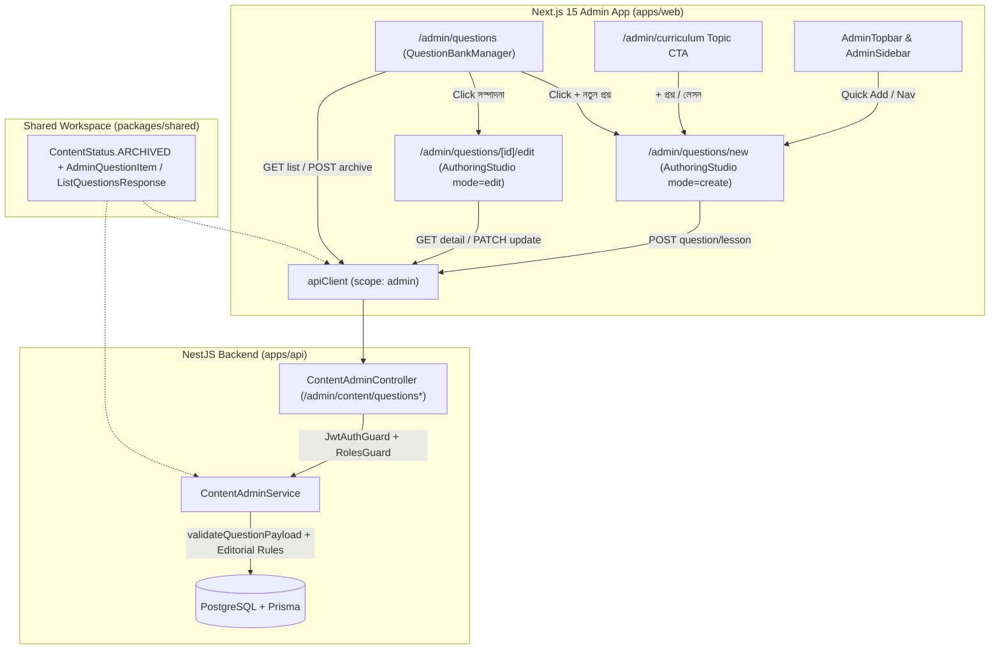

# poRi Admin Question Bank List, Separate Add Screen & Edit Flow Implementation Plan

> **For agentic workers:** REQUIRED SUB-SKILL: Use superpowers:subagent-driven-development to implement this plan task-by-task. Steps use checkbox (`- [ ]`) syntax for tracking.

**Goal:** Separate question listing/management (`/admin/questions`), dedicated authoring (`/admin/questions/new`), and full editing/archiving (`/admin/questions/[id]/edit`) across PostgreSQL/Prisma, NestJS API (`apps/api`), shared contracts (`packages/shared`), and Next.js 15 App Router (`apps/web`).

**Architecture:** `ContentStatus` gains `ARCHIVED` in Prisma and `@pori/shared`. `ContentAdminModule` adds paginated hierarchy/search listing (`GET /admin/content/questions`), single-item hydration (`GET /admin/content/questions/:id`), validated question editing (`PATCH /admin/content/questions/:id`) with version increment and `PUBLISHED -> REVIEW` safety rules (`ADMIN`-only `preservePublished`), and safe archiving (`POST /admin/content/questions/:id/archive`). On the web frontend, `/admin/questions` renders `QuestionBankManager`, while `/admin/questions/new` and `/admin/questions/[id]/edit` host a refactored `AuthoringStudio` supporting `create`/`edit` modes, dynamic `option.id` distractor keys, and full `CQ_CREATIVE` rubric authoring + mobile preview.

**Architecture Diagram:**



**Tech Stack:** NestJS 11, Prisma 6 + PostgreSQL, `class-validator` + `class-transformer`, Next.js 15 App Router, React 19, Zustand (`useAdminAuthStore`), Tailwind CSS, KaTeX, Vitest, Supertest.

**Spec:** [`docs/superpowers/specs/2026-11-09-admin-question-management-design.md`](file:///Users/technonext/Desktop/poRi/docs/superpowers/specs/2026-11-09-admin-question-management-design.md)

## Global Constraints

- Adhere strictly to [`tsconfig.base.json`](file:///Users/technonext/Desktop/poRi/tsconfig.base.json) (`strict: true`, `noImplicitAny: true`, `noUnusedLocals: true`, `noUnusedParameters: true`).
- Rebuild `@pori/shared` (`pnpm --filter @pori/shared build`) immediately after modifying shared types so `apps/api` and `apps/web` resolve updated `dist/` exports.
- Every property on [`ListQuestionsQueryDto`](file:///Users/technonext/Desktop/poRi/apps/api/src/modules/content-admin/dto/list-questions-query.dto.ts) and [`UpdateQuestionAdminDto`](file:///Users/technonext/Desktop/poRi/apps/api/src/modules/content-admin/dto/update-question-admin.dto.ts) must carry explicit `class-validator` decorators because [`main.ts`](file:///Users/technonext/Desktop/poRi/apps/api/src/main.ts#L8-L13) enables `ValidationPipe({ whitelist: true, transform: true })`; additionally enforce runtime validation in [`ContentAdminService`](file:///Users/technonext/Desktop/poRi/apps/api/src/modules/content-admin/content-admin.service.ts) for Vitest calls that bypass HTTP pipes.
- Never hard-delete `Question` rows (which preserves `RevisionMistake` and `ExamSession` integrity); use `ContentStatus.ARCHIVED`.
- Keep all admin HTTP calls scoped to admin auth tokens (`{ scope: 'admin' }` or `/admin/*` path) and surface `401`/`403`/`500` errors cleanly via `role="alert"` banners without `window.confirm` or silent mocks.
- Existing monorepo tests plus all new tests must pass (`pnpm -r test`), and `pnpm -r lint && pnpm -r build` must pass with 0 errors.

---

### Task 1: Schema `ARCHIVED` Status, Shared Question Contracts & Backend List/Detail Endpoints

**Files:**
- Modify: [`apps/api/prisma/schema.prisma`](file:///Users/technonext/Desktop/poRi/apps/api/prisma/schema.prisma#L17-L22)
- Modify: [`packages/shared/src/types/content.ts`](file:///Users/technonext/Desktop/poRi/packages/shared/src/types/content.ts#L1-L7)
- Modify: [`packages/shared/src/types/question.ts`](file:///Users/technonext/Desktop/poRi/packages/shared/src/types/question.ts#L47-L61)
- Modify: [`packages/shared/tests/types.test.ts`](file:///Users/technonext/Desktop/poRi/packages/shared/tests/types.test.ts#L13-L20)
- Create: [`apps/api/src/modules/content-admin/dto/list-questions-query.dto.ts`](file:///Users/technonext/Desktop/poRi/apps/api/src/modules/content-admin/dto/list-questions-query.dto.ts)
- Modify: [`apps/api/src/modules/content-admin/content-admin.service.ts`](file:///Users/technonext/Desktop/poRi/apps/api/src/modules/content-admin/content-admin.service.ts#L1-L25) and append list/get methods
- Modify: [`apps/api/src/modules/content-admin/content-admin.controller.ts`](file:///Users/technonext/Desktop/poRi/apps/api/src/modules/content-admin/content-admin.controller.ts#L1-L93)
- Modify: [`apps/api/src/modules/content-admin/content-admin.service.spec.ts`](file:///Users/technonext/Desktop/poRi/apps/api/src/modules/content-admin/content-admin.service.spec.ts#L25-L31) and append list/get tests

**Interfaces:**
- Consumes: `PrismaService`, `JwtAuthGuard`, `RolesGuard`, `@Roles(...)`, `Role`, `ContentStatus` from `@prisma/client`.
- Produces:
  - `ContentStatus.ARCHIVED` in Prisma schema and `@pori/shared`
  - `QuestionTopicHierarchy`, `QuestionStatusCounts`, `AdminQuestionItem`, `ListQuestionsResponse` in `@pori/shared`
  - `ListQuestionsQueryDto`
  - `ContentAdminService.listQuestions(query: ListQuestionsQueryDto): Promise<ListQuestionsResponse>`
  - `ContentAdminService.getQuestionById(id: string)`
  - `GET /admin/content/questions` & `GET /admin/content/questions/:id` (`EDITOR | REVIEWER | ADMIN`)

- [ ] **Step 1: Write the failing unit tests for `ContentStatus.ARCHIVED`, `listQuestions`, and `getQuestionById`**

Update [`packages/shared/tests/types.test.ts`](file:///Users/technonext/Desktop/poRi/packages/shared/tests/types.test.ts#L13-L20):

```diff
   it('should export correct ContentStatus enums', () => {
     expect(ContentStatus.DRAFT).toBe('DRAFT');
     expect(ContentStatus.REVIEW).toBe('REVIEW');
     expect(ContentStatus.PUBLISHED).toBe('PUBLISHED');
     expect(ContentStatus.CORRECTION).toBe('CORRECTION');
+    expect(ContentStatus.ARCHIVED).toBe('ARCHIVED');
   });
```

Update [`apps/api/src/modules/content-admin/content-admin.service.spec.ts`](file:///Users/technonext/Desktop/poRi/apps/api/src/modules/content-admin/content-admin.service.spec.ts#L25-L31) to include `count` and `groupBy` mocks on `mockPrisma.question`:

```diff
       question: {
         findUnique: vi.fn(),
         create: vi.fn(),
         update: vi.fn(),
         findMany: vi.fn(),
+        count: vi.fn(),
+        groupBy: vi.fn(),
       },
```

Append these test suites to [`apps/api/src/modules/content-admin/content-admin.service.spec.ts`](file:///Users/technonext/Desktop/poRi/apps/api/src/modules/content-admin/content-admin.service.spec.ts#L665):

```ts
  describe('listQuestions', () => {
    const sampleQuestion = {
      id: 'q_motion_mcq_1',
      topicId: 'top_ssc_physics_motion_eq',
      type: 'MCQ',
      stem: 'স্থির অবস্থান থেকে $4\\text{ s}$ পর বেগ কত?',
      options: [
        { id: 'opt_q1_a', text: '$4\\text{ m/s}^2$', isCorrect: true },
        { id: 'opt_q1_b', text: '$64\\text{ m/s}^2$', isCorrect: false },
      ],
      explanation: {
        directAnswer: '৪',
        coreConcept: 'a = v/t',
      },
      cqRubric: null,
      difficulty: 'MEDIUM',
      boardSource: 'Dhaka Board 2022',
      isVerified: true,
      status: ContentStatus.PUBLISHED,
      version: 1,
      createdAt: new Date('2026-11-08T00:00:00Z'),
      updatedAt: new Date('2026-11-09T00:00:00Z'),
      topic: {
        id: 'top_ssc_physics_motion_eq',
        titleBangla: 'গতির সমীকরণ ও সমাধান',
        chapter: {
          id: 'chap_2',
          titleBangla: 'দ্বিতীয় অধ্যায়: গতি',
          subject: {
            id: 'sub_phy',
            code: 'ssc_physics',
            nameBangla: 'পদার্থবিজ্ঞান',
          },
        },
      },
    };

    it('excludes ARCHIVED questions by default and computes statusCounts + pagination', async () => {
      mockPrisma.question.findMany.mockResolvedValue([sampleQuestion]);
      mockPrisma.question.count.mockResolvedValue(25);
      mockPrisma.question.groupBy.mockResolvedValue([
        { status: ContentStatus.PUBLISHED, _count: { _all: 20 } },
        { status: ContentStatus.DRAFT, _count: { _all: 3 } },
        { status: ContentStatus.REVIEW, _count: { _all: 2 } },
        { status: ContentStatus.ARCHIVED, _count: { _all: 4 } },
      ]);

      const res = await service.listQuestions({
        subjectId: 'sub_phy',
        chapterId: 'chap_2',
        topicId: 'top_ssc_physics_motion_eq',
        type: 'MCQ',
        search: 'Dhaka',
        page: '2',
        limit: '10',
      });

      const expectedBaseWhere = {
        topicId: 'top_ssc_physics_motion_eq',
        topic: {
          chapterId: 'chap_2',
          chapter: { subjectId: 'sub_phy' },
        },
        type: 'MCQ',
        OR: [
          { stem: { contains: 'Dhaka', mode: 'insensitive' } },
          { boardSource: { contains: 'Dhaka', mode: 'insensitive' } },
        ],
      };

      expect(mockPrisma.question.findMany).toHaveBeenCalledWith(
        expect.objectContaining({
          where: {
            ...expectedBaseWhere,
            status: { not: 'ARCHIVED' },
          },
          orderBy: [{ updatedAt: 'desc' }, { createdAt: 'desc' }],
          skip: 10,
          take: 10,
        }),
      );
      expect(mockPrisma.question.count).toHaveBeenCalledWith({
        where: {
          ...expectedBaseWhere,
          status: { not: 'ARCHIVED' },
        },
      });
      expect(mockPrisma.question.groupBy).toHaveBeenCalledWith({
        by: ['status'],
        where: expectedBaseWhere,
        _count: { _all: true },
      });
      expect(res).toEqual({
        items: [sampleQuestion],
        total: 25,
        page: 2,
        limit: 10,
        totalPages: 3,
        statusCounts: {
          ALL: 25,
          DRAFT: 3,
          REVIEW: 2,
          CORRECTION: 0,
          PUBLISHED: 20,
          ARCHIVED: 4,
        },
      });
    });

    it('includes archived rows when status=ARCHIVED or includeArchived=true and clamps page/limit', async () => {
      mockPrisma.question.findMany.mockResolvedValue([]);
      mockPrisma.question.count.mockResolvedValue(0);
      mockPrisma.question.groupBy.mockResolvedValue([]);

      const archivedRes = await service.listQuestions({
        status: 'ARCHIVED' as ContentStatus,
        page: '0',
        limit: '250',
      });

      expect(mockPrisma.question.findMany).toHaveBeenCalledWith(
        expect.objectContaining({
          where: { status: 'ARCHIVED' },
          skip: 0,
          take: 100,
        }),
      );
      expect(archivedRes.page).toBe(1);
      expect(archivedRes.limit).toBe(100);
      expect(archivedRes.totalPages).toBe(1);

      await service.listQuestions({ includeArchived: 'true' });
      expect(mockPrisma.question.findMany).toHaveBeenLastCalledWith(
        expect.objectContaining({
          where: {},
        }),
      );
    });
  });

  describe('getQuestionById', () => {
    it('returns question with full subject -> chapter -> topic hierarchy', async () => {
      const fullQuestion = {
        id: 'q_1',
        topicId: 'top_1',
        stem: 'প্রশ্ন',
        topic: {
          id: 'top_1',
          titleBangla: 'টপিক',
          chapter: {
            id: 'chap_1',
            titleBangla: 'অধ্যায়',
            subject: { id: 'sub_1', code: 'ssc_physics', nameBangla: 'পদার্থবিজ্ঞান' },
          },
        },
      };
      mockPrisma.question.findUnique.mockResolvedValue(fullQuestion);

      const res = await service.getQuestionById('q_1');

      expect(mockPrisma.question.findUnique).toHaveBeenCalledWith({
        where: { id: 'q_1' },
        include: {
          topic: {
            select: {
              id: true,
              titleBangla: true,
              chapter: {
                select: {
                  id: true,
                  titleBangla: true,
                  subject: {
                    select: { id: true, code: true, nameBangla: true },
                  },
                },
              },
            },
          },
        },
      });
      expect(res).toEqual(fullQuestion);
    });

    it('throws NotFoundException when question does not exist', async () => {
      mockPrisma.question.findUnique.mockResolvedValue(null);

      await expect(service.getQuestionById('missing_q')).rejects.toThrow(NotFoundException);
    });
  });
```

- [ ] **Step 2: Run the failing unit tests to verify red state**

Run: `pnpm --filter @pori/shared test && pnpm --filter @pori/api test src/modules/content-admin/content-admin.service.spec.ts`
Expected: FAIL because `ContentStatus.ARCHIVED` is `undefined` and `service.listQuestions` / `service.getQuestionById` do not exist.

- [ ] **Step 3: Update Prisma schema, shared types, query DTO, service, and controller**

Update [`apps/api/prisma/schema.prisma`](file:///Users/technonext/Desktop/poRi/apps/api/prisma/schema.prisma#L17-L22):

```diff
 enum ContentStatus {
   DRAFT
   REVIEW
   PUBLISHED
   CORRECTION
+  ARCHIVED
 }
```

Update [`packages/shared/src/types/content.ts`](file:///Users/technonext/Desktop/poRi/packages/shared/src/types/content.ts#L1-L7):

```diff
 export enum ContentStatus {
   DRAFT = 'DRAFT',
   REVIEW = 'REVIEW',
   PUBLISHED = 'PUBLISHED',
   CORRECTION = 'CORRECTION',
+  ARCHIVED = 'ARCHIVED',
 }
```

Update [`packages/shared/src/types/question.ts`](file:///Users/technonext/Desktop/poRi/packages/shared/src/types/question.ts#L47-L61):

```diff
 export interface QuestionDTO {
   id: string;
   topicId: string;
   type: QuestionType;
   stem: string;
   options?: QuestionOption[];
   explanation: ExplanationObject;
   cqRubric?: CQRubric;
   difficulty: QuestionDifficulty;
   source?: QuestionSource;
   status: ContentStatus;
   version: number;
   createdAt?: Date | string;
   updatedAt?: Date | string;
 }
+
+export interface QuestionTopicHierarchy {
+  id: string;
+  titleBangla: string;
+  chapter: {
+    id: string;
+    titleBangla: string;
+    subject: {
+      id: string;
+      code: string;
+      nameBangla: string;
+    };
+  };
+}
+
+export interface AdminQuestionItem {
+  id: string;
+  topicId: string;
+  type: 'MCQ' | 'CQ_CREATIVE' | string;
+  stem: string;
+  options?: QuestionOption[] | null;
+  explanation: ExplanationObject;
+  cqRubric?: Partial<CQRubric> | null;
+  difficulty: QuestionDifficulty | string;
+  boardSource?: string | null;
+  isVerified: boolean;
+  status: ContentStatus | 'DRAFT' | 'REVIEW' | 'CORRECTION' | 'PUBLISHED' | 'ARCHIVED';
+  version: number;
+  createdAt: Date | string;
+  updatedAt: Date | string;
+  topic: QuestionTopicHierarchy;
+}
+
+export interface QuestionStatusCounts {
+  ALL: number;
+  DRAFT: number;
+  REVIEW: number;
+  CORRECTION: number;
+  PUBLISHED: number;
+  ARCHIVED: number;
+}
+
+export interface ListQuestionsResponse {
+  items: AdminQuestionItem[];
+  total: number;
+  page: number;
+  limit: number;
+  totalPages: number;
+  statusCounts: QuestionStatusCounts;
+}
```

Create [`apps/api/src/modules/content-admin/dto/list-questions-query.dto.ts`](file:///Users/technonext/Desktop/poRi/apps/api/src/modules/content-admin/dto/list-questions-query.dto.ts):

```ts
import { IsIn, IsNumberString, IsOptional, IsString } from 'class-validator';
import { ContentStatus } from '@prisma/client';

export class ListQuestionsQueryDto {
  @IsOptional()
  @IsString()
  subjectId?: string;

  @IsOptional()
  @IsString()
  chapterId?: string;

  @IsOptional()
  @IsString()
  topicId?: string;

  @IsOptional()
  @IsIn(['MCQ', 'CQ_CREATIVE'])
  type?: 'MCQ' | 'CQ_CREATIVE';

  @IsOptional()
  @IsIn(['DRAFT', 'REVIEW', 'CORRECTION', 'PUBLISHED', 'ARCHIVED'])
  status?: ContentStatus;

  @IsOptional()
  @IsString()
  search?: string;

  @IsOptional()
  @IsIn(['true', 'false'])
  includeArchived?: string;

  @IsOptional()
  @IsNumberString()
  page?: string;

  @IsOptional()
  @IsNumberString()
  limit?: string;
}
```

Update [`apps/api/src/modules/content-admin/content-admin.service.ts`](file:///Users/technonext/Desktop/poRi/apps/api/src/modules/content-admin/content-admin.service.ts#L1-L25) and append `listQuestions` & `getQuestionById`:

```diff
 import {
   BadRequestException,
   Inject,
   Injectable,
   NotFoundException,
 } from '@nestjs/common';
-import { ContentStatus } from '@prisma/client';
+import { ContentStatus, Prisma } from '@prisma/client';
 import { PrismaService } from '../../database/prisma.service';
 import { CreateLessonAdminDto } from './dto/create-lesson-admin.dto';
 import { CreateQuestionAdminDto } from './dto/create-question-admin.dto';
 import { ReviewContentDto } from './dto/review-content.dto';
 import { CreateChapterAdminDto } from './dto/create-chapter-admin.dto';
 import { CreateTopicAdminDto } from './dto/create-topic-admin.dto';
 import { CreateSubjectAdminDto } from './dto/create-subject-admin.dto';
+import { ListQuestionsQueryDto } from './dto/list-questions-query.dto';
+
+const QUESTION_HIERARCHY_INCLUDE = {
+  topic: {
+    select: {
+      id: true,
+      titleBangla: true,
+      chapter: {
+        select: {
+          id: true,
+          titleBangla: true,
+          subject: {
+            select: {
+              id: true,
+              code: true,
+              nameBangla: true,
+            },
+          },
+        },
+      },
+    },
+  },
+} as const;
```

Append these two methods inside `ContentAdminService` in [`apps/api/src/modules/content-admin/content-admin.service.ts`](file:///Users/technonext/Desktop/poRi/apps/api/src/modules/content-admin/content-admin.service.ts#L401-L403):

```ts
  async listQuestions(query: ListQuestionsQueryDto = {}) {
    if (query.type && !['MCQ', 'CQ_CREATIVE'].includes(query.type)) {
      throw new BadRequestException('type must be MCQ or CQ_CREATIVE');
    }
    if (
      query.status &&
      !['DRAFT', 'REVIEW', 'CORRECTION', 'PUBLISHED', 'ARCHIVED'].includes(query.status)
    ) {
      throw new BadRequestException('Invalid question status filter');
    }

    const baseWhere: Prisma.QuestionWhereInput = {};
    if (query.topicId?.trim()) {
      baseWhere.topicId = query.topicId.trim();
    }

    const topicFilter: Prisma.TopicWhereInput = {};
    if (query.chapterId?.trim()) {
      topicFilter.chapterId = query.chapterId.trim();
    }
    if (query.subjectId?.trim()) {
      topicFilter.chapter = { subjectId: query.subjectId.trim() };
    }
    if (Object.keys(topicFilter).length > 0) {
      baseWhere.topic = topicFilter;
    }

    if (query.type) {
      baseWhere.type = query.type;
    }

    const trimmedSearch = query.search?.trim();
    if (trimmedSearch) {
      baseWhere.OR = [
        { stem: { contains: trimmedSearch, mode: 'insensitive' } },
        { boardSource: { contains: trimmedSearch, mode: 'insensitive' } },
      ];
    }

    const where: Prisma.QuestionWhereInput = { ...baseWhere };
    if (query.status) {
      where.status = query.status;
    } else if (query.includeArchived !== 'true') {
      where.status = { not: ContentStatus.ARCHIVED };
    }

    const parsedPage = Number.parseInt(query.page ?? '1', 10);
    const parsedLimit = Number.parseInt(query.limit ?? '20', 10);
    const page = Number.isFinite(parsedPage) && parsedPage >= 1 ? parsedPage : 1;
    const limit =
      Number.isFinite(parsedLimit) && parsedLimit >= 1
        ? Math.min(100, parsedLimit)
        : 20;
    const skip = (page - 1) * limit;

    const [items, total, groupedCounts] = await Promise.all([
      this.prisma.question.findMany({
        where,
        include: QUESTION_HIERARCHY_INCLUDE,
        orderBy: [{ updatedAt: 'desc' }, { createdAt: 'desc' }],
        skip,
        take: limit,
      }),
      this.prisma.question.count({ where }),
      this.prisma.question.groupBy({
        by: ['status'],
        where: baseWhere,
        _count: { _all: true },
      }),
    ]);

    const statusCounts = {
      ALL: 0,
      DRAFT: 0,
      REVIEW: 0,
      CORRECTION: 0,
      PUBLISHED: 0,
      ARCHIVED: 0,
    };

    for (const row of groupedCounts) {
      const count = row._count._all;
      if (row.status === ContentStatus.DRAFT) {
        statusCounts.DRAFT += count;
        statusCounts.ALL += count;
      } else if (row.status === ContentStatus.REVIEW) {
        statusCounts.REVIEW += count;
        statusCounts.ALL += count;
      } else if (row.status === ContentStatus.CORRECTION) {
        statusCounts.CORRECTION += count;
        statusCounts.ALL += count;
      } else if (row.status === ContentStatus.PUBLISHED) {
        statusCounts.PUBLISHED += count;
        statusCounts.ALL += count;
      } else if (row.status === ContentStatus.ARCHIVED) {
        statusCounts.ARCHIVED += count;
      }
    }

    return {
      items,
      total,
      page,
      limit,
      totalPages: Math.max(1, Math.ceil(total / limit)),
      statusCounts,
    };
  }

  async getQuestionById(id: string) {
    const question = await this.prisma.question.findUnique({
      where: { id },
      include: QUESTION_HIERARCHY_INCLUDE,
    });

    if (!question) {
      throw new NotFoundException(`Question with id ${id} not found`);
    }

    return question;
  }
```

Update [`apps/api/src/modules/content-admin/content-admin.controller.ts`](file:///Users/technonext/Desktop/poRi/apps/api/src/modules/content-admin/content-admin.controller.ts):

```diff
 import {
   Body,
   Controller,
   Get,
   Inject,
   Param,
   Post,
+  Query,
   Req,
   UseGuards,
 } from '@nestjs/common';
```

```diff
 import { CreateTopicAdminDto } from './dto/create-topic-admin.dto';
 import { CreateSubjectAdminDto } from './dto/create-subject-admin.dto';
+import { ListQuestionsQueryDto } from './dto/list-questions-query.dto';
```

```diff
   @Post('questions')
   @Roles(Role.EDITOR, Role.ADMIN)
   async createQuestion(@Body() dto: CreateQuestionAdminDto) {
     return this.contentAdminService.createQuestion(dto);
   }
+
+  @Get('questions')
+  @Roles(Role.EDITOR, Role.REVIEWER, Role.ADMIN)
+  async listQuestions(@Query() query: ListQuestionsQueryDto) {
+    return this.contentAdminService.listQuestions(query);
+  }
+
+  @Get('questions/:id')
+  @Roles(Role.EDITOR, Role.REVIEWER, Role.ADMIN)
+  async getQuestionById(@Param('id') id: string) {
+    return this.contentAdminService.getQuestionById(id);
+  }
```

- [ ] **Step 4: Regenerate Prisma client, rebuild `@pori/shared`, and run tests + lint**

Run:
```bash
pnpm --filter @pori/api prisma:generate
pnpm --filter @pori/shared build && pnpm --filter @pori/shared test
pnpm --filter @pori/api test src/modules/content-admin/content-admin.service.spec.ts && pnpm --filter @pori/api lint
```
Expected: Prisma Client regenerates with `ContentStatus.ARCHIVED`, `@pori/shared` builds cleanly and passes tests, `content-admin.service.spec.ts` passes, and `tsc --noEmit` exits 0.

- [ ] **Step 5: Commit Task 1**

```bash
git add apps/api/prisma/schema.prisma packages/shared/ apps/api/src/modules/content-admin/
git commit -m "feat(api,shared): add ARCHIVED status, shared question contracts, and list/detail endpoints"
```

---

### Task 2: Backend Update & Archive Endpoints (`PATCH`, `POST archive`) + Shared Payload Validation + HTTP E2E RBAC

**Files:**
- Create: [`apps/api/src/modules/content-admin/dto/update-question-admin.dto.ts`](file:///Users/technonext/Desktop/poRi/apps/api/src/modules/content-admin/dto/update-question-admin.dto.ts)
- Modify: [`apps/api/src/modules/content-admin/content-admin.service.ts`](file:///Users/technonext/Desktop/poRi/apps/api/src/modules/content-admin/content-admin.service.ts)
- Modify: [`apps/api/src/modules/content-admin/content-admin.controller.ts`](file:///Users/technonext/Desktop/poRi/apps/api/src/modules/content-admin/content-admin.controller.ts)
- Modify: [`apps/api/src/modules/content-admin/content-admin.service.spec.ts`](file:///Users/technonext/Desktop/poRi/apps/api/src/modules/content-admin/content-admin.service.spec.ts)
- Modify: [`apps/api/test/content-admin.e2e.spec.ts`](file:///Users/technonext/Desktop/poRi/apps/api/test/content-admin.e2e.spec.ts)

**Interfaces:**
- Consumes: `ListQuestionsQueryDto`, `QUESTION_HIERARCHY_INCLUDE`, `Prisma.DbNull`, `Role`, `ContentStatus` from Task 1.
- Produces:
  - `UpdateQuestionAdminDto`
  - `ContentAdminService.updateQuestion(id: string, dto: UpdateQuestionAdminDto, actorRole: Role)`
  - `ContentAdminService.archiveQuestion(id: string, actorRole: Role)`
  - `PATCH /admin/content/questions/:id` (`EDITOR | ADMIN`)
  - `POST /admin/content/questions/:id/archive` (`EDITOR | ADMIN`, HTTP 200)

- [ ] **Step 1: Write the failing unit tests (`updateQuestion`, `archiveQuestion`) and HTTP E2E RBAC tests**

Append `updateQuestion` and `archiveQuestion` test suites to [`apps/api/src/modules/content-admin/content-admin.service.spec.ts`](file:///Users/technonext/Desktop/poRi/apps/api/src/modules/content-admin/content-admin.service.spec.ts):

```ts
  describe('updateQuestion', () => {
    const existingDraftMcq = {
      id: 'q_draft_1',
      topicId: 'topic_force_1',
      type: 'MCQ',
      stem: 'পুরনো প্রশ্ন',
      options: [
        { id: 'opt_q1_a', text: 'উত্তর ১', isCorrect: true },
        { id: 'opt_q1_b', text: 'উত্তর ২', isCorrect: false },
      ],
      explanation: {
        directAnswer: 'সঠিক উত্তর ১',
        coreConcept: 'F = ma',
        distractorAnalysis: { opt_q1_b: 'ভুল গুণন' },
      },
      cqRubric: null,
      difficulty: 'MEDIUM',
      boardSource: 'Dhaka Board 2022',
      isVerified: false,
      status: ContentStatus.DRAFT,
      version: 1,
    };

    it('updates DRAFT question, preserves status unless submitForReview=true, and increments version', async () => {
      mockPrisma.question.findUnique.mockResolvedValue(existingDraftMcq);
      mockPrisma.topic.findUnique.mockResolvedValue({ id: 'topic_force_1' });
      mockPrisma.question.update.mockResolvedValue({
        ...existingDraftMcq,
        stem: 'নতুন প্রশ্ন',
        version: 2,
      });

      await service.updateQuestion(
        'q_draft_1',
        { stem: 'নতুন প্রশ্ন' },
        'EDITOR' as any,
      );

      expect(mockPrisma.question.update).toHaveBeenCalledWith(
        expect.objectContaining({
          where: { id: 'q_draft_1' },
          data: expect.objectContaining({
            stem: 'নতুন প্রশ্ন',
            status: ContentStatus.DRAFT,
            isVerified: false,
            version: { increment: 1 },
          }),
        }),
      );

      await service.updateQuestion(
        'q_draft_1',
        { submitForReview: true },
        'EDITOR' as any,
      );

      expect(mockPrisma.question.update).toHaveBeenLastCalledWith(
        expect.objectContaining({
          data: expect.objectContaining({
            status: ContentStatus.REVIEW,
            version: { increment: 1 },
          }),
        }),
      );
    });

    it('moves PUBLISHED question back to REVIEW by default, blocks EDITOR preservePublished with 403, and allows ADMIN preservePublished', async () => {
      const publishedQuestion = {
        ...existingDraftMcq,
        status: ContentStatus.PUBLISHED,
        isVerified: true,
        version: 3,
      };
      mockPrisma.question.findUnique.mockResolvedValue(publishedQuestion);
      mockPrisma.topic.findUnique.mockResolvedValue({ id: 'topic_force_1' });
      mockPrisma.question.update.mockResolvedValue({
        ...publishedQuestion,
        status: ContentStatus.REVIEW,
        isVerified: false,
        version: 4,
      });

      await service.updateQuestion('q_draft_1', { stem: 'সংশোধিত' }, 'ADMIN' as any);
      expect(mockPrisma.question.update).toHaveBeenCalledWith(
        expect.objectContaining({
          data: expect.objectContaining({
            status: ContentStatus.REVIEW,
            isVerified: false,
            version: { increment: 1 },
          }),
        }),
      );

      await expect(
        service.updateQuestion(
          'q_draft_1',
          { stem: 'সংশোধিত', preservePublished: true },
          'EDITOR' as any,
        ),
      ).rejects.toThrow('Only Admin can keep a question published during edit');

      await service.updateQuestion(
        'q_draft_1',
        { stem: 'সরাসরি আপডেট', preservePublished: true },
        'ADMIN' as any,
      );
      expect(mockPrisma.question.update).toHaveBeenLastCalledWith(
        expect.objectContaining({
          data: expect.objectContaining({
            status: ContentStatus.PUBLISHED,
            isVerified: true,
            version: { increment: 1 },
          }),
        }),
      );
    });

    it('validates CQ_CREATIVE rubric, rejects ARCHIVED edits, and throws 404 on missing topic', async () => {
      mockPrisma.question.findUnique.mockResolvedValue({
        ...existingDraftMcq,
        status: ContentStatus.ARCHIVED,
      });

      await expect(
        service.updateQuestion('q_draft_1', { stem: 'x' }, 'ADMIN' as any),
      ).rejects.toThrow(BadRequestException);

      mockPrisma.question.findUnique.mockResolvedValue(existingDraftMcq);
      mockPrisma.topic.findUnique.mockResolvedValue({ id: 'topic_force_1' });

      await expect(
        service.updateQuestion(
          'q_draft_1',
          {
            type: 'CQ_CREATIVE',
            cqRubric: { ka: { mark: 1, criteria: '' } },
          },
          'ADMIN' as any,
        ),
      ).rejects.toThrow(BadRequestException);

      mockPrisma.topic.findUnique.mockResolvedValue(null);
      await expect(
        service.updateQuestion('q_draft_1', { topicId: 'missing_topic' }, 'ADMIN' as any),
      ).rejects.toThrow(NotFoundException);
    });
  });

  describe('archiveQuestion', () => {
    it('blocks EDITOR from archiving PUBLISHED questions, allows ADMIN, and archives non-published items', async () => {
      mockPrisma.question.findUnique.mockResolvedValue({
        id: 'q_pub',
        status: ContentStatus.PUBLISHED,
      });

      await expect(service.archiveQuestion('q_pub', 'EDITOR' as any)).rejects.toThrow(
        'Only Admin can archive published questions',
      );

      mockPrisma.question.update.mockResolvedValue({
        id: 'q_pub',
        status: ContentStatus.ARCHIVED,
        isVerified: false,
      });

      const res = await service.archiveQuestion('q_pub', 'ADMIN' as any);
      expect(mockPrisma.question.update).toHaveBeenCalledWith(
        expect.objectContaining({
          where: { id: 'q_pub' },
          data: { status: ContentStatus.ARCHIVED, isVerified: false },
        }),
      );
      expect(res.status).toBe(ContentStatus.ARCHIVED);

      mockPrisma.question.findUnique.mockResolvedValue({
        id: 'q_draft',
        status: ContentStatus.DRAFT,
      });
      await service.archiveQuestion('q_draft', 'EDITOR' as any);
      expect(mockPrisma.question.update).toHaveBeenCalledTimes(2);
    });

    it('throws NotFoundException when archiving non-existent question', async () => {
      mockPrisma.question.findUnique.mockResolvedValue(null);

      await expect(service.archiveQuestion('missing_q', 'ADMIN' as any)).rejects.toThrow(
        NotFoundException,
      );
    });
  });
```

Extend [`apps/api/test/content-admin.e2e.spec.ts`](file:///Users/technonext/Desktop/poRi/apps/api/test/content-admin.e2e.spec.ts) `mockPrismaService` (add `subjects`, `chapters`, `question.count`, `question.groupBy`, `include: { topic: ... }` helper, and `Prisma.DbNull` normalization on `question.update`) and append Question Bank list/detail/edit/archive RBAC tests:

```diff
 import { Test, TestingModule } from '@nestjs/testing';
 import { JwtService } from '@nestjs/jwt';
 import request from 'supertest';
-import { Role, ContentStatus } from '@prisma/client';
+import { Role, ContentStatus, Prisma } from '@prisma/client';
 import { AppModule } from '../src/app.module';
 import { PrismaService } from '../src/database/prisma.service';
```

```diff
   let users: any[] = [];
+  let subjects: any[] = [];
+  let chapters: any[] = [];
   let topics: any[] = [];
   let lessons: any[] = [];
   let questions: any[] = [];
   let contentReviews: any[] = [];
```

Replace the `question` block inside `mockPrismaService` (lines 88-132 of [`apps/api/test/content-admin.e2e.spec.ts`](file:///Users/technonext/Desktop/poRi/apps/api/test/content-admin.e2e.spec.ts#L88-L132)) and initialize `subjects`/`chapters` in `beforeEach`:

```ts
    question: {
      findUnique: async ({ where, include }: any) => {
        const found = questions.find((q) => q.id === where.id) || null;
        if (!found) return null;
        if (include?.topic) {
          const t = topics.find((item) => item.id === found.topicId);
          const ch = t ? chapters.find((c) => c.id === t.chapterId) : null;
          const sub = ch ? subjects.find((s) => s.id === ch.subjectId) : null;
          return {
            ...found,
            topic: t
              ? {
                  id: t.id,
                  titleBangla: t.titleBangla,
                  chapter: ch
                    ? {
                        id: ch.id,
                        titleBangla: ch.titleBangla,
                        subject: sub
                          ? { id: sub.id, code: sub.code, nameBangla: sub.nameBangla }
                          : null,
                      }
                    : null,
                }
              : null,
          };
        }
        return found;
      },
      findMany: async ({ where, include, skip = 0, take }: any) => {
        const matchWhere = (q: any) => {
          if (where?.topicId && q.topicId !== where.topicId) return false;
          if (where?.type && q.type !== where.type) return false;
          if (where?.status) {
            if (typeof where.status === 'string' && q.status !== where.status) return false;
            if (where.status.in && !where.status.in.includes(q.status)) return false;
            if (where.status.not && q.status === where.status.not) return false;
          }
          if (where?.topic) {
            const t = topics.find((item) => item.id === q.topicId);
            if (!t) return false;
            if (where.topic.chapterId && t.chapterId !== where.topic.chapterId) return false;
            if (where.topic.chapter?.subjectId) {
              const ch = chapters.find((c) => c.id === t.chapterId);
              if (!ch || ch.subjectId !== where.topic.chapter.subjectId) return false;
            }
          }
          if (where?.OR) {
            const needle = (where.OR[0]?.stem?.contains || '').toLowerCase();
            const stemMatch = (q.stem || '').toLowerCase().includes(needle);
            const boardMatch = (q.boardSource || '').toLowerCase().includes(needle);
            if (!stemMatch && !boardMatch) return false;
          }
          return true;
        };

        let res = questions
          .filter(matchWhere)
          .sort((a, b) => new Date(b.updatedAt).getTime() - new Date(a.updatedAt).getTime());
        if (typeof take === 'number') {
          res = res.slice(skip, skip + take);
        }
        if (include?.topic) {
          return res.map((q) => {
            const t = topics.find((item) => item.id === q.topicId);
            const ch = t ? chapters.find((c) => c.id === t.chapterId) : null;
            const sub = ch ? subjects.find((s) => s.id === ch.subjectId) : null;
            return {
              ...q,
              topic: t
                ? {
                    id: t.id,
                    titleBangla: t.titleBangla,
                    chapter: ch
                      ? {
                          id: ch.id,
                          titleBangla: ch.titleBangla,
                          subject: sub
                            ? { id: sub.id, code: sub.code, nameBangla: sub.nameBangla }
                            : null,
                        }
                      : null,
                  }
                : null,
            };
          });
        }
        return res;
      },
      count: async ({ where }: any) => {
        const list = await mockPrismaService.question.findMany({ where });
        return list.length;
      },
      groupBy: async ({ where }: any) => {
        const matched = await mockPrismaService.question.findMany({ where });
        const counts = new Map<string, number>();
        for (const q of matched) {
          counts.set(q.status, (counts.get(q.status) || 0) + 1);
        }
        return Array.from(counts.entries()).map(([status, _all]) => ({
          status,
          _count: { _all },
        }));
      },
      create: async ({ data }: any) => {
        const newQuestion = {
          id: `q_${Date.now()}_${Math.random().toString(36).substring(2, 6)}`,
          topicId: data.topicId,
          type: data.type ?? 'MCQ',
          stem: data.stem,
          options: data.options === Prisma.DbNull ? null : (data.options ?? null),
          explanation: data.explanation,
          cqRubric: data.cqRubric === Prisma.DbNull ? null : (data.cqRubric ?? null),
          difficulty: data.difficulty ?? 'MEDIUM',
          boardSource: data.boardSource ?? null,
          isVerified: data.isVerified ?? false,
          status: data.status ?? ContentStatus.DRAFT,
          version: data.version ?? 1,
          createdAt: new Date(),
          updatedAt: new Date(),
        };
        questions.push(newQuestion);
        return newQuestion;
      },
      update: async ({ where, data, include }: any) => {
        const idx = questions.findIndex((q) => q.id === where.id);
        if (idx === -1) throw new Error('Question not found');
        const curr = questions[idx];
        const normalized: Record<string, any> = { ...data };
        if (normalized.options === Prisma.DbNull) normalized.options = null;
        if (normalized.cqRubric === Prisma.DbNull) normalized.cqRubric = null;
        const updated = {
          ...curr,
          ...normalized,
          version: data.version?.increment ? curr.version + data.version.increment : curr.version,
          updatedAt: new Date(),
        };
        questions[idx] = updated;
        if (include?.topic) {
          return mockPrismaService.question.findUnique({ where: { id: where.id }, include });
        }
        return updated;
      },
    },
```

In `beforeEach` of [`apps/api/test/content-admin.e2e.spec.ts`](file:///Users/technonext/Desktop/poRi/apps/api/test/content-admin.e2e.spec.ts#L232-L240):

```ts
    subjects = [
      {
        id: 'sub_phy',
        code: 'ssc_physics',
        nameBangla: 'পদার্থবিজ্ঞান',
      },
    ];
    chapters = [
      {
        id: 'chap_force',
        subjectId: 'sub_phy',
        orderIndex: 2,
        titleBangla: 'গতি ও বল',
      },
    ];
    topics = [
      {
        id: 'topic_force',
        chapterId: 'chap_force',
        orderIndex: 1,
        titleBangla: 'নিউটনের গতির সূত্র',
      },
    ];
```

Append this `describe('Question Bank List, Edit & Archive Endpoints (e2e)')` block to [`apps/api/test/content-admin.e2e.spec.ts`](file:///Users/technonext/Desktop/poRi/apps/api/test/content-admin.e2e.spec.ts#L712):

```ts
  describe('Question Bank List, Edit & Archive Endpoints (e2e)', () => {
    it('enforces RBAC across GET list/detail, PATCH edit (including preservePublished), and POST archive', async () => {
      // Seed 1 draft and 1 published question via EDITOR + REVIEWER flow
      const draftRes = await request(app.getHttpServer())
        .post('/admin/content/questions')
        .set('Authorization', `Bearer ${editorToken}`)
        .send({
          topicId: 'topic_force',
          type: 'MCQ',
          stem: 'ড্রাফট প্রশ্ন: বলের একক কী?',
          options: [
            { id: 'opt_1', text: 'নিউটন', isCorrect: true },
            { id: 'opt_2', text: 'জুল', isCorrect: false },
          ],
          explanation: { directAnswer: 'নিউটন', coreConcept: 'SI unit' },
          difficulty: 'EASY',
          boardSource: 'Dhaka 2024',
        })
        .expect(201);

      const pubCreateRes = await request(app.getHttpServer())
        .post('/admin/content/questions')
        .set('Authorization', `Bearer ${editorToken}`)
        .send({
          topicId: 'topic_force',
          type: 'CQ_CREATIVE',
          stem: 'প্রকাশিত সৃজনশীল উদ্দীপক',
          explanation: { directAnswer: 'ক থেকে ঘ সমাধান', coreConcept: 'F=ma' },
          cqRubric: { ka: { mark: 1, criteria: 'বলের সংজ্ঞা' } },
          difficulty: 'HARD',
          boardSource: 'Rajshahi 2023',
        })
        .expect(201);

      await request(app.getHttpServer())
        .post('/admin/content/review')
        .set('Authorization', `Bearer ${reviewerToken}`)
        .send({
          contentType: 'QUESTION',
          contentId: pubCreateRes.body.id,
          action: 'APPROVE',
          comment: 'প্রকাশযোগ্য',
        })
        .expect(201);

      // 1. Unauthenticated / STUDENT rejected
      await request(app.getHttpServer()).get('/admin/content/questions').expect(401);
      await request(app.getHttpServer())
        .get('/admin/content/questions')
        .set('Authorization', `Bearer ${studentToken}`)
        .expect(403);

      // 2. REVIEWER can view list & single item, but cannot PATCH or archive
      const listRes = await request(app.getHttpServer())
        .get('/admin/content/questions?subjectId=sub_phy&search=Rajshahi')
        .set('Authorization', `Bearer ${reviewerToken}`)
        .expect(200);

      expect(listRes.body.items).toHaveLength(1);
      expect(listRes.body.items[0].id).toBe(pubCreateRes.body.id);
      expect(listRes.body.items[0].topic.chapter.subject.code).toBe('ssc_physics');
      expect(listRes.body.statusCounts.PUBLISHED).toBe(1);

      const detailRes = await request(app.getHttpServer())
        .get(`/admin/content/questions/${pubCreateRes.body.id}`)
        .set('Authorization', `Bearer ${reviewerToken}`)
        .expect(200);
      expect(detailRes.body.cqRubric.ka.mark).toBe(1);

      await request(app.getHttpServer())
        .patch(`/admin/content/questions/${draftRes.body.id}`)
        .set('Authorization', `Bearer ${reviewerToken}`)
        .send({ stem: 'Reviewer cannot edit' })
        .expect(403);

      await request(app.getHttpServer())
        .post(`/admin/content/questions/${draftRes.body.id}/archive`)
        .set('Authorization', `Bearer ${reviewerToken}`)
        .expect(403);

      // 3. EDITOR cannot preservePublished or archive PUBLISHED question
      await request(app.getHttpServer())
        .patch(`/admin/content/questions/${pubCreateRes.body.id}`)
        .set('Authorization', `Bearer ${editorToken}`)
        .send({ stem: 'Editor edit', preservePublished: true })
        .expect(403);

      await request(app.getHttpServer())
        .post(`/admin/content/questions/${pubCreateRes.body.id}/archive`)
        .set('Authorization', `Bearer ${editorToken}`)
        .expect(403);

      // 4. EDITOR editing PUBLISHED without preservePublished moves it to REVIEW
      const editorPatchRes = await request(app.getHttpServer())
        .patch(`/admin/content/questions/${pubCreateRes.body.id}`)
        .set('Authorization', `Bearer ${editorToken}`)
        .send({ stem: 'সংশোধিত উদ্দীপক' })
        .expect(200);
      expect(editorPatchRes.body.status).toBe(ContentStatus.REVIEW);
      expect(editorPatchRes.body.version).toBe(3);

      // 5. Re-approve and let ADMIN preservePublished + archive cleanly
      await request(app.getHttpServer())
        .post('/admin/content/review')
        .set('Authorization', `Bearer ${reviewerToken}`)
        .send({
          contentType: 'QUESTION',
          contentId: pubCreateRes.body.id,
          action: 'APPROVE',
          comment: 'পুনরায় অনুমোদিত',
        })
        .expect(201);

      const adminPatchRes = await request(app.getHttpServer())
        .patch(`/admin/content/questions/${pubCreateRes.body.id}`)
        .set('Authorization', `Bearer ${adminToken}`)
        .send({ stem: 'অ্যাডমিন সরাসরি আপডেট', preservePublished: true })
        .expect(200);
      expect(adminPatchRes.body.status).toBe(ContentStatus.PUBLISHED);
      expect(adminPatchRes.body.isVerified).toBe(true);

      const archiveRes = await request(app.getHttpServer())
        .post(`/admin/content/questions/${pubCreateRes.body.id}/archive`)
        .set('Authorization', `Bearer ${adminToken}`)
        .expect(200);
      expect(archiveRes.body.status).toBe(ContentStatus.ARCHIVED);
      expect(archiveRes.body.isVerified).toBe(false);

      // Archived question excluded from default list, present with status=ARCHIVED, and blocks direct edit
      const defaultAfterArchive = await request(app.getHttpServer())
        .get('/admin/content/questions')
        .set('Authorization', `Bearer ${adminToken}`)
        .expect(200);
      expect(defaultAfterArchive.body.items.map((q: any) => q.id)).toEqual([draftRes.body.id]);

      const archivedFilter = await request(app.getHttpServer())
        .get('/admin/content/questions?status=ARCHIVED')
        .set('Authorization', `Bearer ${adminToken}`)
        .expect(200);
      expect(archivedFilter.body.items).toHaveLength(1);

      await request(app.getHttpServer())
        .patch(`/admin/content/questions/${pubCreateRes.body.id}`)
        .set('Authorization', `Bearer ${adminToken}`)
        .send({ stem: 'আর্কাইভ প্রশ্নে এডিট হবে না' })
        .expect(400);
    });
  });
```

- [ ] **Step 2: Run unit and E2E tests to verify red state**

Run: `pnpm --filter @pori/api test src/modules/content-admin/content-admin.service.spec.ts test/content-admin.e2e.spec.ts`
Expected: FAIL because `UpdateQuestionAdminDto`, `updateQuestion`, and `archiveQuestion` do not exist yet.

- [ ] **Step 3: Implement `UpdateQuestionAdminDto`, `validateQuestionPayload`, `updateQuestion`, `archiveQuestion`, and controller routes**

Create [`apps/api/src/modules/content-admin/dto/update-question-admin.dto.ts`](file:///Users/technonext/Desktop/poRi/apps/api/src/modules/content-admin/dto/update-question-admin.dto.ts):

```ts
import {
  IsArray,
  IsBoolean,
  IsIn,
  IsObject,
  IsOptional,
  IsString,
  ValidateIf,
} from 'class-validator';

export class UpdateQuestionAdminDto {
  @IsOptional()
  @IsString()
  topicId?: string;

  @IsOptional()
  @IsIn(['MCQ', 'CQ_CREATIVE'])
  type?: 'MCQ' | 'CQ_CREATIVE';

  @IsOptional()
  @IsString()
  stem?: string;

  @IsOptional()
  @ValidateIf((_, value) => value !== null)
  @IsArray()
  options?: any[] | null;

  @IsOptional()
  @IsObject()
  explanation?: any;

  @IsOptional()
  @ValidateIf((_, value) => value !== null)
  @IsObject()
  cqRubric?: Record<string, { mark?: number; criteria?: string }> | null;

  @IsOptional()
  @IsIn(['EASY', 'MEDIUM', 'HARD'])
  difficulty?: 'EASY' | 'MEDIUM' | 'HARD';

  @IsOptional()
  @ValidateIf((_, value) => value !== null)
  @IsString()
  boardSource?: string | null;

  @IsOptional()
  @IsBoolean()
  preservePublished?: boolean;

  @IsOptional()
  @IsBoolean()
  submitForReview?: boolean;
}
```

Update [`apps/api/src/modules/content-admin/content-admin.service.ts`](file:///Users/technonext/Desktop/poRi/apps/api/src/modules/content-admin/content-admin.service.ts):

```diff
 import {
   BadRequestException,
+  ForbiddenException,
   Inject,
   Injectable,
   NotFoundException,
 } from '@nestjs/common';
-import { ContentStatus, Prisma } from '@prisma/client';
+import { ContentStatus, Prisma, Role } from '@prisma/client';
 import { PrismaService } from '../../database/prisma.service';
 import { CreateLessonAdminDto } from './dto/create-lesson-admin.dto';
 import { CreateQuestionAdminDto } from './dto/create-question-admin.dto';
 import { ReviewContentDto } from './dto/review-content.dto';
 import { CreateChapterAdminDto } from './dto/create-chapter-admin.dto';
 import { CreateTopicAdminDto } from './dto/create-topic-admin.dto';
 import { CreateSubjectAdminDto } from './dto/create-subject-admin.dto';
 import { ListQuestionsQueryDto } from './dto/list-questions-query.dto';
+import { UpdateQuestionAdminDto } from './dto/update-question-admin.dto';
```

Refactor `createQuestion` to call private `validateQuestionPayload`, and add `updateQuestion` & `archiveQuestion`:

```ts
  private validateQuestionPayload(payload: {
    topicId?: string;
    type?: string;
    stem?: string;
    options?: any;
    explanation?: any;
    cqRubric?: any;
    difficulty?: string;
  }) {
    if (!payload.topicId || typeof payload.topicId !== 'string' || !payload.topicId.trim()) {
      throw new BadRequestException('topicId is required');
    }
    if (!payload.type || !['MCQ', 'CQ_CREATIVE'].includes(payload.type)) {
      throw new BadRequestException('type must be MCQ or CQ_CREATIVE');
    }
    if (!payload.stem || typeof payload.stem !== 'string' || !payload.stem.trim()) {
      throw new BadRequestException('stem is required');
    }
    if (!payload.explanation || typeof payload.explanation !== 'object' || Array.isArray(payload.explanation)) {
      throw new BadRequestException('explanation must be a valid object');
    }
    if (
      typeof payload.explanation.directAnswer !== 'string' ||
      !payload.explanation.directAnswer.trim() ||
      typeof payload.explanation.coreConcept !== 'string' ||
      !payload.explanation.coreConcept.trim()
    ) {
      throw new BadRequestException(
        'explanation must include non-empty directAnswer and coreConcept',
      );
    }
    if (!payload.difficulty || !['EASY', 'MEDIUM', 'HARD'].includes(payload.difficulty)) {
      throw new BadRequestException('difficulty must be EASY, MEDIUM, or HARD');
    }

    if (payload.type === 'MCQ') {
      if (!Array.isArray(payload.options) || payload.options.length < 2) {
        throw new BadRequestException('MCQ questions must include at least 2 options');
      }
      let correctCount = 0;
      for (const opt of payload.options) {
        if (
          !opt ||
          typeof opt !== 'object' ||
          !opt.id ||
          typeof opt.id !== 'string' ||
          !opt.id.trim() ||
          !opt.text ||
          typeof opt.text !== 'string' ||
          !opt.text.trim() ||
          typeof opt.isCorrect !== 'boolean'
        ) {
          throw new BadRequestException('Each option must contain id, text, and isCorrect boolean');
        }
        if (opt.isCorrect) {
          correctCount++;
        }
      }
      if (correctCount !== 1) {
        throw new BadRequestException('MCQ questions must have exactly one correct option');
      }
    }

    if (payload.type === 'CQ_CREATIVE' && payload.cqRubric !== undefined && payload.cqRubric !== null) {
      if (typeof payload.cqRubric !== 'object' || Array.isArray(payload.cqRubric)) {
        throw new BadRequestException('cqRubric must be an object keyed by ka, kha, ga, gha');
      }
      const partKeys = ['ka', 'kha', 'ga', 'gha'] as const;
      let validParts = 0;
      for (const key of partKeys) {
        const part = payload.cqRubric[key];
        if (part === undefined) continue;
        if (!part || typeof part !== 'object' || Array.isArray(part)) {
          throw new BadRequestException(`cqRubric.${key} must be an object`);
        }
        const criteriaValid = typeof part.criteria === 'string' && part.criteria.trim().length > 0;
        const markValid =
          typeof part.mark === 'number' && Number.isFinite(part.mark) && part.mark >= 0;
        if (part.mark !== undefined && !markValid) {
          throw new BadRequestException(`cqRubric.${key}.mark must be a non-negative number`);
        }
        if (criteriaValid && markValid) {
          validParts++;
        }
      }
      if (validParts === 0) {
        throw new BadRequestException(
          'CQ_CREATIVE cqRubric must include at least one part (ka, kha, ga, gha) with non-empty criteria and non-negative numeric mark',
        );
      }
    }
  }
```

Update `createQuestion` (replacing inline validation checks in lines 68-120 with `this.validateQuestionPayload(dto)`):

```ts
  async createQuestion(dto: CreateQuestionAdminDto) {
    this.validateQuestionPayload({
      topicId: dto?.topicId,
      type: dto?.type,
      stem: dto?.stem,
      options: dto?.options,
      explanation: dto?.explanation,
      cqRubric: dto?.cqRubric,
      difficulty: dto?.difficulty,
    });

    const topic = await this.prisma.topic.findUnique({
      where: { id: dto.topicId },
    });

    if (!topic) {
      throw new NotFoundException(`Topic with id ${dto.topicId} not found`);
    }

    return this.prisma.question.create({
      data: {
        topicId: dto.topicId,
        type: dto.type,
        stem: dto.stem,
        options:
          dto.type === 'CQ_CREATIVE'
            ? Prisma.DbNull
            : dto.options !== undefined
              ? dto.options
              : Prisma.DbNull,
        explanation: dto.explanation,
        cqRubric:
          dto.type === 'MCQ'
            ? Prisma.DbNull
            : dto.cqRubric !== undefined && dto.cqRubric !== null
              ? dto.cqRubric
              : Prisma.DbNull,
        difficulty: dto.difficulty,
        boardSource: dto.boardSource ?? null,
        status: ContentStatus.DRAFT,
        version: 1,
        isVerified: false,
      },
    });
  }
```

*(Note: verify existing `content-admin.service.spec.ts` `createQuestion` test expectations: line 154 only checks `expect.objectContaining({ topicId, stem, status, version, isVerified })`, which still passes completely!)*

Add `updateQuestion` and `archiveQuestion` inside `ContentAdminService`:

```ts
  async updateQuestion(id: string, dto: UpdateQuestionAdminDto, actorRole: Role) {
    const existing = await this.prisma.question.findUnique({
      where: { id },
    });

    if (!existing) {
      throw new NotFoundException(`Question with id ${id} not found`);
    }

    if (existing.status === ContentStatus.ARCHIVED) {
      throw new BadRequestException('Archived questions cannot be edited directly');
    }

    if (dto.preservePublished === true && actorRole !== Role.ADMIN) {
      throw new ForbiddenException('Only Admin can keep a question published during edit');
    }

    const nextType = dto.type ?? existing.type;
    const mergedTopicId = dto.topicId !== undefined ? dto.topicId : existing.topicId;
    const mergedStem = dto.stem !== undefined ? dto.stem : existing.stem;
    const mergedDifficulty = dto.difficulty !== undefined ? dto.difficulty : existing.difficulty;
    const mergedExplanation =
      dto.explanation !== undefined ? dto.explanation : existing.explanation;
    const mergedOptions =
      nextType === 'CQ_CREATIVE'
        ? null
        : dto.options !== undefined
          ? dto.options
          : existing.options;
    const mergedCqRubric =
      nextType === 'MCQ'
        ? null
        : dto.cqRubric !== undefined
          ? dto.cqRubric
          : existing.cqRubric;
    const mergedBoardSource =
      dto.boardSource !== undefined
        ? dto.boardSource?.trim()
          ? dto.boardSource.trim()
          : null
        : existing.boardSource;

    this.validateQuestionPayload({
      topicId: mergedTopicId,
      type: nextType,
      stem: mergedStem,
      options: mergedOptions,
      explanation: mergedExplanation,
      cqRubric: mergedCqRubric,
      difficulty: mergedDifficulty,
    });

    const topic = await this.prisma.topic.findUnique({
      where: { id: mergedTopicId },
    });
    if (!topic) {
      throw new NotFoundException(`Topic with id ${mergedTopicId} not found`);
    }

    let nextStatus: ContentStatus = existing.status;
    let nextIsVerified = existing.isVerified;

    if (existing.status === ContentStatus.PUBLISHED) {
      if (dto.preservePublished === true && actorRole === Role.ADMIN) {
        nextStatus = ContentStatus.PUBLISHED;
        nextIsVerified = true;
      } else {
        nextStatus = ContentStatus.REVIEW;
        nextIsVerified = false;
      }
    } else if (
      existing.status === ContentStatus.DRAFT ||
      existing.status === ContentStatus.REVIEW ||
      existing.status === ContentStatus.CORRECTION
    ) {
      nextStatus = dto.submitForReview === true ? ContentStatus.REVIEW : existing.status;
      nextIsVerified = false;
    }

    return this.prisma.question.update({
      where: { id },
      data: {
        topicId: mergedTopicId,
        type: nextType,
        stem: mergedStem,
        options: mergedOptions === null ? Prisma.DbNull : (mergedOptions as Prisma.InputJsonValue),
        explanation: mergedExplanation as Prisma.InputJsonValue,
        cqRubric:
          mergedCqRubric === null ? Prisma.DbNull : (mergedCqRubric as Prisma.InputJsonValue),
        difficulty: mergedDifficulty,
        boardSource: mergedBoardSource,
        status: nextStatus,
        isVerified: nextIsVerified,
        version: { increment: 1 },
      },
      include: QUESTION_HIERARCHY_INCLUDE,
    });
  }

  async archiveQuestion(id: string, actorRole: Role) {
    const existing = await this.prisma.question.findUnique({
      where: { id },
    });

    if (!existing) {
      throw new NotFoundException(`Question with id ${id} not found`);
    }

    if (existing.status === ContentStatus.PUBLISHED && actorRole !== Role.ADMIN) {
      throw new ForbiddenException('Only Admin can archive published questions');
    }

    return this.prisma.question.update({
      where: { id },
      data: {
        status: ContentStatus.ARCHIVED,
        isVerified: false,
      },
      include: QUESTION_HIERARCHY_INCLUDE,
    });
  }
```

Update [`apps/api/src/modules/content-admin/content-admin.controller.ts`](file:///Users/technonext/Desktop/poRi/apps/api/src/modules/content-admin/content-admin.controller.ts):

```diff
 import {
   Body,
   Controller,
   Get,
+  HttpCode,
+  HttpStatus,
   Inject,
   Param,
+  Patch,
   Post,
   Query,
   Req,
   UseGuards,
 } from '@nestjs/common';
```

```diff
 import { CreateTopicAdminDto } from './dto/create-topic-admin.dto';
 import { CreateSubjectAdminDto } from './dto/create-subject-admin.dto';
 import { ListQuestionsQueryDto } from './dto/list-questions-query.dto';
+import { UpdateQuestionAdminDto } from './dto/update-question-admin.dto';
```

```diff
   @Get('questions/:id')
   @Roles(Role.EDITOR, Role.REVIEWER, Role.ADMIN)
   async getQuestionById(@Param('id') id: string) {
     return this.contentAdminService.getQuestionById(id);
   }
+
+  @Patch('questions/:id')
+  @Roles(Role.EDITOR, Role.ADMIN)
+  async updateQuestion(
+    @Param('id') id: string,
+    @Body() dto: UpdateQuestionAdminDto,
+    @Req() req: { user: { id: string; role: Role } },
+  ) {
+    return this.contentAdminService.updateQuestion(id, dto, req.user.role);
+  }
+
+  @Post('questions/:id/archive')
+  @HttpCode(HttpStatus.OK)
+  @Roles(Role.EDITOR, Role.ADMIN)
+  async archiveQuestion(
+    @Param('id') id: string,
+    @Req() req: { user: { id: string; role: Role } },
+  ) {
+    return this.contentAdminService.archiveQuestion(id, req.user.role);
+  }
```

- [ ] **Step 4: Run all API unit tests, E2E tests, and typecheck**

Run: `pnpm --filter @pori/api test && pnpm --filter @pori/api test:e2e && pnpm --filter @pori/api lint && pnpm --filter @pori/api build`
Expected: PASS (all unit tests + E2E RBAC suites + `tsc --noEmit` + Nest build).

- [ ] **Step 5: Commit Task 2**

```bash
git add apps/api/src/modules/content-admin/ apps/api/test/content-admin.e2e.spec.ts
git commit -m "feat(api): add PATCH updateQuestion and POST archive endpoints with RBAC"
```

---

### Task 3: Frontend `apiClient.patch`, `QuestionBankManager` Component & `/admin/questions` List Route

**Files:**
- Modify: [`apps/web/src/lib/api-client.ts`](file:///Users/technonext/Desktop/poRi/apps/web/src/lib/api-client.ts#L114-L135)
- Modify: [`apps/web/tests/admin-auth-store.test.ts`](file:///Users/technonext/Desktop/poRi/apps/web/tests/admin-auth-store.test.ts#L335-L344)
- Create: [`apps/web/src/components/admin/question-bank-manager.tsx`](file:///Users/technonext/Desktop/poRi/apps/web/src/components/admin/question-bank-manager.tsx)
- Modify: [`apps/web/src/app/admin/questions/page.tsx`](file:///Users/technonext/Desktop/poRi/apps/web/src/app/admin/questions/page.tsx#L1-L38)
- Create: [`apps/web/tests/admin-question-bank.test.tsx`](file:///Users/technonext/Desktop/poRi/apps/web/tests/admin-question-bank.test.tsx)

**Interfaces:**
- Consumes: `AdminQuestionItem`, `ListQuestionsResponse`, `ContentStatus`, `SubjectDTO`, `ChapterDTO` from `@pori/shared`; `apiClient`, `ApiError`; `useAdminAuthStore`; `LatexRenderer`.
- Produces:
  - `apiClient.patch<T>(endpoint: string, body?: unknown, options?: RequestOptions): Promise<T>`
  - `QuestionBankManager` component rendered at [`AdminQuestionsPage`](file:///Users/technonext/Desktop/poRi/apps/web/src/app/admin/questions/page.tsx) (`/admin/questions`).

- [ ] **Step 1: Write the failing unit tests for `apiClient.patch` and `QuestionBankManager`**

Append `apiClient.patch` test to [`apps/web/tests/admin-auth-store.test.ts`](file:///Users/technonext/Desktop/poRi/apps/web/tests/admin-auth-store.test.ts#L340-L344):

```ts
  it('supports PATCH requests via apiClient.patch with admin scope and JSON payload', async () => {
    useAdminAuthStore.getState().setSession('admin_patch_jwt', {
      id: 'adm_1',
      phoneNumber: '01737740010',
      role: 'ADMIN',
    });

    fetchMock.mockResolvedValueOnce(
      new Response(JSON.stringify({ id: 'q_1', version: 2 }), {
        status: 200,
        headers: { 'content-type': 'application/json' },
      }),
    );

    const res = await apiClient.patch<{ id: string; version: number }>(
      '/admin/content/questions/q_1',
      { stem: 'সংশোধিত প্রশ্ন' },
      { scope: 'admin' },
    );

    expect(res).toEqual({ id: 'q_1', version: 2 });
    const [calledUrl, init] = fetchMock.mock.calls[0];
    expect(calledUrl).toBe('http://localhost:3001/admin/content/questions/q_1');
    expect(init.method).toBe('PATCH');
    expect((init.headers as Headers).get('Authorization')).toBe('Bearer admin_patch_jwt');
    expect(init.body).toBe(JSON.stringify({ stem: 'সংশোধিত প্রশ্ন' }));
  });
```

Create [`apps/web/tests/admin-question-bank.test.tsx`](file:///Users/technonext/Desktop/poRi/apps/web/tests/admin-question-bank.test.tsx):

```tsx
import { describe, it, expect, beforeEach, vi, afterEach } from 'vitest';
import { render, screen, fireEvent, waitFor } from '@testing-library/react';
import React from 'react';
import { QuestionBankManager } from '../src/components/admin/question-bank-manager';
import { useAdminAuthStore } from '../src/store/admin-auth-store';
import { apiClient, ApiError } from '../src/lib/api-client';
import type { AdminQuestionItem, ListQuestionsResponse } from '@pori/shared';

vi.mock('../src/lib/api-client', async () => {
  const actual = await vi.importActual<typeof import('../src/lib/api-client')>(
    '../src/lib/api-client',
  );
  return {
    ...actual,
    apiClient: {
      get: vi.fn(),
      post: vi.fn(),
      patch: vi.fn(),
      put: vi.fn(),
      delete: vi.fn(),
    },
  };
});

const mockedApi = vi.mocked(apiClient);

const MOCK_QUESTIONS: AdminQuestionItem[] = [
  {
    id: 'q_motion_mcq_1',
    topicId: 'top_motion_1',
    type: 'MCQ',
    stem: 'স্থির অবস্থান থেকে সুষম ত্বরণে চলমান বস্তুর বেগ কত?',
    options: [
      { id: 'opt_q1_a', text: '4 m/s', isCorrect: true },
      { id: 'opt_q1_b', text: '8 m/s', isCorrect: false },
    ],
    explanation: {
      directAnswer: '4 m/s',
      coreConcept: 'v = u + at',
    },
    cqRubric: null,
    difficulty: 'MEDIUM',
    boardSource: 'Dhaka Board 2022',
    isVerified: true,
    status: 'PUBLISHED',
    version: 2,
    createdAt: '2026-11-08T00:00:00Z',
    updatedAt: '2026-11-09T00:00:00Z',
    topic: {
      id: 'top_motion_1',
      titleBangla: 'গতির সমীকরণ',
      chapter: {
        id: 'chap_motion',
        titleBangla: 'দ্বিতীয় অধ্যায়: গতি',
        subject: { id: 'sub_phy', code: 'ssc_physics', nameBangla: 'পদার্থবিজ্ঞান' },
      },
    },
  },
  {
    id: 'q_motion_cq_draft',
    topicId: 'top_motion_1',
    type: 'CQ_CREATIVE',
    stem: 'একটি গাড়ি $2\\text{ m/s}^2$ ত্বরণে যাত্রা শুরু করল।',
    options: null,
    explanation: {
      directAnswer: 'ক-ঘ সমাধান',
      coreConcept: 'গতির সূত্র',
    },
    cqRubric: { ka: { mark: 1, criteria: 'ত্বরণ কী?' } },
    difficulty: 'HARD',
    boardSource: 'Rajshahi 2024',
    isVerified: false,
    status: 'DRAFT',
    version: 1,
    createdAt: '2026-11-08T00:00:00Z',
    updatedAt: '2026-11-09T01:00:00Z',
    topic: {
      id: 'top_motion_1',
      titleBangla: 'গতির সমীকরণ',
      chapter: {
        id: 'chap_motion',
        titleBangla: 'দ্বিতীয় অধ্যায়: গতি',
        subject: { id: 'sub_phy', code: 'ssc_physics', nameBangla: 'পদার্থবিজ্ঞান' },
      },
    },
  },
];

function mockDefaultApi(items = MOCK_QUESTIONS) {
  const listResponse: ListQuestionsResponse = {
    items,
    total: items.length,
    page: 1,
    limit: 20,
    totalPages: 1,
    statusCounts: {
      ALL: items.length,
      DRAFT: items.filter((q) => q.status === 'DRAFT').length,
      REVIEW: items.filter((q) => q.status === 'REVIEW').length,
      CORRECTION: items.filter((q) => q.status === 'CORRECTION').length,
      PUBLISHED: items.filter((q) => q.status === 'PUBLISHED').length,
      ARCHIVED: items.filter((q) => q.status === 'ARCHIVED').length,
    },
  };

  mockedApi.get.mockImplementation(async (endpoint: string) => {
    if (endpoint === '/curriculum/subjects') {
      return [
        {
          id: 'sub_phy',
          code: 'ssc_physics',
          nameBangla: 'পদার্থবিজ্ঞান',
          classLevel: 'CLASS_9_10',
          syllabusYear: 2026,
          isReady: true,
        },
      ];
    }
    if (endpoint.startsWith('/curriculum/subjects/sub_phy/chapters')) {
      return [
        {
          id: 'chap_motion',
          subjectId: 'sub_phy',
          orderIndex: 2,
          titleBangla: 'দ্বিতীয় অধ্যায়: গতি',
          topics: [
            {
              id: 'top_motion_1',
              chapterId: 'chap_motion',
              orderIndex: 1,
              titleBangla: 'গতির সমীকরণ',
            },
          ],
        },
      ];
    }
    if (endpoint.startsWith('/admin/content/questions')) {
      return listResponse;
    }
    return [];
  });
}

describe('QuestionBankManager', () => {
  beforeEach(() => {
    mockedApi.get.mockReset();
    mockedApi.post.mockReset();
    mockedApi.patch.mockReset();
    useAdminAuthStore.getState().setSession('adm_jwt', {
      id: 'adm_1',
      phoneNumber: '01737740010',
      fullName: 'Asfaque',
      role: 'ADMIN',
    });
  });

  afterEach(() => {
    useAdminAuthStore.getState().logout();
  });

  it('renders fetched questions, status summary, add CTAs, and edit links for ADMIN', async () => {
    mockDefaultApi();
    render(<QuestionBankManager />);

    expect(screen.getByText(/প্রশ্ন ব্যাংক ও তালিকা/i)).toBeDefined();
    expect(await screen.findByText(/স্থির অবস্থান থেকে সুষম ত্বরণে/i)).toBeDefined();
    expect(screen.getByText(/Dhaka Board 2022/i)).toBeDefined();
    expect(screen.getByText(/Rajshahi 2024/i)).toBeDefined();
    expect(screen.getByText(/v2/i)).toBeDefined();

    const addQuestionLink = screen.getByText(/\+ নতুন প্রশ্ন যোগ করুন/i).closest('a');
    expect(addQuestionLink?.getAttribute('href')).toBe('/admin/questions/new');

    const addLessonLink = screen.getByText(/\+ নতুন লেসন যোগ/i).closest('a');
    expect(addLessonLink?.getAttribute('href')).toBe('/admin/questions/new?type=lesson');

    const editLinks = screen.getAllByText(/সম্পাদনা/i);
    expect(editLinks[0].closest('a')?.getAttribute('href')).toBe(
      '/admin/questions/q_motion_mcq_1/edit',
    );
    expect(screen.getAllByText(/^আর্কাইভ$/i)).toHaveLength(2);
  });

  it('enforces role-based actions: EDITOR omits Archive on PUBLISHED, REVIEWER hides Edit & Archive', async () => {
    useAdminAuthStore.getState().setSession('ed_jwt', {
      id: 'ed_1',
      phoneNumber: '01811111111',
      role: 'EDITOR',
    });
    mockDefaultApi();
    const { rerender } = render(<QuestionBankManager />);

    await screen.findByText(/স্থির অবস্থান থেকে সুষম ত্বরণে/i);
    expect(screen.getAllByText(/সম্পাদনা/i)).toHaveLength(2);
    // Only the DRAFT row exposes Archive for EDITOR (not PUBLISHED row)
    expect(screen.getAllByText(/^আর্কাইভ$/i)).toHaveLength(1);

    useAdminAuthStore.getState().setSession('rev_jwt', {
      id: 'rev_1',
      phoneNumber: '01911111111',
      role: 'REVIEWER',
    });
    rerender(<QuestionBankManager />);

    await waitFor(() => {
      expect(screen.queryByText(/সম্পাদনা/i)).toBeNull();
      expect(screen.queryByText(/^আর্কাইভ$/i)).toBeNull();
    });
  });

  it('triggers cascading subject/chapter/topic & status filters and updates API query params', async () => {
    mockDefaultApi();
    render(<QuestionBankManager />);

    await screen.findByText(/স্থির অবস্থান থেকে সুষম ত্বরণে/i);

    const subjectSelect = screen.getByLabelText(/বিষয় ফিল্টার/i);
    fireEvent.change(subjectSelect, { target: { value: 'sub_phy' } });

    await waitFor(() => {
      expect(mockedApi.get).toHaveBeenCalledWith(
        '/curriculum/subjects/sub_phy/chapters',
        { scope: 'admin' },
      );
      expect(mockedApi.get).toHaveBeenCalledWith(
        expect.stringContaining('subjectId=sub_phy'),
        { scope: 'admin' },
      );
    });

    const statusSelect = screen.getByLabelText(/অবস্থা ফিল্টার/i);
    fireEvent.change(statusSelect, { target: { value: 'DRAFT' } });

    await waitFor(() => {
      expect(mockedApi.get).toHaveBeenCalledWith(
        expect.stringContaining('status=DRAFT'),
        { scope: 'admin' },
      );
    });

    const searchInput = screen.getByPlaceholderText(/প্রশ্ন বা বোর্ডের উৎস খুঁজুন/i);
    fireEvent.change(searchInput, { target: { value: 'Dhaka' } });

    await waitFor(() => {
      expect(mockedApi.get).toHaveBeenCalledWith(
        expect.stringContaining('search=Dhaka'),
        { scope: 'admin' },
      );
    });
  });

  it('opens inline archive confirmation modal, calls POST archive, and refreshes list', async () => {
    mockDefaultApi();
    mockedApi.post.mockResolvedValue({ ...MOCK_QUESTIONS[0], status: 'ARCHIVED' });
    render(<QuestionBankManager />);

    await screen.findByText(/স্থির অবস্থান থেকে সুষম ত্বরণে/i);

    const archiveButtons = screen.getAllByText(/^আর্কাইভ$/i);
    fireEvent.click(archiveButtons[0]);

    expect(screen.getByRole('dialog')).toBeDefined();
    const confirmBtn = screen.getByText(/আর্কাইভ নিশ্চিত করুন/i);
    fireEvent.click(confirmBtn);

    await waitFor(() => {
      expect(mockedApi.post).toHaveBeenCalledWith(
        '/admin/content/questions/q_motion_mcq_1/archive',
        undefined,
        { scope: 'admin' },
      );
    });
  });

  it('displays role=alert error banner when loading fails with 403', async () => {
    mockedApi.get.mockImplementation(async (endpoint: string) => {
      if (endpoint.startsWith('/admin/content/questions')) {
        throw new ApiError(403, 'Forbidden', { message: 'Forbidden resource' });
      }
      return [];
    });

    render(<QuestionBankManager />);

    const alert = await screen.findByRole('alert');
    expect(alert.textContent).toContain('অনুমতি নেই');
  });
});
```

- [ ] **Step 2: Run the failing frontend tests to verify red state**

Run: `pnpm --filter @pori/web test tests/admin-auth-store.test.ts tests/admin-question-bank.test.tsx`
Expected: FAIL because `apiClient.patch` and `QuestionBankManager` do not exist yet.

- [ ] **Step 3: Implement `apiClient.patch`, `QuestionBankManager`, and `/admin/questions/page.tsx`**

Update [`apps/web/src/lib/api-client.ts`](file:///Users/technonext/Desktop/poRi/apps/web/src/lib/api-client.ts#L114-L135):

```diff
   put<T>(endpoint: string, body?: unknown, options?: RequestOptions): Promise<T> {
     return request<T>(endpoint, {
       ...options,
       method: 'PUT',
       body: body instanceof FormData ? body : JSON.stringify(body),
     });
   },
+  patch<T>(endpoint: string, body?: unknown, options?: RequestOptions): Promise<T> {
+    return request<T>(endpoint, {
+      ...options,
+      method: 'PATCH',
+      body:
+        body === undefined
+          ? undefined
+          : body instanceof FormData
+            ? body
+            : JSON.stringify(body),
+    });
+  },
   delete<T>(endpoint: string, options?: RequestOptions): Promise<T> {
```

Create [`apps/web/src/components/admin/question-bank-manager.tsx`](file:///Users/technonext/Desktop/poRi/apps/web/src/components/admin/question-bank-manager.tsx):

```tsx
'use client';

import React, { useCallback, useEffect, useMemo, useState } from 'react';
import Link from 'next/link';
import {
  Archive,
  BookOpen,
  CheckCircle2,
  FileQuestion,
  Filter,
  Pencil,
  Plus,
  RotateCcw,
  Search,
} from 'lucide-react';
import type {
  AdminQuestionItem,
  ListQuestionsResponse,
  QuestionStatusCounts,
} from '@pori/shared';
import { apiClient, ApiError } from '@/lib/api-client';
import { useAdminAuthStore, type AdminRole } from '@/store/admin-auth-store';
import { LatexRenderer } from '@/components/math/latex-renderer';

interface SubjectSummary {
  id: string;
  code: string;
  nameBangla: string;
}

interface ChapterSummary {
  id: string;
  titleBangla: string;
  topics: { id: string; titleBangla: string }[];
}

export interface QuestionBankManagerProps {
  userRole?: AdminRole;
}

const EMPTY_COUNTS: QuestionStatusCounts = {
  ALL: 0,
  DRAFT: 0,
  REVIEW: 0,
  CORRECTION: 0,
  PUBLISHED: 0,
  ARCHIVED: 0,
};

function formatQuestionBankError(err: unknown): string {
  if (err instanceof ApiError) {
    if (err.status === 401) {
      return 'সেশনের মেয়াদ শেষ হয়েছে। অনুগ্রহ করে পুনরায় লগইন করুন।';
    }
    if (err.status === 403) {
      return 'এই প্রশ্ন তালিকা বা কার্যক্রম পরিচালনার অনুমতি নেই।';
    }
    if (err.data && typeof err.data === 'object' && 'message' in err.data) {
      const msg = (err.data as { message?: unknown }).message;
      if (typeof msg === 'string' && msg.trim()) {
        return msg.trim();
      }
      if (Array.isArray(msg) && msg.length > 0) {
        return msg.filter((m): m is string => typeof m === 'string').join(', ');
      }
    }
    return 'প্রশ্ন তালিকা লোড বা আপডেট করতে সার্ভার ত্রুটি ঘটেছে।';
  }
  if (err instanceof Error && err.message.trim()) {
    return err.message;
  }
  return 'অজানা নেটওয়ার্ক ত্রুটি ঘটেছে।';
}

function truncateStem(stem: string, maxLength = 120): string {
  if (stem.length <= maxLength) return stem;
  return `${stem.slice(0, maxLength).trimEnd()}...`;
}

function getStatusBadge(status: AdminQuestionItem['status']): {
  label: string;
  className: string;
} {
  switch (status) {
    case 'PUBLISHED':
      return {
        label: 'প্রকাশিত (PUBLISHED)',
        className: 'bg-emerald-50 text-emerald-700 border-emerald-200',
      };
    case 'REVIEW':
      return {
        label: 'রিভিউ (REVIEW)',
        className: 'bg-amber-50 text-amber-700 border-amber-200',
      };
    case 'CORRECTION':
      return {
        label: 'সংশোধন (CORRECTION)',
        className: 'bg-rose-50 text-rose-700 border-rose-200',
      };
    case 'ARCHIVED':
      return {
        label: 'আর্কাইভড (ARCHIVED)',
        className: 'bg-slate-200 text-slate-600 border-slate-300',
      };
    default:
      return {
        label: 'খসড়া (DRAFT)',
        className: 'bg-slate-100 text-slate-700 border-slate-200',
      };
  }
}

export function QuestionBankManager({ userRole }: QuestionBankManagerProps) {
  const storeRole = useAdminAuthStore((s) => s.adminUser?.role);
  const role = userRole ?? storeRole;
  const canEdit = role === 'ADMIN' || role === 'EDITOR';
  const isAdmin = role === 'ADMIN';

  const [subjects, setSubjects] = useState<SubjectSummary[]>([]);
  const [chapters, setChapters] = useState<ChapterSummary[]>([]);

  const [subjectId, setSubjectId] = useState('');
  const [chapterId, setChapterId] = useState('');
  const [topicId, setTopicId] = useState('');
  const [typeFilter, setTypeFilter] = useState<'' | 'MCQ' | 'CQ_CREATIVE'>('');
  const [statusFilter, setStatusFilter] = useState<string>('');
  const [searchInput, setSearchInput] = useState('');
  const [debouncedSearch, setDebouncedSearch] = useState('');
  const [page, setPage] = useState(1);

  const [items, setItems] = useState<AdminQuestionItem[]>([]);
  const [total, setTotal] = useState(0);
  const [totalPages, setTotalPages] = useState(1);
  const [statusCounts, setStatusCounts] = useState<QuestionStatusCounts>(EMPTY_COUNTS);
  const [loading, setLoading] = useState(true);
  const [errorMessage, setErrorMessage] = useState<string | null>(null);
  const [successMessage, setSuccessMessage] = useState<string | null>(null);

  const [confirmArchiveItem, setConfirmArchiveItem] = useState<AdminQuestionItem | null>(null);
  const [isArchiving, setIsArchiving] = useState(false);

  // Debounce search query
  useEffect(() => {
    const timer = setTimeout(() => {
      setDebouncedSearch(searchInput.trim());
      setPage(1);
    }, 250);
    return () => clearTimeout(timer);
  }, [searchInput]);

  // Load subjects once
  useEffect(() => {
    let isMounted = true;
    async function loadSubjects() {
      try {
        const res = await apiClient.get<SubjectSummary[]>('/curriculum/subjects', {
          scope: 'admin',
        });
        if (isMounted && Array.isArray(res)) {
          setSubjects(res);
        }
      } catch {
        // Non-fatal: filter list stays empty
      }
    }
    loadSubjects();
    return () => {
      isMounted = false;
    };
  }, []);

  // Load chapters when subject filter changes
  useEffect(() => {
    let isMounted = true;
    if (!subjectId) {
      setChapters([]);
      return;
    }
    async function loadChapters() {
      try {
        const res = await apiClient.get<ChapterSummary[]>(
          `/curriculum/subjects/${subjectId}/chapters`,
          { scope: 'admin' },
        );
        if (isMounted && Array.isArray(res)) {
          setChapters(res);
        }
      } catch {
        if (isMounted) setChapters([]);
      }
    }
    loadChapters();
    return () => {
      isMounted = false;
    };
  }, [subjectId]);

  const availableTopics = useMemo(() => {
    if (!chapterId) return [];
    return chapters.find((c) => c.id === chapterId)?.topics ?? [];
  }, [chapters, chapterId]);

  const fetchQuestions = useCallback(async () => {
    setLoading(true);
    setErrorMessage(null);
    try {
      const params = new URLSearchParams();
      if (subjectId) params.set('subjectId', subjectId);
      if (chapterId) params.set('chapterId', chapterId);
      if (topicId) params.set('topicId', topicId);
      if (typeFilter) params.set('type', typeFilter);
      if (statusFilter) params.set('status', statusFilter);
      if (debouncedSearch) params.set('search', debouncedSearch);
      params.set('page', String(page));
      params.set('limit', '20');

      const queryString = params.toString();
      const res = await apiClient.get<ListQuestionsResponse>(
        `/admin/content/questions?${queryString}`,
        { scope: 'admin' },
      );

      setItems(Array.isArray(res.items) ? res.items : []);
      setTotal(res.total ?? 0);
      setTotalPages(Math.max(1, res.totalPages ?? 1));
      setStatusCounts(res.statusCounts ?? EMPTY_COUNTS);
    } catch (err: unknown) {
      setErrorMessage(formatQuestionBankError(err));
    } finally {
      setLoading(false);
    }
  }, [subjectId, chapterId, topicId, typeFilter, statusFilter, debouncedSearch, page]);

  useEffect(() => {
    fetchQuestions();
  }, [fetchQuestions]);

  const newQuestionHref = useMemo(() => {
    const params = new URLSearchParams();
    if (subjectId) params.set('subjectId', subjectId);
    if (topicId) params.set('topicId', topicId);
    const qs = params.toString();
    return qs ? `/admin/questions/new?${qs}` : '/admin/questions/new';
  }, [subjectId, topicId]);

  const newLessonHref = useMemo(() => {
    const params = new URLSearchParams();
    params.set('type', 'lesson');
    if (subjectId) params.set('subjectId', subjectId);
    if (topicId) params.set('topicId', topicId);
    return `/admin/questions/new?${params.toString()}`;
  }, [subjectId, topicId]);

  const handleResetFilters = () => {
    setSubjectId('');
    setChapterId('');
    setTopicId('');
    setTypeFilter('');
    setStatusFilter('');
    setSearchInput('');
    setDebouncedSearch('');
    setPage(1);
  };

  const handleConfirmArchive = async () => {
    if (!confirmArchiveItem) return;
    setIsArchiving(true);
    setErrorMessage(null);
    setSuccessMessage(null);
    try {
      await apiClient.post(
        `/admin/content/questions/${confirmArchiveItem.id}/archive`,
        undefined,
        { scope: 'admin' },
      );
      setConfirmArchiveItem(null);
      setSuccessMessage('প্রশ্নটি সফলভাবে আর্কাইভ করা হয়েছে।');
      await fetchQuestions();
    } catch (err: unknown) {
      setErrorMessage(formatQuestionBankError(err));
      setConfirmArchiveItem(null);
    } finally {
      setIsArchiving(false);
    }
  };

  return (
    <div className="space-y-6">
      {/* Header */}
      <div className="bg-white rounded-2xl border border-slate-200/90 p-5 shadow-xs flex flex-col lg:flex-row lg:items-center justify-between gap-4">
        <div className="space-y-1">
          <h1 className="text-lg font-bold text-slate-900 flex items-center gap-2">
            <FileQuestion className="w-5 h-5 text-indigo-600" />
            <span>প্রশ্ন ব্যাংক ও তালিকা</span>
          </h1>
          <p className="text-xs text-slate-500">
            বিদ্যমান MCQ ও সৃজনশীল (CQ) প্রশ্ন খুঁজুন, ফিল্টার করুন, সম্পাদনা করুন অথবা নিরাপদে আর্কাইভ করুন।
          </p>

          {/* Status Summary Pills */}
          <div className="flex flex-wrap items-center gap-2 pt-2">
            <span className="text-[11px] font-bold px-2.5 py-1 rounded-full bg-slate-100 text-slate-700 border border-slate-200">
              সর্বমোট: {statusCounts.ALL}
            </span>
            <span className="text-[11px] font-bold px-2.5 py-1 rounded-full bg-emerald-50 text-emerald-700 border border-emerald-200">
              Published: {statusCounts.PUBLISHED}
            </span>
            <span className="text-[11px] font-bold px-2.5 py-1 rounded-full bg-amber-50 text-amber-700 border border-amber-200">
              Review: {statusCounts.REVIEW}
            </span>
            <span className="text-[11px] font-bold px-2.5 py-1 rounded-full bg-slate-50 text-slate-700 border border-slate-200">
              Draft: {statusCounts.DRAFT}
            </span>
            <span className="text-[11px] font-bold px-2.5 py-1 rounded-full bg-rose-50 text-rose-700 border border-rose-200">
              Correction: {statusCounts.CORRECTION}
            </span>
            {statusCounts.ARCHIVED > 0 && (
              <span className="text-[11px] font-bold px-2.5 py-1 rounded-full bg-slate-200 text-slate-600 border border-slate-300">
                Archived: {statusCounts.ARCHIVED}
              </span>
            )}
          </div>
        </div>

        <div className="flex flex-wrap items-center gap-2.5 shrink-0">
          <Link
            href={newLessonHref}
            className="inline-flex items-center gap-1.5 px-3.5 py-2 rounded-xl text-xs font-bold text-indigo-700 bg-indigo-50 hover:bg-indigo-100 border border-indigo-200 transition-colors"
          >
            <BookOpen className="w-3.5 h-3.5" />
            <span>+ নতুন লেসন যোগ</span>
          </Link>
          <Link
            href={newQuestionHref}
            className="inline-flex items-center gap-1.5 px-4 py-2 rounded-xl text-xs font-bold text-white bg-indigo-600 hover:bg-indigo-700 shadow-xs transition-colors"
          >
            <Plus className="w-4 h-4" />
            <span>+ নতুন প্রশ্ন যোগ করুন</span>
          </Link>
        </div>
      </div>

      {/* Feedback Alerts */}
      {successMessage && (
        <div className="bg-emerald-50 border border-emerald-200 text-emerald-800 text-xs font-bold p-3.5 rounded-xl flex items-center gap-2">
          <CheckCircle2 className="w-4 h-4 text-emerald-600 shrink-0" />
          <span>{successMessage}</span>
        </div>
      )}
      {errorMessage && (
        <div
          role="alert"
          className="bg-rose-50 border border-rose-200 text-rose-800 text-xs font-bold p-3.5 rounded-xl"
        >
          {errorMessage}
        </div>
      )}

      {/* Filter Toolbar */}
      <div className="bg-white rounded-2xl border border-slate-200/90 p-4 shadow-xs space-y-3">
        <div className="flex items-center justify-between">
          <div className="flex items-center gap-2 text-xs font-bold text-slate-700">
            <Filter className="w-4 h-4 text-indigo-600" />
            <span>ফিল্টার ও অনুসন্ধান</span>
          </div>
          <button
            type="button"
            onClick={handleResetFilters}
            className="inline-flex items-center gap-1 text-[11px] font-bold text-slate-600 hover:text-indigo-700 px-2.5 py-1 rounded-lg hover:bg-slate-100 transition-colors"
          >
            <RotateCcw className="w-3 h-3" />
            <span>ফিল্টার রিসেট</span>
          </button>
        </div>

        <div className="grid grid-cols-1 sm:grid-cols-2 lg:grid-cols-6 gap-3">
          <select
            aria-label="বিষয় ফিল্টার"
            value={subjectId}
            onChange={(e) => {
              setSubjectId(e.target.value);
              setChapterId('');
              setTopicId('');
              setPage(1);
            }}
            className="text-xs font-medium p-2.5 bg-slate-50 border border-slate-300 rounded-xl outline-none focus:border-indigo-500"
          >
            <option value="">সব বিষয়</option>
            {subjects.map((sub) => (
              <option key={sub.id} value={sub.id}>
                {sub.nameBangla}
              </option>
            ))}
          </select>

          <select
            aria-label="অধ্যায় ফিল্টার"
            value={chapterId}
            disabled={!subjectId}
            onChange={(e) => {
              setChapterId(e.target.value);
              setTopicId('');
              setPage(1);
            }}
            className="text-xs font-medium p-2.5 bg-slate-50 border border-slate-300 rounded-xl outline-none focus:border-indigo-500 disabled:opacity-50"
          >
            <option value="">সব অধ্যায়</option>
            {chapters.map((ch) => (
              <option key={ch.id} value={ch.id}>
                {ch.titleBangla}
              </option>
            ))}
          </select>

          <select
            aria-label="টপিক ফিল্টার"
            value={topicId}
            disabled={!chapterId}
            onChange={(e) => {
              setTopicId(e.target.value);
              setPage(1);
            }}
            className="text-xs font-medium p-2.5 bg-slate-50 border border-slate-300 rounded-xl outline-none focus:border-indigo-500 disabled:opacity-50"
          >
            <option value="">সব টপিক</option>
            {availableTopics.map((t) => (
              <option key={t.id} value={t.id}>
                {t.titleBangla}
              </option>
            ))}
          </select>

          <select
            aria-label="প্রশ্নের ধরন ফিল্টার"
            value={typeFilter}
            onChange={(e) => {
              setTypeFilter(e.target.value as '' | 'MCQ' | 'CQ_CREATIVE');
              setPage(1);
            }}
            className="text-xs font-medium p-2.5 bg-slate-50 border border-slate-300 rounded-xl outline-none focus:border-indigo-500"
          >
            <option value="">সব ধরন</option>
            <option value="MCQ">MCQ</option>
            <option value="CQ_CREATIVE">সৃজনশীল (CQ)</option>
          </select>

          <select
            aria-label="অবস্থা ফিল্টার"
            value={statusFilter}
            onChange={(e) => {
              setStatusFilter(e.target.value);
              setPage(1);
            }}
            className="text-xs font-medium p-2.5 bg-slate-50 border border-slate-300 rounded-xl outline-none focus:border-indigo-500"
          >
            <option value="">সক্রিয় সব</option>
            <option value="PUBLISHED">Published</option>
            <option value="REVIEW">Review</option>
            <option value="DRAFT">Draft</option>
            <option value="CORRECTION">Correction</option>
            <option value="ARCHIVED">Archived</option>
          </select>

          <div className="relative">
            <Search className="w-3.5 h-3.5 text-slate-400 absolute left-3 top-1/2 -translate-y-1/2 pointer-events-none" />
            <input
              type="search"
              value={searchInput}
              onChange={(e) => setSearchInput(e.target.value)}
              placeholder="প্রশ্ন বা বোর্ডের উৎস খুঁজুন..."
              className="w-full text-xs pl-8 pr-3 py-2.5 bg-slate-50 border border-slate-300 rounded-xl outline-none focus:border-indigo-500"
            />
          </div>
        </div>
      </div>

      {/* Directory Table */}
      <div className="bg-white rounded-2xl border border-slate-200/90 shadow-xs overflow-hidden">
        {loading ? (
          <div className="p-6 space-y-3" aria-label="প্রশ্ন লোড হচ্ছে">
            {[1, 2, 3].map((row) => (
              <div key={row} className="h-14 rounded-xl bg-slate-100 animate-pulse" />
            ))}
          </div>
        ) : items.length === 0 ? (
          <div className="p-10 text-center space-y-3">
            <p className="text-xs font-semibold text-slate-500">
              নির্বাচিত ফিল্টারে কোনো প্রশ্ন পাওয়া যায়নি।
            </p>
            <Link
              href={newQuestionHref}
              className="inline-flex items-center gap-1.5 px-4 py-2 rounded-xl text-xs font-bold text-white bg-indigo-600 hover:bg-indigo-700"
            >
              <Plus className="w-3.5 h-3.5" />
              <span>নতুন প্রশ্ন যোগ করুন</span>
            </Link>
          </div>
        ) : (
          <div className="overflow-x-auto">
            <table className="w-full text-left border-collapse">
              <thead>
                <tr className="bg-slate-50 border-b border-slate-200 text-[11px] font-bold text-slate-500 uppercase tracking-wider">
                  <th className="px-4 py-3">প্রশ্ন ও উৎস</th>
                  <th className="px-4 py-3">অবস্থান</th>
                  <th className="px-4 py-3">ধরন ও মান</th>
                  <th className="px-4 py-3">অবস্থা ও ভার্সন</th>
                  <th className="px-4 py-3 text-right">কার্যক্রম</th>
                </tr>
              </thead>
              <tbody className="divide-y divide-slate-100 text-xs">
                {items.map((q) => {
                  const statusMeta = getStatusBadge(q.status);
                  const showEdit = canEdit && q.status !== 'ARCHIVED';
                  const showArchive =
                    canEdit &&
                    q.status !== 'ARCHIVED' &&
                    (q.status !== 'PUBLISHED' || isAdmin);

                  return (
                    <tr key={q.id} className="hover:bg-slate-50/70 transition-colors">
                      <td className="px-4 py-3.5 max-w-md space-y-1">
                        <div className="font-semibold text-slate-900 leading-relaxed">
                          <LatexRenderer content={truncateStem(q.stem)} />
                        </div>
                        {q.boardSource && (
                          <span className="inline-block text-[10px] font-bold px-2 py-0.5 rounded-md bg-indigo-50 text-indigo-700 border border-indigo-200">
                            {q.boardSource}
                          </span>
                        )}
                      </td>

                      <td className="px-4 py-3.5 text-[11px] text-slate-600">
                        <div className="font-semibold text-slate-800">
                          {q.topic?.chapter?.subject?.nameBangla || 'অজানা বিষয়'}
                        </div>
                        <div className="text-slate-500">
                          {q.topic?.chapter?.titleBangla || ''} &gt; {q.topic?.titleBangla || ''}
                        </div>
                      </td>

                      <td className="px-4 py-3.5">
                        <div className="flex flex-col items-start gap-1">
                          <span
                            className={`text-[10px] font-bold px-2 py-0.5 rounded-md border ${
                              q.type === 'CQ_CREATIVE'
                                ? 'bg-purple-50 text-purple-700 border-purple-200'
                                : 'bg-sky-50 text-sky-700 border-sky-200'
                            }`}
                          >
                            {q.type === 'CQ_CREATIVE' ? 'সৃজনশীল (CQ)' : 'MCQ'}
                          </span>
                          <span className="text-[10px] font-mono font-bold text-slate-500">
                            {q.difficulty}
                          </span>
                        </div>
                      </td>

                      <td className="px-4 py-3.5">
                        <div className="flex flex-col items-start gap-1">
                          <span
                            className={`text-[10px] font-bold px-2 py-0.5 rounded-full border ${statusMeta.className}`}
                          >
                            {statusMeta.label}
                          </span>
                          <span className="text-[11px] font-mono text-slate-500">v{q.version}</span>
                        </div>
                      </td>

                      <td className="px-4 py-3.5 text-right">
                        <div className="inline-flex items-center justify-end gap-2">
                          {showEdit && (
                            <Link
                              href={`/admin/questions/${q.id}/edit`}
                              className="inline-flex items-center gap-1 px-2.5 py-1.5 rounded-lg text-[11px] font-bold text-indigo-700 bg-indigo-50 hover:bg-indigo-100 border border-indigo-200 transition-colors"
                            >
                              <Pencil className="w-3 h-3" />
                              <span>সম্পাদনা</span>
                            </Link>
                          )}
                          {showArchive && (
                            <button
                              type="button"
                              onClick={() => setConfirmArchiveItem(q)}
                              className="inline-flex items-center gap-1 px-2.5 py-1.5 rounded-lg text-[11px] font-bold text-rose-700 bg-rose-50 hover:bg-rose-100 border border-rose-200 transition-colors"
                            >
                              <Archive className="w-3 h-3" />
                              <span>আর্কাইভ</span>
                            </button>
                          )}
                        </div>
                      </td>
                    </tr>
                  );
                })}
              </tbody>
            </table>
          </div>
        )}

        {/* Pagination */}
        <div className="px-4 py-3 border-t border-slate-200 bg-slate-50/70 flex items-center justify-between text-xs text-slate-600">
          <span>
            মোট {total}টি প্রশ্ন • পাতা {page} / {totalPages}
          </span>
          <div className="flex items-center gap-2">
            <button
              type="button"
              disabled={page <= 1}
              onClick={() => setPage((p) => Math.max(1, p - 1))}
              className="px-3 py-1 rounded-lg border border-slate-300 bg-white font-semibold disabled:opacity-50 hover:bg-slate-100"
            >
              আগের পাতা
            </button>
            <button
              type="button"
              disabled={page >= totalPages}
              onClick={() => setPage((p) => Math.min(totalPages, p + 1))}
              className="px-3 py-1 rounded-lg border border-slate-300 bg-white font-semibold disabled:opacity-50 hover:bg-slate-100"
            >
              পরের পাতা
            </button>
          </div>
        </div>
      </div>

      {/* Inline Archive Confirmation Modal */}
      {confirmArchiveItem && (
        <div
          role="dialog"
          aria-modal="true"
          aria-labelledby="archive-dialog-title"
          className="fixed inset-0 z-50 bg-slate-950/50 backdrop-blur-xs flex items-center justify-center p-4"
        >
          <div className="bg-white rounded-2xl border border-slate-200 max-w-md w-full p-6 space-y-4 shadow-2xl">
            <h2 id="archive-dialog-title" className="text-sm font-bold text-slate-900">
              প্রশ্ন আর্কাইভ নিশ্চিতকরণ
            </h2>
            <p className="text-xs text-slate-600 leading-relaxed">
              প্রশ্নটি আর্কাইভ করলে শিক্ষার্থীদের জন্য আর প্রদর্শিত হবে না, তবে পূর্ববর্তী পরীক্ষার ইতিহাস ও ভুল সংশোধনী রেকর্ড অক্ষুণ্ণ থাকবে।
            </p>
            <div className="flex justify-end gap-2 pt-2">
              <button
                type="button"
                disabled={isArchiving}
                onClick={() => setConfirmArchiveItem(null)}
                className="px-3.5 py-2 rounded-xl text-xs font-bold text-slate-700 bg-slate-100 hover:bg-slate-200"
              >
                বাতিল
              </button>
              <button
                type="button"
                disabled={isArchiving}
                onClick={handleConfirmArchive}
                className="px-4 py-2 rounded-xl text-xs font-bold text-white bg-rose-600 hover:bg-rose-700 disabled:opacity-50"
              >
                {isArchiving ? 'আর্কাইভ হচ্ছে...' : 'আর্কাইভ নিশ্চিত করুন'}
              </button>
            </div>
          </div>
        </div>
      )}
    </div>
  );
}
```

Replace [`apps/web/src/app/admin/questions/page.tsx`](file:///Users/technonext/Desktop/poRi/apps/web/src/app/admin/questions/page.tsx):

```tsx
'use client';

import React from 'react';
import { QuestionBankManager } from '../../../components/admin/question-bank-manager';

export default function AdminQuestionsPage() {
  return (
    <div className="space-y-6">
      <QuestionBankManager />
    </div>
  );
}
```

- [ ] **Step 4: Run web tests and typecheck**

Run: `pnpm --filter @pori/web test tests/admin-auth-store.test.ts tests/admin-question-bank.test.tsx && pnpm --filter @pori/web lint`
Expected: PASS cleanly with 0 TypeScript errors.

- [ ] **Step 5: Commit Task 3**

```bash
git add apps/web/src/lib/api-client.ts apps/web/src/components/admin/question-bank-manager.tsx apps/web/src/app/admin/questions/page.tsx apps/web/tests/admin-auth-store.test.ts apps/web/tests/admin-question-bank.test.tsx
git commit -m "feat(web): add QuestionBankManager at /admin/questions and apiClient.patch"
```

---

### Task 4: Separate `/admin/questions/new` & `/admin/questions/[id]/edit` Routes, `AuthoringStudio` Create/Edit & CQ Refactor, Simulator CQ Preview, and Navigation Updates

**Files:**
- Modify: [`apps/web/src/components/admin/student-simulator-frame.tsx`](file:///Users/technonext/Desktop/poRi/apps/web/src/components/admin/student-simulator-frame.tsx#L18-L265)
- Modify: [`apps/web/src/components/admin/authoring-studio.tsx`](file:///Users/technonext/Desktop/poRi/apps/web/src/components/admin/authoring-studio.tsx#L1-L1049)
- Create: [`apps/web/src/app/admin/questions/new/page.tsx`](file:///Users/technonext/Desktop/poRi/apps/web/src/app/admin/questions/new/page.tsx)
- Create: [`apps/web/src/app/admin/questions/[id]/edit/page.tsx`](file:///Users/technonext/Desktop/poRi/apps/web/src/app/admin/questions/[id]/edit/page.tsx)
- Modify: [`apps/web/src/components/admin/layout/AdminTopbar.tsx`](file:///Users/technonext/Desktop/poRi/apps/web/src/components/admin/layout/AdminTopbar.tsx#L70-L85) and [`apps/web/src/components/admin/layout/AdminTopbar.tsx`](file:///Users/technonext/Desktop/poRi/apps/web/src/components/admin/layout/AdminTopbar.tsx#L161-L169)
- Modify: [`apps/web/src/components/admin/layout/AdminSidebar.tsx`](file:///Users/technonext/Desktop/poRi/apps/web/src/components/admin/layout/AdminSidebar.tsx#L64-L70)
- Modify: [`apps/web/src/app/admin/curriculum/page.tsx`](file:///Users/technonext/Desktop/poRi/apps/web/src/app/admin/curriculum/page.tsx#L12-L22)
- Modify: [`apps/web/src/app/admin/page.tsx`](file:///Users/technonext/Desktop/poRi/apps/web/src/app/admin/page.tsx#L82-L89) and [`apps/web/src/app/admin/page.tsx`](file:///Users/technonext/Desktop/poRi/apps/web/src/app/admin/page.tsx#L198-L214)
- Modify: [`apps/web/tests/admin-layout.test.tsx`](file:///Users/technonext/Desktop/poRi/apps/web/tests/admin-layout.test.tsx#L1-L95)
- Modify: [`apps/web/tests/admin-questions-studio.test.tsx`](file:///Users/technonext/Desktop/poRi/apps/web/tests/admin-questions-studio.test.tsx#L1-L35)

**Interfaces:**
- Consumes: `AdminQuestionItem`, `CQRubric` from `@pori/shared`; `apiClient.get`, `apiClient.post`, `apiClient.patch` (from Task 3); `useAdminAuthStore`.
- Produces:
  - `StudentSimulatorFrameProps` extended with `questionType?: 'MCQ' | 'CQ_CREATIVE'` and `cqRubric?: Partial<CQRubric>`
  - `AuthoringStudioProps` supporting `mode?: 'create' | 'edit'` & `initialQuestion?: AdminQuestionItem` & `onQuestionUpdated`
  - App Router pages `/admin/questions/new` (`AdminNewQuestionPage`) and `/admin/questions/[id]/edit` (`AdminEditQuestionPage`)
  - Updated navigation routes across `AdminTopbar`, `AdminSidebar`, `AdminCurriculumPage`, `AdminOverviewPage`

- [ ] **Step 1: Write the failing frontend tests for `StudentSimulatorFrame` CQ preview, `AuthoringStudio` create/edit/CQ & dynamic distractors, routes, and navigation updates**

Update [`apps/web/tests/admin-layout.test.tsx`](file:///Users/technonext/Desktop/poRi/apps/web/tests/admin-layout.test.tsx):

```diff
 // Mock next/navigation
+let mockPathname = '/admin/curriculum';
 vi.mock('next/navigation', () => ({
-  usePathname: () => '/admin/curriculum',
+  usePathname: () => mockPathname,
   useRouter: () => ({
```

```diff
 describe('Admin Layout Components', () => {
+  beforeEach(() => {
+    mockPathname = '/admin/curriculum';
+  });
+
   describe('AdminSidebar', () => {
```

```diff
       expect(screen.getByText(/poRi Admin/i)).toBeDefined();
       expect(screen.getByText(/কারিকুলাম ট্রাফি/i)).toBeDefined();
-      expect(screen.getByText(/প্রশ্ন ও লেসন স্টুডিও/i)).toBeDefined();
+      expect(screen.getByText(/প্রশ্ন ব্যাংক ও স্টুডিও/i)).toBeDefined();
       expect(screen.getByText(/মডেল টেস্ট/i)).toBeDefined();
```

Append navigation route tests to [`apps/web/tests/admin-layout.test.tsx`](file:///Users/technonext/Desktop/poRi/apps/web/tests/admin-layout.test.tsx#L43-L56):

```diff
   describe('AdminTopbar', () => {
     it('renders breadcrumbs and API connectivity indicator', () => {
       render(
         <AdminTopbar
           isCollapsed={false}
           onToggleCollapse={vi.fn()}
         />
       );
 
       expect(screen.getByText(/অ্যাডমিন/i)).toBeDefined();
       expect(screen.getByText(/কারিকুলাম/i)).toBeDefined();
+      const quickAddLink = screen.getByText(/নতুন কনটেন্ট/i).closest('a');
+      expect(quickAddLink?.getAttribute('href')).toBe('/admin/questions/new');
+    });
+
+    it('renders question bank breadcrumbs for /admin/questions/new and /admin/questions/[id]/edit', () => {
+      mockPathname = '/admin/questions/new';
+      const { rerender } = render(
+        <AdminTopbar isCollapsed={false} onToggleCollapse={vi.fn()} />,
+      );
+      expect(screen.getByText(/প্রশ্ন ব্যাংক/i)).toBeDefined();
+      expect(screen.getByText(/নতুন যোগ/i)).toBeDefined();
+
+      mockPathname = '/admin/questions/q_1/edit';
+      rerender(<AdminTopbar isCollapsed={false} onToggleCollapse={vi.fn()} />);
+      expect(screen.getByText(/প্রশ্ন ব্যাংক/i)).toBeDefined();
+      expect(screen.getByText(/প্রশ্ন সম্পাদনা/i)).toBeDefined();
     });
   });
```

```diff
-import { describe, it, expect, vi } from 'vitest';
+import { describe, it, expect, vi, beforeEach } from 'vitest';
 import { render, screen, fireEvent } from '@testing-library/react';
```

Expand [`apps/web/tests/admin-questions-studio.test.tsx`](file:///Users/technonext/Desktop/poRi/apps/web/tests/admin-questions-studio.test.tsx):

```tsx
import { describe, it, expect, beforeEach, afterEach, vi } from 'vitest';
import { render, screen, fireEvent, waitFor } from '@testing-library/react';
import React from 'react';
import { StudentSimulatorFrame } from '../src/components/admin/student-simulator-frame';
import { AuthoringStudio } from '../src/components/admin/authoring-studio';
import AdminNewQuestionPage from '../src/app/admin/questions/new/page';
import AdminEditQuestionPage from '../src/app/admin/questions/[id]/edit/page';
import { apiClient, ApiError } from '../src/lib/api-client';
import { useAdminAuthStore } from '../src/store/admin-auth-store';
import type { AdminQuestionItem } from '@pori/shared';

let mockedRouteId = 'q_motion_mcq_1';
let mockedSearchQuery = '';

vi.mock('next/navigation', () => ({
  usePathname: () => '/admin/questions/new',
  useRouter: () => ({ push: vi.fn(), replace: vi.fn() }),
  useParams: () => ({ id: mockedRouteId }),
  useSearchParams: () => new URLSearchParams(mockedSearchQuery),
}));

vi.mock('../src/lib/api-client', async () => {
  const actual = await vi.importActual<typeof import('../src/lib/api-client')>(
    '../src/lib/api-client',
  );
  return {
    ...actual,
    apiClient: {
      get: vi.fn(),
      post: vi.fn(),
      patch: vi.fn(),
      put: vi.fn(),
      delete: vi.fn(),
    },
  };
});

const mockedApi = vi.mocked(apiClient);

const SEEDED_PUBLISHED_MCQ: AdminQuestionItem = {
  id: 'q_motion_mcq_1',
  topicId: 'top_ssc_physics_motion_eq',
  type: 'MCQ',
  stem: 'ত্বরণ কত?',
  options: [
    { id: 'opt_q1_a', text: '4 m/s²', isCorrect: true },
    { id: 'opt_q1_b', text: '64 m/s²', isCorrect: false },
    { id: 'opt_q1_c', text: '0.25 m/s²', isCorrect: false },
    { id: 'opt_q1_d', text: '8 m/s²', isCorrect: false },
  ],
  explanation: {
    directAnswer: 'সঠিক উত্তর ক',
    coreConcept: 'v = u + at',
    stepDerivation: 'a = 16 / 4 = 4',
    distractorAnalysis: {
      opt_q1_b: 'বেগ ও সময়ের গুণফল করা হয়েছে',
      opt_q1_c: 'সময়কে বেগ দিয়ে ভাগ করা হয়েছে',
      opt_q1_d: 'অর্ধেক নেওয়া হয়েছে',
    },
    textbookCitation: {
      bookTitle: 'পদার্থবিজ্ঞান',
      chapterName: 'দ্বিতীয় অধ্যায়: গতি',
      pageNumber: 42,
    },
    proTipShortcut: 'a = v / t',
  },
  cqRubric: null,
  difficulty: 'MEDIUM',
  boardSource: 'Dhaka Board 2022',
  isVerified: true,
  status: 'PUBLISHED',
  version: 2,
  createdAt: '2026-11-08T00:00:00Z',
  updatedAt: '2026-11-09T00:00:00Z',
  topic: {
    id: 'top_ssc_physics_motion_eq',
    titleBangla: 'গতির সমীকরণ ও সমাধান',
    chapter: {
      id: 'chap_ssc_physics_ch2',
      titleBangla: 'দ্বিতীয় অধ্যায়: গতি (Motion)',
      subject: { id: 'sub_ssc_physics', code: 'ssc_physics', nameBangla: 'পদার্থবিজ্ঞান' },
    },
  },
};

function setupHierarchyApiMock(question = SEEDED_PUBLISHED_MCQ) {
  mockedApi.get.mockImplementation(async (endpoint: string) => {
    if (endpoint === '/curriculum/subjects') {
      return [
        {
          id: 'sub_ssc_physics',
          code: 'ssc_physics',
          nameBangla: 'পদার্থবিজ্ঞান',
          classLevel: 'CLASS_9_10',
          syllabusYear: 2026,
        },
      ];
    }
    if (endpoint.startsWith('/curriculum/subjects/sub_ssc_physics/chapters')) {
      return [
        {
          id: 'chap_ssc_physics_ch1',
          titleBangla: 'প্রথম অধ্যায়: ভৌত রাশি',
          topics: [],
        },
        {
          id: 'chap_ssc_physics_ch2',
          titleBangla: 'দ্বিতীয় অধ্যায়: গতি (Motion)',
          topics: [
            { id: 'top_ssc_physics_motion_eq', titleBangla: 'গতির সমীকরণ ও সমাধান' },
          ],
        },
      ];
    }
    if (endpoint === `/admin/content/questions/${question.id}`) {
      return question;
    }
    return [];
  });
}

describe('StudentSimulatorFrame & Authoring Routes', () => {
  beforeEach(() => {
    mockedRouteId = 'q_motion_mcq_1';
    mockedSearchQuery = '';
    mockedApi.get.mockReset();
    mockedApi.post.mockReset();
    mockedApi.patch.mockReset();
    useAdminAuthStore.getState().setSession('adm_jwt', {
      id: 'adm_1',
      phoneNumber: '01737740010',
      role: 'ADMIN',
    });
  });

  afterEach(() => {
    useAdminAuthStore.getState().logout();
  });

  it('renders student mobile device preview with stem, options, and live feedback', () => {
    const options = [
      { id: 'opt_1', text: 'v = u + at', isCorrect: true },
      { id: 'opt_2', text: 's = vt^2', isCorrect: false },
      { id: 'opt_3', text: 'v^2 = u^2 - 2as', isCorrect: false },
      { id: 'opt_4', text: 's = ut', isCorrect: false },
    ];

    render(
      <StudentSimulatorFrame
        stem="কোনটি সুষম ত্বরণে গতির প্রথম সমীকরণ?"
        options={options}
        coreConcept="ত্বরণ ধ্রুব থাকলে বেগের বৃদ্ধি সময়ের সমানুপাতিক।"
        proTip="স্থির অবস্থান বললে u = 0 ধরবে।"
      />,
    );

    expect(screen.getByText(/লাইভ স্টুডেন্ট সিমুলেটর/i)).toBeDefined();
    expect(screen.getByText(/কোনটি সুষম ত্বরণে গতির প্রথম সমীকরণ/i)).toBeDefined();
    expect(screen.getByText(/v = u \+ at/i)).toBeDefined();

    const optionBtn = screen.getByText(/v = u \+ at/i);
    fireEvent.click(optionBtn);

    expect(screen.getByText(/সঠিক উত্তর!/i)).toBeDefined();
  });

  it('renders CQ_CREATIVE rubric preview in StudentSimulatorFrame when questionType is CQ_CREATIVE', () => {
    render(
      <StudentSimulatorFrame
        questionType="CQ_CREATIVE"
        stem="উদ্দীপক: একটি গাড়ি ১০ মি/সে বেগে চলছে।"
        options={[]}
        cqRubric={{
          ka: { mark: 1, criteria: 'বেগ কাকে বলে?' },
          kha: { mark: 2, criteria: 'সমবেগ ব্যাখ্যা করো।' },
        }}
        coreConcept="সুষম বেগ"
      />,
    );

    expect(screen.getByText(/সৃজনশীল \(CQ\)/i)).toBeDefined();
    expect(screen.getByText(/উদ্দীপক: একটি গাড়ি/i)).toBeDefined();
    const toggleBtn = screen.getByText(/সমাধান ও রুব্রিক দেখুন/i);
    fireEvent.click(toggleBtn);
    expect(screen.getByText(/বেগ কাকে বলে/i)).toBeDefined();
    expect(screen.getByText(/সমবেগ ব্যাখ্যা করো/i)).toBeDefined();
  });

  it('starts /admin/questions/new with clean blank fields and supports নমুনা ভরুন + CQ authoring', async () => {
    setupHierarchyApiMock();
    mockedApi.post.mockResolvedValue({ id: 'q_cq_new' });
    render(<AdminNewQuestionPage />);

    const backLink = screen.getByText(/← প্রশ্ন তালিকায় ফিরুন/i).closest('a');
    expect(backLink?.getAttribute('href')).toBe('/admin/questions');

    const stemInput = screen.getByPlaceholderText(/প্রশ্নের মূল বিবরণ লিখুন/i) as HTMLTextAreaElement;
    expect(stemInput.value).toBe('');

    // Fill sample on demand
    fireEvent.click(screen.getByText(/নমুনা ভরুন/i));
    expect(stemInput.value).toContain('স্থির অবস্থান থেকে');

    // Switch to CQ_CREATIVE authoring tab and submit
    fireEvent.click(screen.getByText(/^সৃজনশীল \(CQ\)$/i));
    fireEvent.change(screen.getByLabelText(/ক — জ্ঞানমূলক মানদণ্ড/i), {
      target: { value: 'সুষম ত্বরণের সংজ্ঞা' },
    });
    fireEvent.change(screen.getByLabelText(/সরাসরি উত্তর ইনপুট/i), {
      target: { value: 'সৃজনশীল সমাধান' },
    });
    fireEvent.change(screen.getByLabelText(/মূল ধারণা ইনপুট/i), {
      target: { value: 'গতির সমীকরণ' },
    });

    fireEvent.click(screen.getByText(/সৃজনশীল প্রশ্ন জমা দাও/i));

    await waitFor(() => {
      expect(mockedApi.post).toHaveBeenCalledWith(
        '/admin/content/questions',
        expect.objectContaining({
          type: 'CQ_CREATIVE',
          cqRubric: expect.objectContaining({
            ka: expect.objectContaining({ criteria: 'সুষম ত্বরণের সংজ্ঞা' }),
          }),
        }),
      );
    });
  });

  it('hydrates edit screen, preserves seeded option.id distractors (opt_q1_b), shows ADMIN preservePublished checkbox, and submits PATCH', async () => {
    setupHierarchyApiMock(SEEDED_PUBLISHED_MCQ);
    mockedApi.patch.mockResolvedValue({ ...SEEDED_PUBLISHED_MCQ, version: 3 });

    render(<AdminEditQuestionPage />);

    expect(await screen.findByDisplayValue('ত্বরণ কত?')).toBeDefined();
    expect(screen.getByDisplayValue('বেগ ও সময়ের গুণফল করা হয়েছে')).toBeDefined();
    expect(screen.getByText(/বর্তমানে প্রকাশিত \(PUBLISHED\) অবস্থায় আছে/i)).toBeDefined();

    // ADMIN sees keep-published toggle
    const keepPublishedCheckbox = screen.getByLabelText(
      /সরাসরি প্রকাশিত রাখুন \(Keep Published\)/i,
    ) as HTMLInputElement;
    expect(keepPublishedCheckbox.checked).toBe(false);
    fireEvent.click(keepPublishedCheckbox);

    // Edit stem & opt_q1_b distractor and save
    fireEvent.change(screen.getByDisplayValue('ত্বরণ কত?'), {
      target: { value: 'সংশোধিত ত্বরণ কত?' },
    });
    fireEvent.click(screen.getByText(/পরিবর্তন সংরক্ষণ করুন/i));

    await waitFor(() => {
      expect(mockedApi.patch).toHaveBeenCalledWith(
        '/admin/content/questions/q_motion_mcq_1',
        expect.objectContaining({
          stem: 'সংশোধিত ত্বরণ কত?',
          preservePublished: true,
          explanation: expect.objectContaining({
            distractorAnalysis: expect.objectContaining({
              opt_q1_b: 'বেগ ও সময়ের গুণফল করা হয়েছে',
            }),
          }),
        }),
        { scope: 'admin' },
      );
    });
  });

  it('hides keep-published checkbox for EDITOR and shows 404 message on unknown edit ID', async () => {
    useAdminAuthStore.getState().setSession('ed_jwt', {
      id: 'ed_1',
      phoneNumber: '01811111111',
      role: 'EDITOR',
    });
    setupHierarchyApiMock(SEEDED_PUBLISHED_MCQ);
    render(<AuthoringStudio mode="edit" initialQuestion={SEEDED_PUBLISHED_MCQ} />);

    expect(
      screen.queryByLabelText(/সরাসরি প্রকাশিত রাখুন \(Keep Published\)/i),
    ).toBeNull();

    mockedRouteId = 'missing_q';
    mockedApi.get.mockRejectedValueOnce(
      new ApiError(404, 'Not Found', { message: 'Question not found' }),
    );
    render(<AdminEditQuestionPage />);

    expect(await screen.findByText(/প্রশ্নটি পাওয়া যায়নি/i)).toBeDefined();
  });
});
```

- [ ] **Step 2: Run the failing frontend tests to verify red state**

Run: `pnpm --filter @pori/web test tests/admin-layout.test.tsx tests/admin-questions-studio.test.tsx`
Expected: FAIL because `/admin/questions/new`, `/admin/questions/[id]/edit`, CQ preview/editor, and updated navigation links do not exist yet.

- [ ] **Step 3: Implement `StudentSimulatorFrame` CQ preview, `AuthoringStudio` Create/Edit & CQ refactor, `/admin/questions/new`, `/admin/questions/[id]/edit`, and navigation updates**

Update [`apps/web/src/components/admin/student-simulator-frame.tsx`](file:///Users/technonext/Desktop/poRi/apps/web/src/components/admin/student-simulator-frame.tsx):

```tsx
'use client';

import React, { useState } from 'react';
import {
  Smartphone,
  CheckCircle2,
  XCircle,
  HelpCircle,
  Sparkles,
  BookOpen,
  ChevronDown,
  RotateCcw,
  Wifi,
  Battery,
} from 'lucide-react';
import type { CQRubric } from '@pori/shared';
import { LatexRenderer } from '../math/latex-renderer';

export interface SimulatorOption {
  id: string;
  text: string;
  isCorrect: boolean;
}

export interface StudentSimulatorFrameProps {
  questionType?: 'MCQ' | 'CQ_CREATIVE';
  stem: string;
  options: SimulatorOption[];
  cqRubric?: Partial<CQRubric>;
  coreConcept?: string;
  distractors?: Record<string, string>;
  formulaSteps?: string;
  citationBook?: string;
  citationChapter?: string;
  citationPage?: number | string;
  proTip?: string;
}

const CQ_PART_LABELS: { key: keyof CQRubric; title: string }[] = [
  { key: 'ka', title: 'ক (জ্ঞানমূলক)' },
  { key: 'kha', title: 'খ (অনুধাবনমূলক)' },
  { key: 'ga', title: 'গ (প্রয়োগমূলক)' },
  { key: 'gha', title: 'ঘ (উচ্চতর দক্ষতা)' },
];

export function StudentSimulatorFrame({
  questionType = 'MCQ',
  stem,
  options,
  cqRubric,
  coreConcept,
  distractors,
  formulaSteps,
  citationBook,
  citationChapter,
  citationPage,
  proTip,
}: StudentSimulatorFrameProps) {
  const [selectedId, setSelectedId] = useState<string | null>(null);
  const [showExplanation, setShowExplanation] = useState<boolean>(false);

  const selectedOption = options.find((o) => o.id === selectedId);
  const isCorrect = selectedOption?.isCorrect ?? false;
  const hasDistractors = Boolean(
    distractors && Object.values(distractors).some((val) => Boolean(val?.trim())),
  );

  const handleSelect = (id: string) => {
    setSelectedId(id);
    setShowExplanation(true);
  };

  const handleReset = () => {
    setSelectedId(null);
    setShowExplanation(false);
  };

  return (
    <div className="bg-slate-900/90 rounded-3xl p-5 border border-slate-800 shadow-2xl flex flex-col items-center">
      {/* Header Info */}
      <div className="w-full flex items-center justify-between pb-3 border-b border-slate-800 text-xs">
        <div className="flex items-center gap-2 text-indigo-400 font-bold">
          <Smartphone className="w-4 h-4" />
          <span>লাইভ স্টুডেন্ট সিমুলেটর</span>
        </div>
        <button
          type="button"
          onClick={handleReset}
          className="inline-flex items-center gap-1 text-[11px] font-semibold text-slate-400 hover:text-white transition-colors bg-slate-800 px-2 py-0.5 rounded-lg"
          title="সিমুলেটর রিসেট করুন"
        >
          <RotateCcw className="w-3 h-3" />
          <span>রিসেট</span>
        </button>
      </div>

      {/* Phone Mockup Frame */}
      <div className="w-full max-w-sm mt-4 bg-slate-950 rounded-[2.5rem] p-3 shadow-2xl border-4 border-slate-700/80 relative">
        <div className="w-24 h-4 bg-slate-900 rounded-full mx-auto mb-2 flex items-center justify-center">
          <div className="w-2.5 h-2.5 rounded-full bg-slate-800" />
        </div>

        <div className="px-4 py-1 flex items-center justify-between text-[10px] text-slate-400 select-none">
          <span className="font-mono font-bold">10:30 AM</span>
          <div className="flex items-center gap-1.5">
            <Wifi className="w-3 h-3" />
            <span>4G</span>
            <Battery className="w-3.5 h-3.5" />
          </div>
        </div>

        <div className="bg-white rounded-3xl p-4 min-h-[460px] text-slate-800 flex flex-col justify-between overflow-y-auto max-h-[540px]">
          <div className="space-y-4">
            <div className="flex items-center justify-between">
              <span className="text-[10px] font-bold bg-indigo-50 text-indigo-700 px-2.5 py-0.5 rounded-full border border-indigo-100">
                {questionType === 'CQ_CREATIVE'
                  ? 'অনুশীলন প্রশ্ন • সৃজনশীল (CQ)'
                  : 'অনুশীলন প্রশ্ন • MCQ'}
              </span>
              <span className="text-[10px] font-semibold text-slate-400">১/১</span>
            </div>

            <div className="text-xs font-semibold text-slate-900 leading-relaxed bg-slate-50/80 p-3 rounded-2xl border border-slate-100">
              {stem.trim() ? (
                <LatexRenderer content={stem} />
              ) : (
                <span className="text-slate-400 italic">
                  বামের এডিটরে প্রশ্ন লিখলে এখানে রিয়েল-টাইমে প্রদর্শিত হবে...
                </span>
              )}
            </div>

            {questionType === 'CQ_CREATIVE' ? (
              <div className="space-y-2.5">
                <button
                  type="button"
                  onClick={() => setShowExplanation((prev) => !prev)}
                  className="w-full py-2.5 px-3 rounded-xl bg-indigo-600 hover:bg-indigo-700 text-white text-xs font-bold transition-colors"
                >
                  {showExplanation ? 'সমাধান ও রুব্রিক লুকান' : 'সমাধান ও রুব্রিক দেখুন'}
                </button>

                {showExplanation && cqRubric && (
                  <div className="space-y-2">
                    {CQ_PART_LABELS.map(({ key, title }) => {
                      const part = cqRubric[key];
                      if (!part || !part.criteria?.trim()) return null;
                      return (
                        <div
                          key={key}
                          className="p-2.5 rounded-xl border border-slate-200 bg-slate-50 space-y-1 text-[11px]"
                        >
                          <div className="flex items-center justify-between font-bold text-indigo-800">
                            <span>{title}</span>
                            <span className="text-[10px] bg-indigo-100 px-2 py-0.5 rounded-full">
                              নম্বর: {part.mark}
                            </span>
                          </div>
                          <div className="text-slate-700">
                            <LatexRenderer content={part.criteria} />
                          </div>
                        </div>
                      );
                    })}
                  </div>
                )}
              </div>
            ) : (
              <>
                <div className="space-y-2">
                  {options.map((opt, idx) => {
                    const label = ['ক', 'খ', 'গ', 'ঘ'][idx] || String(idx + 1);
                    const isSelected = selectedId === opt.id;

                    let cardStyle =
                      'bg-white border-slate-200 text-slate-700 hover:border-indigo-300 hover:bg-indigo-50/20';

                    if (selectedId) {
                      if (opt.isCorrect) {
                        cardStyle = 'bg-emerald-50 border-emerald-400 text-emerald-900 font-bold';
                      } else if (isSelected) {
                        cardStyle = 'bg-rose-50 border-rose-400 text-rose-900 font-bold';
                      } else {
                        cardStyle = 'opacity-50 bg-slate-50 border-slate-200 text-slate-400';
                      }
                    }

                    return (
                      <button
                        key={opt.id}
                        type="button"
                        onClick={() => handleSelect(opt.id)}
                        className={`w-full text-left p-3 rounded-xl border text-xs flex items-center justify-between gap-2.5 transition-all shadow-2xs ${cardStyle}`}
                      >
                        <div className="flex items-center gap-2.5 min-w-0">
                          <span className="w-5 h-5 rounded-full bg-slate-100 border border-slate-300 flex items-center justify-center font-bold text-[10px] shrink-0">
                            {label}
                          </span>
                          <div className="truncate">
                            {opt.text ? (
                              <LatexRenderer content={opt.text} />
                            ) : (
                              <span className="text-slate-300 italic">বিকল্প খালি</span>
                            )}
                          </div>
                        </div>

                        {selectedId && (
                          <div className="shrink-0">
                            {opt.isCorrect ? (
                              <CheckCircle2 className="w-4 h-4 text-emerald-600" />
                            ) : isSelected ? (
                              <XCircle className="w-4 h-4 text-rose-600" />
                            ) : null}
                          </div>
                        )}
                      </button>
                    );
                  })}
                </div>

                {selectedId && (
                  <div
                    className={`p-3 rounded-xl border text-xs flex items-center justify-between animate-in fade-in ${
                      isCorrect
                        ? 'bg-emerald-50 border-emerald-200 text-emerald-800'
                        : 'bg-rose-50 border-rose-200 text-rose-800'
                    }`}
                  >
                    <div className="flex items-center gap-2 font-bold">
                      {isCorrect ? (
                        <>
                          <CheckCircle2 className="w-4 h-4 text-emerald-600" />
                          <span>সঠিক উত্তর! দারুণ হয়েছে।</span>
                        </>
                      ) : (
                        <>
                          <XCircle className="w-4 h-4 text-rose-600" />
                          <span>ভুল উত্তর! সঠিক ব্যাখ্যাটি নিচে দেখুন।</span>
                        </>
                      )}
                    </div>
                  </div>
                )}
              </>
            )}

            {showExplanation && (
              <div className="space-y-2 pt-2 border-t border-slate-100 animate-in fade-in">
                <div className="flex items-center justify-between text-[11px] font-bold text-slate-700">
                  <span className="flex items-center gap-1">
                    <HelpCircle className="w-3.5 h-3.5 text-indigo-600" />
                    ৬-লেয়ার কনসেপ্ট সমাধান:
                  </span>
                  <ChevronDown className="w-3.5 h-3.5 text-slate-400" />
                </div>

                {coreConcept && (
                  <div className="bg-indigo-50/70 p-2.5 rounded-xl border border-indigo-100 text-[11px] text-slate-700 space-y-1">
                    <span className="font-bold text-indigo-900 block text-[10px]">
                      ১. কোর সঠিক ব্যাখ্যা:
                    </span>
                    <LatexRenderer content={coreConcept} />
                  </div>
                )}

                {formulaSteps && (
                  <div className="bg-purple-50/70 p-2.5 rounded-xl border border-purple-100 text-[11px] text-slate-700 space-y-1">
                    <span className="font-bold text-purple-900 block text-[10px]">
                      ২. গাণিতিক সূত্র ও ধাপ:
                    </span>
                    <LatexRenderer content={formulaSteps} />
                  </div>
                )}

                {questionType === 'MCQ' && hasDistractors && (
                  <div className="bg-amber-50/70 p-2.5 rounded-xl border border-amber-100 text-[11px] text-slate-700 space-y-1">
                    <span className="font-bold text-amber-900 block text-[10px]">
                      ৩. ভুল অপশন কেন ভুল (Distractor Analysis):
                    </span>
                    <p className="text-[10px] text-slate-600">
                      ভুল উত্তরগুলো শিক্ষার্থীদের সাধারণ ধারণাগত ভুল চিহ্নিত করে।
                    </p>
                  </div>
                )}

                {citationBook && (
                  <div className="bg-slate-100 p-2.5 rounded-xl text-[10px] text-slate-600 flex items-center gap-2">
                    <BookOpen className="w-3.5 h-3.5 text-slate-500 shrink-0" />
                    <span>
                      <strong>NCTB রেফারেন্স:</strong> {citationBook}{' '}
                      {citationChapter ? `• ${citationChapter}` : ''}{' '}
                      {citationPage ? `• পৃষ্ঠা: ${citationPage}` : ''}
                    </span>
                  </div>
                )}

                {proTip && (
                  <div className="bg-emerald-50 p-2.5 rounded-xl text-[10px] text-emerald-800 flex items-center gap-2 border border-emerald-200">
                    <Sparkles className="w-3.5 h-3.5 text-emerald-600 shrink-0" />
                    <span>
                      <strong>শর্টকাট প্রো-টিপ:</strong> {proTip}
                    </span>
                  </div>
                )}
              </div>
            )}
          </div>
        </div>
      </div>
    </div>
  );
}
```

Refactor [`apps/web/src/components/admin/authoring-studio.tsx`](file:///Users/technonext/Desktop/poRi/apps/web/src/components/admin/authoring-studio.tsx) completely:

```tsx
'use client';

import React, { useEffect, useRef, useState } from 'react';
import Link from 'next/link';
import {
  AlertTriangle,
  BookOpen,
  CheckCircle,
  Eye,
  FileText,
  HelpCircle,
  PenTool,
  Plus,
  Send,
  Sparkles,
  Trash2,
} from 'lucide-react';
import type { AdminQuestionItem, CQRubric } from '@pori/shared';
import { MathToolbar } from '@/components/admin/math-toolbar';
import { LatexRenderer } from '@/components/math/latex-renderer';
import { apiClient, ApiError } from '@/lib/api-client';
import { useAdminAuthStore } from '@/store/admin-auth-store';
import { StudentSimulatorFrame } from './student-simulator-frame';

function formatAuthoringApiError(err: ApiError): string {
  if (err.status === 401) {
    return 'সেশনের মেয়াদ শেষ হয়েছে। অনুগ্রহ করে পুনরায় লগইন করুন।';
  }
  if (err.status === 403) {
    return 'এই কাজটি করার অনুমতি নেই (Editor বা Admin অধিকার প্রয়োজন)।';
  }

  if (err.data && typeof err.data === 'object' && 'message' in err.data) {
    const rawMessage = (err.data as { message?: unknown }).message;
    if (Array.isArray(rawMessage)) {
      const joined = rawMessage
        .filter((item): item is string => typeof item === 'string' && item.trim().length > 0)
        .join(', ');
      if (joined) {
        return joined;
      }
    } else if (typeof rawMessage === 'string' && rawMessage.trim()) {
      return rawMessage.trim();
    }
  } else if (typeof err.data === 'string' && err.data.trim()) {
    return err.data.trim();
  }

  if (err.status === 400) {
    return 'কন্টেন্টের তথ্য সঠিক নয়। অনুগ্রহ করে ইনপুট যাচাই করুন।';
  }

  return 'কন্টেন্ট সংরক্ষণ ব্যর্থ হয়েছে। অনুগ্রহ করে আবার চেষ্টা করুন।';
}

export interface AuthoringStudioProps {
  mode?: 'create' | 'edit';
  initialQuestion?: AdminQuestionItem;
  onContentCreated?: () => void;
  onQuestionUpdated?: (updated: AdminQuestionItem) => void;
  initialTopicId?: string;
  initialSubjectId?: string;
  initialContentType?: 'MCQ' | 'LESSON' | 'CQ';
}

interface SubjectOption {
  id: string;
  code: string;
  nameBangla: string;
  classLevel?: string;
  syllabusYear?: number;
}

interface ChapterOption {
  id: string;
  titleBangla: string;
  topics: { id: string; titleBangla: string }[];
}

const DEFAULT_SUBJECTS: SubjectOption[] = [
  {
    id: 'sub_ssc_physics',
    code: 'ssc_physics',
    nameBangla: 'পদার্থবিজ্ঞান',
    classLevel: 'CLASS_9_10',
    syllabusYear: 2026,
  },
  {
    id: 'sub_ssc_chemistry',
    code: 'ssc_chemistry',
    nameBangla: 'রসায়ন',
    classLevel: 'CLASS_9_10',
    syllabusYear: 2026,
  },
];

const DEFAULT_CHAPTERS_MAP: Record<string, ChapterOption[]> = {
  sub_ssc_physics: [
    {
      id: 'chap_ssc_physics_ch1',
      titleBangla: 'প্রথম অধ্যায়: ভৌত রাশি ও পরিমাপ',
      topics: [],
    },
    {
      id: 'chap_ssc_physics_ch2',
      titleBangla: 'দ্বিতীয় অধ্যায়: গতি (Motion)',
      topics: [
        {
          id: 'top_ssc_physics_motion_eq',
          titleBangla: 'গতির সমীকরণ ও সমাধান',
        },
      ],
    },
  ],
  sub_ssc_chemistry: [
    {
      id: 'chap_ssc_chem_ch1',
      titleBangla: 'প্রথম অধ্যায়: রসায়নের ধারণা',
      topics: [
        {
          id: 'top_ssc_chem_ch1_scope',
          titleBangla: 'রসায়নের পরিধি ও গুরুত্ব',
        },
      ],
    },
  ],
};

const EMPTY_OPTIONS = [
  { id: 'opt_1', text: '', isCorrect: true },
  { id: 'opt_2', text: '', isCorrect: false },
  { id: 'opt_3', text: '', isCorrect: false },
  { id: 'opt_4', text: '', isCorrect: false },
];

const EMPTY_RUBRIC: CQRubric = {
  ka: { mark: 1, criteria: '' },
  kha: { mark: 2, criteria: '' },
  ga: { mark: 3, criteria: '' },
  gha: { mark: 4, criteria: '' },
};

const CQ_SECTIONS: { key: keyof CQRubric; label: string; placeholder: string }[] = [
  { key: 'ka', label: 'ক — জ্ঞানমূলক মানদণ্ড', placeholder: 'সংজ্ঞা বা মূল তথ্য ও উত্তর...' },
  { key: 'kha', label: 'খ — অনুধাবনমূলক মানদণ্ড', placeholder: 'ধারণাগত ব্যাখ্যা ও কারণ...' },
  { key: 'ga', label: 'গ — প্রয়োগমূলক মানদণ্ড', placeholder: 'সূত্র প্রয়োগ ও ধাপওয়ারী সমাধান...' },
  { key: 'gha', label: 'ঘ — উচ্চতর দক্ষতা মানদণ্ড', placeholder: 'যৌক্তিক বিশ্লেষণ ও সিদ্ধান্ত...' },
];

function normalizeOptions(initialQuestion?: AdminQuestionItem) {
  if (Array.isArray(initialQuestion?.options) && initialQuestion.options.length >= 2) {
    return initialQuestion.options.map((opt) => ({
      id: opt.id,
      text: opt.text,
      isCorrect: Boolean(opt.isCorrect),
    }));
  }
  return EMPTY_OPTIONS.map((o) => ({ ...o }));
}

function normalizeRubric(initialQuestion?: AdminQuestionItem): CQRubric {
  const src = initialQuestion?.cqRubric;
  return {
    ka: { mark: src?.ka?.mark ?? 1, criteria: src?.ka?.criteria ?? '' },
    kha: { mark: src?.kha?.mark ?? 2, criteria: src?.kha?.criteria ?? '' },
    ga: { mark: src?.ga?.mark ?? 3, criteria: src?.ga?.criteria ?? '' },
    gha: { mark: src?.gha?.mark ?? 4, criteria: src?.gha?.criteria ?? '' },
  };
}

export function AuthoringStudio({
  mode = 'create',
  initialQuestion,
  onContentCreated,
  onQuestionUpdated,
  initialTopicId,
  initialSubjectId,
  initialContentType,
}: AuthoringStudioProps) {
  const adminRole = useAdminAuthStore((s) => s.adminUser?.role);
  const isEditMode = mode === 'edit' && Boolean(initialQuestion);

  const resolvedInitialType: 'MCQ' | 'LESSON' | 'CQ' = isEditMode
    ? initialQuestion?.type === 'CQ_CREATIVE'
      ? 'CQ'
      : 'MCQ'
    : initialContentType || 'MCQ';

  const resolvedInitialSubjectId =
    initialQuestion?.topic?.chapter?.subject?.id || initialSubjectId || 'sub_ssc_physics';
  const resolvedInitialChapterId =
    initialQuestion?.topic?.chapter?.id || 'chap_ssc_physics_ch2';
  const resolvedInitialTopicId =
    initialQuestion?.topicId || initialTopicId || 'top_ssc_physics_motion_eq';

  const [contentType, setContentType] = useState<'MCQ' | 'LESSON' | 'CQ'>(resolvedInitialType);
  const [subjects, setSubjects] = useState<SubjectOption[]>(DEFAULT_SUBJECTS);
  const [activeSubjectId, setActiveSubjectId] = useState(resolvedInitialSubjectId);
  const [chapters, setChapters] = useState<ChapterOption[]>(
    DEFAULT_CHAPTERS_MAP[resolvedInitialSubjectId] || [],
  );
  const [selectedChapterId, setSelectedChapterId] = useState<string>(resolvedInitialChapterId);
  const [selectedTopicId, setSelectedTopicId] = useState<string>(resolvedInitialTopicId);

  const preferredTopicRef = useRef<string | undefined>(
    initialQuestion?.topicId || initialTopicId,
  );
  const hydratedQuestionIdRef = useRef<string | undefined>(initialQuestion?.id);

  const [isSubmitting, setIsSubmitting] = useState(false);
  const [successMessage, setSuccessMessage] = useState<string | null>(null);
  const [errorMessage, setErrorMessage] = useState<string | null>(null);

  // Shared Question Stem & Metadata
  const [stem, setStem] = useState(initialQuestion?.stem ?? '');
  const [difficulty, setDifficulty] = useState<'EASY' | 'MEDIUM' | 'HARD'>(
    (initialQuestion?.difficulty as 'EASY' | 'MEDIUM' | 'HARD') || 'MEDIUM',
  );
  const [boardSource, setBoardSource] = useState(initialQuestion?.boardSource ?? '');

  // MCQ Options + Dynamic Distractors keyed by option.id
  const initialOptions = normalizeOptions(initialQuestion);
  const [mcqOptions, setMcqOptions] = useState(initialOptions);
  const [correctOptionIndex, setCorrectOptionIndex] = useState(() => {
    const idx = initialOptions.findIndex((o) => o.isCorrect);
    return idx >= 0 ? idx : 0;
  });
  const [distractorMap, setDistractorMap] = useState<Record<string, string>>(
    () => initialQuestion?.explanation?.distractorAnalysis ?? {},
  );

  // CQ Rubric State
  const [cqRubric, setCqRubric] = useState<CQRubric>(() => normalizeRubric(initialQuestion));

  // 6-Layer Explanations
  const [directAnswer, setDirectAnswer] = useState(
    initialQuestion?.explanation?.directAnswer ?? '',
  );
  const [coreConcept, setCoreConcept] = useState(
    initialQuestion?.explanation?.coreConcept ?? '',
  );
  const [stepDerivation, setStepDerivation] = useState(
    initialQuestion?.explanation?.stepDerivation ?? '',
  );
  const [citationBook, setCitationBook] = useState(
    initialQuestion?.explanation?.textbookCitation?.bookTitle ?? '',
  );
  const [citationChapter, setCitationChapter] = useState(
    initialQuestion?.explanation?.textbookCitation?.chapterName ?? '',
  );
  const [citationPage, setCitationPage] = useState(
    initialQuestion?.explanation?.textbookCitation?.pageNumber !== undefined
      ? String(initialQuestion.explanation.textbookCitation.pageNumber)
      : '',
  );
  const [proTip, setProTip] = useState(
    initialQuestion?.explanation?.proTipShortcut ?? '',
  );

  // Edit Editorial Controls
  const [preservePublished, setPreservePublished] = useState(false);
  const [submitForReview, setSubmitForReview] = useState(false);

  // Lesson Form State
  const [lessonTitle, setLessonTitle] = useState('');
  const [learningGoal, setLearningGoal] = useState('');
  const [lessonExplanation, setLessonExplanation] = useState('');
  const [terms, setTerms] = useState([{ termBangla: '', termEnglish: '', definition: '' }]);
  const [workedExampleProblem, setWorkedExampleProblem] = useState('');
  const [workedExampleSolution, setWorkedExampleSolution] = useState('');
  const [memoryAid, setMemoryAid] = useState('');

  // Re-hydrate when initialQuestion record changes (edit route)
  useEffect(() => {
    if (!initialQuestion || hydratedQuestionIdRef.current === initialQuestion.id) return;
    hydratedQuestionIdRef.current = initialQuestion.id;

    setContentType(initialQuestion.type === 'CQ_CREATIVE' ? 'CQ' : 'MCQ');
    const qSub = initialQuestion.topic?.chapter?.subject?.id;
    const qChap = initialQuestion.topic?.chapter?.id;
    if (qSub) setActiveSubjectId(qSub);
    if (qChap) setSelectedChapterId(qChap);
    preferredTopicRef.current = initialQuestion.topicId;
    setSelectedTopicId(initialQuestion.topicId);

    setStem(initialQuestion.stem ?? '');
    setDifficulty((initialQuestion.difficulty as 'EASY' | 'MEDIUM' | 'HARD') || 'MEDIUM');
    setBoardSource(initialQuestion.boardSource ?? '');

    const nextOpts = normalizeOptions(initialQuestion);
    setMcqOptions(nextOpts);
    const idx = nextOpts.findIndex((o) => o.isCorrect);
    setCorrectOptionIndex(idx >= 0 ? idx : 0);
    setDistractorMap(initialQuestion.explanation?.distractorAnalysis ?? {});
    setCqRubric(normalizeRubric(initialQuestion));

    setDirectAnswer(initialQuestion.explanation?.directAnswer ?? '');
    setCoreConcept(initialQuestion.explanation?.coreConcept ?? '');
    setStepDerivation(initialQuestion.explanation?.stepDerivation ?? '');
    setCitationBook(initialQuestion.explanation?.textbookCitation?.bookTitle ?? '');
    setCitationChapter(initialQuestion.explanation?.textbookCitation?.chapterName ?? '');
    setCitationPage(
      initialQuestion.explanation?.textbookCitation?.pageNumber !== undefined
        ? String(initialQuestion.explanation.textbookCitation.pageNumber)
        : '',
    );
    setProTip(initialQuestion.explanation?.proTipShortcut ?? '');
    setPreservePublished(false);
    setSubmitForReview(false);
  }, [initialQuestion]);

  useEffect(() => {
    if (!isEditMode && initialTopicId) {
      preferredTopicRef.current = initialTopicId;
      setSelectedTopicId(initialTopicId);
    }
  }, [initialTopicId, isEditMode]);

  useEffect(() => {
    if (!isEditMode && initialSubjectId) {
      setActiveSubjectId(initialSubjectId);
    }
  }, [initialSubjectId, isEditMode]);

  useEffect(() => {
    if (!isEditMode && initialContentType) {
      setContentType(initialContentType);
    }
  }, [initialContentType, isEditMode]);

  // 1. Fetch available subjects once on mount / subject prop change
  useEffect(() => {
    let isMounted = true;
    async function fetchSubjects() {
      try {
        const res = await apiClient.get<SubjectOption[]>('/curriculum/subjects', {
          scope: 'admin',
        });
        if (isMounted && Array.isArray(res) && res.length > 0) {
          setSubjects(res);
          if (!initialSubjectId && !initialQuestion?.topic?.chapter?.subject?.id) {
            setActiveSubjectId((current) => {
              if (res.some((s) => s.id === current)) return current;
              const defaultSub = res.find((s) => s.code === 'ssc_physics') || res[0];
              return defaultSub.id;
            });
          }
        }
      } catch {
        // Keep defaults on error
      }
    }
    fetchSubjects();
    return () => {
      isMounted = false;
    };
  }, [initialSubjectId, initialQuestion?.topic?.chapter?.subject?.id]);

  // 2. Fetch chapters & topics for activeSubjectId without clobbering hydrated topicId
  useEffect(() => {
    let isMounted = true;
    async function fetchHierarchy() {
      try {
        const res = await apiClient.get<ChapterOption[]>(
          `/curriculum/subjects/${activeSubjectId}/chapters`,
          { scope: 'admin' },
        );
        if (!isMounted || !Array.isArray(res)) return;
        setChapters(res);

        if (res.length === 0) {
          if (!isEditMode) {
            setSelectedChapterId('');
            setSelectedTopicId('');
          }
          return;
        }

        const targetTopic = preferredTopicRef.current;
        let matchedChap: ChapterOption | undefined;
        let matchedTopicId = '';

        if (targetTopic) {
          matchedChap = res.find((c) => (c.topics || []).some((t) => t.id === targetTopic));
          if (matchedChap) {
            matchedTopicId = targetTopic;
          }
        }

        if (!matchedChap) {
          matchedChap = res.find((c) => (c.topics || []).length > 0) || res[0];
          matchedTopicId = matchedChap?.topics?.[0]?.id || '';
        }

        setSelectedChapterId(matchedChap.id);
        setSelectedTopicId(matchedTopicId);
        if (!isEditMode && matchedChap.titleBangla) {
          const chapterTitle = matchedChap.titleBangla;
          setCitationChapter((prev) => prev || chapterTitle);
        }
      } catch {
        if (!isMounted) return;
        const fallback = DEFAULT_CHAPTERS_MAP[activeSubjectId] || [];
        setChapters(fallback);
        if (!isEditMode && fallback.length > 0) {
          const target = fallback.find((c) => (c.topics || []).length > 0) || fallback[0];
          setSelectedChapterId(target.id);
          setSelectedTopicId(target.topics?.[0]?.id || '');
        }
      }
    }
    fetchHierarchy();
    return () => {
      isMounted = false;
    };
  }, [activeSubjectId, isEditMode]);

  const handleSubjectChange = (subjectId: string) => {
    preferredTopicRef.current = undefined;
    setActiveSubjectId(subjectId);
    const sub = subjects.find((s) => s.id === subjectId);
    if (sub) {
      const classStr =
        sub.classLevel === 'CLASS_9_10'
          ? '৯ম-১০ম শ্রেণি'
          : sub.classLevel === 'HSC' || sub.classLevel === 'CLASS_11_12'
            ? 'একাদশ-দ্বাদশ শ্রেণি'
            : '';
      setCitationBook(`${sub.nameBangla}${classStr ? ` (${classStr})` : ''}`);
    }
  };

  const handleChapterChange = (chapterId: string) => {
    preferredTopicRef.current = undefined;
    setSelectedChapterId(chapterId);
    const chap = chapters.find((c) => c.id === chapterId);
    if (chap) {
      setCitationChapter(chap.titleBangla);
      setSelectedTopicId(chap.topics?.[0]?.id || '');
    } else {
      setSelectedTopicId('');
    }
  };

  const handleTopicChange = (topicId: string) => {
    preferredTopicRef.current = topicId;
    setSelectedTopicId(topicId);
  };

  const handleFillSampleTemplate = () => {
    if (contentType === 'LESSON') {
      setLessonTitle('নিউটনের ৩য় গতিসূত্র ও রকেটের উড্ডয়ন');
      setLearningGoal('ক্রিয়া ও প্রতিক্রিয়া বলের সমতা ও দিক বুঝতে পারা।');
      setLessonExplanation('প্রত্যেক ক্রিয়ারই একটি সমান ও বিপরীত প্রতিক্রিয়া আছে:\n$$F_1 = -F_2$$');
      setTerms([
        {
          termBangla: 'ক্রিয়া বল',
          termEnglish: 'Action Force',
          definition: 'একটি বস্তু অপর বস্তুর ওপর যে বল প্রয়োগ করে।',
        },
      ]);
      setWorkedExampleProblem('$500\\text{ kg}$ রকেটে ভরবেগের সংরক্ষণ নির্ণয় করো।');
      setWorkedExampleSolution('$m_R v_R = m_g v_g$');
      setMemoryAid('বল দিলে বল পাবে, উল্টো দিকে সমান যাবে!');
      return;
    }

    if (contentType === 'CQ') {
      setStem(
        'স্থির অবস্থান থেকে $2\\text{ ms}^{-2}$ সুষম ত্বরণে চলমান একটি গাড়ি $10\\text{ s}$ পর সমবেগে চলতে থাকে।',
      );
      setDifficulty('HARD');
      setBoardSource('Dhaka Board 2024');
      setCqRubric({
        ka: { mark: 1, criteria: 'সুষম ত্বরণের সংজ্ঞা লিখুন।' },
        kha: { mark: 2, criteria: 'বেগ বনাম দ্রুতির পার্থক্য ব্যাখ্যা করুন।' },
        ga: { mark: 3, criteria: '$10\\text{ s}$-এ অতিক্রান্ত দূরত্ব $s = \\frac{1}{2}at^2 = 100\\text{ m}$।' },
        gha: { mark: 4, criteria: 'সমবেগ ও ত্বরণকালের মোট সরণ বিশ্লেষণ করুন।' },
      });
      setDirectAnswer('সৃজনশীল অংশ ক, খ, গ, ঘ সমাধান নিচে সংযুক্ত।');
      setCoreConcept('গতির ২য় ও ১ম সমীকরণের যৌথ প্রয়োগ।');
      setStepDerivation('$v = u + at = 2 \\times 10 = 20\\text{ ms}^{-1}$');
      setCitationBook('পদার্থবিজ্ঞান (৯ম-১০ম শ্রেণি)');
      setCitationChapter('দ্বিতীয় অধ্যায়: গতি');
      setCitationPage('৪৫');
      setProTip('ত্বরণকাল ও সমবেগকালের দূরত্ব আলাদাভাবে বের করে যোগ করুন।');
      return;
    }

    setStem(
      'স্থির অবস্থান থেকে $2\\text{ ms}^{-2}$ সুষম ত্বরণে চলা একটি গাড়ি $4\\text{ s}$ পর কত বেগ অর্জন করবে?',
    );
    setDifficulty('MEDIUM');
    setBoardSource('Dhaka Board 2024');
    setMcqOptions([
      { id: 'opt_1', text: '4 ms⁻¹', isCorrect: false },
      { id: 'opt_2', text: '8 ms⁻¹', isCorrect: true },
      { id: 'opt_3', text: '16 ms⁻¹', isCorrect: false },
      { id: 'opt_4', text: '20 ms⁻¹', isCorrect: false },
    ]);
    setCorrectOptionIndex(1);
    setDirectAnswer('সঠিক উত্তর (খ) 8 ms⁻¹।');
    setCoreConcept('গতির ১ম সমীকরণ: $v = u + at$।');
    setStepDerivation('$v = 0 + (2 \\times 4) = 8\\text{ ms}^{-1}$');
    setDistractorMap({
      opt_1: 'এটি কেবল সময়ের মান (4 s), বেগ নয়।',
      opt_2: 'সঠিক গণনা: v = at = 8 ms⁻¹।',
      opt_3: 'দূরত্বের সূত্রের সাথে বিভ্রান্তির ফলে ভুল।',
      opt_4: 'ভুল গুণন।',
    });
    setCitationBook('পদার্থবিজ্ঞান (৯ম-১০ম শ্রেণি)');
    setCitationChapter('দ্বিতীয় অধ্যায়: গতি');
    setCitationPage('৪৫');
    setProTip('স্থির অবস্থান বললে $u = 0$, তাই সরাসরি $v = at$।');
  };

  const handleInsertFormulaIntoStem = (formula: string) => {
    setStem((prev) => `${prev} $${formula}$ `.trimStart());
  };

  const handleInsertFormulaIntoLesson = (formula: string) => {
    setLessonExplanation((prev) => `${prev} $${formula}$ `.trimStart());
  };

  const handleAddTerm = () => {
    setTerms([...terms, { termBangla: '', termEnglish: '', definition: '' }]);
  };

  const handleRemoveTerm = (idx: number) => {
    setTerms(terms.filter((_, i) => i !== idx));
  };

  const handleOptionCorrectChange = (index: number) => {
    setCorrectOptionIndex(index);
    setMcqOptions((prev) =>
      prev.map((opt, i) => ({
        ...opt,
        isCorrect: i === index,
      })),
    );
  };

  const handleOptionTextChange = (index: number, text: string) => {
    setMcqOptions((prev) => prev.map((opt, i) => (i === index ? { ...opt, text } : opt)));
  };

  const handleDistractorChange = (optionId: string, value: string) => {
    setDistractorMap((prev) => ({
      ...prev,
      [optionId]: value,
    }));
  };

  const handleRubricChange = (
    part: keyof CQRubric,
    field: 'mark' | 'criteria',
    value: string,
  ) => {
    setCqRubric((prev) => ({
      ...prev,
      [part]: {
        ...prev[part],
        [field]: field === 'mark' ? Math.max(0, Number(value) || 0) : value,
      },
    }));
  };

  const handleSubmit = async (e: React.FormEvent) => {
    e.preventDefault();
    setIsSubmitting(true);
    setSuccessMessage(null);
    setErrorMessage(null);

    if (!selectedTopicId) {
      setErrorMessage('একটি নির্দিষ্ট টপিক নির্বাচন করুন। টপিক ছাড়া প্রশ্ন বা লেসন তৈরি করা যাবে না।');
      setIsSubmitting(false);
      return;
    }

    try {
      if (contentType === 'LESSON') {
        const payload = {
          topicId: selectedTopicId,
          titleBangla: lessonTitle,
          learningGoal,
          explanation: lessonExplanation,
          importantTerms: terms.filter((t) => t.termBangla.trim()),
          workedExample: workedExampleProblem
            ? { problem: workedExampleProblem, stepByStepSolution: workedExampleSolution }
            : undefined,
          memoryAid: memoryAid || undefined,
        };

        await apiClient.post('/admin/content/lessons', payload);
        setSuccessMessage(
          '✅ NCTB লেসন খসড়া সফলভাবে সংরক্ষিত হয়েছে এবং সম্পাদকীয় পর্যালোচনায় পাঠানো হয়েছে!',
        );
        onContentCreated?.();
        return;
      }

      const parsedPage = Number.parseInt(citationPage, 10);
      const baseExplanation = {
        directAnswer,
        coreConcept,
        stepDerivation: stepDerivation || undefined,
        textbookCitation: citationBook
          ? {
              bookTitle: citationBook,
              chapterName: citationChapter,
              ...(Number.isFinite(parsedPage) ? { pageNumber: parsedPage } : {}),
            }
          : undefined,
        proTipShortcut: proTip || undefined,
      };

      if (contentType === 'MCQ') {
        const distractorPayload: Record<string, string> = {};
        for (const opt of mcqOptions) {
          if (distractorMap[opt.id] !== undefined && distractorMap[opt.id].trim()) {
            distractorPayload[opt.id] = distractorMap[opt.id];
          }
        }

        const mcqPayload = {
          topicId: selectedTopicId,
          type: 'MCQ' as const,
          stem,
          difficulty,
          boardSource: boardSource.trim() || undefined,
          options: mcqOptions.map((opt, i) => ({
            id: opt.id || `opt_${i + 1}`,
            text: opt.text,
            isCorrect: i === correctOptionIndex,
          })),
          explanation: {
            ...baseExplanation,
            distractorAnalysis: distractorPayload,
          },
        };

        if (isEditMode && initialQuestion) {
          const updated = await apiClient.patch<AdminQuestionItem>(
            `/admin/content/questions/${initialQuestion.id}`,
            {
              ...mcqPayload,
              boardSource: boardSource.trim() || null,
              ...(initialQuestion.status === 'PUBLISHED' ? { preservePublished } : {}),
              ...(initialQuestion.status === 'DRAFT' || initialQuestion.status === 'CORRECTION'
                ? { submitForReview }
                : {}),
            },
            { scope: 'admin' },
          );
          setSuccessMessage('✅ প্রশ্নটি সফলভাবে আপডেট করা হয়েছে!');
          onQuestionUpdated?.(updated);
        } else {
          await apiClient.post('/admin/content/questions', mcqPayload);
          setSuccessMessage(
            '✅ ৬-স্তরের ব্যাখ্যাসহ MCQ প্রশ্ন সফলভাবে তৈরি হয়েছে এবং রিভিউ কিউতে যুক্ত করা হয়েছে!',
          );
          onContentCreated?.();
        }
      } else {
        const cqPayload = {
          topicId: selectedTopicId,
          type: 'CQ_CREATIVE' as const,
          stem,
          difficulty,
          boardSource: boardSource.trim() || undefined,
          options: null,
          cqRubric,
          explanation: baseExplanation,
        };

        if (isEditMode && initialQuestion) {
          const updated = await apiClient.patch<AdminQuestionItem>(
            `/admin/content/questions/${initialQuestion.id}`,
            {
              ...cqPayload,
              boardSource: boardSource.trim() || null,
              ...(initialQuestion.status === 'PUBLISHED' ? { preservePublished } : {}),
              ...(initialQuestion.status === 'DRAFT' || initialQuestion.status === 'CORRECTION'
                ? { submitForReview }
                : {}),
            },
            { scope: 'admin' },
          );
          setSuccessMessage('✅ সৃজনশীল (CQ) প্রশ্নটি সফলভাবে আপডেট করা হয়েছে!');
          onQuestionUpdated?.(updated);
        } else {
          await apiClient.post('/admin/content/questions', cqPayload);
          setSuccessMessage('✅ ৬-স্তরের ব্যাখ্যাসহ সৃজনশীল (CQ) প্রশ্ন সফলভাবে তৈরি হয়েছে!');
          onContentCreated?.();
        }
      }
    } catch (err: unknown) {
      if (err instanceof ApiError) {
        setErrorMessage(formatAuthoringApiError(err));
      } else if (err instanceof Error && err.message.trim()) {
        setErrorMessage(err.message);
      } else {
        setErrorMessage('কন্টেন্ট সংরক্ষণ ব্যর্থ হয়েছে। অনুগ্রহ করে আবার চেষ্টা করুন।');
      }
    } finally {
      setIsSubmitting(false);
    }
  };

  const activeChapter = chapters.find((c) => c.id === selectedChapterId) || chapters[0];
  const availableTopics = activeChapter?.topics || [];

  return (
    <div className="space-y-6">
      {/* Header & Type Switcher */}
      <div className="bg-white rounded-2xl border border-slate-200/90 p-4 shadow-xs flex flex-col sm:flex-row items-start sm:items-center justify-between gap-4">
        <div>
          <h2 className="text-base font-bold text-slate-900 flex items-center gap-2">
            <PenTool className="w-5 h-5 text-indigo-600" />
            <span>
              {isEditMode
                ? 'প্রশ্ন সম্পাদনা (Edit Question)'
                : 'অথরিং স্টুডিও (Content Authoring Studio)'}
            </span>
          </h2>
          <p className="text-xs text-slate-500 mt-0.5">
            {isEditMode
              ? `প্রশ্ন আইডি: ${initialQuestion?.id} • বর্তমান ভার্সন v${initialQuestion?.version} (${initialQuestion?.status})`
              : 'কাঠামোগত ইনপুট, LaTeX সমীকরণ ও ৬-স্তরের ব্যাখ্যার সাথে নতুন কন্টেন্ট তৈরি করুন।'}
          </p>
        </div>

        <div className="flex flex-wrap items-center gap-2">
          {!isEditMode && (
            <>
              <button
                type="button"
                onClick={handleFillSampleTemplate}
                className="px-3 py-1.5 rounded-xl text-xs font-bold text-indigo-700 bg-indigo-50 hover:bg-indigo-100 border border-indigo-200 transition-colors"
              >
                নমুনা ভরুন
              </button>

              <div className="flex bg-slate-100 p-1 rounded-xl">
                <button
                  type="button"
                  onClick={() => setContentType('MCQ')}
                  className={`px-3 py-1.5 rounded-lg text-xs font-bold transition-all ${
                    contentType === 'MCQ'
                      ? 'bg-white text-indigo-700 shadow-xs'
                      : 'text-slate-600 hover:text-slate-900'
                  }`}
                >
                  ৬-স্তরের MCQ
                </button>
                <button
                  type="button"
                  onClick={() => setContentType('CQ')}
                  className={`px-3 py-1.5 rounded-lg text-xs font-bold transition-all ${
                    contentType === 'CQ'
                      ? 'bg-white text-indigo-700 shadow-xs'
                      : 'text-slate-600 hover:text-slate-900'
                  }`}
                >
                  সৃজনশীল (CQ)
                </button>
                <button
                  type="button"
                  onClick={() => setContentType('LESSON')}
                  className={`px-3 py-1.5 rounded-lg text-xs font-bold transition-all ${
                    contentType === 'LESSON'
                      ? 'bg-white text-indigo-700 shadow-xs'
                      : 'text-slate-600 hover:text-slate-900'
                  }`}
                >
                  পাঠ্য লেসন (Lesson)
                </button>
              </div>
            </>
          )}

          {isEditMode && initialQuestion && (
            <span className="px-3 py-1 rounded-full text-xs font-bold bg-indigo-50 text-indigo-700 border border-indigo-200">
              {initialQuestion.type === 'CQ_CREATIVE' ? 'সৃজনশীল (CQ)' : 'MCQ'} • v
              {initialQuestion.version}
            </span>
          )}
        </div>
      </div>

      {/* Edit Mode Published Warning */}
      {isEditMode && initialQuestion?.status === 'PUBLISHED' && (
        <div className="bg-amber-50 border border-amber-200 text-amber-900 p-4 rounded-2xl text-xs space-y-2">
          <div className="flex items-start gap-2 font-bold">
            <AlertTriangle className="w-4 h-4 text-amber-600 shrink-0 mt-0.5" />
            <span>
              এই প্রশ্নটি বর্তমানে প্রকাশিত (PUBLISHED) অবস্থায় আছে। সংরক্ষণ করলে এটি স্বয়ংক্রিয়ভাবে REVIEW অবস্থায় যাবে।
            </span>
          </div>

          {adminRole === 'ADMIN' && (
            <label className="flex items-center gap-2 font-bold text-amber-950 cursor-pointer pl-6">
              <input
                type="checkbox"
                checked={preservePublished}
                onChange={(e) => setPreservePublished(e.target.checked)}
                className="rounded border-amber-400 text-indigo-600"
              />
              <span>সরাসরি প্রকাশিত রাখুন (Keep Published)</span>
            </label>
          )}
        </div>
      )}

      {/* Success / Error Banners */}
      {successMessage && (
        <div className="bg-emerald-50 border border-emerald-200 text-emerald-800 text-xs font-bold p-3.5 rounded-xl flex items-center justify-between gap-2">
          <div className="flex items-center gap-2">
            <CheckCircle className="w-4 h-4 text-emerald-600 shrink-0" />
            <span>{successMessage}</span>
          </div>
          <Link
            href="/admin/questions"
            className="px-3 py-1 rounded-lg bg-emerald-600 text-white hover:bg-emerald-700 shrink-0"
          >
            তালিকায় ফিরুন
          </Link>
        </div>
      )}
      {errorMessage && (
        <div
          role="alert"
          className="bg-rose-50 border border-rose-200 text-rose-800 text-xs font-bold p-3.5 rounded-xl"
        >
          {errorMessage}
        </div>
      )}

      {/* Target Topic Selection */}
      <div className="bg-white rounded-2xl border border-slate-200/90 p-5 shadow-xs space-y-4">
        <div className="flex flex-col sm:flex-row sm:items-center justify-between gap-2 border-b border-slate-100 pb-3">
          <div className="flex items-center gap-2.5">
            <div className="w-8 h-8 rounded-xl bg-indigo-50 border border-indigo-100 flex items-center justify-center text-indigo-600 shadow-2xs">
              <BookOpen className="w-4 h-4" />
            </div>
            <div>
              <h3 className="text-xs font-bold text-slate-900 uppercase tracking-wider">
                কারিকুলাম টপিক নির্বাচন
              </h3>
              <p className="text-[11px] text-slate-500">
                বিষয়, অধ্যায় ও নির্দিষ্ট টপিক নির্বাচন করে কন্টেন্ট ট্যাগিং নিশ্চিত করুন।
              </p>
            </div>
          </div>

          {selectedTopicId && (
            <div className="text-[11px] text-slate-600 bg-slate-50 border border-slate-200/80 px-2.5 py-1 rounded-lg font-mono">
              টপিক আইডি: <span className="font-bold text-indigo-700">{selectedTopicId}</span>
            </div>
          )}
        </div>

        <div className="grid grid-cols-1 md:grid-cols-3 gap-4">
          <div>
            <label className="block text-xs font-semibold text-slate-700 mb-1.5">
              ১. বিষয় (Subject)
            </label>
            <select
              value={activeSubjectId}
              onChange={(e) => handleSubjectChange(e.target.value)}
              className="w-full text-xs font-medium p-2.5 bg-slate-50 hover:bg-white border border-slate-300 rounded-xl outline-none"
            >
              {subjects.map((sub) => (
                <option key={sub.id} value={sub.id}>
                  {sub.nameBangla} • {sub.syllabusYear || 2026}
                </option>
              ))}
            </select>
          </div>

          <div>
            <label className="block text-xs font-semibold text-slate-700 mb-1.5">
              ২. অধ্যায় (Chapter)
            </label>
            <select
              value={selectedChapterId}
              onChange={(e) => handleChapterChange(e.target.value)}
              className="w-full text-xs font-medium p-2.5 bg-slate-50 hover:bg-white border border-slate-300 rounded-xl outline-none"
            >
              {chapters.length === 0 ? (
                <option value="">অধ্যায় পাওয়া যায়নি...</option>
              ) : (
                chapters.map((chap) => (
                  <option key={chap.id} value={chap.id}>
                    {chap.titleBangla} ({chap.topics?.length || 0}টি টপিক)
                  </option>
                ))
              )}
            </select>
          </div>

          <div>
            <label className="block text-xs font-semibold text-slate-700 mb-1.5">
              ৩. নির্দিষ্ট টপিক (Topic)
            </label>
            <select
              value={selectedTopicId}
              onChange={(e) => handleTopicChange(e.target.value)}
              className="w-full text-xs font-medium p-2.5 bg-slate-50 hover:bg-white border border-slate-300 rounded-xl outline-none"
            >
              {availableTopics.length === 0 ? (
                <option value="">(এই অধ্যায়ে কোনো টপিক নেই)</option>
              ) : (
                availableTopics.map((t) => (
                  <option key={t.id} value={t.id}>
                    {t.titleBangla}
                  </option>
                ))
              )}
            </select>
          </div>
        </div>
      </div>

      {/* MCQ or CQ Question Form with Split Mobile Simulator */}
      {(contentType === 'MCQ' || contentType === 'CQ') && (
        <form onSubmit={handleSubmit}>
          <div className="grid grid-cols-1 lg:grid-cols-12 gap-8 items-start">
            <div className="lg:col-span-7 space-y-6">
              {/* Question Stem */}
              <div className="bg-white rounded-2xl border border-slate-200 p-5 shadow-sm space-y-4">
                <div className="flex items-center justify-between">
                  <h3 className="text-sm font-bold text-slate-900 flex items-center gap-1.5">
                    <HelpCircle className="w-4 h-4 text-indigo-600" />
                    <span>
                      {contentType === 'CQ'
                        ? 'সৃজনশীল উদ্দীপক (CQ Stem)'
                        : 'প্রশ্নের বিবরণ (Question Stem)'}
                    </span>
                  </h3>
                  <div className="flex items-center gap-2">
                    <select
                      aria-label="কঠিনতা"
                      value={difficulty}
                      onChange={(e) =>
                        setDifficulty(e.target.value as 'EASY' | 'MEDIUM' | 'HARD')
                      }
                      className="text-xs font-bold p-1.5 bg-slate-50 border border-slate-300 rounded-lg"
                    >
                      <option value="EASY">সহজ (EASY)</option>
                      <option value="MEDIUM">মাঝারি (MEDIUM)</option>
                      <option value="HARD">কঠিন (HARD)</option>
                    </select>
                    <input
                      type="text"
                      value={boardSource}
                      onChange={(e) => setBoardSource(e.target.value)}
                      placeholder="বোর্ড পরীক্ষার উৎস"
                      className="text-xs p-1.5 border border-slate-300 rounded-lg w-36"
                    />
                  </div>
                </div>

                <MathToolbar onInsert={handleInsertFormulaIntoStem} />

                <textarea
                  rows={3}
                  required
                  value={stem}
                  onChange={(e) => setStem(e.target.value)}
                  placeholder="প্রশ্নের মূল বিবরণ লিখুন..."
                  className="w-full text-xs p-3 border border-slate-300 rounded-xl focus:ring-2 focus:ring-indigo-500 focus:outline-none"
                />

                <div className="bg-slate-50 p-3 rounded-xl border border-slate-200 space-y-1">
                  <span className="text-[11px] font-bold text-slate-500 flex items-center gap-1">
                    <Eye className="w-3 h-3" />
                    <span>লাইভ সমীকরণ প্রিভিউ:</span>
                  </span>
                  <div className="text-xs text-slate-900">
                    <LatexRenderer content={stem} />
                  </div>
                </div>
              </div>

              {/* MCQ Options */}
              {contentType === 'MCQ' && (
                <div className="bg-white rounded-2xl border border-slate-200 p-5 shadow-sm space-y-4">
                  <h3 className="text-sm font-bold text-slate-900">
                    ৪টি উত্তর বিকল্প ও সঠিক উত্তর নির্বাচন
                  </h3>
                  <div className="grid grid-cols-1 sm:grid-cols-2 gap-3">
                    {mcqOptions.map((opt, i) => {
                      const label = ['ক', 'খ', 'গ', 'ঘ'][i] || String(i + 1);
                      const isSelectedCorrect = correctOptionIndex === i;
                      return (
                        <div
                          key={opt.id}
                          className={`p-3 rounded-xl border transition-all ${
                            isSelectedCorrect
                              ? 'border-emerald-500 bg-emerald-50/40 ring-1 ring-emerald-500'
                              : 'border-slate-200 bg-white'
                          }`}
                        >
                          <div className="flex items-center justify-between mb-1.5">
                            <span className="text-xs font-bold text-slate-700">
                              বিকল্প ({label})
                            </span>
                            <label className="flex items-center gap-1.5 text-xs font-bold cursor-pointer text-emerald-700">
                              <input
                                type="radio"
                                name="correctOption"
                                checked={isSelectedCorrect}
                                onChange={() => handleOptionCorrectChange(i)}
                                className="text-emerald-600 focus:ring-emerald-500"
                              />
                              <span>সঠিক উত্তর</span>
                            </label>
                          </div>
                          <input
                            type="text"
                            required
                            value={opt.text}
                            onChange={(e) => handleOptionTextChange(i, e.target.value)}
                            placeholder={`বিকল্প ${label} এর টেক্সট`}
                            className="w-full text-xs p-2 border border-slate-300 rounded-lg focus:outline-none focus:ring-1 focus:ring-emerald-500"
                          />
                        </div>
                      );
                    })}
                  </div>
                </div>
              )}

              {/* CQ Rubric Builder */}
              {contentType === 'CQ' && (
                <div className="bg-white rounded-2xl border border-slate-200 p-5 shadow-sm space-y-4">
                  <div className="flex items-center gap-2">
                    <FileText className="w-4 h-4 text-purple-600" />
                    <h3 className="text-sm font-bold text-slate-900">
                      সৃজনশীল প্রশ্নের ক, খ, গ, ঘ রুব্রিক ও নম্বর বণ্টন
                    </h3>
                  </div>

                  <div className="space-y-3">
                    {CQ_SECTIONS.map(({ key, label, placeholder }) => (
                      <div
                        key={key}
                        className="p-3 rounded-xl border border-slate-200 bg-slate-50/60 space-y-2"
                      >
                        <div className="flex items-center justify-between gap-3">
                          <span className="text-xs font-bold text-slate-800">{label}</span>
                          <label className="flex items-center gap-1.5 text-xs font-semibold text-slate-600">
                            <span>নম্বর:</span>
                            <input
                              type="number"
                              min={0}
                              max={10}
                              aria-label={`${label} নম্বর`}
                              value={cqRubric[key].mark}
                              onChange={(e) => handleRubricChange(key, 'mark', e.target.value)}
                              className="w-16 text-xs p-1 border border-slate-300 rounded-lg bg-white text-center font-mono"
                            />
                          </label>
                        </div>
                        <textarea
                          rows={2}
                          aria-label={label}
                          placeholder={placeholder}
                          value={cqRubric[key].criteria}
                          onChange={(e) => handleRubricChange(key, 'criteria', e.target.value)}
                          className="w-full text-xs p-2.5 border border-slate-300 rounded-xl bg-white"
                        />
                      </div>
                    ))}
                  </div>
                </div>
              )}

              {/* 6-Layer Explanations Box */}
              <div className="bg-white rounded-2xl border border-slate-200 p-5 shadow-sm space-y-4">
                <div className="flex items-center gap-2">
                  <Sparkles className="w-4 h-4 text-indigo-600" />
                  <h3 className="text-sm font-bold text-slate-900">
                    ৬-স্তরের বিশ্লেষণ ও ডিপ এক্সপ্ল্যানেশন সিস্টেম (6-Layer System)
                  </h3>
                </div>

                <div className="grid grid-cols-1 md:grid-cols-2 gap-4">
                  <div>
                    <label
                      htmlFor="direct-answer-input"
                      className="block text-xs font-bold text-slate-700 mb-1"
                    >
                      স্তর ১: সরাসরি উত্তর (Direct Answer)
                    </label>
                    <input
                      id="direct-answer-input"
                      aria-label="সরাসরি উত্তর ইনপুট"
                      type="text"
                      required
                      value={directAnswer}
                      onChange={(e) => setDirectAnswer(e.target.value)}
                      className="w-full text-xs p-2.5 border border-slate-300 rounded-xl"
                    />
                  </div>

                  <div>
                    <label
                      htmlFor="core-concept-input"
                      className="block text-xs font-bold text-slate-700 mb-1"
                    >
                      স্তর ২: মূল ধারণা (Core Concept)
                    </label>
                    <input
                      id="core-concept-input"
                      aria-label="মূল ধারণা ইনপুট"
                      type="text"
                      required
                      value={coreConcept}
                      onChange={(e) => setCoreConcept(e.target.value)}
                      className="w-full text-xs p-2.5 border border-slate-300 rounded-xl"
                    />
                  </div>
                </div>

                <div>
                  <label className="block text-xs font-bold text-slate-700 mb-1">
                    স্তর ৩: গাণিতিক প্রতিপাদন ও ধাপ (Step Derivation with KaTeX)
                  </label>
                  <textarea
                    rows={3}
                    required={contentType === 'MCQ'}
                    value={stepDerivation}
                    onChange={(e) => setStepDerivation(e.target.value)}
                    className="w-full text-xs p-2.5 border border-slate-300 rounded-xl font-mono"
                  />
                </div>

                {contentType === 'MCQ' && (
                  <div className="space-y-2 pt-2 border-t border-slate-100">
                    <label className="block text-xs font-bold text-slate-700">
                      স্তর ৪: অপশন বিশ্লেষণ (Distractor Analysis — প্রতিটি অপশন কেন ভুল/সঠিক)
                    </label>
                    <div className="grid grid-cols-1 sm:grid-cols-2 gap-3">
                      {mcqOptions.map((opt, idx) => {
                        const label = ['ক', 'খ', 'গ', 'ঘ'][idx] || opt.id;
                        return (
                          <div key={opt.id}>
                            <span className="text-[11px] font-semibold text-slate-500">
                              বিকল্প ({label}) কারণ:
                            </span>
                            <input
                              type="text"
                              aria-label={`বিকল্প (${label}) বিশ্লেষণ`}
                              value={distractorMap[opt.id] ?? ''}
                              onChange={(e) => handleDistractorChange(opt.id, e.target.value)}
                              className="w-full text-xs p-2 border border-slate-200 rounded-lg mt-0.5"
                            />
                          </div>
                        );
                      })}
                    </div>
                  </div>
                )}

                <div className="grid grid-cols-1 sm:grid-cols-3 gap-3 pt-2 border-t border-slate-100">
                  <div>
                    <label className="block text-xs font-semibold text-slate-700 mb-1">
                      পাঠ্যবইয়ের নাম
                    </label>
                    <input
                      type="text"
                      value={citationBook}
                      onChange={(e) => setCitationBook(e.target.value)}
                      className="w-full text-xs p-2 border border-slate-300 rounded-lg"
                    />
                  </div>
                  <div>
                    <label className="block text-xs font-semibold text-slate-700 mb-1">
                      অধ্যায়
                    </label>
                    <input
                      type="text"
                      value={citationChapter}
                      onChange={(e) => setCitationChapter(e.target.value)}
                      className="w-full text-xs p-2 border border-slate-300 rounded-lg"
                    />
                  </div>
                  <div>
                    <label className="block text-xs font-semibold text-slate-700 mb-1">
                      পৃষ্ঠা নম্বর
                    </label>
                    <input
                      type="text"
                      value={citationPage}
                      onChange={(e) => setCitationPage(e.target.value)}
                      className="w-full text-xs p-2 border border-slate-300 rounded-lg"
                    />
                  </div>
                </div>

                <div>
                  <label className="block text-xs font-bold text-slate-700 mb-1">
                    স্তর ৬: প্রো-টিপ ও সময় বাঁচানোর কৌশল (Pro-Tip / Shortcut)
                  </label>
                  <input
                    type="text"
                    value={proTip}
                    onChange={(e) => setProTip(e.target.value)}
                    placeholder="শর্টকাট কৌশল লিখুন..."
                    className="w-full text-xs p-2.5 border border-slate-300 rounded-xl"
                  />
                </div>
              </div>

              {isEditMode &&
                (initialQuestion?.status === 'DRAFT' ||
                  initialQuestion?.status === 'CORRECTION') && (
                  <label className="flex items-center gap-2 text-xs font-bold text-slate-700 bg-slate-50 border border-slate-200 px-4 py-3 rounded-xl cursor-pointer">
                    <input
                      type="checkbox"
                      checked={submitForReview}
                      onChange={(e) => setSubmitForReview(e.target.checked)}
                      className="rounded border-slate-300 text-indigo-600"
                    />
                    <span>রিভিউয়ের জন্য পাঠান (Submit for Review)</span>
                  </label>
                )}

              <div className="flex justify-end gap-3 pt-2">
                <button
                  type="submit"
                  disabled={isSubmitting}
                  className="bg-indigo-600 hover:bg-indigo-700 text-white font-bold text-xs px-6 py-3 rounded-xl shadow transition-all flex items-center gap-2 disabled:opacity-50"
                >
                  <Send className="w-4 h-4" />
                  <span>
                    {isSubmitting
                      ? 'সংরক্ষণ হচ্ছে...'
                      : isEditMode
                        ? 'পরিবর্তন সংরক্ষণ করুন'
                        : contentType === 'CQ'
                          ? '৬-স্তরের ব্যাখ্যাসহ সৃজনশীল প্রশ্ন জমা দাও'
                          : '৬-স্তরের ব্যাখ্যাসহ প্রশ্ন জমা দাও'}
                  </span>
                </button>
              </div>
            </div>

            <div className="lg:col-span-5 lg:sticky lg:top-24 space-y-4">
              <StudentSimulatorFrame
                questionType={contentType === 'CQ' ? 'CQ_CREATIVE' : 'MCQ'}
                stem={stem}
                options={mcqOptions.map((o) => ({
                  id: o.id,
                  text: o.text,
                  isCorrect: o.isCorrect,
                }))}
                cqRubric={cqRubric}
                coreConcept={coreConcept}
                distractors={distractorMap}
                formulaSteps={stepDerivation}
                citationBook={citationBook}
                citationChapter={citationChapter}
                citationPage={citationPage}
                proTip={proTip}
              />
            </div>
          </div>
        </form>
      )}

      {/* Lesson Studio Form */}
      {!isEditMode && contentType === 'LESSON' && (
        <form onSubmit={handleSubmit} className="space-y-6">
          <div className="bg-white rounded-2xl border border-slate-200 p-5 shadow-sm space-y-4">
            <h3 className="text-sm font-bold text-slate-900">লেসনের শিরোনাম ও শিখনফল</h3>

            <div>
              <label className="block text-xs font-bold text-slate-700 mb-1">
                পাঠের শিরোনাম (বাংলায়)
              </label>
              <input
                type="text"
                required
                value={lessonTitle}
                onChange={(e) => setLessonTitle(e.target.value)}
                className="w-full text-xs p-2.5 border border-slate-300 rounded-xl"
              />
            </div>

            <div>
              <label className="block text-xs font-bold text-slate-700 mb-1">
                শিখনফল (Learning Goal)
              </label>
              <input
                type="text"
                required
                value={learningGoal}
                onChange={(e) => setLearningGoal(e.target.value)}
                className="w-full text-xs p-2.5 border border-slate-300 rounded-xl"
              />
            </div>

            <div>
              <label className="block text-xs font-bold text-slate-700 mb-1">
                মূল ব্যাখ্যা (LaTeX সমীকরণসহ)
              </label>
              <MathToolbar onInsert={handleInsertFormulaIntoLesson} className="mb-2" />
              <textarea
                rows={4}
                required
                value={lessonExplanation}
                onChange={(e) => setLessonExplanation(e.target.value)}
                className="w-full text-xs p-3 border border-slate-300 rounded-xl font-mono"
              />
            </div>

            <div className="bg-slate-50 p-3 rounded-xl border border-slate-200 space-y-1">
              <span className="text-[11px] font-bold text-slate-500">ব্যাখ্যা লাইভ প্রিভিউ:</span>
              <div className="text-xs text-slate-900">
                <LatexRenderer content={lessonExplanation} />
              </div>
            </div>
          </div>

          <div className="bg-white rounded-2xl border border-slate-200 p-5 shadow-sm space-y-4">
            <div className="flex items-center justify-between">
              <h3 className="text-sm font-bold text-slate-900">
                গুরুত্বপূর্ণ পরিভাষা ও সংজ্ঞা (Terminology)
              </h3>
              <button
                type="button"
                onClick={handleAddTerm}
                className="inline-flex items-center gap-1 text-xs font-bold text-indigo-600 hover:text-indigo-800 bg-indigo-50 px-2.5 py-1 rounded-lg"
              >
                <Plus className="w-3.5 h-3.5" />
                <span>নতুন শব্দ যোগ করো</span>
              </button>
            </div>

            <div className="space-y-2">
              {terms.map((t, idx) => (
                <div
                  key={idx}
                  className="flex flex-col sm:flex-row items-center gap-2 p-2 bg-slate-50 rounded-xl border border-slate-200"
                >
                  <input
                    type="text"
                    required
                    placeholder="বাংলা শব্দ"
                    value={t.termBangla}
                    onChange={(e) => {
                      const updated = [...terms];
                      updated[idx].termBangla = e.target.value;
                      setTerms(updated);
                    }}
                    className="w-full sm:w-1/4 text-xs p-2 border border-slate-300 rounded-lg bg-white"
                  />
                  <input
                    type="text"
                    placeholder="English Term"
                    value={t.termEnglish}
                    onChange={(e) => {
                      const updated = [...terms];
                      updated[idx].termEnglish = e.target.value;
                      setTerms(updated);
                    }}
                    className="w-full sm:w-1/4 text-xs p-2 border border-slate-300 rounded-lg bg-white"
                  />
                  <input
                    type="text"
                    required
                    placeholder="সংজ্ঞা বা সংক্ষিপ্ত ব্যাখ্যা"
                    value={t.definition}
                    onChange={(e) => {
                      const updated = [...terms];
                      updated[idx].definition = e.target.value;
                      setTerms(updated);
                    }}
                    className="w-full sm:w-2/4 text-xs p-2 border border-slate-300 rounded-lg bg-white"
                  />
                  {terms.length > 1 && (
                    <button
                      type="button"
                      onClick={() => handleRemoveTerm(idx)}
                      className="p-1.5 text-rose-500 hover:bg-rose-50 rounded-lg"
                    >
                      <Trash2 className="w-4 h-4" />
                    </button>
                  )}
                </div>
              ))}
            </div>
          </div>

          <div className="bg-white rounded-2xl border border-slate-200 p-5 shadow-sm space-y-4">
            <h3 className="text-sm font-bold text-slate-900">
              গাণিতিক উদাহরণ ও মনে রাখার টেকনিক
            </h3>

            <div className="grid grid-cols-1 sm:grid-cols-2 gap-4">
              <div>
                <label className="block text-xs font-semibold text-slate-700 mb-1">
                  গাণিতিক সমস্যা (Problem)
                </label>
                <textarea
                  rows={2}
                  value={workedExampleProblem}
                  onChange={(e) => setWorkedExampleProblem(e.target.value)}
                  className="w-full text-xs p-2 border border-slate-300 rounded-lg font-mono"
                />
              </div>
              <div>
                <label className="block text-xs font-semibold text-slate-700 mb-1">
                  ধাপওয়ারী সমাধান (Solution)
                </label>
                <textarea
                  rows={2}
                  value={workedExampleSolution}
                  onChange={(e) => setWorkedExampleSolution(e.target.value)}
                  className="w-full text-xs p-2 border border-slate-300 rounded-lg font-mono"
                />
              </div>
            </div>

            <div>
              <label className="block text-xs font-bold text-slate-700 mb-1">
                মনে রাখার টেকনিক / ছন্দ (Mnemonic)
              </label>
              <input
                type="text"
                value={memoryAid}
                onChange={(e) => setMemoryAid(e.target.value)}
                className="w-full text-xs p-2.5 border border-slate-300 rounded-xl"
              />
            </div>
          </div>

          <div className="flex justify-end gap-3">
            <button
              type="submit"
              disabled={isSubmitting}
              className="bg-indigo-600 hover:bg-indigo-700 text-white font-bold text-xs px-6 py-3 rounded-xl shadow transition-all flex items-center gap-2 disabled:opacity-50"
            >
              <Send className="w-4 h-4" />
              <span>{isSubmitting ? 'সংরক্ষণ হচ্ছে...' : 'সম্পূর্ণ লেসন খসড়া জমা দাও'}</span>
            </button>
          </div>
        </form>
      )}
    </div>
  );
}
```

Create [`apps/web/src/app/admin/questions/new/page.tsx`](file:///Users/technonext/Desktop/poRi/apps/web/src/app/admin/questions/new/page.tsx):

```tsx
'use client';

import React, { Suspense } from 'react';
import Link from 'next/link';
import { useSearchParams } from 'next/navigation';
import { AuthoringStudio } from '../../../../components/admin/authoring-studio';

function NewQuestionPageContent() {
  const searchParams = useSearchParams();
  const topicId = searchParams.get('topicId') || undefined;
  const subjectId = searchParams.get('subjectId') || undefined;
  const rawType = searchParams.get('type')?.toUpperCase();
  const contentType =
    rawType === 'LESSON'
      ? 'LESSON'
      : rawType === 'CQ' || rawType === 'CQ_CREATIVE'
        ? 'CQ'
        : 'MCQ';

  return (
    <div className="space-y-4">
      <div>
        <Link
          href="/admin/questions"
          className="inline-flex items-center gap-1.5 text-xs font-bold text-indigo-700 hover:text-indigo-900 bg-indigo-50 hover:bg-indigo-100 border border-indigo-200 px-3 py-1.5 rounded-xl transition-colors"
        >
          ← প্রশ্ন তালিকায় ফিরুন
        </Link>
      </div>
      <AuthoringStudio
        mode="create"
        initialTopicId={topicId}
        initialSubjectId={subjectId}
        initialContentType={contentType}
      />
    </div>
  );
}

export default function AdminNewQuestionPage() {
  return (
    <Suspense
      fallback={
        <div className="p-8 text-center text-xs text-slate-400">
          নতুন প্রশ্ন ও লেসন স্টুডিও লোড হচ্ছে...
        </div>
      }
    >
      <NewQuestionPageContent />
    </Suspense>
  );
}
```

Create [`apps/web/src/app/admin/questions/[id]/edit/page.tsx`](file:///Users/technonext/Desktop/poRi/apps/web/src/app/admin/questions/%5Bid%5D/edit/page.tsx):

```tsx
'use client';

import React, { useEffect, useState } from 'react';
import Link from 'next/link';
import { useParams } from 'next/navigation';
import type { AdminQuestionItem } from '@pori/shared';
import { apiClient, ApiError } from '@/lib/api-client';
import { AuthoringStudio } from '../../../../../components/admin/authoring-studio';

export default function AdminEditQuestionPage() {
  const params = useParams<{ id: string }>();
  const questionId = params?.id;

  const [question, setQuestion] = useState<AdminQuestionItem | null>(null);
  const [loading, setLoading] = useState(true);
  const [notFound, setNotFound] = useState(false);
  const [errorMessage, setErrorMessage] = useState<string | null>(null);

  useEffect(() => {
    if (!questionId) return;
    let isMounted = true;

    async function loadQuestion() {
      setLoading(true);
      setNotFound(false);
      setErrorMessage(null);
      try {
        const res = await apiClient.get<AdminQuestionItem>(
          `/admin/content/questions/${questionId}`,
          { scope: 'admin' },
        );
        if (isMounted) {
          setQuestion(res);
        }
      } catch (err: unknown) {
        if (!isMounted) return;
        if (err instanceof ApiError) {
          if (err.status === 404) {
            setNotFound(true);
          } else if (err.status === 401) {
            setErrorMessage('সেশনের মেয়াদ শেষ হয়েছে। অনুগ্রহ করে পুনরায় লগইন করুন।');
          } else if (err.status === 403) {
            setErrorMessage('এই প্রশ্নটি সম্পাদনা করার অনুমতি নেই।');
          } else {
            setErrorMessage('প্রশ্ন লোড করা যায়নি। অনুগ্রহ করে আবার চেষ্টা করুন।');
          }
        } else {
          setErrorMessage('নেটওয়ার্ক ত্রুটি ঘটেছে।');
        }
      } finally {
        if (isMounted) setLoading(false);
      }
    }

    loadQuestion();
    return () => {
      isMounted = false;
    };
  }, [questionId]);

  return (
    <div className="space-y-4">
      <div>
        <Link
          href="/admin/questions"
          className="inline-flex items-center gap-1.5 text-xs font-bold text-indigo-700 hover:text-indigo-900 bg-indigo-50 hover:bg-indigo-100 border border-indigo-200 px-3 py-1.5 rounded-xl transition-colors"
        >
          ← প্রশ্ন তালিকায় ফিরুন
        </Link>
      </div>

      {loading && (
        <div className="p-8 bg-white rounded-2xl border border-slate-200 text-center text-xs text-slate-500">
          প্রশ্নের তথ্য লোড হচ্ছে...
        </div>
      )}

      {!loading && notFound && (
        <div className="p-8 bg-white rounded-2xl border border-rose-200 text-center space-y-3">
          <p className="text-sm font-bold text-rose-700">প্রশ্নটি পাওয়া যায়নি</p>
          <Link
            href="/admin/questions"
            className="inline-flex items-center px-4 py-2 rounded-xl text-xs font-bold text-white bg-indigo-600 hover:bg-indigo-700"
          >
            প্রশ্ন তালিকায় ফিরুন
          </Link>
        </div>
      )}

      {!loading && !notFound && errorMessage && (
        <div
          role="alert"
          className="bg-rose-50 border border-rose-200 text-rose-800 text-xs font-bold p-4 rounded-xl"
        >
          {errorMessage}
        </div>
      )}

      {!loading && !notFound && !errorMessage && question && (
        <AuthoringStudio
          mode="edit"
          initialQuestion={question}
          onQuestionUpdated={setQuestion}
        />
      )}
    </div>
  );
}
```

Update Navigation Files:
1. [`apps/web/src/components/admin/layout/AdminTopbar.tsx`](file:///Users/technonext/Desktop/poRi/apps/web/src/components/admin/layout/AdminTopbar.tsx):

```diff
     if (pathname.includes('/curriculum')) {
       segments.push({ label: 'কারিকুলাম ট্রাফি', href: '/admin/curriculum' });
     } else if (pathname.includes('/questions')) {
-      segments.push({ label: 'প্রশ্ন ও লেসন স্টুডিও', href: '/admin/questions' });
+      segments.push({ label: 'প্রশ্ন ব্যাংক', href: '/admin/questions' });
+      if (pathname.endsWith('/questions/new')) {
+        segments.push({ label: 'নতুন যোগ', href: '/admin/questions/new' });
+      } else if (pathname.includes('/edit')) {
+        segments.push({ label: 'প্রশ্ন সম্পাদনা', href: pathname });
+      }
     } else if (pathname.includes('/model-tests')) {
```

```diff
         {/* Quick Action Link to New Question */}
         <Link
-          href="/admin/questions"
+          href="/admin/questions/new"
           className="inline-flex items-center gap-1.5 bg-indigo-600 hover:bg-indigo-700 text-white text-xs font-bold px-3 py-1.5 rounded-xl shadow-xs transition-colors"
         >
```

2. [`apps/web/src/components/admin/layout/AdminSidebar.tsx`](file:///Users/technonext/Desktop/poRi/apps/web/src/components/admin/layout/AdminSidebar.tsx#L64-L69):

```diff
     {
-      label: 'প্রশ্ন ও লেসন স্টুডিও',
+      label: 'প্রশ্ন ব্যাংক ও স্টুডিও',
       href: '/admin/questions',
       icon: FileQuestion,
       badge: '৬-লেয়ার',
     },
```

3. [`apps/web/src/app/admin/curriculum/page.tsx`](file:///Users/technonext/Desktop/poRi/apps/web/src/app/admin/curriculum/page.tsx#L12-L22):

```diff
   const handleNavigateToAuthoring = (
     topicId: string,
     subId: string,
     type: 'MCQ' | 'LESSON'
   ) => {
     router.push(
-      `/admin/questions?topicId=${encodeURIComponent(topicId)}&subjectId=${encodeURIComponent(
+      `/admin/questions/new?topicId=${encodeURIComponent(topicId)}&subjectId=${encodeURIComponent(
         subId
       )}&type=${type.toLowerCase()}`
     );
   };
```

4. [`apps/web/src/app/admin/page.tsx`](file:///Users/technonext/Desktop/poRi/apps/web/src/app/admin/page.tsx#L82-L89) and [`apps/web/src/app/admin/page.tsx`](file:///Users/technonext/Desktop/poRi/apps/web/src/app/admin/page.tsx#L198-L214):

```diff
             <Link
               href="/admin/questions"
               className="inline-flex items-center gap-2 bg-white hover:bg-slate-50 text-slate-700 text-xs font-bold px-4 py-2.5 rounded-xl border border-slate-200 shadow-xs transition-all"
             >
               <FileQuestion className="w-4 h-4 text-indigo-600" />
-              <span>প্রশ্ন স্টুডিও</span>
+              <span>প্রশ্ন ব্যাংক</span>
             </Link>
```

```diff
           <Link
-            href="/admin/questions"
+            href="/admin/questions/new"
             className="group p-4 rounded-xl border border-slate-200 hover:border-indigo-400 hover:bg-indigo-50/30 transition-all flex flex-col justify-between"
           >
```

- [ ] **Step 4: Verify full monorepo tests, lint, build, Prisma push, and live UI/API workflow**

Run offline verification:
```bash
pnpm --filter @pori/shared build
pnpm -r test && pnpm -r lint && pnpm -r build
```
Expected: Every workspace (`shared`, `api`, `web`) passes all unit/E2E tests, `tsc --noEmit`, and production builds with 0 errors.

Then run live database schema sync + server restart & smoke test:
```bash
pnpm --filter @pori/api prisma:push && pnpm --filter @pori/api prisma:seed
```
Restart running API (`3001`) and Web (`3000`) daemons, sign in via `POST /auth/admin/login` (`01737740010` / `Asfaque@321`), verify `GET /admin/content/questions`, `GET /admin/content/questions/q_motion_mcq_1`, `PATCH /admin/content/questions/...`, `POST /admin/content/questions/.../archive`, and verify `/admin/questions`, `/admin/questions/new`, and `/admin/questions/q_motion_mcq_1/edit` serve HTTP 200.

- [ ] **Step 5: Commit Task 4**

```bash
git add apps/web/src/
git add apps/web/tests/
git commit -m "feat(web): separate /admin/questions/new and [id]/edit routes with CQ authoring and dynamic distractors"
```

---

## Verification & Self-Review Checklist

1. **Spec Coverage Verified:**
   - Task 1 implements Spec Sections 2.1, 2.2 (`GET /admin/content/questions`, `GET /admin/content/questions/:id`, `ContentStatus.ARCHIVED`, shared types).
   - Task 2 implements Spec Sections 2.3, 2.4 (`PATCH /admin/content/questions/:id`, `POST /admin/content/questions/:id/archive`, `validateQuestionPayload`, `preservePublished`, `submitForReview`, version increment, E2E RBAC).
   - Task 3 implements Spec Section 3.2 (`QuestionBankManager`, `/admin/questions`, `apiClient.patch`, inline confirmation modal, role-gated buttons, filters, pagination).
   - Task 4 implements Spec Sections 3.1, 3.3, 3.4 (`/admin/questions/new`, `/admin/questions/[id]/edit`, `AuthoringStudio` create/edit/CQ/dynamic distractors, `StudentSimulatorFrame` CQ preview, `AdminTopbar`/`AdminSidebar`/`AdminCurriculumPage`/`AdminOverviewPage` navigation).
2. **Placeholder Scan:** Zero `TBD`/`TODO`/"Similar to Task N" placeholders; all DTOs, Prisma `DbNull` handling, components, routes, and tests include complete implementations.
3. **Type & Prop Consistency:** `AdminQuestionItem`, `ListQuestionsResponse`, `ContentStatus.ARCHIVED`, `AuthoringStudioProps`, and `StudentSimulatorFrameProps` signatures match identically across all 4 tasks.
