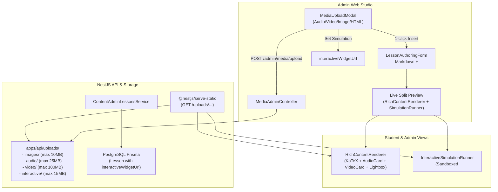

# Rich Media Uploads & Sandboxed Interactive HTML Simulations Implementation Plan

> **For agentic workers:** REQUIRED SUB-SKILL: Use superpowers:subagent-driven-development to implement this plan task-by-task. Steps use checkbox (`- [ ]`) syntax for tracking.

**Goal:** Build end-to-end rich media (audio frequency clips, optics video lectures, image diagrams) and sandboxed interactive HTML physics simulation uploads and execution for Lessons on the poRi platform.

**Architecture:**
Self-hosted local disk storage under `apps/api/uploads/{images,audio,video,interactive}/` served via NestJS static asset delivery (`/uploads/...`) with strict MIME and size validation. Prisma `Lesson` and shared `@pori/shared` contracts are extended with `interactiveWidgetUrl`. Frontend Lesson Studio is equipped with a media upload modal featuring audio/video live preview and 1-click cursor insertion, plus a dedicated simulation slot. Student and reviewer views render custom educational audio player cards, responsive 16:9 videos, zoomable diagrams, and an isolated, sandboxed `<iframe>` runner with fullscreen and reload capabilities.

**Architecture Diagram:**


**Tech Stack:**
- Backend: NestJS 11, Prisma 6, `@nestjs/serve-static`, `multer`, `adm-zip`
- Shared: `@pori/shared` TypeScript types & contracts
- Frontend: Next.js 15, React 19, Lucide React, KaTeX, Vitest, Testing Library

**Spec:** [`docs/superpowers/specs/2026-11-10-rich-media-interactive-html-design.md`](file:///Users/technonext/Desktop/poRi/docs/superpowers/specs/2026-11-10-rich-media-interactive-html-design.md)

## Global Constraints

- Monorepo package boundaries: Rebuild `@pori/shared` whenever `packages/shared/src/**` changes (`pnpm --filter @pori/shared build`).
- TypeScript strictness: `strict: true`, `noImplicitAny: true`, `noUnusedLocals: true`, `noUnusedParameters: true` across all packages.
- Zero credential requirements: Local disk storage only in `apps/api/uploads/`; no cloud S3/R2 keys.
- Sandboxing security: Interactive simulations MUST run in an isolated `<iframe sandbox="allow-scripts allow-same-origin allow-downloads" />` to prevent accessing auth tokens or parent frame DOM.
- Backward compatibility: All existing lesson records without media or simulations must continue rendering without warnings or layout shifts.
- Verification standard: Every task must compile cleanly and pass its test suite; final task must achieve green on monorepo-wide test, lint, and build.

---

### Task 1: Backend Media Upload API, Static File Serving & Schema Extension (`@pori/shared` + `apps/api`)

**Files:**
- Modify: `packages/shared/src/types/content.ts`
- Modify: `apps/api/package.json`
- Modify: `apps/api/prisma/schema.prisma`
- Create: `apps/api/src/modules/media-admin/media-admin.module.ts`
- Create: `apps/api/src/modules/media-admin/media-admin.controller.ts`
- Create: `apps/api/src/modules/media-admin/media-admin.service.ts`
- Modify: `apps/api/src/modules/content-admin/dto/create-lesson-admin.dto.ts`
- Modify: `apps/api/src/modules/content-admin/dto/update-lesson-admin.dto.ts`
- Modify: `apps/api/src/modules/content-admin/content-admin-lessons.service.ts`
- Modify: `apps/api/src/app.module.ts`
- Test: `apps/api/src/modules/media-admin/media-admin.service.spec.ts`
- Test: `apps/api/test/media-admin.e2e.spec.ts`

**Interfaces:**
- Produces:
  - `POST /admin/media/upload`: accepts `multipart/form-data`, returns `MediaUploadResponse { url, originalName, mimeType, size, category }`
  - Static endpoint: `GET /uploads/*` serving files from `apps/api/uploads/`
  - `AdminLessonItem.interactiveWidgetUrl?: string | null`
  - `CreateLessonAdminDto.interactiveWidgetUrl?: string`
  - `UpdateLessonAdminDto.interactiveWidgetUrl?: string | null`

- [ ] **Step 1: Install backend dependencies**
```bash
pnpm --filter @pori/api add @nestjs/serve-static adm-zip
pnpm --filter @pori/api add -D @types/multer @types/adm-zip
```

- [ ] **Step 2: Update shared types in `packages/shared/src/types/content.ts`**
Add `interactiveWidgetUrl?: string | null;` to `AdminLessonItem` and export `MediaUploadResponse`:
```ts
export type MediaCategory = 'IMAGE' | 'AUDIO' | 'VIDEO' | 'INTERACTIVE';

export interface MediaUploadResponse {
  url: string;
  originalName: string;
  mimeType: string;
  size: number;
  category: MediaCategory;
}
```
Rebuild shared package:
```bash
pnpm --filter @pori/shared build
```

- [ ] **Step 3: Update Prisma schema in `apps/api/prisma/schema.prisma`**
Add `interactiveWidgetUrl String?` to `model Lesson`:
```prisma
model Lesson {
  id                   String        @id @default(uuid())
  topicId              String
  topic                Topic         @relation(fields: [topicId], references: [id])
  titleBangla          String
  learningGoal         String
  explanation          String        // Formatted Markdown with KaTeX math & inline media tags
  interactiveWidgetUrl String?       // Optional URL to sandboxed HTML simulation
  importantTerms       Json          // Array of { termBangla, termEnglish, definition }
  workedExample        Json?         // { problem, stepByStepSolution }
  memoryAid            String?
  status               ContentStatus @default(DRAFT)
  version              Int           @default(1)
  createdAt            DateTime      @default(now())
  updatedAt            DateTime      @updatedAt

  @@index([topicId, status])
  @@index([status, updatedAt])
}
```
Sync Prisma client:
```bash
pnpm --filter @pori/api prisma:generate
```

- [ ] **Step 4: Update Lesson DTOs and `ContentAdminLessonsService`**
In `CreateLessonAdminDto`:
```ts
@IsOptional()
@IsString()
interactiveWidgetUrl?: string;
```
In `UpdateLessonAdminDto`:
```ts
@IsOptional()
@ValidateIf((_, value) => value !== null)
@IsString()
interactiveWidgetUrl?: string | null;
```
In `ContentAdminLessonsService`:
Include `interactiveWidgetUrl` in `createLesson` payload and `updateLesson` data handling (allow updating to new string or `null` to clear).

- [ ] **Step 5: Write failing unit test for `MediaAdminService`**
Create `apps/api/src/modules/media-admin/media-admin.service.spec.ts`:
- Tests validating image (PNG/JPEG), audio (MP3/WAV), video (MP4), and interactive HTML/ZIP uploads.
- Tests rejecting oversized files (>10MB for image, >25MB for audio, >100MB for video, >15MB for interactive).
- Tests rejecting invalid MIME types (e.g. `.exe`, `.sh`).
- Tests ZIP archive safe extraction without path traversal (`../`).

- [ ] **Step 6: Implement `MediaAdminService`, `MediaAdminController`, and `MediaAdminModule`**
- Create upload directories on service initialization:
  - `apps/api/uploads/images`
  - `apps/api/uploads/audio`
  - `apps/api/uploads/video`
  - `apps/api/uploads/interactive`
- Handle single file upload with UUID naming.
- For ZIP interactive widgets, extract into `apps/api/uploads/interactive/${uuid}/` and ensure `index.html` exists or return the entry URL.
- Configure `ServeStaticModule.forRoot(...)` in `apps/api/src/app.module.ts`:
  ```ts
  ServeStaticModule.forRoot({
    rootPath: join(process.cwd(), 'uploads'),
    serveRoot: '/uploads',
  }),
  ```

- [ ] **Step 7: Write E2E test in `apps/api/test/media-admin.e2e.spec.ts`**
- Test `POST /admin/media/upload` with `ADMIN` and `EDITOR` authorization tokens (expect 201).
- Test unauthenticated / `REVIEWER` / `STUDENT` tokens (expect 401 / 403).
- Test fetching the uploaded asset via `GET /uploads/audio/...` (expect 200 with proper content-type header).
- Test creating a lesson with `interactiveWidgetUrl` and retrieving it.

- [ ] **Step 8: Run API tests & commit Task 1**
```bash
pnpm --filter @pori/api test
pnpm --filter @pori/api test:e2e
git add packages/shared apps/api
git commit -m "feat(api,shared): add local media upload API, static file serving, and interactiveWidgetUrl schema support"
```

---

### Task 2: Frontend Rich Content & Sandboxed Simulation Components (`apps/web`)

**Files:**
- Create: `apps/web/src/components/content/rich-content-renderer.tsx`
- Create: `apps/web/src/components/content/interactive-simulation-runner.tsx`
- Modify: `apps/web/src/components/admin/lessons/LessonDetailDrawer.tsx`
- Test: `apps/web/tests/rich-content-renderer.test.tsx`
- Test: `apps/web/tests/interactive-simulation-runner.test.tsx`

**Interfaces:**
- Produces:
  - `<RichContentRenderer content={explanation} />`: parses KaTeX math formulas, `<audio controls src="..." title="...">` into styled educational Audio Cards, `<video controls src="...">` into 16:9 responsive video player cards, and images with lightbox zoom.
  - `<InteractiveSimulationRunner widgetUrl={interactiveWidgetUrl} title={lessonTitle} />`: renders responsive container with sandboxed `<iframe>`, fullscreen toggle button, and reset/reload button.

- [ ] **Step 1: Write failing test for `RichContentRenderer`**
Create `apps/web/tests/rich-content-renderer.test.tsx`:
- Tests rendering plain text and KaTeX equations (`$F = ma$`).
- Tests parsing and rendering `<audio controls src="/uploads/audio/low-freq.mp3" title="১০০ Hz কম্পাঙ্ক"></audio>` as an educational Audio Card with play/pause and time display.
- Tests parsing `<video controls src="/uploads/video/optics.mp4" title="প্রতিফলন পরীক্ষা"></video>` as a responsive video player.
- Tests rendering markdown images `` with figure captions and click-to-zoom.

- [ ] **Step 2: Implement `RichContentRenderer`**
In `apps/web/src/components/content/rich-content-renderer.tsx`:
- Split text into tokens: KaTeX math tokens, audio embed tokens, video embed tokens, markdown image tokens, and prose.
- Render educational audio card:
  - Play/pause toggle button with Lucide `Play` / `Pause` icons.
  - Progress bar showing current time and total duration.
  - Title badge with Lucide `Volume2` icon (e.g. "কম কম্পাঙ্কের শব্দ তরঙ্গ - ১০০ Hz").
- Render video card:
  - 16:9 aspect ratio container (`aspect-video`) with native controls, rounded corners, and shadow.
- Render zoomable image:
  - Centered figure with caption.
  - Optional modal lightbox when clicked.

- [ ] **Step 3: Write failing test for `InteractiveSimulationRunner`**
Create `apps/web/tests/interactive-simulation-runner.test.tsx`:
- Asserts `<iframe>` renders with `sandbox="allow-scripts allow-same-origin allow-downloads"`.
- Tests resolving relative `/uploads/...` URLs to API base URL (`http://localhost:3001/uploads/...`).
- Tests clicking "পূর্ণস্ক্রীন (Fullscreen)" toggles container expansion.
- Tests clicking "রিলোড (Reload)" forces iframe refresh via key/src reload.

- [ ] **Step 4: Implement `InteractiveSimulationRunner`**
In `apps/web/src/components/content/interactive-simulation-runner.tsx`:
- Top toolbar:
  - Interactive badge (`⚡ ল্যাব সিমুলেশন`)
  - Simulation title
  - Fullscreen toggle button (`Maximize2` / `Minimize2`)
  - Reload button (`RotateCcw`)
- Responsive iframe container with subtle border and loading skeleton.

- [ ] **Step 5: Integrate into `LessonDetailDrawer.tsx`**
Update `apps/web/src/components/admin/lessons/LessonDetailDrawer.tsx`:
- Replace raw `<LatexRenderer />` explanation with `<RichContentRenderer />`.
- When `lesson.interactiveWidgetUrl` is present, render `<InteractiveSimulationRunner />` below the learning goal before the explanation.

- [ ] **Step 6: Run tests and commit Task 2**
```bash
pnpm --filter @pori/web test tests/rich-content-renderer.test.tsx tests/interactive-simulation-runner.test.tsx
git add apps/web/src/components/content apps/web/src/components/admin/lessons/LessonDetailDrawer.tsx apps/web/tests
git commit -m "feat(web): add RichContentRenderer and InteractiveSimulationRunner components with drawer integration"
```

---

### Task 3: Admin Studio Media Toolbar & Interactive Upload Integration (`apps/web`)

**Files:**
- Create: `apps/web/src/components/admin/lessons/MediaUploadModal.tsx`
- Modify: `apps/web/src/components/admin/lessons/LessonAuthoringForm.tsx`
- Modify: `apps/web/src/components/admin/lessons/LessonAuthoringStudio.tsx`
- Modify: `apps/web/src/components/admin/authoring-helpers.ts`
- Test: `apps/web/tests/admin-media-upload.test.tsx`
- Test: `apps/web/tests/admin-lessons-studio.test.tsx`

**Interfaces:**
- Consumes:
  - `POST /admin/media/upload` from Task 1
  - `<RichContentRenderer />` & `<InteractiveSimulationRunner />` from Task 2
- Produces:
  - `MediaUploadModal`: handles drag-and-drop file uploads, previews media, and triggers `onInsertTag(tagString)` or `onSelectSimulation(url)`
  - `LessonAuthoringForm`: includes toolbar buttons and interactive simulation upload section

- [ ] **Step 1: Write failing test for `MediaUploadModal`**
Create `apps/web/tests/admin-media-upload.test.tsx`:
- Tests opening modal with categories: Image, Audio, Video, Simulation.
- Tests selecting file calls `apiClient.post('/admin/media/upload', formData, { scope: 'admin' })`.
- Tests audio preview renders audio element when upload succeeds.
- Tests clicking "ইনসার্ট করুন" calls `onInsertTag` with correct markdown/HTML tag.
- Tests simulation upload calls `onSelectSimulation(url)`.

- [ ] **Step 2: Implement `MediaUploadModal.tsx`**
In `apps/web/src/components/admin/lessons/MediaUploadModal.tsx`:
- Tab/Category selector: `ছবি (Image)`, `অডিও (Audio)`, `ভিডিও (Video)`, `সিমুলেশন (Interactive)`.
- Drag-and-drop file dropzone with size instructions.
- Upload progress / loading spinner.
- In-modal preview:
  - Audio: waveform / audio controls to test sound clips.
  - Video: video player preview.
  - Image: thumbnail with dimensions.
  - Interactive: sandbox frame preview.
- Asset title input (for Bengali caption / title attribute).
- 1-Click insertion action:
  - Audio tag: `<audio controls src="${res.url}" title="${title}"></audio>`
  - Video tag: `<video controls src="${res.url}" title="${title}"></video>`
  - Image tag: ``

- [ ] **Step 3: Update `LessonAuthoringForm.tsx`**
- Add toolbar above explanation textarea:
  - `[ 📷 ছবি যোগ ] [ 🎵 অডিও ক্লিপ ] [ 🎥 ভিডিও লেকচার ] [ ⚡ সিমুলেশন ফাইল ]`
  - Clicking any button opens `MediaUploadModal` pre-selected to that category.
  - Text insertion helper inserts tag at the current cursor position in the explanation textarea.
- Add dedicated "ইন্টারেক্টিভ সিমুলেশন (Interactive HTML Widget)" section below explanation:
  - File upload / URL input for `interactiveWidgetUrl`.
  - Preview card with `<InteractiveSimulationRunner />`.
  - Remove / Clear button.

- [ ] **Step 4: Update `authoring-helpers.ts` & `LessonAuthoringStudio.tsx`**
In `authoring-helpers.ts`:
- Update `createInitialLessonFormState` to include `interactiveWidgetUrl: initialLesson?.interactiveWidgetUrl || ''`.
- Update `buildLessonPayload` and `buildLessonEditPayload` to pass `interactiveWidgetUrl: formState.interactiveWidgetUrl || null`.
In `LessonAuthoringStudio.tsx`:
- Live split preview panel renders `<RichContentRenderer />` for explanation and `<InteractiveSimulationRunner />` for simulation.

- [ ] **Step 5: Run tests & commit Task 3**
```bash
pnpm --filter @pori/web test tests/admin-media-upload.test.tsx tests/admin-lessons-studio.test.tsx
git add apps/web/src/components/admin/lessons apps/web/src/components/admin/authoring-helpers.ts apps/web/tests
git commit -m "feat(web): add MediaUploadModal toolbar and interactive simulation authoring to LessonStudio"
```

---

### Task 4: Student Lesson Integration, Seed Content & Full Monorepo Verification

**Files:**
- Modify: `apps/web/src/app/lesson/[topicId]/page.tsx` (or student lesson viewer component)
- Modify: `apps/api/prisma/seed.ts`
- Test: Full monorepo verification suite

- [ ] **Step 1: Update Student Lesson View**
In `apps/web/src/app/lesson/[topicId]/page.tsx`:
- Replace raw text rendering with `<RichContentRenderer content={lesson.explanation} />`.
- When `lesson.interactiveWidgetUrl` exists, render `<InteractiveSimulationRunner widgetUrl={lesson.interactiveWidgetUrl} title={lesson.titleBangla} />`.

- [ ] **Step 2: Update Seed Script with Rich Sample Physics Lesson**
In `apps/api/prisma/seed.ts`:
- Create sample assets in `apps/api/uploads/`:
  - A sample interactive HTML wave simulation widget (`uploads/interactive/sound-wave-simulator.html`).
  - Sample audio files (sound frequency wave clips).
- Seed a lesson under SSC Physics (e.g. "শব্দ ও তরঙ্গ" or "গতির সমীকরণ") with:
  - KaTeX mathematical derivations
  - Embedded audio frequency comparisons (`<audio controls src="/uploads/audio/..." title="কম্পাঙ্ক পরীক্ষা"></audio>`)
  - Interactive HTML simulation link (`/uploads/interactive/sound-wave-simulator.html`)

- [ ] **Step 3: Run Database Push & Seed**
```bash
pnpm --filter @pori/api prisma db push
pnpm --filter @pori/api prisma:seed
```

- [ ] **Step 4: Full Monorepo Verification**
Run all tests, linters, and production builds:
```bash
pnpm --filter @pori/shared build
pnpm -r test
pnpm --filter @pori/api test:e2e
pnpm -r lint
pnpm -r build
```

- [ ] **Step 5: Commit Task 4**
```bash
git add apps/web/src/app/lesson apps/api/prisma/seed.ts apps/api/uploads
git commit -m "feat(web,seed): integrate rich media in student lesson view and seed interactive physics simulation"
```
