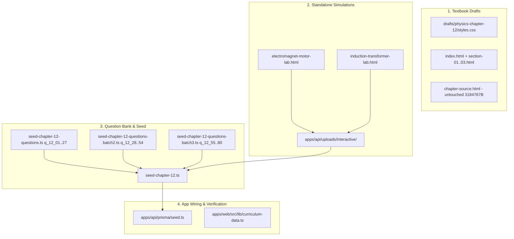

# SSC Physics Chapter 12 Elevation Implementation Plan

> **For agentic workers:** REQUIRED SUB-SKILL: Use superpowers:subagent-driven-development (recommended) or superpowers:executing-plans to implement this plan task-by-task. Steps use checkbox (`- [ ]`) syntax for tracking.

**Goal:** Elevate SSC Physics Chapter 12 (`বিদ্যুতের চৌম্বক ক্রিয়া / Magnetic Effects of Current`) across interactive textbook drafts, two standalone HTML simulations, an 80-question verified database bank, and web curriculum metadata to match the Chapters 6–11 production standard.

**Architecture:** Four sequential/parallel workstreams converge into one verified seed: upgrading the static Bengali HTML textbook sections in `drafts/physics-chapter-12/`, building two offline unified interactive laboratories synced to both `sample-simulations/` and `uploads/interactive/`, authoring 80 Bengali SSC questions (68 MCQs + 12 CQs) across three TypeScript batches (`seed-chapter-12-questions*.ts`), and registering `chap_ssc_physics_ch12` in `seed.ts` and `curriculum-data.ts`.

**Architecture Diagram:**



**Tech Stack:** Static HTML5/CSS3/SVG + KaTeX `0.16.8`, Vanilla JS offline simulations (`PORI UNIFIED SIMULATOR THEME`), TypeScript, Prisma ORM + PostgreSQL (`tsx`), Next.js `curriculum-data.ts`.

**Spec:** [2026-11-11-physics-chapter-12-design.md](file:///Users/technonext/Desktop/poRi/docs/superpowers/specs/2026-11-11-physics-chapter-12-design.md)

## Global Constraints
- `chapter-source.html` (`3184767` bytes, 17 scanned PDF pages) must remain completely untouched.
- Chapters 1–11 files must not be modified.
- Draft HTML files must load KaTeX `0.16.8` (`cdn.jsdelivr.net/npm/katex@0.16.8`) with zero Sinhala (`\u0D80-\u0DFF`), Burmese (`\u1000-\u109F`), or Armenian (`\u0530-\u058F`) OCR glitches and no `$` inside SVG `<text>`.
- Standalone simulations must work 100% offline (zero external CDNs), include `PORI UNIFIED SIMULATOR THEME` + `PORI UNIFIED RANGE SYNC`, have matching copies in both `apps/api/prisma/sample-simulations/` and `apps/api/uploads/interactive/`, and use Unicode symbols instead of `$...$` in SVG `<text>` and `<option>`.
- Every TypeScript LaTeX string must use double-escaped backslashes (`\\text`, `\\frac`, `\\times`) so zero raw control characters appear, and `seed-chapter-12.ts` must reference `subjectId: 'sub_ssc_physics'` directly without re-upserting `Subject`.

## Review Focus
1. **OCR glitch leak (`সমমերু`)**: Existing `section-01.html` contains Armenian `ե` (`\u0565`); validator checks `[\u0530-\u058F\u0D80-\u0DFF\u1000-\u109F]` across all drafts and all 80 questions.
2. **Transformer zero-division & DC trap (`induction-transformer-lab.html`)**: Primary/secondary turns clamped ($\ge 50$), load resistance clamped ($\ge 5\,\Omega$), and DC input mode must explicitly show $0\,\text{V}$ steady-state induced secondary voltage with a warning badge.
3. **JS template literals vs unrendered LaTeX `$`**: Simulation validator strips `${...}` before scanning `<text>` and `<option>` so real `$...$` leaks are caught without false positives.
4. **Control chars in TS strings (`\f`, `\t`, `\r`, `\b`)**: Runtime question validator fails on any `[\x00-\x08\x0B\x0C\x0E-\x1F]` or unbalanced `$` / `$$`.
5. **Strict Prisma `Lesson` & `QuestionData` shapes**: `boardSource` at top level (not inside `explanation`), `textbookCitation` inside `explanation` as object, `cqRubric.ka..gha` as `{ mark, criteria }`, enforced by `tsc --noEmit` and live DB seed.

---

### Task 1: Elevate Textbook Drafts & Styles (`drafts/physics-chapter-12/`)

**Files:**
- Modify: [styles.css](file:///Users/technonext/Desktop/poRi/drafts/physics-chapter-12/styles.css#L160-L169)
- Modify: [index.html](file:///Users/technonext/Desktop/poRi/drafts/physics-chapter-12/index.html)
- Modify: [section-01.html](file:///Users/technonext/Desktop/poRi/drafts/physics-chapter-12/section-01.html)
- Modify: [section-02.html](file:///Users/technonext/Desktop/poRi/drafts/physics-chapter-12/section-02.html)
- Modify: [section-03.html](file:///Users/technonext/Desktop/poRi/drafts/physics-chapter-12/section-03.html)
- Test: Scratch static validator `validate-ch12.js`

**Interfaces:**
- Produces: Static Bengali textbook modules `section-01.html`..`section-03.html` with inline SVG `.lab` widgets in all 3 sections and untouched `chapter-source.html`.

- [ ] **Step 1: Append responsive `.stats`, `.stat`, `.check ol`, and `figure.visual` rules to `styles.css`**

Preserve lines 1–169 of [styles.css](file:///Users/technonext/Desktop/poRi/drafts/physics-chapter-12/styles.css) (skeuomorphic slider + `.lab-iframe-card`) and append the card/figure layout rules used in Chapter 11.

- [ ] **Step 2: Upgrade `index.html`, `section-01.html`, `section-02.html`, and `section-03.html`**

Add KaTeX `0.16.8` stylesheet + auto-render script, replace the Armenian OCR glitch (`সমমերু` -> `সমমেরু`), structure each section cleanly with `.goal`, `.grid > .term`, `.highlight-box`, `.table-wrap`, `.worked`, `.memory`, `details.check`, high-contrast responsive `<svg>` diagrams (zero `$` inside `<text>`), and inline interactive `.lab` widgets (Magnet Polarity & Field Lab in `section-01.html`, Solenoid/Electromagnet Force Lab in `section-02.html`, Transformer Voltage & Turns Lab in `section-03.html`).

- [ ] **Step 3: Write `validate-ch12.js` and verify draft checks pass (once Task 2 simulations exist, re-run full check)**

Check `chapter-source.html` size === `3184767`, KaTeX `0.16.8` presence, zero `[\u0530-\u058F\u0D80-\u0DFF\u1000-\u109F]`, balanced `$`/`$$`, `<svg>` and `.lab` in `section-01..03.html`, and zero `$` in `<text>`.

---

### Task 2: Build 2 Standalone Interactive Simulations

**Files:**
- Create: [electromagnet-motor-lab.html](file:///Users/technonext/Desktop/poRi/apps/api/prisma/sample-simulations/electromagnet-motor-lab.html)
- Create: [induction-transformer-lab.html](file:///Users/technonext/Desktop/poRi/apps/api/prisma/sample-simulations/induction-transformer-lab.html)
- Mirror: Copy both into `/Users/technonext/Desktop/poRi/apps/api/uploads/interactive/`

**Interfaces:**
- Produces: Interactive widget URLs `/uploads/interactive/electromagnet-motor-lab.html` and `/uploads/interactive/induction-transformer-lab.html` referenced by Task 4.

- [ ] **Step 1: Implement `electromagnet-motor-lab.html`**

Include `PORI UNIFIED SIMULATOR THEME` light-card layout and `PORI UNIFIED RANGE SYNC`. Provide mode switch (`তড়িৎচুম্বক ও সলিনয়েড` vs `DC মোটর ও ফ্লেমিং বল`), turns $N$ (`50–500`), current $I$ (`0.5–10 A`), core material (`বায়ু`, `নরম লোহা`), polarity toggle, live SVG coil/motor animation, relative magnetic field strength, and force direction readout.

- [ ] **Step 2: Implement `induction-transformer-lab.html`**

Provide mode switch (`তড়িৎচৌম্বকীয় আবেশ` vs `ট্রান্সফরমার`), primary source selector (`AC উৎস` vs `স্থির DC উৎস`), primary voltage $V_p$ (`12–240 V`), primary turns $N_p$ (`50–1000`), secondary turns $N_s$ (`50–1000`), and load resistance $R_L$ (`5–100 Ω`). Compute ideal $V_s = V_p (N_s / N_p)$ (or $0\,\text{V}$ steady-state in DC mode with explicit textbook warning), $I_s = V_s / R_L$, $I_p = (N_s / N_p) I_s$, $P = V_s I_s$, and `Step-Up` / `Step-Down` badge.

- [ ] **Step 3: Copy both HTML files to `apps/api/uploads/interactive/` and run `node validate-ch12.js`**

Expected: Exit `0` (`OK: All Chapter 12 draft HTML & simulation checks passed!`).

---

### Task 3: Author 80-Question SSC Question Bank (`q_12_01`–`q_12_80`)

**Files:**
- Create: [seed-chapter-12-questions.ts](file:///Users/technonext/Desktop/poRi/apps/api/prisma/seed-chapter-12-questions.ts) (`chapter12QuestionsBatch1`: `q_12_01`–`q_12_27`, 23 MCQs + 4 CQs)
- Create: [seed-chapter-12-questions-batch2.ts](file:///Users/technonext/Desktop/poRi/apps/api/prisma/seed-chapter-12-questions-batch2.ts) (`chapter12QuestionsBatch2`: `q_12_28`–`q_12_54`, 23 MCQs + 4 CQs)
- Create: [seed-chapter-12-questions-batch3.ts](file:///Users/technonext/Desktop/poRi/apps/api/prisma/seed-chapter-12-questions-batch3.ts) (`chapter12QuestionsBatch3`: `q_12_55`–`q_12_80`, 22 MCQs + 4 CQs)

**Interfaces:**
- Consumes: `QuestionData` from [seed-chapter-7-questions.ts](file:///Users/technonext/Desktop/poRi/apps/api/prisma/seed-chapter-7-questions.ts#L5-L34).
- Produces: `chapter12QuestionsBatch1`, `chapter12QuestionsBatch2`, `chapter12QuestionsBatch3` (total `80`: `68` MCQ + `12` `CQ_CREATIVE`) mapped evenly across `top_ssc_physics_ch12_1`–`4`.

- [ ] **Step 1: Write `seed-chapter-12-questions.ts` (Batch 1: Topics 12.1 & 12.2.1–12.2.2)**

Cover magnets, poles, magnetic field lines, compass behavior, Oersted/circular magnetic field, right-hand grip rule, solenoid, and electromagnets (23 MCQs + 4 CQs with full `cqRubric.ka..gha`).

- [ ] **Step 2: Write `seed-chapter-12-questions-batch2.ts` (Batch 2: Topics 12.2.3–12.2.4)**

Cover magnetic force on current-carrying wire, Fleming's Left-Hand Rule, commutator function, split-ring vs slip-ring concepts, DC motor energy conversion, and torque factors (23 MCQs + 4 CQs).

- [ ] **Step 3: Write `seed-chapter-12-questions-batch3.ts` (Batch 3: Topic 12.3 Induction, Generator & Transformer)**

Cover Faraday electromagnetic induction, galvanometer deflection, AC vs DC generators, step-up/step-down transformer calculations ($V_s/V_p = N_s/N_p = I_p/I_s$), $P_{\text{in}} = P_{\text{out}}$, high-voltage power transmission, and why transformers require AC (22 MCQs + 4 CQs).

---

### Task 4: Create `seed-chapter-12.ts`, Wire `seed.ts` & `curriculum-data.ts`, and Verify End-to-End

**Files:**
- Create: [seed-chapter-12.ts](file:///Users/technonext/Desktop/poRi/apps/api/prisma/seed-chapter-12.ts)
- Modify: [seed.ts](file:///Users/technonext/Desktop/poRi/apps/api/prisma/seed.ts)
- Modify: [curriculum-data.ts](file:///Users/technonext/Desktop/poRi/apps/web/src/lib/curriculum-data.ts)
- Test: Scratch runtime validator `validate-ch12-questions.ts`

**Interfaces:**
- Consumes: `chapter12QuestionsBatch1..3` from Task 3 and simulation URLs from Task 2.
- Produces: `export async function seedChapter12(prisma: PrismaClient)` and `export const chapter12AllQuestions`.

- [ ] **Step 1: Create `seed-chapter-12.ts` with 4 topics, 4 rich Bengali lessons, and 80-question upsert loop**

Set `interactiveWidgetUrl: '/uploads/interactive/electromagnet-motor-lab.html'` on `les_ssc_physics_ch12_2` & `les_ssc_physics_ch12_3` (or `les_ssc_physics_ch12_3`) and `/uploads/interactive/induction-transformer-lab.html` on `les_ssc_physics_ch12_4`. Pass `subjectId: 'sub_ssc_physics'` directly in `prisma.chapter.upsert`.

- [ ] **Step 2: Register `seedChapter12` in `seed.ts` and `chap_ssc_physics_ch12` + `findTopicHierarchy` fallback in `curriculum-data.ts`**

Match keywords `ch12`, `magnet`, `solenoid`, `electromagnet`, `motor`, `generator`, `transformer`, `induction`, `chumbok` in `findTopicHierarchy`.

- [ ] **Step 3: Write `validate-ch12-questions.ts` and run full verification + DB seed**

Run:
```bash
node /Users/technonext/.gemini/antigravity/brain/b1487276-21d4-4a33-9276-882b6c44a9b2/scratch/validate-ch12.js
pnpm --filter api exec tsx /Users/technonext/.gemini/antigravity/brain/b1487276-21d4-4a33-9276-882b6c44a9b2/scratch/validate-ch12-questions.ts
pnpm --filter api exec tsc --noEmit
pnpm --filter web exec tsc --noEmit
pnpm --filter api exec tsx prisma/seed-chapter-12.ts
```
Expected: All 5 commands exit `0`, printing `OK: All 80 Chapter 12 questions passed validation!` and `✅ Chapter 12 seeded (80 verified questions).`.
