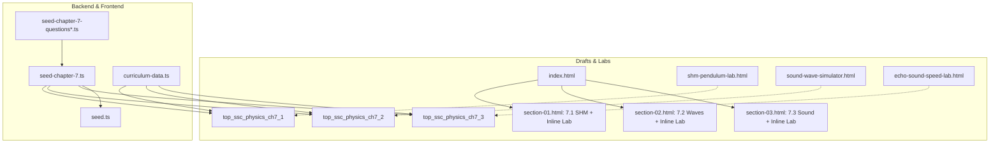

# SSC Physics Chapter 7 (তরঙ্গ ও শব্দ / Waves and Sound) Full Elevation Implementation Plan

> **For agentic workers:** REQUIRED SUB-SKILL: Use superpowers:subagent-driven-development (recommended) or superpowers:executing-plans to implement this plan task-by-task. Steps use checkbox (`- [ ]`) syntax for tracking.

**Goal:** Elevate SSC Physics Chapter 7 (*তরঙ্গ ও শব্দ*) to match Chapters 5–6 in Bengali pedagogical depth, KaTeX precision, interactive simulations, Prisma curriculum/question-bank seeding, and frontend curriculum wiring.

**Architecture:**
1. **Curriculum Drafts (`drafts/physics-chapter-7/`):** Upgrade `index.html` and `section-01.html`–`section-03.html` with KaTeX `0.16.8`, structured components, worked mathematical problems, mnemonics, self-checks, and inline interactive labs.
2. **Interactive Simulation Labs (`apps/api/prisma/sample-simulations/`):** Build `shm-pendulum-lab.html` and `echo-sound-speed-lab.html` in the unified `poRi` simulator theme alongside existing `sound-wave-simulator.html`.
3. **Backend Prisma Curriculum & Question Bank (`apps/api/prisma/`):** Seed 3 topics/lessons in `seed-chapter-7.ts` and 78 verified SSC questions across `seed-chapter-7-questions.ts`, `seed-chapter-7-questions-batch2.ts`, and `seed-chapter-7-questions-batch3.ts`, wired into `seed.ts`.
4. **Frontend Curriculum Data (`apps/web/src/lib/curriculum-data.ts`):** Register `chap_ssc_physics_ch7` and its topic hierarchy heuristic.

**Architecture Diagram:**

**Tech Stack:** HTML5, CSS3, KaTeX CDN (`katex@0.16.8`), SVG, Vanilla ES6 JS, TypeScript, Prisma ORM, Node.js.

**Spec:** [2026-11-11-physics-chapter-7-design.md](file:///Users/technonext/Desktop/poRi/docs/superpowers/specs/2026-11-11-physics-chapter-7-design.md)

## Global Constraints
- Preserve `chapter-source.html` and Chapters 1–6 untouched.
- Every section HTML must load KaTeX `0.16.8` CSS + JS + auto-render, use `styles.css`, and include `.goal`, `.grid > .term`, `.highlight-box`, `.worked > .problem + .solution`, `.note`, `.memory`, `details.check`, `.nav`, and `.footer`.
- Standalone simulations must include the `PORI UNIFIED SIMULATOR THEME` CSS block and `PORI UNIFIED RANGE SYNC` script.
- Every MCQ must have exactly 4 options with 1 `isCorrect: true`; every `CQ_CREATIVE` must include `cqRubric` (`ka`, `kha`, `ga`, `gha`).

## Review Focus
- Unbalanced `$` or `$$` KaTeX delimiters or unescaped LaTeX backslashes inside JS template strings in `seed-chapter-7*.ts`.
- Broken anchor links between `index.html` and `#sub-7-2-*` / `#sub-7-3-*` in `section-02.html` and `section-03.html`.
- Division-by-zero or NaN edge cases in interactive lab sliders ($f > 0$, $\ell > 0$, $k > 0$, $T_K > 0$).
- Duplicate question IDs or option IDs across the 3 question-bank batches.
- Missing `ch7` fallback in `findTopicHierarchy()` causing Chapter 7 topics to fall back to Chapter 2.

---

### Task 1: Upgrade Chapter 7 Drafts (`index.html`, `section-01.html`–`section-03.html`)

**Files:**
- Modify: `drafts/physics-chapter-7/index.html`
- Modify: `drafts/physics-chapter-7/section-01.html`
- Modify: `drafts/physics-chapter-7/section-02.html`
- Modify: `drafts/physics-chapter-7/section-03.html`

- [ ] **Step 1:** Upgrade `index.html` with indigo/violet wave hero, 4 stat cards, 3 detailed roadmap cards with `#sub-*` links, and source card.
- [ ] **Step 2:** Upgrade `section-01.html` (7.1 সরল স্পন্দন গতি) with KaTeX, full SHM & pendulum derivations, inline interactive SHM Pendulum & Spring lab, 3 worked problems, memory aid, and self-checks.
- [ ] **Step 3:** Upgrade `section-02.html` (7.2 তরঙ্গ) with KaTeX, 7.2.1–7.2.3 full coverage, transverse/longitudinal comparison table, upgraded interactive Wave Lab (mode toggle + presets + live SVG), 3 worked problems, memory aid, and self-checks.
- [ ] **Step 4:** Upgrade `section-03.html` (7.3 শব্দ তরঙ্গ) with KaTeX, 7.3.1–7.3.5 full coverage, inline Echo & Sound Speed lab, 3 worked problems, decibel table, memory aid, and self-checks.

---

### Task 2: Build Standalone Chapter 7 Simulation Labs

**Files:**
- Create: `apps/api/prisma/sample-simulations/shm-pendulum-lab.html`
- Create: `apps/api/prisma/sample-simulations/echo-sound-speed-lab.html`
- Reference: `apps/api/prisma/sample-simulations/sound-wave-simulator.html`

- [ ] **Step 1:** Build `shm-pendulum-lab.html` with Pendulum / Spring-Mass toggle, presets, live SVG animation, $T, f, \omega$ breakdown, and PORI unified simulator theme + range sync.
- [ ] **Step 2:** Build `echo-sound-speed-lab.html` with Air/Water/Iron medium selector, temperature & distance sliders, animated sound wave pulse + echo reflection, $0.1\text{ s}$ audibility readout, and PORI unified theme + range sync.

---

### Task 3: Write Chapter 7 Question Bank (78 Questions across 3 Batches)

**Files:**
- Create: `apps/api/prisma/seed-chapter-7-questions.ts`
- Create: `apps/api/prisma/seed-chapter-7-questions-batch2.ts`
- Create: `apps/api/prisma/seed-chapter-7-questions-batch3.ts`

- [ ] **Step 1:** Write Batch 1 (26 questions: MCQs + CQs for 7.1 & 7.2).
- [ ] **Step 2:** Write Batch 2 (26 questions: MCQs + CQs for 7.2 & 7.3).
- [ ] **Step 3:** Write Batch 3 (26 questions: Hard/Board analytical MCQs + CQs across 7.1–7.3) and export combined `chapter7Questions` from `seed-chapter-7-questions.ts`.

---

### Task 4: Write `seed-chapter-7.ts` and Wire Backend + Frontend

**Files:**
- Create: `apps/api/prisma/seed-chapter-7.ts`
- Modify: `apps/api/prisma/seed.ts`
- Modify: `apps/web/src/lib/curriculum-data.ts`

- [ ] **Step 1:** Implement `seedChapter7(prisma)` upserting `chap_ssc_physics_ch7`, 3 topics, 3 lessons with `interactiveWidgetUrl`, and all 78 questions.
- [ ] **Step 2:** Register `seedChapter7` in `apps/api/prisma/seed.ts`.
- [ ] **Step 3:** Add `chap_ssc_physics_ch7` to `DEFAULT_CHAPTERS` and `findTopicHierarchy` in `apps/web/src/lib/curriculum-data.ts`.

---

### Task 5: Full Validation & TypeScript Verification

- [ ] **Step 1:** Run automated Node.js validator script across drafts, simulations, and question bank.
- [ ] **Step 2:** Run `pnpm --filter api exec tsc --noEmit` and `pnpm --filter web exec tsc --noEmit`.
