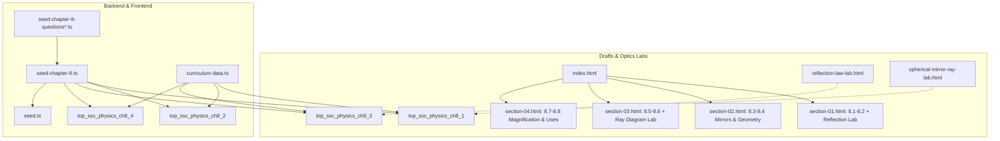

# SSC Physics Chapter 8 (আলোর প্রতিফলন / Reflection of Light) Full Elevation Implementation Plan

> **For agentic workers:** REQUIRED SUB-SKILL: Use superpowers:subagent-driven-development (recommended) or superpowers:executing-plans to implement this plan task-by-task. Steps use checkbox (`- [ ]`) syntax for tracking.

**Goal:** Elevate SSC Physics Chapter 8 (*আলোর প্রতিফলন*) to match Chapters 5–7 with KaTeX study drafts, interactive optics simulations, Prisma curriculum/question-bank seeds, and frontend curriculum wiring.

**Architecture:**
1. **Curriculum Drafts (`drafts/physics-chapter-8/`):** Upgrade `styles.css`, `index.html`, and `section-01.html`–`section-04.html` with KaTeX `0.16.8`, pedagogical callouts, worked math/optics problems, and inline interactive SVG labs in Sections 8.1–8.2 and 8.5–8.6.
2. **Interactive Simulation Labs (`apps/api/prisma/sample-simulations/`):** Build `reflection-law-lab.html` and `spherical-mirror-ray-lab.html` in the unified `poRi` simulator theme.
3. **Backend Prisma Curriculum & Question Bank (`apps/api/prisma/`):** Seed 4 topics/lessons in `seed-chapter-8.ts` and 80 verified SSC questions across `seed-chapter-8-questions.ts`, `seed-chapter-8-questions-batch2.ts`, and `seed-chapter-8-questions-batch3.ts`, wired into `seed.ts`.
4. **Frontend Curriculum Data (`apps/web/src/lib/curriculum-data.ts`):** Register `chap_ssc_physics_ch8` and its topic hierarchy heuristic.

**Architecture Diagram:**

**Tech Stack:** HTML5, CSS3, KaTeX CDN (`katex@0.16.8`), SVG, Vanilla ES6 JS, TypeScript, Prisma ORM, Node.js.

**Spec:** [2026-11-11-physics-chapter-8-design.md](file:///Users/technonext/Desktop/poRi/docs/superpowers/specs/2026-11-11-physics-chapter-8-design.md)

## Global Constraints
- Preserve `chapter-source.html`, `assets/`, and Chapters 1–7 untouched.
- Every section HTML must load KaTeX `0.16.8` CSS + JS + auto-render and include `.goal`, `.grid > .term`, `.highlight-box`, `.worked > .problem + .solution`, `.note`, `.memory`, `details.check`, `.nav`, and `.footer`.
- Standalone simulations must include the `PORI UNIFIED SIMULATOR THEME` styling and `PORI UNIFIED RANGE SYNC` script.
- Every MCQ must have 4 options with 1 `isCorrect: true`; every `CQ_CREATIVE` must include `cqRubric` (`ka`, `kha`, `ga`, `gha`).

## Review Focus
- Correct sign-convention math in mirror equation ($\frac{1}{u} + \frac{1}{v} = \frac{1}{f}$) and magnification ($m = -\frac{v}{u}$) across worked examples and questions.
- Handling $u = f$ (image at infinity, parallel reflected rays) in `spherical-mirror-ray-lab.html` and `section-03.html` without `Infinity` or `NaN` SVG coordinates.
- Unbalanced `$` / `$$` KaTeX delimiters or unescaped LaTeX backslashes in JS template literals.
- Duplicate question IDs or option IDs across the 3 question-bank batches.
- Missing `ch8` fallback in `findTopicHierarchy()`.

---

### Task 1: Upgrade Chapter 8 `styles.css`, `index.html`, and `section-01.html`–`section-04.html`
- [ ] **Step 1:** Upgrade `styles.css` with `.memory`, `.lab`, `.preset-row`, `.calc-breakdown`, `.table-wrap`, and skeuomorphic slider styles.
- [ ] **Step 2:** Upgrade `index.html` with optical-blue hero, 4 stat cards, 4 detailed roadmap cards, and source card.
- [ ] **Step 3:** Upgrade `section-01.html` (8.1–8.2) with KaTeX, spectrum table, laws of reflection, inline Reflection Lab, 3 worked problems, memory aid, and self-checks.
- [ ] **Step 4:** Upgrade `section-02.html` (8.3–8.4) with KaTeX, real/virtual comparison, plane mirror properties ($H/2$, $2\theta$), spherical mirror geometry ($f = R/2$), 3 worked problems, memory aid, and self-checks.
- [ ] **Step 5:** Upgrade `section-03.html` (8.5–8.6) with KaTeX, convex & concave image formation table, mirror formula, inline Ray Diagram Lab (safe $u = f$ guard), 3 worked problems, memory aid, and self-checks.
- [ ] **Step 6:** Upgrade `section-04.html` (8.7–8.8) with KaTeX, magnification formula & sign convention, mirror uses (including blind turns), 3 worked problems, memory aid, and self-checks.

### Task 2: Build Standalone Chapter 8 Simulation Labs
- [ ] **Step 1:** Create `apps/api/prisma/sample-simulations/reflection-law-lab.html`.
- [ ] **Step 2:** Create `apps/api/prisma/sample-simulations/spherical-mirror-ray-lab.html`.

### Task 3: Write Chapter 8 Question Bank (80 Questions across 3 Batches)
- [ ] **Step 1:** Create `seed-chapter-8-questions.ts` (Batch 1: 26 questions, 8.1–8.4) + combined export.
- [ ] **Step 2:** Create `seed-chapter-8-questions-batch2.ts` (Batch 2: 26 questions, 8.5–8.8).
- [ ] **Step 3:** Create `seed-chapter-8-questions-batch3.ts` (Batch 3: 28 analytical/board questions, 8.1–8.8).

### Task 4: Write `seed-chapter-8.ts` and Wire Backend + Frontend
- [ ] **Step 1:** Create `apps/api/prisma/seed-chapter-8.ts`.
- [ ] **Step 2:** Register `seedChapter8` in `apps/api/prisma/seed.ts`.
- [ ] **Step 3:** Register `chap_ssc_physics_ch8` and heuristic in `apps/web/src/lib/curriculum-data.ts`.

### Task 5: Validate & Typecheck
- [ ] **Step 1:** Run automated Node.js validator script across drafts, simulations, and question bank.
- [ ] **Step 2:** Run `pnpm --filter api exec tsc --noEmit`, `pnpm --filter web exec tsc --noEmit`, and `tsx` runtime import check.
