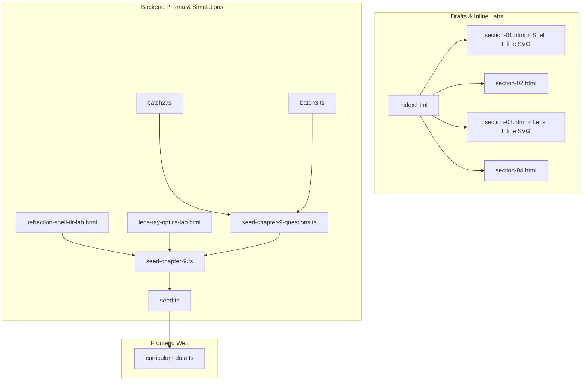

# SSC Physics Chapter 9 Elevation Implementation Plan

> **For agentic workers:** REQUIRED SUB-SKILL: Use superpowers:subagent-driven-development (recommended) or superpowers:executing-plans to implement this plan task-by-task. Steps use checkbox (`- [ ]`) syntax for tracking.

**Goal:** Elevate SSC Physics Chapter 9 (*আলোর প্রতিসরণ / Refraction of Light*) with KaTeX study drafts, inline & standalone SVG physics labs, an 80-question verified bank, Prisma seeds, and frontend curriculum wiring.

**Architecture:** Chapter 9 mirrors the Chapter 6–8 layout: 4 structured HTML lessons (`section-01..04.html`) plus an optical-cyan landing index (`index.html`), 2 standalone `poRi` simulations (`refraction-snell-tir-lab.html`, `lens-ray-optics-lab.html`), 3 Prisma question-bank batch files (~80 questions) seeded via `seed-chapter-9.ts`, and frontend hierarchy registration in `curriculum-data.ts`.

**Architecture Diagram:**

**Tech Stack:** HTML5/CSS3, KaTeX 0.16.8, Vanilla ES6 + SVG, TypeScript, Prisma ORM, Next.js curriculum helpers.

**Spec:** `docs/superpowers/specs/2026-11-11-physics-chapter-9-design.md`

## Global Constraints

- Preserve Chapters 1–8, `drafts/physics-chapter-9/chapter-source.html`, and `drafts/physics-chapter-9/assets/` untouched.
- Every standalone simulation must include `PORI UNIFIED SIMULATOR THEME` and `PORI UNIFIED RANGE SYNC`.
- Guard thin lens simulation explicitly against $u = f$ (`Math.abs(u - fMag) < 0.01`) to avoid divide-by-zero SVG `Infinity`/`NaN`.
- Every MCQ has exactly 4 unique option IDs (`opt_9_...`) and 1 `isCorrect: true`; every `CQ_CREATIVE` has `options: null` and complete `cqRubric: { ka, kha, ga, gha }`.

---

### Tasks

- [x] **Task 1:** Write spec & implementation plan (`docs/superpowers/specs/2026-11-11-physics-chapter-9-design.md` and `docs/superpowers/plans/2026-11-11-physics-chapter-9-elevation.md`).
- [ ] **Task 2:** Upgrade `drafts/physics-chapter-9/index.html` and `section-01.html`–`section-04.html` (preserving/polishing `styles.css`, fixing Sinhala corruption in `section-04.html`, adding KaTeX `0.16.8`, pedagogical blocks, and inline SVG optics labs in `section-01.html` and `section-03.html`).
- [ ] **Task 3:** Create standalone `refraction-snell-tir-lab.html` and `lens-ray-optics-lab.html` in `apps/api/prisma/sample-simulations/` and copy into `apps/api/uploads/interactive/`.
- [ ] **Task 4:** Create 80 verified questions across `seed-chapter-9-questions.ts`, `batch2.ts`, and `batch3.ts`, plus `seed-chapter-9.ts`.
- [ ] **Task 5:** Register `seedChapter9` in `apps/api/prisma/seed.ts` and `chap_ssc_physics_ch9` in `apps/web/src/lib/curriculum-data.ts`.
- [ ] **Task 6:** Validate all HTML files, math delimiters, simulations, TypeScript builds (`api` and `web`), runtime question invariants, and live `seed-chapter-9.ts` execution.
