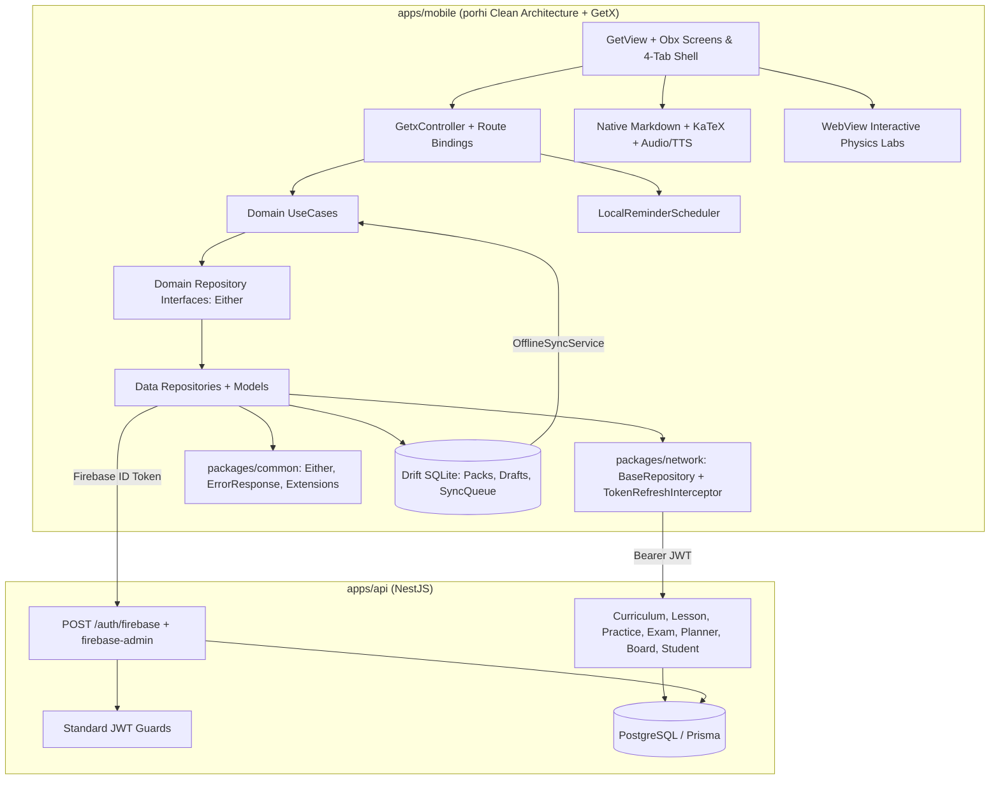

# porhi Flutter Student Mobile App Implementation Plan

> **For agentic workers:** REQUIRED SUB-SKILL: Use superpowers:subagent-driven-development (recommended) or superpowers:executing-plans to implement this plan task-by-task. Steps use checkbox (`- [ ]`) syntax for tracking.

**Goal:** Build the user-only **porhi** Flutter mobile client (`apps/mobile`, Android-first) using Clean Architecture + GetX + local `common`/`network` Dart packages with full student feature parity and a Firebase Google + Phone OTP token-exchange bridge in `apps/api`.

**Architecture:** `apps/mobile` follows Clean Architecture (`data/{datasources,models,repositories}` -> `domain/{entities,repositories,usecases}` -> `presentation/<page>/{binding,controller,view,widgets}`) with GetX for DI (`Bindings`), reactive state (`GetxController`, `Obx`), and named routing (`GetMaterialApp`, `GetPage`, 4-tab shell switching the active tab via `Obx` without `IndexedStack`). Local path packages `apps/mobile/packages/common` (`Either`, `Common`, utilities/widgets) and `apps/mobile/packages/network` (`NetworkInitializer`, `BaseRepository`, `ErrorResponse`, `TokenRefreshInterceptor`) power normalized API calls (`Future<Either<ErrorResponse, Entity>>`) against `apps/api` using a poRi JWT obtained via `POST /auth/firebase`; Drift SQLite persists downloaded chapter packs, offline exam drafts, and `SyncQueue` for `POST /student/sync-offline`.

**Architecture Diagram:**



**Tech Stack:** Flutter `3.44.8`+, Dart, `get` (GetX), `clean_getx` CLI (`/Users/technonext/StudioProjects/clean_getx`), local `common` & `network` packages (`/Users/technonext/TN_Project/common`, `/Users/technonext/TN_Project/netword`), `dio`, `equatable`, `intl`, `drift` + `sqlite3_flutter_libs`, `firebase_core`, `firebase_auth`, `google_sign_in`, `flutter_secure_storage`, `shared_preferences`, `flutter_math_fork`, `just_audio`, `flutter_tts`, `webview_flutter`, `cached_network_image`, `chewie` + `video_player`, `fl_chart`, `flutter_local_notifications` + `timezone`, `connectivity_plus`, `share_plus`, NestJS, Prisma, `firebase-admin`, Vitest.

**Spec:** [2026-11-12-flutter-student-app-design.md](file:///Users/technonext/Desktop/poRi/docs/superpowers/specs/2026-11-12-flutter-student-app-design.md)

## Global Constraints

- Mobile app branding is **porhi** everywhere (display name `porhi` / `পড়ি`, Dart package `porhi`, Android application ID `com.porhi.app`).
- Monorepo layout stays `apps/mobile/` alongside `apps/api/` and `apps/web/`; keep `apps/mobile/` and `apps/mobile/packages/{common,network}/` free of JS `package.json` files so `pnpm -r build`, `pnpm -r test`, and `pnpm -r lint` stay green. Keep TypeScript `packages/shared` separate.
- Platform target is **Android-first** on Flutter `3.44.8`+ stable; public Apple App Store Sign in with Apple and in-app account deletion (`DELETE /auth/account`) are deferred.
- **No Guest Mode** on mobile; students must authenticate with Firebase Google Sign-In or Phone OTP upfront (`POST /auth/guest` is never exposed in mobile UI).
- **No Admin/Editor/Reviewer UI** (`/admin/*`) in `apps/mobile`.
- Existing web/admin auth flows (`POST /auth/guest`, `POST /auth/request-otp`, `POST /auth/verify-otp`, `POST /auth/admin/login`, `JwtAuthGuard`, `OptionalJwtAuthGuard`) must remain backward-compatible.
- Expand `User.selectedClass` validation (`UpdateProfileDto`, `AuthService.updateProfile`, `POST /auth/firebase`) to accept `'CLASS_6_8' | 'SSC' | 'HSC' | 'ADMISSION' | 'BCS'` (default `'SSC'`).
- **Clean Architecture + GetX boundaries:** Domain never imports Flutter UI, Dio, or data-layer models; `common` never imports porhi features or Dio/network; `network` never imports `firebase_auth`, feature DTOs, or presentation logic. Controllers receive use cases only, wrap only reactive reads in `Obx`, clear loading flags in `finally`, and dispose owned text/scroll/focus controllers in `onClose`. Use `permanent` only for deliberately app-lifetime services.
- Resolve relative media/simulation paths (`/uploads/...`, `/audio/...`) against `API_BASE_URL`; build Guardian share URLs against `WEB_BASE_URL` (defaulting to `API_BASE_URL` with trailing `/api` stripped, or `http://localhost:3000` in dev).
- All Firebase, media, notification, and network dependencies sit behind mockable abstractions so tests run offline without live Firebase credentials.

## Review Focus

1. **Malformed/unclosed LaTeX or relative media tags in lesson/question strings:** `RichContentTokenizer` and `RichContentView` must never throw on unclosed `$` / `$$` or invalid TeX, falling back cleanly to plain text and resolving `/uploads/...` against `API_BASE_URL`. *(Pinned in Task 5)*
2. **Firebase sign-in colliding with existing web student or staff accounts:** `POST /auth/firebase` must link an existing `STUDENT` matched by `phoneNumber` or `email` without duplicating users, and reject `EDITOR`/`REVIEWER`/`ADMIN` or `passwordHash != null` accounts with HTTP `403`. *(Pinned in Task 1)*
3. **Offline exam crash/app-kill, `ApiClientImpl` header resets on 401 refresh, or partial sync drop:** `ActiveExamDrafts` must restore timer/answers/flags locally, `AuthRequestInterceptor` must re-inject `Authorization` and `baseUrl` on every request (including `TokenRefreshInterceptor` retries, because `ApiClientImpl` resets `_dio.options.headers`), and `OfflineSyncService` must keep un-synced queue rows intact on failure. *(Pinned in Task 3, Task 4 & Task 10)*
4. **Guardian share URL joining onto `/api` in production:** `EnvConfig.guardianShareUrl(sharePath)` must strip trailing `/api` from `API_BASE_URL` (or use `WEB_BASE_URL`) so production links never contain `/api/guardian/...`. *(Pinned in Task 2 & Task 12)*
5. **Invalid/past study reminder times or Bangla digits crashing notification scheduling:** `LocalReminderScheduler` must normalize Bangla numerals, skip past or completed tasks cleanly, and cancel prior reminders when tasks complete or delete. *(Pinned in Task 12)*

---

### Task 1: Backend Firebase Auth Bridge, 5-Track Profile Expansion & Offline Pack Parity (`apps/api`)

**Files:**
- Modify: [schema.prisma](file:///Users/technonext/Desktop/poRi/apps/api/prisma/schema.prisma#L32-L52)
- Modify: [package.json](file:///Users/technonext/Desktop/poRi/apps/api/package.json)
- Create: `apps/api/src/modules/auth/firebase-verifier.service.ts`
- Create: `apps/api/src/modules/auth/dto/firebase-login.dto.ts`
- Modify: [update-profile.dto.ts](file:///Users/technonext/Desktop/poRi/apps/api/src/modules/auth/dto/update-profile.dto.ts)
- Modify: [auth.service.ts](file:///Users/technonext/Desktop/poRi/apps/api/src/modules/auth/auth.service.ts)
- Modify: [auth.controller.ts](file:///Users/technonext/Desktop/poRi/apps/api/src/modules/auth/auth.controller.ts)
- Modify: [auth.module.ts](file:///Users/technonext/Desktop/poRi/apps/api/src/modules/auth/auth.module.ts)
- Modify: [curriculum.service.ts](file:///Users/technonext/Desktop/poRi/apps/api/src/modules/curriculum/curriculum.service.ts#L270-L286)
- Modify: [auth.service.spec.ts](file:///Users/technonext/Desktop/poRi/apps/api/src/modules/auth/auth.service.spec.ts)
- Modify: [curriculum.service.spec.ts](file:///Users/technonext/Desktop/poRi/apps/api/src/modules/curriculum/curriculum.service.spec.ts)

**Interfaces:**
- Produces:
  - `POST /auth/firebase` accepting `{ idToken: string; fullName?: string; selectedClass?: ProgramTrack }` returning `{ accessToken: string; isNewUser: boolean; user: { id, firebaseUid, phoneNumber, email, fullName, role, selectedClass } }`
  - `PATCH /auth/profile` accepting `selectedClass?: 'CLASS_6_8' | 'SSC' | 'HSC' | 'ADMISSION' | 'BCS'`
  - `GET /curriculum/chapter/:chapterId/offline-pack` questions including `cqRubric` and `boardSource`

> [!IMPORTANT]
> Prisma schema adds `firebaseUid String? @unique` and `email String? @unique` on `User`; run `prisma:generate` and update migration/db push without breaking existing seed/test mocks.

- [ ] **Step 1: Write failing backend tests for `firebaseLogin`, 5-track `updateProfile`, and `getOfflineChapterPack`**

Add unit tests in [auth.service.spec.ts](file:///Users/technonext/Desktop/poRi/apps/api/src/modules/auth/auth.service.spec.ts) and [curriculum.service.spec.ts](file:///Users/technonext/Desktop/poRi/apps/api/src/modules/curriculum/curriculum.service.spec.ts):

```ts
// auth.service.spec.ts
it('creates a new student via firebaseLogin and returns isNewUser: true', async () => { /* ... */ });
it('links firebaseUid to an existing student matched by phoneNumber without duplicating user', async () => { /* ... */ });
it('rejects staff/passwordHash account in firebaseLogin with ForbiddenException', async () => { /* ... */ });
it('accepts all 5 student tracks on updateProfile and rejects INVALID', async () => { /* ... */ });

// curriculum.service.spec.ts
it('includes cqRubric and boardSource in offline chapter pack questions', async () => { /* ... */ });
```

- [ ] **Step 2: Run backend tests to verify they fail**

Run: `pnpm --filter @pori/api test`
Expected: FAIL because `firebaseLogin`, `FirebaseVerifierService`, 5-track validation, and `cqRubric`/`boardSource` mapping do not exist yet.

- [ ] **Step 3: Install `firebase-admin` and update Prisma `User` schema**

Run `pnpm --filter @pori/api add firebase-admin`, add `firebaseUid String? @unique` and `email String? @unique` to `User` in [schema.prisma](file:///Users/technonext/Desktop/poRi/apps/api/prisma/schema.prisma#L32-L52), and run `pnpm --filter @pori/api prisma:generate`.

- [ ] **Step 4: Implement `FirebaseVerifierService`, `FirebaseLoginDto`, `AuthService.firebaseLogin`, and `POST /auth/firebase`**

Implement `FirebaseVerifierService.verifyIdToken(idToken: string)` (lazy init from `FIREBASE_SERVICE_ACCOUNT_JSON` or `FIREBASE_PROJECT_ID` / ADC, throwing `UnauthorizedException` on invalid token or missing config), `FirebaseLoginDto`, `AuthService.firebaseLogin` (resolving by `firebaseUid` -> normalized `phoneNumber` -> `email`, rejecting staff/passwordHash accounts with `ForbiddenException`, linking `firebaseUid`/`email` or creating `STUDENT`), and wire `POST /auth/firebase` in [auth.controller.ts](file:///Users/technonext/Desktop/poRi/apps/api/src/modules/auth/auth.controller.ts) and [auth.module.ts](file:///Users/technonext/Desktop/poRi/apps/api/src/modules/auth/auth.module.ts).

- [ ] **Step 5: Expand `selectedClass` to 5 tracks and fix `getOfflineChapterPack` CQ/board fields**

Update [update-profile.dto.ts](file:///Users/technonext/Desktop/poRi/apps/api/src/modules/auth/dto/update-profile.dto.ts) and `AuthService.updateProfile` to allow `['CLASS_6_8', 'SSC', 'HSC', 'ADMISSION', 'BCS']`, and update `CurriculumService.getOfflineChapterPack` in [curriculum.service.ts](file:///Users/technonext/Desktop/poRi/apps/api/src/modules/curriculum/curriculum.service.ts#L270-L286) to include `cqRubric: q.cqRubric ?? null` and `boardSource: q.boardSource ?? null`.

- [ ] **Step 6: Run API tests and typecheck to verify PASS**

Run: `pnpm --filter @pori/api test && pnpm --filter @pori/api lint`
Expected: PASS.

- [ ] **Step 7: Commit**

```bash
git add apps/api pnpm-lock.yaml
git commit -m "feat(api): add Firebase token-exchange auth, 5-track profile support, and offline pack CQ parity"
```

---

### Task 2: Flutter App Scaffold, Local `common`/`network` Packages, Env, Theme & Bilingual i18n

**Files:**
- Create: `apps/mobile/packages/common/...` (copied cleanly from `/Users/technonext/TN_Project/common`, excluding `build/` and `.dart_tool/`)
- Create: `apps/mobile/packages/network/...` (copied cleanly from `/Users/technonext/TN_Project/netword`, excluding `build/` and `.dart_tool/`)
- Create: `apps/mobile/pubspec.yaml`
- Create: `apps/mobile/lib/app/env.dart`
- Create: `apps/mobile/lib/core/theme/porhi_theme.dart`
- Create: `apps/mobile/lib/core/i18n/app_strings.dart`
- Create: `apps/mobile/lib/core/i18n/bangla_digits.dart`
- Create: `apps/mobile/lib/routes/app_routes.dart`
- Create: `apps/mobile/lib/routes/app_pages.dart`
- Create: `apps/mobile/assets/audio/lesson-intro.wav` (copied from `apps/web/public/audio/lesson-intro.wav`)
- Test: `apps/mobile/test/core/env_and_i18n_test.dart`

**Interfaces:**
- Consumes: `package:common/common.dart` (`Either`, `Left`, `Right`, `Common`, `BaseStorageService`, `logError`), `package:network/network.dart` (`BaseRepository`, `BaseResponseModel`, `ErrorResponse`, `NetworkInitializer`, `TokenRefreshInterceptor`)
- Produces:
  - `EnvConfig` (`apiBaseUrl`, `webBaseUrl`, `resolveMediaUrl(String path)`, `guardianShareUrl(String sharePath)`)
  - `PorhiTheme`, `AppLanguage` (`bn`, `en`), `AppStrings`, `toBanglaDigits(Object input)`
  - `AppRoutes` and `AppPages` skeletons compatible with `clean_getx` CLI (`dart run /Users/technonext/StudioProjects/clean_getx/bin/clean_getx.dart`)

- [ ] **Step 1: Scaffold `apps/mobile` and vendor `common` + `network` under `apps/mobile/packages/`**

1. Run `flutter create --org com.porhi --project-name porhi --platforms=android,ios apps/mobile`.
2. Copy `/Users/technonext/TN_Project/common` -> `apps/mobile/packages/common` and `/Users/technonext/TN_Project/netword` -> `apps/mobile/packages/network` (excluding `.dart_tool`, `build`, `.git`). Verify `apps/mobile/packages/network/pubspec.yaml` still resolves `common: path: "../common"`.
3. Configure `apps/mobile/pubspec.yaml` (`name: porhi`) with path dependencies `common: { path: packages/common }`, `network: { path: packages/network }`, plus `get`, `intl`, `equatable`, `dio`, `drift`, `sqlite3_flutter_libs`, `path_provider`, `path`, `firebase_core`, `firebase_auth`, `google_sign_in`, `flutter_secure_storage`, `shared_preferences`, `flutter_math_fork`, `just_audio`, `flutter_tts`, `webview_flutter`, `cached_network_image`, `chewie`, `video_player`, `fl_chart`, `flutter_local_notifications`, `timezone`, `connectivity_plus`, `share_plus`, and dev dependencies `mocktail`, `drift_dev`, `build_runner`, `flutter_lints`.
4. Set Android `applicationId "com.porhi.app"` and app label `porhi` in `android/app/build.gradle*` and `AndroidManifest.xml`, and copy `apps/web/public/audio/lesson-intro.wav` to `apps/mobile/assets/audio/lesson-intro.wav`.

- [ ] **Step 2: Write failing tests for `EnvConfig` (including `/api` stripping for Guardian links) and `toBanglaDigits`**

```dart
// apps/mobile/test/core/env_and_i18n_test.dart
test('guardianShareUrl strips trailing /api from apiBaseUrl when webBaseUrl unset', () {
  final env = EnvConfig(apiBaseUrl: 'https://165-99-219-120.sslip.io/api');
  expect(env.guardianShareUrl('/guardian/abc123'), 'https://165-99-219-120.sslip.io/guardian/abc123');
});

test('resolveMediaUrl joins relative /uploads path to apiBaseUrl', () {
  final env = EnvConfig(apiBaseUrl: 'http://10.0.2.2:3001');
  expect(env.resolveMediaUrl('/uploads/interactive/motion.html'), 'http://10.0.2.2:3001/uploads/interactive/motion.html');
});

test('toBanglaDigits converts ASCII digits cleanly', () {
  expect(toBanglaDigits('2026-11-12 (85%)'), '২০২৬-১১-১২ (৮৫%)');
});
```

- [ ] **Step 3: Run tests to verify failure**

Run: `cd apps/mobile && flutter pub get && flutter test test/core/env_and_i18n_test.dart`
Expected: FAIL because `env.dart` and `bangla_digits.dart` do not exist yet.

- [ ] **Step 4: Implement `EnvConfig`, `PorhiTheme`, `AppStrings`, `bangla_digits.dart`, `AppRoutes`, and `AppPages`**

Implement `EnvConfig` (`--dart-define=API_BASE_URL=...`, `--dart-define=WEB_BASE_URL=...`), `PorhiTheme` (`Common.init(...)` button/dialog styles matching poRi/porhi indigo-emerald-slate palette), `AppStrings`/`bangla_digits.dart`, and initial `AppRoutes`/`AppPages`.

- [ ] **Step 5: Verify `common`, `network`, Flutter unit tests, and monorepo `pnpm` workspace all pass**

Run: `cd apps/mobile/packages/common && flutter test && cd ../network && flutter test && cd ../.. && flutter test test/core/env_and_i18n_test.dart && cd ../.. && pnpm -r test`
Expected: PASS across `common`, `network`, `apps/mobile`, and JS workspace (`pnpm -r test`).

- [ ] **Step 6: Commit**

```bash
git add apps/mobile
git commit -m "chore(mobile): scaffold porhi Clean-GetX Flutter app with common/network packages, env, theme, and i18n"
```

---

### Task 3: Drift Local Database, Secure Storage Adapter & Offline Sync Coordinator

**Files:**
- Create: `apps/mobile/lib/core/storage/secure_storage_service.dart`
- Create: `apps/mobile/lib/core/storage/preferences_storage_service.dart`
- Create: `apps/mobile/lib/core/database/app_database.dart`
- Create: `apps/mobile/lib/core/database/app_database.g.dart`
- Create: `apps/mobile/lib/core/sync/offline_sync_service.dart`
- Test: `apps/mobile/test/core/offline_sync_service_test.dart`

**Interfaces:**
- Consumes: `Either`, `BaseStorageService` (`common`), `ErrorResponse` (`network`), `POST /student/sync-offline` (via feature data source/repository abstraction)
- Produces:
  - `AppDatabase` (Drift tables: `DownloadedChapters`, `CachedLessons`, `CachedQuestions`, `ActiveExamDrafts`, `SyncQueue`, `LocalStudentCache`)
  - `SecureStorageService` (token & user cache)
  - `OfflineSyncService` (`enqueueLessonComplete`, `enqueuePracticeAttempt`, `enqueueExamSubmission`, `flushPendingQueue`, reactive `pendingCount` `RxInt`)

- [ ] **Step 1: Write failing tests for Drift `ActiveExamDrafts` persistence and `OfflineSyncService` queue flush / failure retention**

```dart
// apps/mobile/test/core/offline_sync_service_test.dart
test('flushPendingQueue delegates batched sync payload and clears queue rows on Right()', () async { /* ... */ });
test('flushPendingQueue preserves queue rows and increments retryCount on Left(ErrorResponse)', () async { /* ... */ });
test('ActiveExamDrafts persists and restores answers, flags, and remainingSeconds', () async { /* ... */ });
```

- [ ] **Step 2: Run test to verify failure**

Run: `cd apps/mobile && flutter test test/core/offline_sync_service_test.dart`
Expected: FAIL.

- [ ] **Step 3: Implement `SecureStorageService`, `PreferencesStorageService`, Drift `AppDatabase`, and `OfflineSyncService`**

Generate Drift code with `dart run build_runner build --delete-conflicting-outputs`. Keep `OfflineSyncService` calling an injected sync callback/usecase returning `Future<Either<ErrorResponse, void>>` (never calling Dio directly).

- [ ] **Step 4: Run tests to verify PASS**

Run: `cd apps/mobile && flutter test test/core/offline_sync_service_test.dart`
Expected: PASS.

- [ ] **Step 5: Commit**

```bash
git add apps/mobile
git commit -m "feat(mobile): add Drift offline database, secure storage, and OfflineSyncService coordinator"
```

---

### Task 4: Network Bridge (`InitialBinding` + Token Refresh), Auth Feature (Google & Phone OTP, Onboarding, Account)

**Files:**
- Create: `apps/mobile/lib/core/network/auth_request_interceptor.dart`
- Create: `apps/mobile/lib/app/initial_binding.dart`
- Create: `apps/mobile/lib/app/app.dart`
- Create: `apps/mobile/lib/main.dart`
- Create: `apps/mobile/lib/features/auth/domain/entities/auth_user_entity.dart`
- Create: `apps/mobile/lib/features/auth/domain/repositories/auth_repository.dart`
- Create: `apps/mobile/lib/features/auth/domain/usecases/auth_usecases.dart`
- Create: `apps/mobile/lib/features/auth/data/datasources/auth_remote_datasource.dart`
- Create: `apps/mobile/lib/features/auth/data/datasources/firebase_auth_gateway.dart`
- Create: `apps/mobile/lib/features/auth/data/models/auth_models.dart`
- Create: `apps/mobile/lib/features/auth/data/repositories/auth_repository_impl.dart`
- Create: `apps/mobile/lib/features/auth/presentation/login/...` (`binding/`, `controller/`, `view/`, `widgets/`)
- Create: `apps/mobile/lib/features/auth/presentation/onboarding/...` (`binding/`, `controller/`, `view/`)
- Create: `apps/mobile/lib/features/auth/presentation/account/...` (`binding/`, `controller/`, `view/`)
- Test: `apps/mobile/test/features/auth/auth_flow_test.dart`

**Interfaces:**
- Consumes: `BaseRepository`, `NetworkInitializer`, `TokenRefreshInterceptor`, `ErrorResponse` (`network`); `Either` (`common`); `EnvConfig`, `SecureStorageService`; `POST /auth/firebase`, `GET /auth/me`, `PATCH /auth/profile`
- Produces:
  - `AuthRepository` (`signInWithGoogle()`, `requestPhoneOtp(String phone)`, `verifyPhoneOtp(String verificationId, String smsCode)`, `refreshBackendSession()`, `getMe()`, `updateProfile(...)`, `signOut()`) returning `Future<Either<ErrorResponse, ...>>`
  - `InitialBinding` registering app-wide `EnvConfig`, `AppDatabase`, `SecureStorageService`, `OfflineSyncService`, and lazy `AuthRepository` + shared feature repositories
  - `LoginView` / `OnboardingView` / `AccountView` + GetX controllers & route bindings

- [ ] **Step 1: Write failing tests for `AuthRequestInterceptor` + `TokenRefreshInterceptor` integration, `AuthRepositoryImpl`, and `LoginView` (no guest mode)**

```dart
// apps/mobile/test/features/auth/auth_flow_test.dart
test('AuthRequestInterceptor preserves baseUrl and Authorization header after ApiClientImpl header reset', () async { /* ... */ });
test('AuthRepositoryImpl returns Right(AuthSessionEntity) on Google sign-in + POST /auth/firebase', () async { /* ... */ });
testWidgets('LoginView displays Google and Phone OTP options with no Guest sign-in button', (tester) async { /* ... */ });
testWidgets('OnboardingView validates fullName and submits 5-track selectedClass via UpdateProfileUseCase', (tester) async { /* ... */ });
```

- [ ] **Step 2: Run test to verify failure**

Run: `cd apps/mobile && flutter test test/features/auth/auth_flow_test.dart`
Expected: FAIL.

- [ ] **Step 3: Implement `AuthRequestInterceptor` & `InitialBinding` (`NetworkInitializer.initialize`)**

- `AuthRequestInterceptor` prepends `EnvConfig.apiBaseUrl` when `options.path` is relative and injects `Authorization: Bearer <porhiJwt>` on every request (ensuring `ApiClientImpl`'s `_dio.options.headers = _regularHeader` never strips the token).
- `TokenRefreshInterceptor` delegates `onRefreshToken` to an app-level `AuthSessionCoordinator` callback (keeping `packages/network` 100% free of `firebase_auth` imports).

- [ ] **Step 4: Implement `auth/` domain entities, repository interface, use cases, DTO models, `FirebaseAuthGateway`, `AuthRemoteDataSource` (extending `BaseRepository`), and `AuthRepositoryImpl`**

- [ ] **Step 5: Implement `Login`, `Onboarding`, and `Account` GetX bindings, controllers (`GetxController`), and views (`GetView`)**

Ensure `AppRoutes` & `AppPages` register `/login`, `/onboarding`, and `/account`, and `GetMaterialApp` launches to `/login` or `/home` based on stored session.

- [ ] **Step 6: Run tests to verify PASS**

Run: `cd apps/mobile && flutter test test/features/auth/auth_flow_test.dart`
Expected: PASS.

- [ ] **Step 7: Commit**

```bash
git add apps/mobile
git commit -m "feat(mobile): add Clean-GetX Firebase Google/Phone auth, token refresh, onboarding, and account"
```

---

### Task 5: Rich Content Parser, KaTeX Math, Audio/Video/Image Lightbox & Interactive Lab WebView

**Files:**
- Create: `apps/mobile/lib/core/widgets/rich_content/rich_content_tokenizer.dart`
- Create: `apps/mobile/lib/core/widgets/rich_content/rich_content_view.dart`
- Create: `apps/mobile/lib/core/widgets/lesson_audio_player.dart`
- Create: `apps/mobile/lib/core/widgets/interactive_lab/interactive_lab_card.dart`
- Test: `apps/mobile/test/core/rich_content_test.dart`

**Interfaces:**
- Consumes: `EnvConfig.resolveMediaUrl`
- Produces:
  - `parseRichTokens(String raw) -> List<RichContentToken>` (`text`, `audio`, `video`, `image`)
  - `parseMarkdownBlocks(String text) -> List<MarkdownBlock>`
  - `RichContentView`, `LessonAudioPlayer`, `InteractiveLabCard`

- [ ] **Step 1: Write failing tests for token extraction, malformed LaTeX fallback, and relative media URL resolution**

```dart
// apps/mobile/test/core/rich_content_test.dart
test('parseRichTokens extracts <audio>, <video>, and  in exact sequence', () { /* ... */ });
test('parseMarkdownBlocks handles tables, $$...$$ math, and unclosed $ without throwing', () { /* ... */ });
testWidgets('RichContentView renders fallback text on invalid TeX syntax', (tester) async { /* ... */ });
```

- [ ] **Step 2: Run test to verify failure**

Run: `cd apps/mobile && flutter test test/core/rich_content_test.dart`
Expected: FAIL.

- [ ] **Step 3: Implement `rich_content_tokenizer.dart`, `rich_content_view.dart`, `lesson_audio_player.dart`, and `interactive_lab_card.dart`**

Port exact semantics from [rich-content-renderer.tsx](file:///Users/technonext/Desktop/poRi/apps/web/src/components/content/rich-content-renderer.tsx), wrap `flutter_math_fork` with `onErrorFallback`, support `just_audio` + `flutter_tts` (`bn-BD`/`en-US`) in `LessonAudioPlayer`, and support online/offline `loadFile` + fullscreen in `InteractiveLabCard` (`webview_flutter`).

- [ ] **Step 4: Run tests to verify PASS**

Run: `cd apps/mobile && flutter test test/core/rich_content_test.dart`
Expected: PASS.

- [ ] **Step 5: Commit**

```bash
git add apps/mobile
git commit -m "feat(mobile): add native Markdown/KaTeX renderer, audio/TTS player, and HTML lab WebView"
```

---

### Task 6: 4-Tab Shell (No `IndexedStack`), Home Dashboard & Quick Search

**Files:**
- Create: `apps/mobile/lib/features/shell/presentation/main_shell/...` (`binding/`, `controller/`, `view/`)
- Create: `apps/mobile/lib/features/dashboard/domain/...` (`entities/student_overview_entity.dart`, `repositories/student_repository.dart`, `usecases/...`)
- Create: `apps/mobile/lib/features/dashboard/data/...` (`datasources/`, `models/`, `repositories/student_repository_impl.dart`)
- Create: `apps/mobile/lib/features/dashboard/presentation/dashboard/...` (`binding/`, `controller/`, `view/`, `widgets/`)
- Create: `apps/mobile/lib/features/dashboard/presentation/shared/quick_search_sheet.dart`
- Test: `apps/mobile/test/features/dashboard/dashboard_test.dart`

**Interfaces:**
- Consumes: `BaseRepository` (`network`), `Either<ErrorResponse, ...>` (`common`), `GET /student/overview`, `GET /planner`, `GET /curriculum/subjects/:id/chapters`, `AppDatabase`
- Produces:
  - `MainShellView` (renders only the active tab via `Obx` without `IndexedStack`, while `MainShellBinding` lazily registers the 4 tab controllers: Home, Subjects, Planner, Progress)
  - `StudentRepository` (`getOverview`, `markLessonComplete`, `toggleBookmark`, `saveNote`, `submitFeedback`, `createShareLink`, `listShareLinks`, `revokeShareLink`, `syncOffline`)

- [ ] **Step 1: Write failing tests for `DashboardController`, `MainShellView` tab switching, and `QuickSearchSheet`**

```dart
// apps/mobile/test/features/dashboard/dashboard_test.dart
test('GetOverviewUseCase returns cached overview when offline and live overview when online', () async { /* ... */ });
testWidgets('MainShellView switches active tab via Obx without mounting inactive tabs in an IndexedStack', (tester) async { /* ... */ });
testWidgets('DashboardView renders streak, 7-day activity strip, continue card, and due mistakes', (tester) async { /* ... */ });
```

- [ ] **Step 2: Run test to verify failure**

Run: `cd apps/mobile && flutter test test/features/dashboard/dashboard_test.dart`
Expected: FAIL.

- [ ] **Step 3: Implement `dashboard` Clean Architecture layers (`data`, `domain`, `presentation`), `MainShell`, and `QuickSearchSheet`**

Register `StudentRepository` in `InitialBinding` and `/home` (`MainShellView` + `MainShellBinding`) in `AppRoutes` & `AppPages`.

- [ ] **Step 4: Run tests to verify PASS**

Run: `cd apps/mobile && flutter test test/features/dashboard/dashboard_test.dart`
Expected: PASS.

- [ ] **Step 5: Commit**

```bash
git add apps/mobile
git commit -m "feat(mobile): add 4-tab shell, Home dashboard, and Quick Search"
```

---

### Task 7: Subjects Catalog (5 Tracks), Curriculum Index & Offline Chapter Pack Download

**Files:**
- Create: `apps/mobile/lib/features/curriculum/domain/...` (`entities/`, `repositories/curriculum_repository.dart`, `usecases/`)
- Create: `apps/mobile/lib/features/curriculum/data/...` (`datasources/`, `models/`, `repositories/curriculum_repository_impl.dart`)
- Create: `apps/mobile/lib/features/curriculum/presentation/subjects/...` (`binding/`, `controller/`, `view/`, `widgets/`)
- Create: `apps/mobile/lib/features/curriculum/presentation/curriculum/...` (`binding/`, `controller/`, `view/`, `widgets/`)
- Test: `apps/mobile/test/features/curriculum/curriculum_test.dart`

**Interfaces:**
- Consumes: `GET /curriculum/subjects`, `GET /curriculum/subjects/:subjectId/chapters`, `GET /curriculum/chapter/:chapterId/offline-pack`, `AppDatabase`
- Produces:
  - `CurriculumRepository` (`getSubjects({program})`, `getChapters(subjectId)`, `downloadChapterPack(chapterId)`, `removeChapterPack(chapterId)`, `isChapterDownloaded(chapterId)`)
  - Named route `/curriculum/:subjectId` + `SubjectsView` tab

- [ ] **Step 1: Write failing tests for 5-track filtering, topic filter pills, and offline pack download (persisting lessons, questions, HTML labs, and audio)**

- [ ] **Step 2: Run test to verify failure**

Run: `cd apps/mobile && flutter test test/features/curriculum/curriculum_test.dart`
Expected: FAIL.

- [ ] **Step 3: Implement `curriculum` Clean Architecture layers (`data`, `domain`, `presentation`) and register `/curriculum` route**

Ensure switching subject updates active subject state and navigates via `Get.toNamed` to `/curriculum/:subjectId` so context never shifts silently.

- [ ] **Step 4: Run tests to verify PASS**

Run: `cd apps/mobile && flutter test test/features/curriculum/curriculum_test.dart`
Expected: PASS.

- [ ] **Step 5: Commit**

```bash
git add apps/mobile
git commit -m "feat(mobile): add 5-track Subjects catalog, Curriculum index, and offline pack downloader"
```

---

### Task 8: Connected Lesson Reader, Personal Notes, Quick Practice & Content Reporting

**Files:**
- Create: `apps/mobile/lib/features/lesson/domain/...` (`entities/`, `repositories/lesson_repository.dart`, `usecases/`)
- Create: `apps/mobile/lib/features/lesson/data/...` (`datasources/`, `models/`, `repositories/lesson_repository_impl.dart`)
- Create: `apps/mobile/lib/features/lesson/presentation/lesson/...` (`binding/`, `controller/`, `view/`, `widgets/`)
- Create: `apps/mobile/lib/features/content_report/domain/...` & `data/...` & `presentation/report_sheet/...`
- Test: `apps/mobile/test/features/lesson/lesson_test.dart`

**Interfaces:**
- Consumes: `GET /lessons/topic/:topicId`, `POST /student/lesson-complete`, `POST /student/bookmarks/toggle`, `POST /student/notes`, `POST /student/feedback`, `POST /content-reports`, `RichContentView`, `LessonAudioPlayer`, `InteractiveLabCard`, `OfflineSyncService`
- Produces:
  - `/lesson/:topicId` (`LessonView` + `LessonBinding` + `LessonController`)
  - Reusable `ReportContentSheet`

- [ ] **Step 1: Write failing tests for Lesson loading (online + Drift fallback), personal note save, offline completion queuing, and `ReportContentSheet`**

- [ ] **Step 2: Run test to verify failure**

Run: `cd apps/mobile && flutter test test/features/lesson/lesson_test.dart`
Expected: FAIL.

- [ ] **Step 3: Implement `lesson` and `content_report` Clean Architecture layers and views**

- [ ] **Step 4: Run tests to verify PASS**

Run: `cd apps/mobile && flutter test test/features/lesson/lesson_test.dart`
Expected: PASS.

- [ ] **Step 5: Commit**

```bash
git add apps/mobile
git commit -m "feat(mobile): add Lesson reader, personal notes, quick practice, and content reporting"
```

---

### Task 9: Smart MCQ Practice Runner (6-Layer Explanation) & CQ Self-Assessment

**Files:**
- Create: `apps/mobile/lib/features/practice/domain/...` (`entities/`, `repositories/practice_repository.dart`, `usecases/`)
- Create: `apps/mobile/lib/features/practice/data/...` (`datasources/`, `models/`, `repositories/practice_repository_impl.dart`)
- Create: `apps/mobile/lib/features/practice/presentation/practice/...` (`binding/`, `controller/`, `view/`, `widgets/`)
- Create: `apps/mobile/lib/features/practice/presentation/shared/explanation_layers_card.dart`
- Create: `apps/mobile/lib/features/practice/presentation/shared/cq_rubric_card.dart`
- Test: `apps/mobile/test/features/practice/practice_test.dart`

**Interfaces:**
- Consumes: `GET /practice/chapter/:chapterId/questions`, `POST /practice/submit`, `POST /practice/cq-self-assess`, `AppDatabase`, `OfflineSyncService`
- Produces:
  - `/practice/:chapterId` (`PracticeView` + `PracticeBinding`)
  - Shared `ExplanationLayersCard` and `CqRubricCard`

- [ ] **Step 1: Write failing tests for MCQ instant grading, 6-layer explanation, CQ ক/খ/গ/ঘ rubric self-assess, offline grading + `PRACTICE_ATTEMPT` enqueue, and retry-mistakes summary**

- [ ] **Step 2: Run test to verify failure**

Run: `cd apps/mobile && flutter test test/features/practice/practice_test.dart`
Expected: FAIL.

- [ ] **Step 3: Implement `practice` Clean Architecture layers, `ExplanationLayersCard`, `CqRubricCard`, and `PracticeView`**

- [ ] **Step 4: Run tests to verify PASS**

Run: `cd apps/mobile && flutter test test/features/practice/practice_test.dart`
Expected: PASS.

- [ ] **Step 5: Commit**

```bash
git add apps/mobile
git commit -m "feat(mobile): add smart MCQ practice with 6-layer explanations and CQ self-assessment"
```

---

### Task 10: Timed Exam Runner (Chapter / Topic / Weak / Subject Model Test) & Percentile Results

**Files:**
- Create: `apps/mobile/lib/features/exam/domain/...` (`entities/`, `repositories/exam_repository.dart`, `usecases/`)
- Create: `apps/mobile/lib/features/exam/data/...` (`datasources/`, `models/`, `repositories/exam_repository_impl.dart`)
- Create: `apps/mobile/lib/features/exam/presentation/exam_setup/...` (`binding/`, `controller/`, `view/`)
- Create: `apps/mobile/lib/features/exam/presentation/exam_runner/...` (`binding/`, `controller/`, `view/`, `widgets/`)
- Create: `apps/mobile/lib/features/exam/presentation/exam_result/...` (`binding/`, `controller/`, `view/`, `widgets/`)
- Test: `apps/mobile/test/features/exam/exam_test.dart`

**Interfaces:**
- Consumes: `POST /exam/start`, `PUT /exam/heartbeat/:sessionId`, `POST /exam/submit/:sessionId`, `GET /exam/session/:sessionId`, `AppDatabase` (`ActiveExamDrafts`), `OfflineSyncService`, `ExplanationLayersCard`
- Produces:
  - `/exam/setup`, `/exam/runner`, `/exam/result/:sessionId`

- [ ] **Step 1: Write failing tests for `ActiveExamDrafts` autosave/resume, countdown auto-submit, offline grading with `negativeRatio` + `EXAM_SUBMISSION` enqueue, and percentile result rendering**

- [ ] **Step 2: Run test to verify failure**

Run: `cd apps/mobile && flutter test test/features/exam/exam_test.dart`
Expected: FAIL.

- [ ] **Step 3: Implement `exam` Clean Architecture layers, controllers (cancelling timers & disposing scroll/text controllers in `onClose`), and views**

- [ ] **Step 4: Run tests to verify PASS**

Run: `cd apps/mobile && flutter test test/features/exam/exam_test.dart`
Expected: PASS.

- [ ] **Step 5: Commit**

```bash
git add apps/mobile
git commit -m "feat(mobile): add timed Exam setup, autosave/offline runner, and percentile results"
```

---

### Task 11: Multi-Subject Exam Rehearsal & Verified Board Question Archive

**Files:**
- Create: `apps/mobile/lib/features/rehearsal/...` (`domain/`, `data/`, `presentation/rehearsal/{binding,controller,view,widgets}/`)
- Create: `apps/mobile/lib/features/board_archive/...` (`domain/`, `data/`, `presentation/board_archive/{binding,controller,view,widgets}/`)
- Test: `apps/mobile/test/features/rehearsal_and_board_test.dart`

**Interfaces:**
- Consumes: `POST /exam/rehearsal/start`, `GET /exam/rehearsal/history`, `GET /exam/rehearsal/:id`, `POST /exam/rehearsal/:id/paper/:idx/start|submit`, `GET /board-archive/filters`, `GET /board-archive/questions`, `ExplanationLayersCard`, `CqRubricCard`
- Produces:
  - `parseBoardSource` (Dart port of [board-parser.ts](file:///Users/technonext/Desktop/poRi/packages/shared/src/utils/board-parser.ts))
  - `/exam/rehearsal` and `/board-archive` GetX routes & bindings

- [ ] **Step 1: Write failing tests for `parseBoardSource`, Multi-Paper Rehearsal paper/intermission transitions, and Board Archive filters + interactive solve**

- [ ] **Step 2: Run test to verify failure**

Run: `cd apps/mobile && flutter test test/features/rehearsal_and_board_test.dart`
Expected: FAIL.

- [ ] **Step 3: Implement `rehearsal` and `board_archive` Clean Architecture layers and views**

- [ ] **Step 4: Run tests to verify PASS**

Run: `cd apps/mobile && flutter test test/features/rehearsal_and_board_test.dart`
Expected: PASS.

- [ ] **Step 5: Commit**

```bash
git add apps/mobile
git commit -m "feat(mobile): add Multi-Subject Exam Rehearsal and Verified Board Archive"
```

---

### Task 12: Study Planner, Local Device Notifications, Progress Analytics & Guardian Share Links

**Files:**
- Create: `apps/mobile/lib/core/notifications/local_reminder_scheduler.dart`
- Create: `apps/mobile/lib/features/planner/...` (`domain/`, `data/`, `presentation/planner/{binding,controller,view,widgets}/`)
- Create: `apps/mobile/lib/features/progress/...` (`domain/`, `data/`, `presentation/progress/{binding,controller,view,widgets}/`)
- Test: `apps/mobile/test/features/planner_and_progress_test.dart`

**Interfaces:**
- Consumes: `GET/POST/PATCH/DELETE /planner`, `POST /planner/auto-generate`, `GET /exam/history`, `GET /student/overview`, `GET/POST/DELETE /student/share-links`, `GET /content-reports/mine`, `EnvConfig.guardianShareUrl`
- Produces:
  - `LocalReminderScheduler` (normalizes Bangla digits in `HH:mm`, skips past/completed tasks, cancels on complete/delete, deep-links via `Get.toNamed` on tap)
  - `PlannerView` & `ProgressView` (score trend `fl_chart`, weak topics, bookmarks, my content reports, Parent/Teacher Guardian share link create/copy/share/revoke)

- [ ] **Step 1: Write failing tests for `LocalReminderScheduler` edge cases, `PlannerController` auto-generate/CRUD, and `ProgressView` + Guardian `WEB_BASE_URL` link**

- [ ] **Step 2: Run test to verify failure**

Run: `cd apps/mobile && flutter test test/features/planner_and_progress_test.dart`
Expected: FAIL.

- [ ] **Step 3: Implement `LocalReminderScheduler`, `planner` and `progress` Clean Architecture layers and views**

- [ ] **Step 4: Run full verification across Flutter packages, `apps/mobile`, and monorepo**

Run: `cd apps/mobile/packages/common && flutter test && cd ../network && flutter test && cd ../.. && flutter analyze && flutter test && cd ../.. && pnpm -r test && pnpm -r lint`
Expected: PASS (0 analyzer errors, all Dart/Flutter tests green, all JS monorepo tests & typechecks green).

- [ ] **Step 5: Commit**

```bash
git add apps/mobile
git commit -m "feat(mobile): add Study Planner notifications, Progress analytics, and Guardian share links"
```

---

## Self-Review Checklist
1. **Spec coverage:** Every requirement in [2026-11-12-flutter-student-app-design.md](file:///Users/technonext/Desktop/poRi/docs/superpowers/specs/2026-11-12-flutter-student-app-design.md) — Clean Architecture (`data`/`domain`/`presentation`), GetX (`GetMaterialApp`, `GetPage`, `Bindings`, `GetView`, `Obx`, dynamic 4-tab shell without `IndexedStack`), local `apps/mobile/packages/{common,network}` (`Either<ErrorResponse, Entity>`, `BaseRepository`, `NetworkInitializer`, `TokenRefreshInterceptor`), `POST /auth/firebase` + 5-track `selectedClass`, `porhi` naming & Android-first, Drift offline packs & `OfflineSyncService`, all student features (Dashboard, Quick Search, 5-track Subjects, Curriculum + offline downloader, Lesson + audio/TTS + HTML lab WebView + notes + reporting, MCQ 6-layer + CQ rubric, Timed exams + percentile, Multi-paper rehearsal, Verified Board Archive, Study Planner + local notifications, Progress + Guardian share links) — maps 1-to-1 to Tasks 1–12.
2. **Type/interface consistency:** `EnvConfig`, `AppDatabase`, `OfflineSyncService`, `AuthRequestInterceptor`, `AuthRepository`, `StudentRepository`, `CurriculumRepository`, `RichContentView`, `LessonAudioPlayer`, `InteractiveLabCard`, `ExplanationLayersCard`, `CqRubricCard`, `ReportContentSheet`, and `LocalReminderScheduler` match across tasks and match the actual `common`/`network` APIs (`Either<ErrorResponse, T>`, `BaseRepository`, `BaseResponseModel`, `TokenRefreshInterceptor`).
3. **Review Focus coverage:** All 5 failure modes are explicitly pinned in Task 1, Task 2, Task 3, Task 4, Task 5, Task 10, and Task 12.
