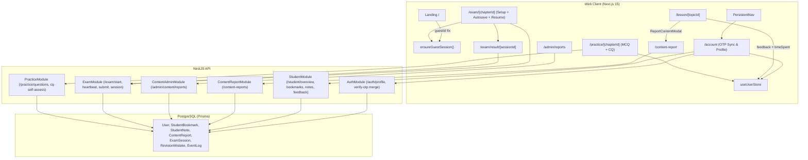

# poRi MVP Completion Implementation Plan

> **For agentic workers:** REQUIRED SUB-SKILL: Use superpowers:subagent-driven-development (recommended) or superpowers:executing-plans to implement this plan task-by-task. Steps use checkbox (`- [ ]`) syntax for tracking.

**Goal:** Complete all remaining Section 0 & Section 5 MVP flows on `feat/mvp-completion`—Account/OTP cross-device sync, Content Error Reporting & Admin Triage, Exam Setup/Autosave/Resume/Full Results, and Student CQ Self-Assessment—with zero regressions to existing functionality or tests.

**Architecture:** Additive Prisma models (`StudentBookmark`, `StudentNote`, `ContentReport`) paired with backward-compatible NestJS endpoints (`AuthModule`, `StudentModule`, `ContentReportModule`, `ContentAdminModule`, `ExamModule`, `PracticeModule`) and focused Next.js 15 App Router screens (`/account`, `/content-report`, `/exam/[chapterId]`, `/exam/result/[sessionId]`, `/admin/reports`) backed by Zustand persistence and real guest JWT bootstrapping.

**Architecture Diagram:**

**Tech Stack:** TypeScript, NestJS 10, Prisma 6, Next.js 15 App Router, React 19, Zustand 5, Tailwind CSS, Vitest, Testing Library, Supertest.

**Spec:** [2026-11-12-mvp-completion-design.md](../specs/2026-11-12-mvp-completion-design.md)

## Global Constraints

- Bengali (`bn`) is the default teaching/UI language with English toggle parity via `useLanguageStore().tr(...)`.
- Preserve 100% backward compatibility on all existing endpoints:
  - `GET /practice/chapter/:chapterId/questions` defaults to `type: 'MCQ'` and omits `explanation` & `isCorrect` on MCQs.
  - `POST /exam/start` executes identically when optional `questionLimit` and `mode` are omitted.
  - `GET /student/overview` keeps all existing keys intact; new sync fields (`bookmarks`, `lessonNotes`) are optional.
- Guard all new Prisma model lookups inside existing services (`AuthService`, `StudentService`) with optional chaining so existing unit-test mocks do not break.
- No regressions: every existing test across `@pori/shared`, `@pori/api`, and `@pori/web` must continue passing alongside new TDD tests.

## Review Focus

- **Partial Prisma Mocks in Legacy Unit Tests:** `AuthService.verifyOtp` and `StudentService.getOverview` unit specs mock only legacy tables; unguarded calls to `prisma.studentBookmark` or `prisma.studentNote` would throw `TypeError`. Pinned in Tasks 2 & 3 tests.
- **Lost `guestId` or Unauthenticated Exam Entry:** Direct navigation to `/exam/[chapterId]` without visiting `/` causes 401 on `POST /exam/start`; missing `setGuestId` on `/` breaks OTP guest progress migration. Pinned in Tasks 5 & 7 tests.
- **Expired Exam Session Resume Loop:** Reopening a stored exam session after `durationSeconds + GRACE_PERIOD_SECONDS` has elapsed must gracefully clear/finalize stale local state instead of endlessly triggering failing `/exam/submit` retries. Pinned in Task 7 tests.
- **MCQ Answer Leakage When Adding CQ Support:** `PracticeService.getChapterQuestions` must still strip `isCorrect` and `explanation` for `MCQ` questions while returning `cqRubric` and `explanation` only for `CQ_CREATIVE` items. Pinned in Task 4 tests.
- **Unauthenticated Error Reports & Role Enforcement on Admin Triage:** `POST /content-reports` must work for guests/anonymous students (`OptionalJwtAuthGuard`), whereas `GET/PATCH /admin/content/reports` must forbid `STUDENT` roles with 403 and record `resolvedAt` for correction-time metrics. Pinned in Task 3 tests.

---

### Task 1: Prisma Schema Additions & Shared Types (`packages/shared`, `apps/api/prisma`)

**Files:**
- Modify: [schema.prisma](file:///Users/technonext/Desktop/poRi/apps/api/prisma/schema.prisma)
- Modify: [content.ts](file:///Users/technonext/Desktop/poRi/packages/shared/src/types/content.ts)
- Test: [types.test.ts](file:///Users/technonext/Desktop/poRi/packages/shared/tests/types.test.ts), [prisma.spec.ts](file:///Users/technonext/Desktop/poRi/apps/api/test/prisma.spec.ts)

**Interfaces:**
- Produces in `@pori/shared`: `ReportStatus`, `ReportCategory`, `ContentReportDTO`, `CqSelfAssessPayload`, `StudentBookmarkSyncItem`

- [ ] **Step 1: Add failing type assertion test in `packages/shared/tests/types.test.ts`**
  Add a test checking `ReportStatus` enum values (`OPEN`, `IN_REVIEW`, `RESOLVED`, `DISMISSED`) and `ContentReportDTO` shape.
- [ ] **Step 2: Run shared tests to verify failure**
  Run: `pnpm --filter @pori/shared test` -> FAIL (`ReportStatus` not exported).
- [ ] **Step 3: Update `packages/shared/src/types/content.ts` and `apps/api/prisma/schema.prisma`**
  - Export `ReportStatus`, `ReportCategory`, `ContentReportDTO`, `CqSelfAssessPayload`, `StudentBookmarkSyncItem` from `packages/shared/src/types/content.ts`.
  - Add `ReportStatus` enum and `StudentBookmark`, `StudentNote`, `ContentReport` models + relations on `User` in `apps/api/prisma/schema.prisma`.
- [ ] **Step 4: Build `@pori/shared`, generate Prisma client, and verify tests pass**
  Run: `pnpm --filter @pori/shared build && pnpm --filter @pori/shared test && pnpm --filter @pori/api prisma:generate && pnpm --filter @pori/api test test/prisma.spec.ts` -> PASS.
- [ ] **Step 5: Commit**
  Commit `packages/shared` and `apps/api/prisma/schema.prisma`.

---

### Task 2: Auth Profile, Guest Bookmark/Note Migration & Student Sync/Feedback APIs (`apps/api`)

**Files:**
- Create: `apps/api/src/modules/auth/dto/update-profile.dto.ts`
- Modify: [auth.controller.ts](file:///Users/technonext/Desktop/poRi/apps/api/src/modules/auth/auth.controller.ts), [auth.service.ts](file:///Users/technonext/Desktop/poRi/apps/api/src/modules/auth/auth.service.ts)
- Modify: [student.controller.ts](file:///Users/technonext/Desktop/poRi/apps/api/src/modules/student/student.controller.ts), [student.service.ts](file:///Users/technonext/Desktop/poRi/apps/api/src/modules/student/student.service.ts)
- Test: [auth.service.spec.ts](file:///Users/technonext/Desktop/poRi/apps/api/src/modules/auth/auth.service.spec.ts), [student.service.spec.ts](file:///Users/technonext/Desktop/poRi/apps/api/src/modules/student/student.service.spec.ts)

**Interfaces:**
- Consumes: `StudentBookmark`, `StudentNote` Prisma models.
- Produces:
  - `PATCH /auth/profile` (`{ fullName?: string; selectedClass?: 'SSC' | 'HSC' }`) -> updated user summary
  - `POST /student/bookmarks/toggle` (`{ itemId, itemType, titleBangla, subtitleBangla?, href }`) -> `{ bookmarked: boolean }`
  - `PUT /student/notes/:topicId` (`{ content: string }`) -> `{ success: true, topicId, content }`
  - `POST /student/feedback` (`{ contentType, contentId, helpful: boolean, comment?: string }`) -> `{ success: true }`
  - `StudentOverviewResponse` optional `bookmarks?` & `lessonNotes?`

- [ ] **Step 1: Write failing unit tests**
  - In `auth.service.spec.ts`: test `updateProfile(userId, dto)` updates `fullName`/`selectedClass` and rejects invalid class values; test `verifyOtp` guest merge carries over `StudentBookmark` & `StudentNote` without failing when optional tables are absent in mocks.
  - In `student.service.spec.ts`: test `toggleBookmark`, `saveLessonNote`, `recordExplanationFeedback`, and `getOverview` returning `bookmarks` & `lessonNotes` when mocked (and safe empty/omitted fallback when not mocked).
- [ ] **Step 2: Run unit tests to verify failure**
  Run: `pnpm --filter @pori/api test src/modules/auth/auth.service.spec.ts src/modules/student/student.service.spec.ts` -> FAIL.
- [ ] **Step 3: Implement `AuthService.updateProfile`, guest merge extension, and `StudentService` sync/feedback endpoints**
  Keep all existing `EventLog` queries and return shapes strictly unchanged.
- [ ] **Step 4: Run API tests to verify pass**
  Run: `pnpm --filter @pori/api test src/modules/auth/auth.service.spec.ts src/modules/student/student.service.spec.ts test/auth.e2e.spec.ts` -> PASS.
- [ ] **Step 5: Commit**

---

### Task 3: ContentReport Module & Admin Report Triage Queue (`apps/api`)

**Files:**
- Create: `apps/api/src/modules/content-report/dto/create-content-report.dto.ts`
- Create: `apps/api/src/modules/content-report/content-report.service.ts`
- Create: `apps/api/src/modules/content-report/content-report.controller.ts`
- Create: `apps/api/src/modules/content-report/content-report.module.ts`
- Create: `apps/api/src/modules/content-report/content-report.service.spec.ts`
- Create: `apps/api/src/modules/content-admin/dto/resolve-report.dto.ts`
- Modify: [app.module.ts](file:///Users/technonext/Desktop/poRi/apps/api/src/app.module.ts), [content-admin.controller.ts](file:///Users/technonext/Desktop/poRi/apps/api/src/modules/content-admin/content-admin.controller.ts), [content-admin.service.ts](file:///Users/technonext/Desktop/poRi/apps/api/src/modules/content-admin/content-admin.service.ts)
- Test: `apps/api/src/modules/content-report/content-report.service.spec.ts`, `apps/api/test/content-report.e2e.spec.ts`

**Interfaces:**
- Produces:
  - `POST /content-reports` (`OptionalJwtAuthGuard`)
  - `GET /content-reports/mine` (`OptionalJwtAuthGuard`)
  - `GET /admin/content/reports?status=...` (`@Roles(Role.EDITOR, Role.REVIEWER, Role.ADMIN)`) -> `{ items, counts, avgResolutionHours }`
  - `PATCH /admin/content/reports/:id` (`{ status, resolutionNote?, moveContentToCorrection?: boolean }`)

- [ ] **Step 1: Write failing unit & e2e tests**
  Test guest/authenticated submission (`POST /content-reports`), `GET /content-reports/mine`, `GET /admin/content/reports` avg correction-time calculation, `PATCH /admin/content/reports/:id` setting `resolvedAt` & optionally moving linked `Lesson`/`Question` to `CORRECTION`, and 403 rejection for `STUDENT` role.
- [ ] **Step 2: Run tests to verify failure**
  Run: `pnpm --filter @pori/api test src/modules/content-report/content-report.service.spec.ts test/content-report.e2e.spec.ts` -> FAIL.
- [ ] **Step 3: Implement `ContentReportModule` and `ContentAdminService`/`Controller` report endpoints**
- [ ] **Step 4: Run tests to verify pass**
  Run: `pnpm --filter @pori/api test src/modules/content-report/content-report.service.spec.ts test/content-report.e2e.spec.ts test/content-admin.e2e.spec.ts` -> PASS.
- [ ] **Step 5: Commit**

---

### Task 4: Exam Setup Options (`mode`, `questionLimit`) & Practice CQ Self-Assessment APIs (`apps/api`)

**Files:**
- Create: `apps/api/src/modules/practice/dto/cq-self-assess.dto.ts`
- Modify: [start-exam.dto.ts](file:///Users/technonext/Desktop/poRi/apps/api/src/modules/exam/dto/start-exam.dto.ts), [exam.service.ts](file:///Users/technonext/Desktop/poRi/apps/api/src/modules/exam/exam.service.ts)
- Modify: [practice.controller.ts](file:///Users/technonext/Desktop/poRi/apps/api/src/modules/practice/practice.controller.ts), [practice.service.ts](file:///Users/technonext/Desktop/poRi/apps/api/src/modules/practice/practice.service.ts)
- Test: [exam.service.spec.ts](file:///Users/technonext/Desktop/poRi/apps/api/src/modules/exam/exam.service.spec.ts), [practice.service.spec.ts](file:///Users/technonext/Desktop/poRi/apps/api/src/modules/practice/practice.service.spec.ts)

**Interfaces:**
- Consumes: `RevisionMistake`, `EventLog`.
- Produces:
  - `StartExamDto` optional `questionLimit?: number`, `mode?: 'ALL' | 'WEAK_AREA'`
  - `GET /practice/chapter/:chapterId/questions?type=MCQ|CQ_CREATIVE|ALL` (defaults to `'MCQ'`)
  - `POST /practice/cq-self-assess` (`{ questionId, selfScores: { ka, kha, ga, gha }, totalScore, maxScore }`)

- [ ] **Step 1: Write failing tests in `exam.service.spec.ts` and `practice.service.spec.ts`**
  - `ExamService`: `startExam` with `questionLimit` slices shuffled questions; `mode: 'WEAK_AREA'` filters/prioritizes unresolved mistakes; default calls still query `{ type: 'MCQ', status: ContentStatus.PUBLISHED, topic: { chapterId } }` identically.
  - `PracticeService`: `?type=CQ_CREATIVE` returns CQ items with `cqRubric` & `explanation`, while `MCQ` queries never expose `isCorrect` or `explanation`; `submitCqSelfAssess` logs `CQ_SELF_ASSESS` event and updates `RevisionMistake`.
- [ ] **Step 2: Run tests to verify failure**
  Run: `pnpm --filter @pori/api test src/modules/exam/exam.service.spec.ts src/modules/practice/practice.service.spec.ts` -> FAIL.
- [ ] **Step 3: Implement `StartExamDto`/`ExamService` enhancements and `PracticeController`/`PracticeService` CQ endpoints**
- [ ] **Step 4: Run all API tests to verify pass**
  Run: `pnpm --filter @pori/api test` -> ALL PASS.
- [ ] **Step 5: Commit**

---

### Task 5: Frontend Guest Session Bootstrap, Store Sync, `/account` & `PersistentNav` (`apps/web`)

**Files:**
- Create: `apps/web/src/lib/guest-session.ts`
- Create: `apps/web/src/app/account/page.tsx`
- Modify: [page.tsx](file:///Users/technonext/Desktop/poRi/apps/web/src/app/page.tsx), [user-store.ts](file:///Users/technonext/Desktop/poRi/apps/web/src/store/user-store.ts), [persistent-nav.tsx](file:///Users/technonext/Desktop/poRi/apps/web/src/components/navigation/persistent-nav.tsx)
- Test: [navigation.test.tsx](file:///Users/technonext/Desktop/poRi/apps/web/tests/navigation.test.tsx), `apps/web/tests/account-sync.test.tsx`

**Interfaces:**
- Produces:
  - `ensureGuestSession(): Promise<string | null>`
  - `/account` page with Guest-to-OTP upgrade/merge (`guestId`), `PATCH /auth/profile`, bookmarks/notes management, link to `/content-report`, and logout.

- [ ] **Step 1: Write failing tests in `apps/web/tests/account-sync.test.tsx` and `apps/web/tests/navigation.test.tsx`**
  - Verify `LandingPage` `handleGuestStart` persists `guestId` when `/auth/guest` succeeds.
  - Verify `ensureGuestSession()` requests `/auth/guest` once when no token is present and stores `token` + `guestId`.
  - Verify `/account` renders guest badge, links guest session via OTP passing `guestId`, updates profile (`PATCH /auth/profile`), and lists bookmarks & lesson notes.
  - Verify `PersistentNav` includes `/account` link without breaking existing destination tests.
- [ ] **Step 2: Run web tests to verify failure**
  Run: `pnpm --filter @pori/web test tests/account-sync.test.tsx tests/navigation.test.tsx` -> FAIL.
- [ ] **Step 3: Implement `guest-session.ts`, `user-store.ts` server sync extensions, `page.tsx` fix, `persistent-nav.tsx` link, and `account/page.tsx`**
- [ ] **Step 4: Run tests to verify pass**
  Run: `pnpm --filter @pori/web test tests/account-sync.test.tsx tests/navigation.test.tsx` -> PASS.
- [ ] **Step 5: Commit**

---

### Task 6: Content Error Reporting, Bengali Explanation Feedback & Admin `/admin/reports` (`apps/web`)

**Files:**
- Create: `apps/web/src/components/student/report-content-modal.tsx`
- Create: `apps/web/src/app/content-report/page.tsx`
- Create: `apps/web/src/app/admin/reports/page.tsx`
- Modify: [lesson/[topicId]/page.tsx](file:///Users/technonext/Desktop/poRi/apps/web/src/app/lesson/%5BtopicId%5D/page.tsx), [practice/[chapterId]/page.tsx](file:///Users/technonext/Desktop/poRi/apps/web/src/app/practice/%5BchapterId%5D/page.tsx), [AdminSidebar.tsx](file:///Users/technonext/Desktop/poRi/apps/web/src/components/admin/layout/AdminSidebar.tsx), [AdminTopbar.tsx](file:///Users/technonext/Desktop/poRi/apps/web/src/components/admin/layout/AdminTopbar.tsx)
- Test: `apps/web/tests/content-report.test.tsx`, [student-lesson-page.test.tsx](file:///Users/technonext/Desktop/poRi/apps/web/tests/student-lesson-page.test.tsx), [admin-layout.test.tsx](file:///Users/technonext/Desktop/poRi/apps/web/tests/admin-layout.test.tsx)

**Interfaces:**
- Consumes: `POST /content-reports`, `GET /content-reports/mine`, `POST /student/feedback`, `GET /admin/content/reports`, `PATCH /admin/content/reports/:id`.
- Produces: `ReportContentModal`, `/content-report`, `/admin/reports`.

- [ ] **Step 1: Write failing tests in `content-report.test.tsx` and update `student-lesson-page.test.tsx`**
  Test submitting an error report via modal and `/content-report`, Bengali helpfulness feedback toggle on `/lesson/[topicId]` (`POST /student/feedback`), active reading `timeSpentSeconds` sent on `lesson-complete`, and `/admin/reports` resolving a report (`PATCH /admin/content/reports/:id`).
- [ ] **Step 2: Run tests to verify failure**
  Run: `pnpm --filter @pori/web test tests/content-report.test.tsx tests/student-lesson-page.test.tsx` -> FAIL.
- [ ] **Step 3: Implement `ReportContentModal`, `/content-report`, `/lesson/[topicId]` & `/practice/[chapterId]` triggers, `/admin/reports`, and admin sidebar/topbar integration**
- [ ] **Step 4: Run tests to verify pass**
  Run: `pnpm --filter @pori/web test tests/content-report.test.tsx tests/student-lesson-page.test.tsx tests/admin-layout.test.tsx` -> PASS.
- [ ] **Step 5: Commit**

---

### Task 7: Exam Setup, Local Autosave/Resume, Full Results & CQ Self-Assessment (`apps/web`)

**Files:**
- Create: `apps/web/src/app/exam/result/[sessionId]/page.tsx`
- Modify: [exam/[chapterId]/page.tsx](file:///Users/technonext/Desktop/poRi/apps/web/src/app/exam/%5BchapterId%5D/page.tsx), [practice/[chapterId]/page.tsx](file:///Users/technonext/Desktop/poRi/apps/web/src/app/practice/%5BchapterId%5D/page.tsx), [progress/page.tsx](file:///Users/technonext/Desktop/poRi/apps/web/src/app/progress/page.tsx)
- Test: `apps/web/tests/exam-runner.test.tsx`, [practice-runner.test.tsx](file:///Users/technonext/Desktop/poRi/apps/web/tests/practice-runner.test.tsx)

**Interfaces:**
- Consumes: `ensureGuestSession()`, `POST /exam/start`, `PUT /exam/heartbeat/:sessionId`, `POST /exam/submit/:sessionId`, `GET /exam/session/:sessionId`, `GET /practice/chapter/:chapterId/questions?type=CQ_CREATIVE`, `POST /practice/cq-self-assess`, `ReportContentModal`.

- [ ] **Step 1: Write failing tests in `exam-runner.test.tsx` and `practice-runner.test.tsx`**
  - `exam-runner.test.tsx`: test setup screen (chapter vs topic vs weak-area, question count, negative marking), calling `ensureGuestSession()` before `/exam/start`, saving & resuming an active session from `localStorage` + `GET /exam/session/:sessionId`, expired session graceful fallback, net score with negative deduction + per-question time + `/lesson/[topicId]` link + report modal in results, and `/exam/result/[sessionId]` rendering a stored session.
  - `practice-runner.test.tsx`: preserve all 4 existing MCQ tests untouched, plus add test for switching to `সৃজনশীল (CQ)` tab, revealing `cqRubric` (`ক/খ/গ/ঘ`), and submitting self-assessment (`POST /practice/cq-self-assess`).
- [ ] **Step 2: Run tests to verify failure**
  Run: `pnpm --filter @pori/web test tests/exam-runner.test.tsx tests/practice-runner.test.tsx` -> FAIL.
- [ ] **Step 3: Implement upgraded `exam/[chapterId]/page.tsx`, `exam/result/[sessionId]/page.tsx`, `progress/page.tsx` result links, and `practice/[chapterId]/page.tsx` CQ mode**
- [ ] **Step 4: Run full monorepo test, lint, and build verification**
  Run: `pnpm --filter @pori/shared build && pnpm test && pnpm lint && pnpm build` -> ALL PASS.
- [ ] **Step 5: Commit**

---

## Self-Review Checklist
1. **Spec coverage:** Every item in `2026-11-12-mvp-completion-design.md` (Tracks A, B, C, D) maps directly to Tasks 1–7.
2. **Step scan:** Every step specifies exact files, contracts, and test assertions without vague placeholders.
3. **Type consistency:** `ReportStatus`, `ContentReportDTO`, `CqSelfAssessPayload`, `ensureGuestSession`, `StudentBookmark`, `StudentNote`, `ContentReport` match across `@pori/shared`, `@pori/api`, and `@pori/web`.
4. **Review focus:** All 5 failure modes are explicitly pinned to tests in Tasks 2, 3, 4, 5, and 7.
