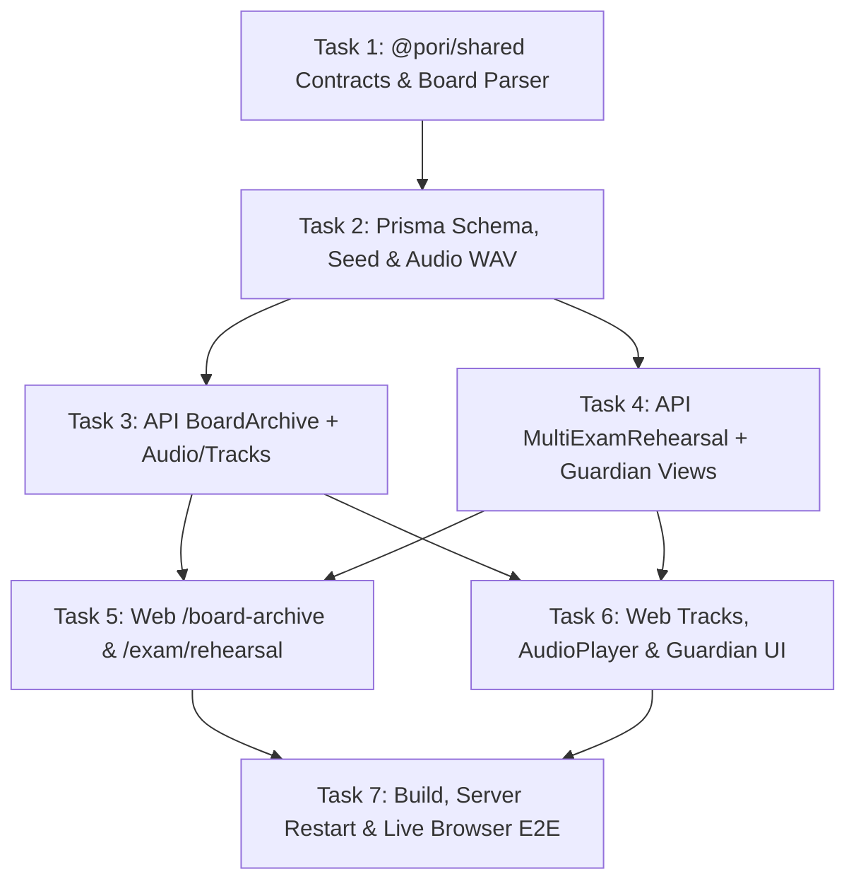

# poRi Phase 2 Implementation Plan

> **For agentic workers:** Executing inline in current session with strict TDD (`test -> fail -> minimal implementation -> verify -> commit`). Track progress in `task.md`.

**Goal:** Deliver poRi Phase 2 across three cohesive tracks on branch `feat/phase-2`:
1. **Verified Board Question Archive** (`/board-archive`, `BoardArchiveModule`, shared `parseBoardSource` normalizer).
2. **Multi-Subject Exam Rehearsal** (`/exam/rehearsal`, `MultiExamRehearsal`, independent per-paper timers, intermission, combined analytics).
3. **Expanded Tracks & Features** (`CLASS_6_8`, `SSC`, `HSC`, `ADMISSION`, `BCS` tracks + `Subject.program`, `Lesson.audioUrl`/`LessonAudioPlayer` + Web Speech narration fallback, and Parent/Teacher read-only views `/guardian/[shareCode]`).

**Architecture:** Shared canonical board/track contracts in `@pori/shared` drive both NestJS (`apps/api`) and Next.js (`apps/web`). Multi-paper rehearsal reuses `ExamService` (`ExamSession`, grading, percentile, mistake capture) so exam logic is never duplicated; guardian share reports reuse `StudentService` overview/mastery calculations without modifying `apps/api/src/modules/auth/*`.

**Tech Stack:** TypeScript, NestJS 11, Prisma 6 + PostgreSQL, Next.js 15 App Router, React 19, Tailwind CSS, Zustand, Vitest + React Testing Library.

---

## Dependency Graph

---

## Global Constraints

1. **Auth Freeze:** Do **NOT** modify any file inside `apps/api/src/modules/auth/*`. Keep Section 1 pre-merge auth readiness items unchecked.
2. **Branch Hygiene:** Stay on `feat/phase-2` (branched from `feat/v1.1` at `a63e9c0`). Never merge into `main`.
3. **Navigation Integrity:** Keep `PersistentNav`'s 3 primary nav links (`হোম`, `বিষয়সমূহ`, `অগ্রগতি`) intact so `navigation.test.tsx` continues passing; surface Phase 2 routes via Dashboard Quick Hub, `/subjects`, `/curriculum/[subjectId]`, `/progress`, and `/lesson/[topicId]`.
4. **No Duplicated Domain Logic:**
   - Reuse `@pori/shared` `parseBoardSource()` on both backend and frontend.
   - Reuse `ExamService.startExam` / `submitExam` for rehearsal papers.
   - Reuse `StudentService` metrics in `GuardianService`.
5. **Hydration & Offline Safety:** Keep `window`, `navigator`, `speechSynthesis`, `localStorage`, and `new Date()` in client-only `useEffect` hooks or guarded state; provide graceful fallbacks when offline.
6. **Build vs Dev Server:** Stop running `next dev` before `pnpm build`, clear `apps/web/.next`, then restart dev servers cleanly before live browser verification.

## Review Focus

- `parseBoardSource()` normalization accuracy across inconsistent historical seeds (`Chattogram` / `Chittagong` / `চট্টগ্রাম`, `Comilla` / `Cumilla`, `Barisal` / `Barishal`, `Jessore` / `Jashore`, Bangla/English digits `2020–2025`).
- Independent countdown timer isolation across Paper 1 -> Intermission -> Paper 2 -> Combined Report in `MultiExamRehearsal`.
- Strict read-only isolation on `/guardian/report/:shareCode` (never expose phone numbers, password hashes, or private notes; respect `isActive` / revocation immediately).
- Audio playback reliability + Web Speech fallback cleanup on unmount.

---

## Task 1: Shared Phase 2 Types & Canonical Board Parser (`@pori/shared`)

**Files:**
- Create: `packages/shared/src/utils/board-parser.ts`
- Create: `packages/shared/src/utils/__tests__/board-parser.test.ts`
- Modify: `packages/shared/src/types/curriculum.ts`
- Modify: `packages/shared/src/types/content.ts`
- Modify: `packages/shared/src/index.ts`

**Interfaces:**
- `BoardKey`: `'DHAKA' | 'RAJSHAHI' | 'CHATTOGRAM' | 'CUMILLA' | 'JASHORE' | 'SYLHET' | 'DINAJPUR' | 'BARISHAL' | 'MYMENSINGH' | 'ALL_BOARDS' | 'OTHER'`
- `BOARD_METADATA`, `PROGRAM_TRACK_METADATA`
- `parseBoardSource(raw?: string | null): ParsedBoardInfo`
- Extend `ProgramType` (`CLASS_6_8`, `SSC`, `HSC`, `ADMISSION`, `BCS`), `SubjectDTO.program`, `LessonDTO` (`audioUrl`, `audioDurationSeconds`), plus `BoardArchiveFiltersDTO`, `BoardQuestionItemDTO`, `BoardArchiveResponseDTO`, `MultiExamRehearsalDTO`, `GuardianShareLinkDTO`, `GuardianReportDTO`.

**Steps:**
1. Write failing unit tests in `packages/shared/src/utils/__tests__/board-parser.test.ts` covering variant spellings (`"Chittagong Board 2022"`, `"চট্টগ্রাম বোর্ড ২০২৩"`, `"Cumilla Board 2020"`, `"All Boards 2024"`, `"Model Practice"`), Bangla numeral conversion, and track metadata lookup.
2. Run `pnpm --filter @pori/shared test` — verify FAIL.
3. Implement `packages/shared/src/utils/board-parser.ts`, extend types in `curriculum.ts` and `content.ts`, export in `packages/shared/src/index.ts`.
4. Run `pnpm --filter @pori/shared test && pnpm --filter @pori/shared build && pnpm --filter @pori/shared lint` — verify PASS.
5. Commit: `feat(shared): add canonical board parser and Phase 2 DTOs`.

---

## Task 2: Prisma Schema, Seed Data Expansion & Pilot Audio WAV

**Files:**
- Modify: `apps/api/prisma/schema.prisma`
- Modify: `apps/api/test/prisma.spec.ts`
- Create: `apps/api/prisma/seed-phase2.ts`
- Modify: `apps/api/prisma/seed.ts`
- Create: `apps/web/public/audio/lesson-intro.wav`

**Schema Changes:**
- `Subject`: add `program String @default("SSC")`, `@@index([program, isReady])`.
- `Lesson`: add `audioUrl String?`, `audioDurationSeconds Int?`.
- `User`: add relations `rehearsals MultiExamRehearsal[]`, `guardianShareLinks GuardianShareLink[]`.
- Add `MultiExamRehearsal` model and `GuardianShareLink` model.

**Steps:**
1. Update `apps/api/test/prisma.spec.ts` to assert `service.multiExamRehearsal` and `service.guardianShareLink` exist.
2. Run `pnpm --filter @pori/api test test/prisma.spec.ts` — verify FAIL before schema update.
3. Update `apps/api/prisma/schema.prisma`, generate client (`pnpm --filter @pori/api prisma:generate`), push schema (`pnpm --filter @pori/api prisma:push`).
4. Run `pnpm --filter @pori/api test test/prisma.spec.ts` — verify PASS.
5. Create clean static WAV asset `apps/web/public/audio/lesson-intro.wav` and idempotent `apps/api/prisma/seed-phase2.ts` (adds `2020` & `2024–2025` verified Dhaka/Rajshahi/Chattogram board questions, ready subjects + chapters + topics + lessons with audio URLs + questions for `CLASS_6_8`, `SSC` Chemistry, `HSC` Physics 1st Paper, `ADMISSION`, and `BCS`). Hook `seedPhase2(prisma)` into `apps/api/prisma/seed.ts`.
6. Run `pnpm --filter @pori/api prisma:seed` and verify PostgreSQL row creation succeeds without duplicates on re-run.
7. Commit: `feat(api): add Phase 2 schema models, track seeds, and pilot lesson audio`.

---

## Task 3: Backend Board Archive Module & Audio/Track API Extensions

**Files:**
- Create: `apps/api/src/modules/board-archive/board-archive.module.ts`
- Create: `apps/api/src/modules/board-archive/board-archive.service.ts`
- Create: `apps/api/src/modules/board-archive/board-archive.controller.ts`
- Create: `apps/api/src/modules/board-archive/board-archive.service.spec.ts`
- Modify: `apps/api/src/app.module.ts`
- Modify: `apps/api/src/modules/curriculum/curriculum.controller.ts`
- Modify: `apps/api/src/modules/curriculum/curriculum.service.ts`
- Modify: `apps/api/src/modules/content-admin/dto/create-lesson-admin.dto.ts`
- Modify: `apps/api/src/modules/content-admin/dto/update-lesson-admin.dto.ts`
- Modify: `apps/api/src/modules/content-admin/content-admin-lessons.helpers.ts`
- Modify: `apps/api/src/modules/content-admin/content-admin-lessons.service.ts`

**Steps:**
1. Write failing specs in `board-archive.service.spec.ts` covering: canonical grouping of `Chattogram`/`Chittagong`/`চট্টগ্রাম`, `2024+` (`>= 2024`) filter, `2020–2024` exact years, subject/program/type/search filters, and pagination.
2. Run `pnpm --filter @pori/api test src/modules/board-archive/board-archive.service.spec.ts` — verify FAIL.
3. Implement `BoardArchiveService`, `BoardArchiveController`, `BoardArchiveModule`, and register in `AppModule`.
4. Extend `CurriculumController` / `CurriculumService` (`getSubjects(classLevel?, program?)`, `SUBJECT_CODE_ALIASES` for Phase 2 tracks, and include `audioUrl`/`audioDurationSeconds` on `getOfflineChapterPack`) + `ContentAdmin` lesson DTOs/helpers/service to accept `audioUrl` and `audioDurationSeconds`.
5. Run `pnpm --filter @pori/api test && pnpm --filter @pori/api lint` — verify PASS.
6. Commit: `feat(api): implement BoardArchiveModule and curriculum track/audio extensions`.

---

## Task 4: Backend Multi-Subject Exam Rehearsal & Parent/Teacher Progress Views

**Files:**
- Modify: `apps/api/src/modules/exam/exam.controller.ts`
- Modify: `apps/api/src/modules/exam/exam.service.ts`
- Modify: `apps/api/src/modules/exam/exam.service.spec.ts`
- Modify: `apps/api/src/modules/student/student.controller.ts`
- Modify: `apps/api/src/modules/student/student.service.ts`
- Create: `apps/api/src/modules/guardian/guardian.module.ts`
- Create: `apps/api/src/modules/guardian/guardian.controller.ts`
- Create: `apps/api/src/modules/guardian/guardian.service.ts`
- Create: `apps/api/src/modules/guardian/guardian.service.spec.ts`
- Modify: `apps/api/src/app.module.ts`

**Steps:**
1. Write failing unit tests in `exam.service.spec.ts` (rehearsal creation starting paper 0, paper 0 submit -> `INTERMISSION` -> paper 1 start with independent timer -> paper 1 submit -> `COMPLETED` with combined `totalScore` and `totalMarks`) and `guardian.service.spec.ts` (share link creation, active report resolution reusing student metrics, revoked link 404/rejection, PII exclusion).
2. Run both test files — verify FAIL.
3. Implement rehearsal endpoints on `ExamController`/`ExamService` delegating paper start/submit to existing `startExam`/`submitExam` helpers.
4. Implement share-link CRUD on `StudentController`/`StudentService` + public read-only `GuardianModule` (`GET /guardian/report/:shareCode`) + register in `AppModule`.
5. Run `pnpm --filter @pori/api test && pnpm --filter @pori/api lint` — verify PASS. Verify `apps/api/src/modules/auth/` untouched.
6. Commit: `feat(api): add multi-paper exam rehearsal and guardian share progress APIs`.

---

## Task 5: Frontend `/board-archive` & `/exam/rehearsal`

**Files:**
- Create: `apps/web/src/app/board-archive/page.tsx`
- Create: `apps/web/src/app/exam/rehearsal/page.tsx`
- Create: `apps/web/tests/board-archive-rehearsal.test.tsx`

**Steps:**
1. Write failing RTL tests in `apps/web/tests/board-archive-rehearsal.test.tsx` testing Board & Year filter updates (`Dhaka`, `Rajshahi`, `Chattogram`, `2020–2024+`), interactive MCQ answer selection + 6-layer explanation drawer + CQ rubric reveal on `/board-archive`, and multi-paper rehearsal preset launch -> paper timer -> submit paper 1 -> intermission -> start paper 2 -> combined multi-paper report on `/exam/rehearsal`.
2. Run `pnpm --filter @pori/web test tests/board-archive-rehearsal.test.tsx` — verify FAIL.
3. Implement `/board-archive/page.tsx` and `/exam/rehearsal/page.tsx` cleanly using `apiClient`, `@pori/shared` helpers, bilingual UI labels, and offline/empty-state handling.
4. Run `pnpm --filter @pori/web test tests/board-archive-rehearsal.test.tsx && pnpm --filter @pori/web lint` — verify PASS.
5. Commit: `feat(web): add Verified Board Archive and Multi-Subject Exam Rehearsal pages`.

---

## Task 6: Frontend Expanded Tracks, Audio Lessons, Guardian Viewer & Entry Links

**Files:**
- Modify: `apps/web/src/lib/curriculum-data.ts`
- Modify: `apps/web/src/app/subjects/page.tsx`
- Create: `apps/web/src/components/student/lesson-audio-player.tsx`
- Modify: `apps/web/src/app/lesson/[topicId]/page.tsx`
- Modify: `apps/web/src/app/progress/page.tsx`
- Create: `apps/web/src/app/guardian/[shareCode]/page.tsx`
- Modify: `apps/web/src/app/dashboard/page.tsx`
- Modify: `apps/web/src/app/curriculum/[subjectId]/page.tsx`
- Create: `apps/web/tests/phase2-tracks-audio-guardian.test.tsx`

**Steps:**
1. Write failing RTL tests in `apps/web/tests/phase2-tracks-audio-guardian.test.tsx` testing:
   - `/subjects` track filter tabs (`সকল`, `ষষ্ঠ–অষ্টম`, `SSC`, `HSC`, `ভর্তি প্রস্তুতি`, `BCS`).
   - `LessonAudioPlayer` rendering audio element speed controls (`0.75x–1.5x`) and Web Speech narration toggle when `audioUrl` is absent or toggled.
   - `/progress` share link generation + `/guardian/[shareCode]` rendering Parent vs Teacher lenses cleanly.
2. Run `pnpm --filter @pori/web test tests/phase2-tracks-audio-guardian.test.tsx` — verify FAIL.
3. Implement updates across `curriculum-data.ts`, `subjects/page.tsx`, `lesson-audio-player.tsx`, `lesson/[topicId]/page.tsx`, `progress/page.tsx`, `guardian/[shareCode]/page.tsx`, `dashboard/page.tsx`, and `curriculum/[subjectId]/page.tsx`.
4. Run `pnpm --filter @pori/web test && pnpm --filter @pori/web lint` — verify PASS.
5. Commit: `feat(web): add expanded tracks, lesson audio player, and guardian share views`.

---

## Task 7: Final Full Verification, Server Restart & Live Browser Audit

**Steps:**
1. Run `pnpm test && pnpm lint`.
2. Stop running dev servers cleanly, run `pnpm build`, clear `apps/web/.next`, restart `@pori/api` (`start:dev`) and `@pori/web` (`dev`).
3. Dispatch `browser` subagent (`Model: "flash"`) covering:
   - `/subjects` expanded track tabs + entering a new track curriculum (`HSC` / `CLASS_6_8` / `ADMISSION` / `BCS`).
   - `/lesson/[topicId]` audio player visibility and controls.
   - `/board-archive` filtering Dhaka/Rajshahi/Chattogram + `2020–2024+` + opening explanation/rubric.
   - `/exam/rehearsal` starting a multi-paper rehearsal, submitting Paper 1 -> Intermission -> Paper 2 -> Combined result.
   - `/progress` creating a Parent/Teacher share link -> opening `/guardian/[shareCode]` -> switching/verifying read-only analytics + mobile `375x812` sanity check.
4. Confirm `0` console errors, `0` HTTP `>= 400`, `0` Next.js hydration/overlay errors, and empty `git diff feat/v1.1..HEAD -- apps/api/src/modules/auth`.
5. Update `task.md` and report concise observed verification summary.
