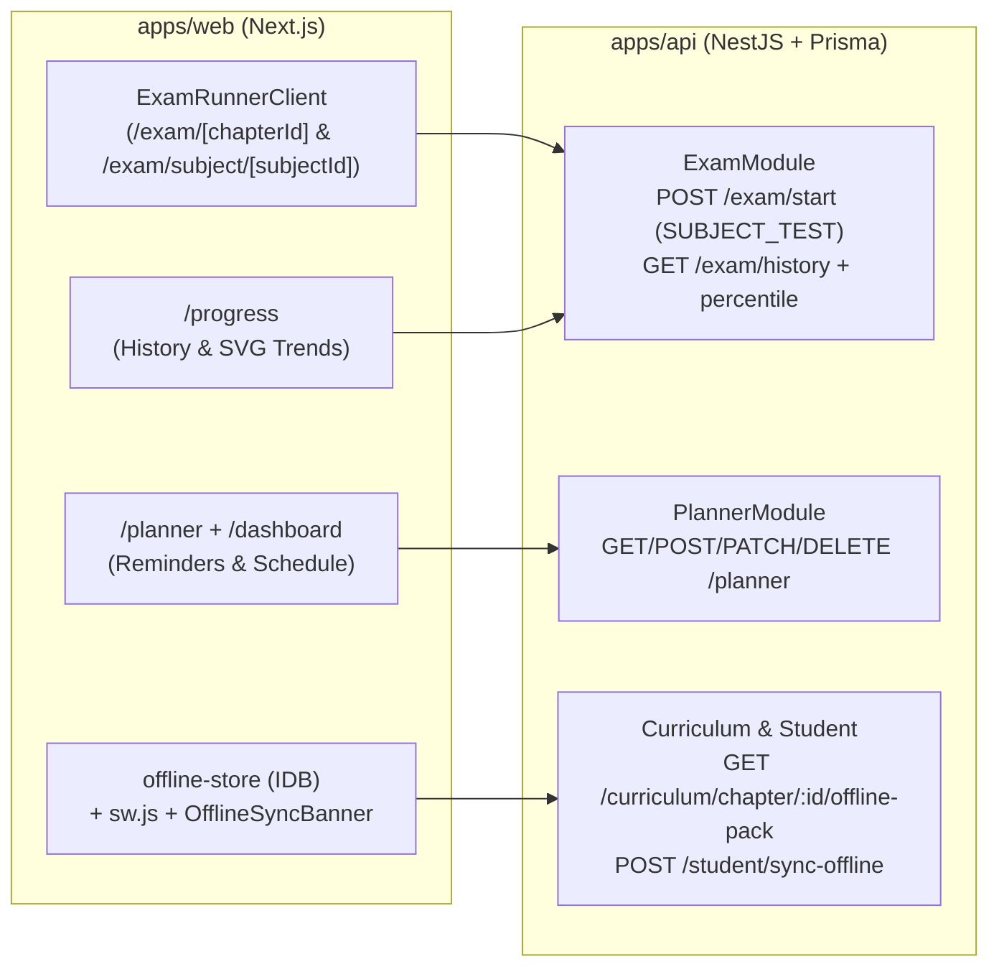

# poRi v1.1 Implementation Plan

> **For agentic workers:** REQUIRED SUB-SKILL: Use superpowers:subagent-driven-development or superpowers:executing-plans to implement this plan task-by-task. Steps use checkbox (`- [ ]`) syntax for tracking.

**Goal:** Deliver the complete poRi **v1.1** release on `feat/v1.1`: (1) Full Subject Model Tests (`SUBJECT_TEST`), peer percentile ranking, and `/progress` score trend analytics; (2) Persistent Study Planner & Reminders (`StudyPlanTask`, auto-schedule generator, `/planner`, due reminder banner); and (3) Offline Chapter Packs, Offline Exam Runner, IndexedDB caching, safe production Service Worker, and automatic `POST /student/sync-offline` reconciliation — all without modifying `apps/api/src/modules/auth/*`.

**Architecture:** Additive Prisma + NestJS modules (`ExamModule` extensions, new `PlannerModule` with `OptionalJwtAuthGuard`, `CurriculumModule` offline-pack export, `StudentModule` offline sync replay) paired with shared TypeScript contracts in `@pori/shared` and Next.js frontend upgrades (`ExamRunnerClient`, `/exam/subject/[subjectId]`, `/progress` SVG trend chart, `/planner`, IndexedDB `offline-store`, non-dev-caching `sw.js`, and `OfflineSyncBanner`).

**Tech Stack:** TypeScript 5, NestJS 11, Prisma 6 + PostgreSQL (`pori_db`), Next.js 16 (App Router), Tailwind CSS v4, Zustand, Vitest + React Testing Library (`apps/web`), Jest (`apps/api`).

**Design Spec:** [2026-11-12-v1.1-design.md](../specs/2026-11-12-v1.1-design.md)

---

### Global Constraints & Conventions
- **Zero Auth Changes:** Do **NOT** modify `apps/api/src/modules/auth/*` or `OptionalJwtAuthGuard` / `JwtAuthGuard` implementations.
- **No Branch Merge:** Work exclusively on `feat/v1.1` (never merge to `main`).
- **Dev Server Safety:** Do NOT run `next build` (`pnpm --filter @pori/web build`) while `pnpm --filter @pori/web dev` is serving on port 3000 without restarting the dev server cleanly afterward. Verify iteratively with `pnpm --filter @pori/web test` and `pnpm --filter @pori/web lint`.
- **Service Worker Safety:** `apps/web/public/sw.js` and `registerServiceWorker()` must never cache `_next/static` or intercept HMR traffic on `localhost` / `127.0.0.1`.
- **Navigation Safety:** Preserve `PersistentNav`'s 3 primary nav links (`হোম`, `বিষয়সমূহ`, `অগ্রগতি`) so `navigation.test.tsx` continues passing; place `/planner` in the utility cluster next to `/account` and inside `/dashboard`.
- **Safe Prisma Mocks:** Guard newly introduced Prisma queries (e.g., `prisma.subject?.findUnique`, `prisma.examSession?.findMany`, `prisma.studyPlanTask`) cleanly so unit-test mocks without those delegates don't crash.
- **Safe Client Fire-and-Forget:** Wrap async `apiClient` calls in `Promise.resolve(...).catch(() => {})` so mocked `apiClient` functions returning `undefined` in Vitest tests never throw unhandled rejections.
- **Bangla UI & Digits:** Keep user-facing strings localized via `tr(...)` and format numeric displays with `toBanglaDigits` where appropriate.
- **Strict Red-Green TDD:** Write failing tests first -> confirm FAIL -> implement minimal clean code -> confirm PASS -> commit.

### Review Focus (5 Highest-Impact Failure Modes)
1. **Percentile & History Mocks Breaking Existing Exam Tests:** Adding peer percentile lookups inside `submitExam`/`getSession` without optional chaining on `this.prisma.examSession?.findMany` would break existing `exam.service.spec.ts` suites.
2. **Breaking `StartExamDto` Validation:** Making `chapterId` unconditionally optional would allow malformed `CHAPTER_TEST` payloads; `@ValidateIf((o) => o.testType !== 'SUBJECT_TEST')` plus `ExamService.startExam` explicit check prevents regressions.
3. **Leaking Answers on Regular Practice Endpoints:** Regular `/practice/chapter/:chapterId/questions` (`MCQ`) strips `isCorrect`/`explanation`; only explicit `GET /curriculum/chapter/:chapterId/offline-pack` should bundle practice answers for local offline grading.
4. **Dev Server Chunk 404s from Service Worker or `next build`:** Caching `/_next/static` in dev or leaving `sw.js` active on localhost breaks HMR chunks. Guard both registration and `fetch` listener strictly against localhost dev traffic.
5. **Offline Sync Duplicates or Rejected Fire-and-Forget Calls:** Replaying offline lessons/exams multiple times must not crash on missing question IDs or re-run identically; deduplicate offline session IDs inside `EventLog`/notes or deterministic check.

---

### Task 1: Shared v1.1 Contracts & Backend `SUBJECT_TEST`, Percentile & `GET /exam/history`

**Files:**
- Modify: `packages/shared/src/types/content.ts`
- Modify: `packages/shared/tests/types.test.ts`
- Modify: `apps/api/src/modules/exam/dto/start-exam.dto.ts`
- Modify: `apps/api/src/modules/exam/exam.service.ts`
- Modify: `apps/api/src/modules/exam/exam.controller.ts`
- Modify: `apps/api/src/modules/exam/exam.service.spec.ts`

- [ ] **Step 1: Add failing `@pori/shared` contract tests & build types**
  - Add interfaces to `packages/shared/src/types/content.ts`: `ExamTestType` union (including `'SUBJECT_TEST' | 'OFFLINE_CHAPTER_TEST'`), `ExamHistoryItemDTO`, `ExamHistorySummaryDTO`, `ExamTrendPointDTO`, `ExamHistoryResponseDTO`, `StudyPlanTaskDTO`, `OfflineChapterPackDTO`, and `OfflineSyncPayload`.
  - Add assertions in `packages/shared/tests/types.test.ts`.
  - Run `pnpm --filter @pori/shared test` -> verify TDD expectations & `pnpm --filter @pori/shared build`.

- [ ] **Step 2: Write failing backend tests in `apps/api/src/modules/exam/exam.service.spec.ts`**
  - Test `startExam` with `testType: 'SUBJECT_TEST'` (no `chapterId`, queries across subject chapters via `topic: { chapter: { subjectId } }`, defaults/caps up to `100` questions).
  - Test `startExam` rejects `'CHAPTER_TEST'` without `chapterId`.
  - Test `submitExam` and `getSession` include `percentile` (`0–100`) when completed sessions exist for that scope.
  - Test `getHistory(userId, filters)` returns `{ items, summary, trend }` filtered by `subjectId` and `testType`.
  - Run `pnpm --filter @pori/api test -- exam.service.spec` -> confirm RED.

- [ ] **Step 3: Implement `StartExamDto`, `ExamService`, and `ExamController` extensions**
  - Update `StartExamDto`: `'SUBJECT_TEST'` in `@IsIn`, `@ValidateIf((o) => o.testType !== 'SUBJECT_TEST')` on `chapterId`, `@Max(100)` on `questionLimit`.
  - Update `ExamService`: handle `'SUBJECT_TEST'` in `startExam`, shared `computePercentile(subjectId, chapterId, testType, scorePercent)` helper used by `submitExam` & `getSession`, and `getHistory(userId, query)`.
  - Add `@Get('history')` in `ExamController` (with optional `subjectId` and `testType` query params).
  - Run `pnpm --filter @pori/api test -- exam.service.spec && pnpm --filter @pori/api lint` -> confirm GREEN -> commit.

---

### Task 2: Database `StudyPlanTask` & Backend `PlannerModule`

**Files:**
- Modify: `apps/api/prisma/schema.prisma`
- Modify: `apps/api/src/app.module.ts`
- Create: `apps/api/src/modules/planner/dto/planner.dto.ts`
- Create: `apps/api/src/modules/planner/planner.service.ts`
- Create: `apps/api/src/modules/planner/planner.controller.ts`
- Create: `apps/api/src/modules/planner/planner.module.ts`
- Create: `apps/api/src/modules/planner/planner.service.spec.ts`

- [ ] **Step 1: Add `StudyPlanTask` to `apps/api/prisma/schema.prisma`**
  - Add `StudyPlanTask` model (`id`, `userId`, `subjectId?`, `chapterId?`, `topicId?`, `titleBangla`, `scheduledDate`, `reminderTime?`, `targetType`, `completed`, `completedAt?`, `createdAt`, `updatedAt`, indexed on `[userId, scheduledDate]`) and `studyPlanTasks StudyPlanTask[]` on `User`.
  - Run `pnpm --filter @pori/api prisma:generate && pnpm --filter @pori/api prisma:push`.

- [ ] **Step 2: Write failing `PlannerService` unit tests**
  - Create `apps/api/src/modules/planner/planner.service.spec.ts` covering:
    - `listTasks(userId)` returning sorted tasks + `todayDueCount`
    - `createTask(userId, dto)` creating custom study task
    - `autoGeneratePlan(userId, body)` prioritizing unresolved `RevisionMistake` topics first, then remaining subject topics across 7 upcoming dates (`YYYY-MM-DD`) without duplicating already scheduled open tasks for the same topic
    - `updateTask(userId, id, dto)` toggling `completed` + `completedAt` and verifying ownership
    - `deleteTask(userId, id)` deleting owned task and throwing `NotFoundException` if missing
  - Run `pnpm --filter @pori/api test -- planner.service.spec` -> confirm RED.

- [ ] **Step 3: Implement `PlannerModule` & register in `AppModule`**
  - Create DTOs (`CreateStudyTaskDto`, `UpdateStudyTaskDto`, `AutoGeneratePlanDto`), `PlannerService`, `PlannerController` (`@UseGuards(OptionalJwtAuthGuard)` returning graceful local/guest error or user-scoped tasks cleanly when `req?.user?.id` missing/present), and `PlannerModule`.
  - Register `PlannerModule` in `apps/api/src/app.module.ts`.
  - Run `pnpm --filter @pori/api test && pnpm --filter @pori/api lint` -> confirm GREEN -> commit.

---

### Task 3: Backend Offline Chapter Pack & Offline Sync Endpoint

**Files:**
- Modify: `apps/api/src/modules/curriculum/curriculum.controller.ts`
- Modify: `apps/api/src/modules/curriculum/curriculum.service.ts`
- Modify: `apps/api/src/modules/curriculum/curriculum.service.spec.ts` (or create if absent)
- Modify: `apps/api/src/modules/student/dto/student.dto.ts`
- Modify: `apps/api/src/modules/student/student.controller.ts`
- Modify: `apps/api/src/modules/student/student.service.ts`
- Modify: `apps/api/src/modules/student/student.service.spec.ts`

- [ ] **Step 1: Write failing tests for `GET /curriculum/chapter/:chapterId/offline-pack` and `POST /student/sync-offline`**
  - Test `getOfflineChapterPack(chapterId)` returns `{ chapterId, subjectId, titleBangla, versionHash, downloadedAt, lessons, questions }` containing `PUBLISHED` lessons and `PUBLISHED` questions (preserving answers/explanations strictly inside the offline pack), and throws `NotFoundException` for unknown chapter IDs.
  - Test `syncOfflineActivity(userId, payload)` replays:
    - `lessonCompletes` into `EventLog` (deduplicating already logged `offlineEventId`s)
    - `practiceAttempts` into `RevisionMistake` / `EventLog`
    - `examSubmissions` into `ExamSession` (`testType: 'OFFLINE_CHAPTER_TEST'`, `status: 'COMPLETED'`) + `RevisionMistake` for wrong answers
    - Returns `{ syncedLessons, syncedAttempts, syncedExams }`.
  - Run targeted `apps/api` tests -> confirm RED.

- [ ] **Step 2: Implement `getOfflineChapterPack` and `syncOfflineActivity`**
  - Implement in `CurriculumService` + `CurriculumController` (`@Get('chapter/:chapterId/offline-pack')`).
  - Add `SyncOfflineDto` in `apps/api/src/modules/student/dto/student.dto.ts` and implement `syncOfflineActivity` in `StudentService` + `@Post('sync-offline')` in `StudentController`.
  - Run `pnpm --filter @pori/api test && pnpm --filter @pori/api lint` -> confirm GREEN -> commit.

---

### Task 4: Frontend Track 1 — `ExamRunnerClient`, `/exam/subject/[subjectId]`, Percentiles & `/progress` Trends

**Files:**
- Create: `apps/web/src/components/student/exam-runner-client.tsx`
- Modify: `apps/web/src/app/exam/[chapterId]/page.tsx`
- Create: `apps/web/src/app/exam/subject/[subjectId]/page.tsx`
- Modify: `apps/web/src/components/student/exam-result-view.tsx`
- Modify: `apps/web/src/app/progress/page.tsx`
- Modify: `apps/web/src/app/curriculum/[subjectId]/page.tsx`
- Modify: `apps/web/src/app/dashboard/page.tsx`
- Create/Modify: `apps/web/tests/subject-exam-progress.test.tsx`

- [ ] **Step 1: Write failing UI tests (`apps/web/tests/subject-exam-progress.test.tsx`)**
  - Test `ExamRunnerClient` in `subject` mode starts a `SUBJECT_TEST` with `{ testType: 'SUBJECT_TEST', subjectId }` and supports 25/50/100 question setup options.
  - Test `ExamResultView` displays `"পজিশন / পারসেন্টাইল"` pill when `percentile` is returned.
  - Test `/progress` renders `GET /exam/history` summary KPIs, exam-type filter pills (`সব`, `অধ্যায় টেস্ট`, `বিষয়ভিত্তিক মডেল টেস্ট`), and inline SVG score trend chart (`svg[data-testid="score-trend-chart"]`).
  - Run `pnpm --filter @pori/web test -- subject-exam-progress` -> confirm RED.

- [ ] **Step 2: Implement Track 1 UI components & pages**
  - Extract shared `ExamRunnerClient` from `apps/web/src/app/exam/[chapterId]/page.tsx` supporting `mode: 'chapter' | 'subject'`, optional offline fallback hook (prepared cleanly for Track 3), and percentile propagation to `/exam/result/[sessionId]` or inline result view.
  - Wire `apps/web/src/app/exam/[chapterId]/page.tsx` and `apps/web/src/app/exam/subject/[subjectId]/page.tsx`.
  - Add percentile display to `ExamResultView` (`apps/web/src/components/student/exam-result-view.tsx`).
  - Add `"পূর্ণ বিষয় মডেল টেস্ট"` CTA button in `apps/web/src/app/curriculum/[subjectId]/page.tsx` header and quick Subject Model Test card/link in `/dashboard`.
  - Upgrade `apps/web/src/app/progress/page.tsx` with `GET /exam/history`, exam-type filter pills, and lightweight responsive SVG polyline score trend chart.
  - Run `pnpm --filter @pori/web test && pnpm --filter @pori/web lint` -> confirm GREEN -> commit.

---

### Task 5: Frontend Track 2 — Study Planner & Due Reminders

**Files:**
- Modify: `apps/web/src/store/user-store.ts`
- Create: `apps/web/src/lib/reminders.ts`
- Create: `apps/web/src/app/planner/page.tsx`
- Modify: `apps/web/src/components/navigation/persistent-nav.tsx`
- Modify: `apps/web/src/app/dashboard/page.tsx`
- Create: `apps/web/tests/planner.test.tsx`

- [ ] **Step 1: Write failing planner & reminder tests (`apps/web/tests/planner.test.tsx`)**
  - Test `reminders.ts` (`getDueTasks`, `getUpcomingReminders`, `formatLocalDateIso`) returns only uncompleted tasks matching today/overdue dates and formats Bangla schedule labels accurately.
  - Test `/planner` page renders Today/Week task sections, creates a custom task (`POST /planner`), triggers `"স্মার্ট ৭-দিনের রুটিন তৈরি করো"` (`POST /planner/auto-generate`), and toggles completion (`PATCH /planner/:id`).
  - Test `/dashboard` renders today's due planner card linking to `/planner`.
  - Run `pnpm --filter @pori/web test -- planner` -> confirm RED.

- [ ] **Step 2: Implement `reminders.ts`, store actions, `/planner`, `PersistentNav` icon & `/dashboard` card**
  - Extend `useUserStore` with `studyPlanTasks`, `setStudyPlanTasks`, `addStudyPlanTask`, `toggleStudyPlanTask`, `removeStudyPlanTask`, persisting cleanly in Zustand + syncing with `/planner` when authenticated/token available.
  - Create `apps/web/src/lib/reminders.ts` (including safe Web `Notification` permission check).
  - Build `apps/web/src/app/planner/page.tsx`.
  - Add subtle icon link to `/planner` in `PersistentNav` utility area (keeping the 3 core nav links intact!) and add Today's Plan / Due Reminders card on `/dashboard`.
  - Run `pnpm --filter @pori/web test && pnpm --filter @pori/web lint` -> confirm GREEN -> commit.

---

### Task 6: Frontend Track 3 — IndexedDB Offline Store, Service Worker & Sync Banner

**Files:**
- Create: `apps/web/src/lib/offline-store.ts`
- Create: `apps/web/public/sw.js`
- Create: `apps/web/src/lib/sw-register.ts`
- Create: `apps/web/src/components/navigation/offline-sync-banner.tsx`
- Modify: `apps/web/src/components/navigation/app-shell.tsx`
- Modify: `apps/web/src/app/curriculum/[subjectId]/page.tsx`
- Modify: `apps/web/src/app/lesson/[topicId]/page.tsx`
- Modify: `apps/web/src/app/practice/[chapterId]/page.tsx`
- Modify: `apps/web/src/components/student/exam-runner-client.tsx`
- Create: `apps/web/tests/offline-sync.test.tsx`

- [ ] **Step 1: Write failing offline store & UI sync tests (`apps/web/tests/offline-sync.test.tsx`)**
  - Test `offline-store.ts` (`saveChapterPack`, `getChapterPack`, `listDownloadedPacks`, `removeChapterPack`, `enqueueSyncEvent`, `getPendingSyncQueue`, `clearSyncedItems`) using localStorage fallback in jsdom.
  - Test `OfflineSyncBanner` shows offline status indicator when `navigator.onLine === false`, shows queued count when pending items exist, and calls `POST /student/sync-offline` to flush queue when online.
  - Test `/curriculum/[subjectId]` chapter card download button calls `GET /curriculum/chapter/:id/offline-pack` and updates status badge to `"অফলাইন সংরক্ষিত"`.
  - Test `/practice/[chapterId]` and `/lesson/[topicId]` fall back cleanly to saved offline packs when network fails.
  - Run `pnpm --filter @pori/web test -- offline-sync` -> confirm RED.

- [ ] **Step 2: Implement IndexedDB offline engine, safe `sw.js`, `OfflineSyncBanner`, and page integration**
  - Implement `apps/web/src/lib/offline-store.ts`.
  - Create `apps/web/public/sw.js` (strictly skips `localhost`/`127.0.0.1` `_next/static` chunks & API mutations; caches app shell + visited chapter/lesson routes for production offline access).
  - Create `apps/web/src/lib/sw-register.ts` and mount `OfflineSyncBanner` + SW registration inside `AppShell`.
  - Wire download/remove toggles on `/curriculum/[subjectId]`, offline fallback + completion queue in `/lesson/[topicId]`, offline MCQ pack fallback + practice attempt queuing in `/practice/[chapterId]`, and offline chapter exam grading + `examSubmissions` queuing in `ExamRunnerClient`.
  - Run `pnpm --filter @pori/web test && pnpm --filter @pori/web lint` -> confirm GREEN -> commit.

---

### Task 7: Final Full Monorepo Verification & Live Browser Inspection

- [ ] **Step 1: Run complete `@pori/shared`, `@pori/api`, and `@pori/web` test & lint suites**
  - `pnpm --filter @pori/shared build && pnpm test && pnpm lint`
- [ ] **Step 2: Verify production `pnpm build`, restore dev server cleanly, and verify with browser subagent**
  - Stop/check dev server if needed, run `pnpm build`, clean `.next` if dev server runs afterward, and ensure both `@pori/api` (port 3001) and `@pori/web` (port 3000) dev daemons run cleanly.
  - Dispatch `browser` subagent (`Model: "flash"`) to test `/dashboard`, `/curriculum/sub_ssc_physics` (Subject Model Test CTA + Offline Pack button), `/exam/subject/sub_ssc_physics`, `/progress` (history filter & SVG chart), and `/planner` (task creation + auto-schedule) — confirming zero console errors, zero 500s, and clean responsive Bangla rendering.
  - Update `docs/progress_checklist.md` (keeping Section 1 unchecked per user instruction) and `task.md`, then commit.
