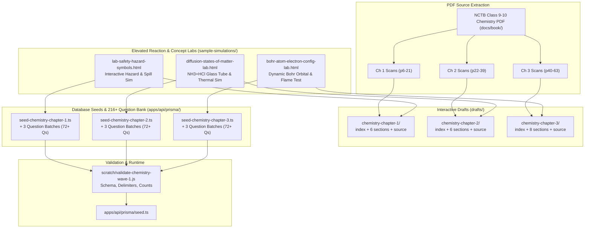

# SSC Chemistry Wave 1 (Chapters 1–3) Implementation Plan

> **For agentic workers:** REQUIRED SUB-SKILL: Use superpowers:subagent-driven-development (recommended) or superpowers:executing-plans to implement this plan task-by-task. Steps use checkbox (`- [ ]`) syntax for tracking.

**Goal:** Author and integrate complete interactive HTML drafts, elevated dynamic chemical reaction labs, comprehensive database seeds, and 216+ verified questions (162+ MCQs with distractor analyses + 54+ CQs with complete 4-tier rubrics) for SSC Chemistry Chapters 1, 2, and 3 following NCTB 2026 standards.

**Architecture:** Each chapter is built as a self-contained, isolated educational package. Dynamic chemical reaction simulators are authored as standalone HTML5/SVG/Canvas applications with live particle/reaction effects in `apps/api/prisma/sample-simulations/`. Interactive drafts are built in `drafts/chemistry-chapter-X/` featuring KaTeX formulas, check questions, and textbook scan viewers. Prisma seeds create chapters, topics, and lessons, while questions are partitioned across 3 batch files per chapter (`seed-chemistry-chapter-X-questions.ts`, `batch2.ts`, `batch3.ts`). Verification is enforced via an automated test harness before integrating into `apps/api/prisma/seed.ts`.

**Architecture Diagram:**

**Tech Stack:** TypeScript, Prisma ORM, KaTeX chemical/math typesetting, HTML5/SVG/Canvas (Vanilla JS without external dependencies), PyMuPDF page extractor, Node.js validation harness.

**Spec:** [docs/superpowers/specs/2026-11-22-chemistry-curriculum-labs-and-drafts-design.md](file:///Users/technonext/Desktop/poRi/docs/superpowers/specs/2026-11-22-chemistry-curriculum-labs-and-drafts-design.md)

---

## Global Constraints

- Every question must strictly satisfy the `QuestionData` interface defined in `apps/api/prisma/seed-chapter-1-questions.ts`.
- Every MCQ must have exactly 4 options with exactly 1 `isCorrect: true`, plus `explanation` containing `directAnswer`, `coreConcept`, `stepDerivation` (with KaTeX chemical formulas), `distractorAnalysis` (for all 3 incorrect options), and `proTipShortcut`.
- Every CQ must have an authentic stem, type `'CQ_CREATIVE'`, and a complete 4-part `cqRubric`: `ka` (1 mark), `kha` (2 marks), `ga` (3 marks), `gha` (4 marks).
- Total questions per chapter across 3 batch files must be $\ge 72$ (54+ MCQs + 18+ CQs), distributed evenly across topics.
- Every simulation lab in `sample-simulations/` must be a self-contained HTML file (CSS + SVG/Canvas + Vanilla JS) without external runtime build dependencies.
- All chemical equations and mathematical formulas must use standard KaTeX syntax with properly escaped backslashes in template literals (e.g. `\\text{H}_2\\text{O}`, `\\Delta H`, `\\rightarrow`).
- All TypeScript checks (`tsc --noEmit`) and validation scripts must exit with code 0.
- `sscChemistrySubject.isReady` in `seed.ts` remains `false` during rollout to preserve green E2E test suites.

## Review Focus

1. **Chemical Reaction Animation Dynamics:** Ensure labs are not static pictures; verify diffusion ring formation, hazard interactions, and orbital builders animate smoothly.
2. **KaTeX Delimiter Balance:** Ensure all `$`, `$$` and chemical subscripts are balanced with no unescaped syntax errors.
3. **Question Distractor Completeness:** Ensure no MCQ lacks `distractorAnalysis` for any of the 3 incorrect options.
4. **CQ Rubric Structure:** Verify all CQs possess valid `ka`, `kha`, `ga`, and `gha` criteria and marks.
5. **Topic ID & Chapter ID Consistency:** Verify all IDs match conventions (`top_ssc_chemistry_ch1_*`, `top_ssc_chemistry_ch2_*`, `top_ssc_chemistry_ch3_*`).

---

### Task 1: Setup Validation Test Harness & PDF Page Extraction Script

**Files:**
- Create: `scratch/validate-chemistry-wave-1.js`
- Create: `scratch/extract-chemistry-pages.py`

**Interfaces:**
- Produces: `scratch/validate-chemistry-wave-1.js` which exits with 0 on complete pass and 1 on error.
- Produces: `scratch/extract-chemistry-pages.py` extracting high-res page images for Chapters 1, 2, and 3.

- [x] **Step 1: Write `scratch/extract-chemistry-pages.py`**
  Extract pages 6–21 for Chapter 1, 22–39 for Chapter 2, and 40–63 for Chapter 3 using PyMuPDF.

- [x] **Step 2: Run extraction script**
  Command: `python3 scratch/extract-chemistry-pages.py`
  Verify images are extracted to `drafts/chemistry-chapter-1/pages/`, `drafts/chemistry-chapter-2/pages/`, and `drafts/chemistry-chapter-3/pages/`.

- [x] **Step 3: Write `scratch/validate-chemistry-wave-1.js`**
  Validate existence of drafts, labs, seed files, question counts ($\ge 72$ per chapter, $\ge 54$ MCQs, $\ge 18$ CQs), MCQ distractors, CQ rubrics, and LaTeX delimiter balance.

- [x] **Step 4: Run validator to confirm initial expected failure**
  Command: `node scratch/validate-chemistry-wave-1.js`
  Expected: FAIL with missing files report.

---

### Task 2: Build Chapter 1 (রসায়নের ধারণা / Concepts of Chemistry)

**Files:**
- Create: `apps/api/prisma/sample-simulations/lab-safety-hazard-symbols.html`
- Create: `drafts/chemistry-chapter-1/styles.css`
- Create: `drafts/chemistry-chapter-1/index.html`
- Create: `drafts/chemistry-chapter-1/chapter-source.html`
- Create: `drafts/chemistry-chapter-1/section-01.html` through `section-06.html`
- Create: `apps/api/prisma/seed-chemistry-chapter-1.ts`
- Create: `apps/api/prisma/seed-chemistry-chapter-1-questions.ts`
- Create: `apps/api/prisma/seed-chemistry-chapter-1-questions-batch2.ts`
- Create: `apps/api/prisma/seed-chemistry-chapter-1-questions-batch3.ts`

**Interfaces:**
- Produces: Complete Chapter 1 draft and 72+ question seed (`chapter1Questions`).
- Produces: Interactive simulation `lab-safety-hazard-symbols.html`.

- [ ] **Step 1: Author elevated simulation `lab-safety-hazard-symbols.html`**
  Implement interactive hazard symbol matcher (Explosive, Flammable, Toxic, Corrosive, Environmental hazard, Health hazard, Biohazard, Radioactive), dynamic chemical spill cleanup scenario, and PPE gear checker.

- [ ] **Step 2: Author Chapter 1 HTML drafts**
  Create `styles.css`, `index.html`, `chapter-source.html`, and `section-01.html` through `section-06.html` with KaTeX equations, learning goals, term cards, hazard boxes, and check questions.

- [ ] **Step 3: Author Chapter 1 questions (Batches 1, 2, 3)**
  Write 72 questions (54 MCQs + 18 CQs) with full distractor rationales and 4-tier CQ rubrics across all 6 topics.

- [ ] **Step 4: Author Chapter 1 curriculum seed (`seed-chemistry-chapter-1.ts`)**
  Define chapter `chap_ssc_chemistry_ch1`, 6 topics, and 6 rich lessons with KaTeX and term cards.

- [ ] **Step 5: Verify Chapter 1 components**
  Command: `node scratch/validate-chemistry-wave-1.js --chapter 1`
  Expected: PASS for Chapter 1.

---

### Task 3: Build Chapter 2 (পদার্থের অবস্থা / States of Matter)

**Files:**
- Create: `apps/api/prisma/sample-simulations/diffusion-states-of-matter-lab.html`
- Create: `drafts/chemistry-chapter-2/styles.css`
- Create: `drafts/chemistry-chapter-2/index.html`
- Create: `drafts/chemistry-chapter-2/chapter-source.html`
- Create: `drafts/chemistry-chapter-2/section-01.html` through `section-06.html`
- Create: `apps/api/prisma/seed-chemistry-chapter-2.ts`
- Create: `apps/api/prisma/seed-chemistry-chapter-2-questions.ts`
- Create: `apps/api/prisma/seed-chemistry-chapter-2-questions-batch2.ts`
- Create: `apps/api/prisma/seed-chemistry-chapter-2-questions-batch3.ts`

**Interfaces:**
- Produces: Complete Chapter 2 draft and 72+ question seed (`chapter2Questions`).
- Produces: Interactive simulation `diffusion-states-of-matter-lab.html`.

- [ ] **Step 1: Author elevated simulation `diffusion-states-of-matter-lab.html`**
  Implement dynamic glass tube diffusion experiment ($\text{NH}_3 + \text{HCl} \rightarrow \text{NH}_4\text{Cl}$) with real-time particle movement, molar mass Graham's law ratio, and interactive heating curve graph showing melting and boiling plateaus.

- [ ] **Step 2: Author Chapter 2 HTML drafts**
  Create `styles.css`, `index.html`, `chapter-source.html`, and `section-01.html` through `section-06.html` covering kinetic theory, diffusion, effusion, candle combustion, and phase transitions.

- [ ] **Step 3: Author Chapter 2 questions (Batches 1, 2, 3)**
  Write 72 questions (54 MCQs + 18 CQs) with full distractor rationales and 4-tier CQ rubrics across all 6 topics.

- [ ] **Step 4: Author Chapter 2 curriculum seed (`seed-chemistry-chapter-2.ts`)**
  Define chapter `chap_ssc_chemistry_ch2`, 6 topics, and 6 rich lessons.

- [ ] **Step 5: Verify Chapter 2 components**
  Command: `node scratch/validate-chemistry-wave-1.js --chapter 2`
  Expected: PASS for Chapter 2.

---

### Task 4: Build Chapter 3 (পদার্থের গঠন / Structure of Matter)

**Files:**
- Create: `apps/api/prisma/sample-simulations/bohr-atom-electron-config-lab.html`
- Create: `drafts/chemistry-chapter-3/styles.css`
- Create: `drafts/chemistry-chapter-3/index.html`
- Create: `drafts/chemistry-chapter-3/chapter-source.html`
- Create: `drafts/chemistry-chapter-3/section-01.html` through `section-08.html`
- Create: `apps/api/prisma/seed-chemistry-chapter-3.ts`
- Create: `apps/api/prisma/seed-chemistry-chapter-3-questions.ts`
- Create: `apps/api/prisma/seed-chemistry-chapter-3-questions-batch2.ts`
- Create: `apps/api/prisma/seed-chemistry-chapter-3-questions-batch3.ts`

**Interfaces:**
- Produces: Complete Chapter 3 draft and 72+ question seed (`chapter3Questions`).
- Produces: Interactive simulation `bohr-atom-electron-config-lab.html`.

- [ ] **Step 1: Author elevated simulation `bohr-atom-electron-config-lab.html`**
  Implement interactive atomic builder with nucleus controls (protons/neutrons), orbital shell electron filling ($K, L, M, N$ and $s, p, d, f$ notation), and live flame test emission spectral visualizer ($\text{Cu}^{2+}$ green, $\text{Na}^+$ yellow, $\text{K}^+$ lilac, $\text{Ca}^{2+}$ brick-red).

- [ ] **Step 2: Author Chapter 3 HTML drafts**
  Create `styles.css`, `index.html`, `chapter-source.html`, and `section-01.html` through `section-08.html` covering subatomic particles, isotopes, Rutherford/Bohr models, and electronic configurations.

- [ ] **Step 3: Author Chapter 3 questions (Batches 1, 2, 3)**
  Write 72 questions (54 MCQs + 18 CQs) with full distractor rationales and 4-tier CQ rubrics across all 8 topics.

- [ ] **Step 4: Author Chapter 3 curriculum seed (`seed-chemistry-chapter-3.ts`)**
  Define chapter `chap_ssc_chemistry_ch3`, 8 topics, and 8 rich lessons.

- [ ] **Step 5: Verify Chapter 3 components**
  Command: `node scratch/validate-chemistry-wave-1.js --chapter 3`
  Expected: PASS for Chapter 3.

---

### Task 5: Integrate Wave 1 Seeds into `seed.ts` & Validate Full Build

**Files:**
- Modify: `apps/api/prisma/seed.ts`

**Interfaces:**
- Consumes: `seedChemistryChapter1`, `seedChemistryChapter2`, `seedChemistryChapter3`.
- Produces: Working seed pipeline with simulation assets copied to `apps/api/uploads/interactive/`.

- [ ] **Step 1: Update `apps/api/prisma/seed.ts`**
  Import and invoke `seedChemistryChapter1`, `seedChemistryChapter2`, and `seedChemistryChapter3`. Add the 3 new simulation files to `sampleSimulations` copy list.

- [ ] **Step 2: Run full Wave 1 validation harness**
  Command: `node scratch/validate-chemistry-wave-1.js`
  Expected: PASS with 100% of Wave 1 criteria met.

- [ ] **Step 3: Run TypeScript compiler check**
  Command: `pnpm --filter @porhi/api build --noEmit`
  Expected: TypeScript compiles with 0 errors.

- [ ] **Step 4: Commit Wave 1 implementation**
  Command: `git add . && git commit -m "feat(chemistry): implement Wave 1 (Chapters 1-3) drafts, elevated labs, and 216-question bank"`
